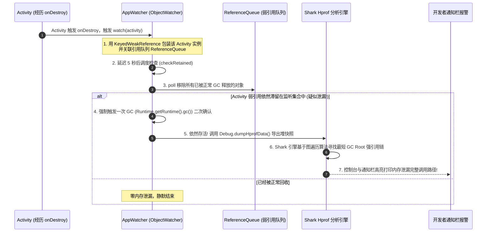
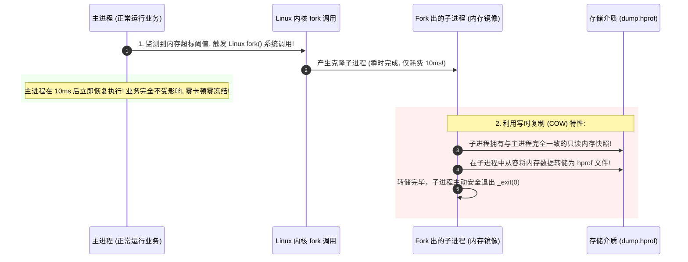

# 内存泄露深度治理LeakCanary源码Shark引擎与Native泄漏

在 Android 稳定性与性能工程中，**内存泄漏（Memory Leak）** 是导致应用可用物理内存持续缩紧、频繁引发系统级 **GC 挂起卡顿（STW，Stop-The-World）**，并最终引爆 **`OutOfMemoryError`（OOM）** 的头号元凶。Square 开源的 **LeakCanary** 凭借非侵入式的自动化检测，成为全行业的检测标杆。本文深入剖析 **`ObjectWatcher` 弱引用队列判定机制、Shark 堆分析引擎的极速索引算法，以及线上生产级 Fork 子进程 Dump 与 Native 堆外泄漏排查 SOP**。

---

## 核心底层机制与全景架构

### 1. LeakCanary 自动检测全链路架构拓扑



---

## 源码级架构物理拆解

### 1. 核心物理判定：`KeyedWeakReference` 与 `ReferenceQueue`

Java 虚拟机规范严格规定了弱引用与引用队列的物理绑定契约：
- 当一个对象只剩下弱引用（WeakReference）时，一旦发生垃圾回收（GC），JVM 会在回收该对象物理内存的瞬间，**自动将包装它的 `WeakReference` 对象实例投递进绑定的 `ReferenceQueue` 中**！

在 `leakcanary.ObjectWatcher` 源码中：
```kotlin
// 1. 监视目标对象
@Synchronized fun watch(watchedObject: Any, description: String) {
    val key = UUID.randomUUID().toString()
    val reference = KeyedWeakReference(watchedObject, key, description, queue)
    watchedObjects[key] = reference // 加入待查哈希表
    checkRetainedExecutor.execute {
        moveToRetained(key) // 5 秒后执行状态检查
    }
}

// 2. 检查逻辑核心：清除正常回收的对象
private fun removeWeaklyReachableObjects() {
    var ref: KeyedWeakReference?
    do {
        // 从 ReferenceQueue 中不断轮询弹出已被 GC 成功回收的对象引用
        ref = queue.poll() as KeyedWeakReference?
        if (ref != null) {
            // 只要队列中有，说明内存已经释放，从待查表中安全摘除！
            watchedObjects.remove(ref.key)
        }
    } while (ref != null)
}
```

---

### 2. Shark 分析引擎的革命：告别旧版 HAHA 自身的 OOM 噩梦

在早期 LeakCanary 1.x 时代，堆快照分析使用的是 Eclipse 开发的旧版 **HAHA 引擎**：
- **旧引擎致命缺陷**：分析一个 $200\text{ MB}$ 的 Hprof 文件，HAHA 自身在手机内存中需要建立极其庞大的 Java 对象树，**分析过程额外耗费 $400\text{ MB} \sim 800\text{ MB}$ 的内存**！结果线上常常发生“为了查内存泄漏，分析工具自己先把 App 撑爆 OOM 崩溃”的滑稽事故。
- **现代 Shark 引擎的突破（LeakCanary 2.x）**：
  1. **零全量加载（Direct On-Disk Indexing）**：Shark 不把 Hprof 全量反序列化到堆内存中，而是仅在磁盘上建立轻量的索引表（Offset Index）；
  2. **内存降低 10 倍**：分析一个大型 Hprof 仅消耗不到 $30\text{ MB}$ 的运行内存；
  3. **极速广度优先搜索（BFS）**：基于最短路径算法，迅速在成千上万个对象引用中精确定位到**阻碍 GC 回收的那唯一一条关键强引用边**。

---

### 3. 生产线上终极挑战：`Debug.dumpHprofData()` 导致的卡死与 Fork 破局

#### 为什么严禁在生产线上直接调用原生 `dumpHprofData`？
- **物理硬伤**：执行原生 `dumpHprofData()` 时，虚拟机必须强制调用 **Stop-The-World（STW）**，挂起应用的所有线程，将几百兆内存写入闪存，**整个主线程被彻底冻结长达 3 ~ 10 秒**！用户感知为严重假死卡顿，线上直接触发系统级 **ANR**！
- **大厂破局（快手 Koom / 字节 Tailor 方案）**：



---

## Native 堆外内存泄漏监控实战

随着越来越多的代码下沉到 C/C++，由 `malloc()`、`calloc()` 申请未 `free()` 的堆外泄漏，Java 层的 GC 根本无能为力。

### 1. 生产级 Native 泄漏检测方案：PLT Hook 拦截 `malloc`
利用前篇剖析的 **bhook / xHook**，拦截全局的内存分配系统调用：
1. **Hook `malloc` / `realloc`**：每当有内存分配，利用 `libunwind` 抓取当前的 Native 调用栈（Backtrace），并将指针地址记录在全局 Hash 表中；
2. **Hook `free`**：当指针被释放时，从 Hash 表中移除记录；
3. **泄漏判定**：若某个分配地址经过了很长时间（或特定业务结束）依然滞留在 Hash 表中，且内存占用持续飙升，精准抓取其分配堆栈报警。

---

## 社招高频硬核连环追问

### Q1: 单例模式（Singleton）持有 Context 引发的内存泄漏，为什么传入 `ApplicationContext` 就能破解？
- **考点**：进程级上下文 vs 组件级上下文。
- **解析**：
  - **`Activity` 的生命周期是局部的**：用户按返回键退出时，Activity 应该被物理销毁回收；若全局静态单例持有了该 Activity 的引用，会导致整座 Activity 及其包含的完整 View 树物理泄漏；
  - **`ApplicationContext` 的生命周期与整个 Linux 进程同寿**：它本身就是随着 App 进程启动而创建、随 App 进程被杀死而销毁的。单例持有 ApplicationContext，生命周期完全对齐，因此绝对不会引发内存泄漏。

### Q2: 匿名内部类、非静态内部类、静态内部类，谁会隐式持有外部类引用？
- **考点**：JVM 编译期字节码生成的隐式引用机制。
- **解析**：
  - **静态内部类（`static class`）**：在字节码中是一个完全独立的类，**绝对不持有外部类引用**；
  - **非静态内部类与匿名内部类**：编译器在编译时，会强制为其生成一个名为 **`this$0`** 的合成成员变量（Synthetic Field），在构造函数中强制传入并强引用外部类实例。若在内部开启异步线程、Handler 延时操作，极易通过 `this$0` 造成外部类的内存泄漏。

---

## 生产级避坑指南与排障 SOP

### 1. 注册监听器未配对反注册排查清单

在组件销毁时，必须在对应的生命周期方法中严格执行清理：
```java
@Override
protected void onDestroy() {
    super.onDestroy();
    // 1. 广播反注册
    unregisterReceiver(myReceiver);
    // 2. 传感器监听注销
    sensorManager.unregisterListener(this);
    // 3. EventBus / 全局观察者反注册
    EventBus.getDefault().unregister(this);
    // 4. 清理动画，防止 ValueAnimator 内部 Choreographer 回调强持有 View
    if (animator != null) {
        animator.cancel();
        animator.removeAllUpdateListeners();
    }
}
```
通过该规范可斩断 90% 以上由业务监听器引发的常见内存泄漏。
