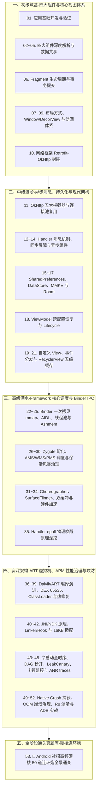

# Android 原生与系统底层架构全景指南

欢迎来到 **Android 原生核心进阶与系统底层架构专栏**。

本专栏面向 **3~5 年及以上社招资深/架构级 Android 工程师** 与渴望彻底突破技术天花板的移动端技术人员，严格摒弃“调 API 背参数”与“空洞概念罗列”，直击一线大厂（字节、阿里、腾讯、美团、快手）工业级高频考核深水区。

> [!NOTE] 专栏分流导读
> 为了提供最系统化的现代移动端知识图谱，本技术体系已实现现代化分离：
> - 现代编程语言、协程底层与并发流式模型，请移步 **[Kotlin 现代语言与并发响应式专栏](/doc/Android/Kotlin前言)**；
> - 现代响应式声明式 UI 工具包，请移步 **[Jetpack Compose 现代化声明式 UI 革命专栏](/doc/Android/Compose前言)**；
> - 本专栏聚焦于 **Android 原生四大组件、UI 绘制渲染管线、Handler 消息循环、Binder IPC 底层、ART/NDK 机制与大厂 APM 性能稳定性工程化**。

---

## 🗺️ Android 原生与系统底层全阶段技术图谱

---

## 📚 专栏章节索引

### 一、初级筑基·四大组件与核心视图体系
1. [01. Android 原生应用基础开发与调试验证规范](/doc/Android/Android应用基本开发与验证)
2. [02. 四大组件之 Activity 状态机与生命周期深入](/doc/Android/四大组件之Activity)
3. [03. 四大组件之 Service 生命周期、前台服务与绑定机制](/doc/Android/四大组件之Service)
4. [04. 四大组件之 BroadcastReceiver 注册机制与广播风暴治理](/doc/Android/四大组件之BroadcastReceiver)
5. [05. 四大组件之 ContentProvider 数据共享与多进程访问](/doc/Android/四大组件之ContentProvider)
6. [06. Fragment 核心生命周期、事务提交与栈管理实战](/doc/Android/Fragment)
7. [07. 常用布局容器测量排版特性与自适应布局方式](/doc/Android/布局方式)
8. [08. Window、DecorView 与 ViewRootImpl 层级结构剖析](/doc/Android/Window与DecorView)
9. [09. Android 动画体系核心：补间动画、帧动画与属性动画](/doc/Android/动画体系)
10. [10. 网络通信基础：Retrofit 与 OkHttp 企业级网络层封装](/doc/Android/网络框架Retrofit-OkHttp)

### 二、中级进阶·异步消息、数据持久化与现代架构
11. [11. OkHttp 核心架构全景：五大拦截器责任链与连接池复用机制](/doc/Android/OkHttp核心架构全景五大拦截器责任链与连接池复用机制)
12. [12. Handler 消息机制四大核心对象与底层源码全景](/doc/Android/Handler消息机制)
13. [13. 同步屏障 Sync-Barrier 与 IdleHandler 冷启动分批初始化](/doc/Android/同步屏障Sync-Barrier与IdleHandler冷启动分批初始化)
14. [14. 异步任务组件对比：HandlerThread、IntentService 与 WorkManager](/doc/Android/HandlerThread-IntentService-WorkManager对比)
15. [15. 本地持久化选型：SharedPreferences、DataStore 与 MMKV 深度对比](/doc/Android/SharedPreferences-DataStore-MMKV)
16. [16. 极速持久化 MMKV 原理 mmap 与 Room 数据库 WAL 并发模式](/doc/Android/MMKV极速持久化原理mmap与Room数据库WAL并发模式)
17. [17. Jetpack 之 Room 数据库核心架构与实战](/doc/Android/Jetpack之Room)
18. [18. Jetpack ViewModel 跨配置恢复与 LiveData/Lifecycle 状态机解密](/doc/Android/ViewModel跨配置恢复与Lifecycle状态机深度解密)
19. [19. 自定义 View 高级绘制：Xfermode、PathMeasure 与 Shader 着色器](/doc/Android/自定义View高级绘制Xfermode-PathMeasure与Shader着色器)
20. [20. View 事件分发责任链、多点触控与滑动冲突实战](/doc/Android/View事件分发责任链多点触控与NestedScrolling嵌套滑动)
21. [21. RecyclerView 五级缓存架构与预取机制 Prefetch 深度解析](/doc/Android/RecyclerView五级缓存架构与预取机制Prefetch)

### 三、高级深水·Framework 核心调度、Binder IPC 与系统渲染管线
22. [22. Linux 内核基石：Binder 物理机制与一次拷贝 mmap 原理深剖](/doc/Android/Binder核心物理机制与一次拷贝mmap原理)
23. [23. AIDL 底层编译架构与 Stub-Proxy 模型逐行剖析](/doc/Android/AIDL底层编译架构与Stub-Proxy模型逐行剖析)
24. [24. Binder 线程池管理、死亡代理与驱动协议码](/doc/Android/Binder线程池管理死亡代理与驱动协议码)
25. [25. 跨进程超大传输突破：Ashmem 匿名共享内存与 FileProvider 机制](/doc/Android/跨进程超大传输突破Ashmem匿名共享内存与FileProvider)
26. [26. Zygote 孵化机制与应用进程创建全流程](/doc/Android/Zygote孵化机制与应用进程创建全流程)
27. [27. AMS 与 ATMS 任务栈管理与 LaunchMode 底层状态机](/doc/Android/AMS与ATMS任务栈管理与LaunchMode底层状态机)
28. [28. WMS 窗口管理系统：Token 校验与 BadTokenException 破局](/doc/Android/WMS窗口管理系统Token校验与BadTokenException破局)
29. [29. PMS 包管理服务：APK 解析、签名校验与权限映射](/doc/Android/PMS包管理服务APK解析签名校验与权限映射)
30. [30. 四大组件底层机制：Service 跨进程保活与广播风暴治理](/doc/Android/四大组件底层机制Service跨进程保活与广播风暴治理)
31. [31. UI 渲染引擎：Choreographer 编舞者 VSYNC 与 SurfaceFlinger 渲染管线](/doc/Android/Choreographer编舞者VSYNC与SurfaceFlinger渲染管线)
32. [32. 屏幕防撕裂双缓冲三缓冲 Triple-Buffering 与掉帧物理成因](/doc/Android/屏幕防撕裂双缓冲三缓冲Triple-Buffering与掉帧物理成因)
33. [33. View 树绘制流程深入：performTraversals 与 MeasureSpec 计算](/doc/Android/View树绘制流程深入performTraversals与MeasureSpec计算)
34. [34. 硬件加速底层 DisplayList-RenderNode 与 RenderThread 渲染管线](/doc/Android/硬件加速底层DisplayList-RenderNode与RenderThread渲染管线)
35. [35. Handler 消息机制底层源码与 Linux-epoll 唤醒原理物理剖析](/doc/Android/Handler消息机制底层源码与Linux-epoll唤醒原理)

### 四、资深架构·ART 虚拟机、NDK 底层、APM 性能治理与稳定性攻防
36. [36. Dalvik 与 ART 架构演进：AOT-JIT 与 Profile 引导混合编译](/doc/Android/Dalvik与ART架构演进AOT-JIT与Profile引导混合编译)
37. [37. DEX 文件格式深度拆解与 65535 方法数限制物理成因](/doc/Android/DEX文件格式深度拆解与65535方法数限制物理成因)
38. [38. 类加载器 ClassLoader 体系与双亲委派机制](/doc/Android/类加载器ClassLoader体系与双亲委派机制)
39. [39. 热修复与插件化核心原理：DexElements 合并与资源加载](/doc/Android/热修复与插件化核心原理DexElements合并与资源加载)
40. [40. JNI 核心原理：动态注册、静态注册与引用泄漏防范](/doc/Android/JNI核心原理动态注册静态注册与引用泄漏防范)
41. [41. Android-Linker 与 SO 加载流程：PLT-GOT-Hook 与 Inline-Hook](/doc/Android/Android-Linker与SO加载流程PLT-GOT-Hook与Inline-Hook)
42. [42. ⚠️ Android 16KB 页面大小兼容影响与治理全解](/doc/Android/Android16KB页面大小兼容影响与治理全解)
43. [43. App 冷启动全时序深挖：从 startActivity 到首帧上屏](/doc/Android/App冷启动全时序深挖从startActivity到首帧上屏)
44. [44. 极速冷启动秒开：有向无环图 DAG 任务编排与包体积瘦身 SOP](/doc/Android/极速冷启动秒开有向无环图DAG任务编排与包体积瘦身SOP)
45. [45. 内存泄露深度治理：LeakCanary 源码 Shark 引擎与 Native 泄漏](/doc/Android/内存泄露深度治理LeakCanary源码Shark引擎与Native泄漏)
46. [46. Bitmap 物理内存变迁、复用池与超大图分块加载](/doc/Android/Bitmap物理内存变迁复用池与超大图分块加载)
47. [47. 线上卡顿监控：BlockCanary-Matrix 原理与 ASM 插桩 APM 实战](/doc/Android/线上卡顿监控BlockCanary-Matrix原理与ASM插桩APM实战)
48. [48. ANR 触发四大场景底层超时机制与 traces 物理排障 SOP](/doc/Android/ANR触发四大场景底层超时机制与traces物理排障SOP)
49. [49. Native-Crash 捕获机制：Linux 信号处理与 Breakpad 移植](/doc/Android/Native-Crash捕获机制Linux信号处理与Breakpad移植)
50. [50. OOM 内存溢出防范与线上复杂崩溃治理全景实战](/doc/Android/崩溃治理专题)
51. [51. Android 代码混淆与 R8 高级实战全解](/doc/Android/Android代码混淆与R8高级实战全解)
52. [52. Android 发包打包、签名与 ADB 调试命令全集](/doc/Android/Android发包打包与ADB调试命令全集)

### 五、全阶段通关真题库·社招高频硬核连环炮
53. [53. 🎯 Android 社招高频硬核 50 道连环炮全景通关](/doc/Android/Android社招高频硬核50道连环炮全景通关)
