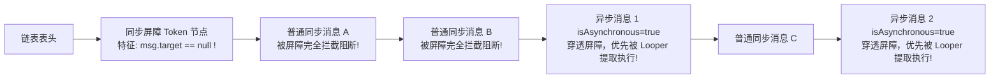
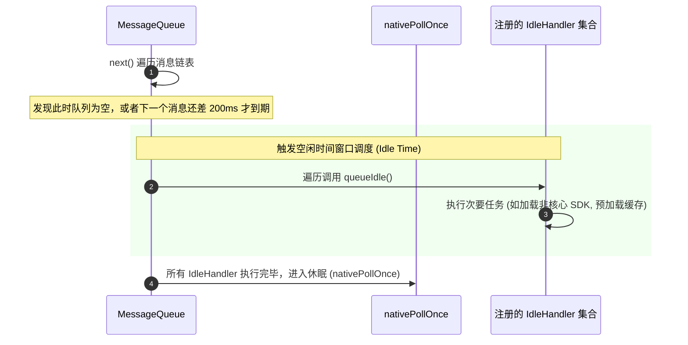

# 同步屏障Sync-Barrier与IdleHandler冷启动分批初始化

在 Android 系统的 `MessageQueue` 调度流水线中，并非所有消息都按照严格的 FIFO（先进先出）排队。为了保障高优先级的 UI 绘制事件绝对不被海量业务消息延误，系统引入了 **同步屏障（Synchronization Barrier）** 机制。此外，为了解决 App 冷启动时数十个 SDK 疯狂争抢 CPU 的问题，利用 **`IdleHandler` 捕获主线程空闲时间分批初始化** 成为大厂面试与架构实战的标配利器。

---

## 核心底层机制与全景架构

### 1. 同步屏障对消息队列的物理拦截模型

在普通的 `MessageQueue` 链表中，同步消息与异步消息按时间戳顺序混杂排列。一旦插入同步屏障，队列的流转规则将发生突变：



---

## 源码级架构物理拆解

### 1. 深度推导：`MessageQueue#next()` 中的屏障过滤源码

在 `android.os.MessageQueue#next()` 中，有一段极其经典的穿透算法：

```java
Message prevMsg = null;
Message msg = mMessages;

// 核心判断：如果队首消息是一个“同步屏障”（即 msg.target == null）
if (msg != null && msg.target == null) {
    // 开启同步屏障模式：循环向后遍历，寻找第一个异步消息（isAsynchronous == true）
    do {
        prevMsg = msg;
        msg = msg.next;
    } while (msg != null && !msg.isAsynchronous());
}

if (msg != null) {
    if (now < msg.when) {
        // 下一个消息还没到时间，计算睡眠时间
        nextPollTimeoutMillis = (int) Math.min(msg.when - now, Integer.MAX_VALUE);
    } else {
        // 找到了可执行的异步消息，将其从链表中解绑摘除并返回！
        mBlocked = false;
        if (prevMsg != null) {
            prevMsg.next = msg.next;
        } else {
            mMessages = msg.next;
        }
        msg.next = null;
        return msg;
    }
}
```

#### 为什么系统如此设计？典型应用场景：
- 在 `ViewRootImpl#scheduleTraversals()` 中：
  ```java
  // 1. 发起绘制前，立即向队列插入一个同步屏障
  mTraversalBarrier = mHandler.getLooper().getQueue().postSyncBarrier();
  // 2. 投递一个异步消息 TraversalRunnable (内部 msg.setAsynchronous(true))
  mChoreographer.postCallback(Choreographer.CALLBACK_TRAVERSAL, mTraversalRunnable, null);
  ```
- **核心目的**：无论队列中堆积了多少个正在排队的网络响应或后台事件，**UI 刷新消息必须拥有特权，插队优先执行，杜绝因普通消息堆积造成无意义的掉帧！**
- 绘制流程结束后，调用 `removeSyncBarrier(mTraversalBarrier)` 移除屏障，恢复普通消息的流转。

---

### 2. `IdleHandler`：利用 CPU 空闲窗口的调度艺术

什么是 `IdleHandler`？
- 它并不是一个消息，而是定义在 `MessageQueue` 内部的一个轻量接口：
  ```java
  public static interface IdleHandler {
      /**
       * 当队列没有更多消息，或者所有消息都是未来时间戳时回调
       * @return true: 保持监听, 下次空闲继续调用; false: 一次性执行, 执行后自动从监听列表中移除
       */
      boolean queueIdle();
  }
  ```



---

## 社招高频硬核连环追问

### Q1: 如果向 MessageQueue 插入了同步屏障（`postSyncBarrier`），但业务代码忘记调用 `removeSyncBarrier` 移除，会发生什么？
- **考点**：同步屏障泄漏（Sync Barrier Leak）故障排查。
- **解析**：
  - **严重灾难**：同步屏障将永久驻留在 `mMessages` 链表头部；
  - 队列中所有的**普通同步消息将永远无法被调度执行（无限期饥饿）**！用户点击按钮无反应、后台回调全部死锁冻结；
  - 只有被标记为 `setAsynchronous(true)` 的异步消息还能被处理（如系统的动画和 View 绘制）；
  - 表现为：**界面看似在刷新，但用户交互和业务逻辑全部瘫痪，最终引发系统级 ANR！**
  - **规避方案**：`postSyncBarrier` 与 `removeSyncBarrier` 必须成对出现，且移除逻辑必须写在 `finally` 块中。

### Q2: `IdleHandler#queueIdle()` 执行耗时过长，会导致主线程卡顿甚至 ANR 吗？
- **考点**：`IdleHandler` 的执行线程边界。
- **解析**：
  - **必定会导致卡顿！**
  - `IdleHandler.queueIdle()` 是在**主线程的同一个 `Looper.loop()` 栈帧中同步执行的**，它并不是在后台异步线程运行！
  - 如果在 `queueIdle()` 内部执行了超过 5 秒的同步阻塞操作（如大文件读写或复杂加解密），期间用户点击了屏幕，触控事件无法得到响应，**照样会直接引爆系统的 ANR（Input dispatching timed out）**！
  - **规范**：`queueIdle()` 仅适合执行耗时极短（建议 5ms 以内）的轻量初始化（如：注册无耗时的广播监听、预取少量内存数据）。

---

## 生产级冷启动分批初始化实战 SOP

在大型 App 的 `Application#onCreate()` 中，按优先级梯度分流初始化：

```java
public class PerformanceApplication extends Application {

    @Override
    public void onCreate() {
        super.onCreate();
        
        // 1. 第一梯度：主线程必须立即执行的极少数关键组件 (如 Crash 监控、基础路由)
        initCrashReport();

        // 2. 第二梯度：异步并行线程池初始化 (如网络库、数据库引擎)
        ThreadUtils.runOnWorkerPool(this::initNetworkAndDb);

        // 3. 第三梯度：首屏上屏后，利用 IdleHandler 在 CPU 空闲时惰性分批初始化
        Looper.myQueue().addIdleHandler(new MessageQueue.IdleHandler() {
            @Override
            public boolean queueIdle() {
                // 仅在主线程空闲时被调用一次
                initPushSdk();      // 推送 SDK
                initFeedbackSdk();  // 用户反馈组件
                initImagePreload(); // 预加载缓存
                return false;       // 返回 false，执行完后自动注销，不重复执行
            }
        });
    }
}
```
通过该方案，可轻松压降启动期主线程竞争，将冷启动时间削减 30% 以上。
