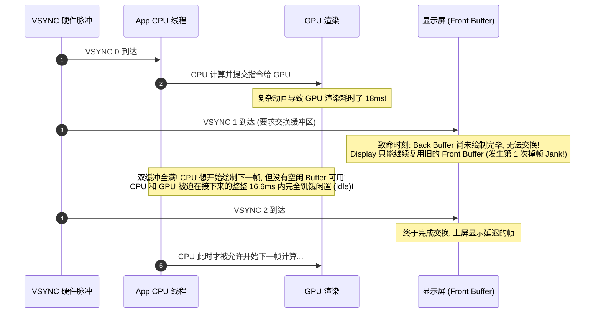
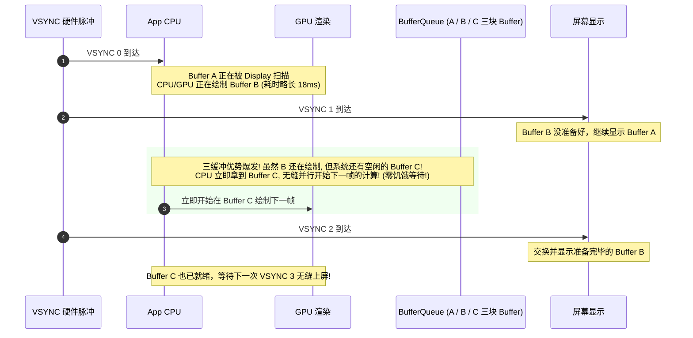

# 屏幕防撕裂双缓冲三缓冲Triple-Buffering与掉帧物理成因

在计算机图形学与智能手机硬件交互中，屏幕显示绝非“绘制完成立刻上屏”那么简单。如果缺乏严密的硬件时钟同步，屏幕就会产生丑陋的“画面撕裂（Screen Tearing）”。Android 系统从经典的 **Project Butter（黄油计划）** 起，全面引入了 **VSYNC 垂直同步信号、双缓冲（Double Buffering）以及三缓冲（Triple Buffering）** 机制。本文将从硬件底层物理扫描原理出发，深度解密三缓冲是如何最大化压榨 CPU/GPU 算力并终结连续掉帧的。

---

## 核心底层机制与全景架构

### 1. 画面撕裂（Screen Tearing）的物理本质

屏幕显示器是通过电子枪（或 OLED/LCD 行扫描驱动芯片）**自上而下一行一行逐行扫描**将像素点亮到屏幕上的。

```mermaid
flowchart TD
    subgraph 撕裂产生场景 (无垂直同步与单缓冲)
        FrameA[Frame A 画面: 赛车在左侧]
        FrameB[Frame B 画面: 赛车在右侧]
        Screen[屏幕物理面板 (逐行扫描中)]
        
        FrameA -->|扫描前半屏 (0~50%)| Screen
        Switch[此时显卡强行覆盖缓冲区为 Frame B!] --> Screen
        FrameB -->|扫描后半屏 (51~100%)| Screen
        
        Screen --> Tearing[画面物理撕裂: 上半屏是赛车在左, 下半屏是赛车在右, 画面错位断层!]
    end
```

为了彻底解决撕裂问题，图形系统必须引入：
1. **双缓冲（Double Buffering）**：显存中划分出两个独立的物理缓冲区：
   - **`Front Buffer`（前缓冲区）**：屏幕硬件驱动正在读取并逐行扫描呈现给用户的画面；
   - **`Back Buffer`（后缓冲区）**：GPU 和 CPU 正在后台秘密绘制渲染的下一帧画面。
2. **VSYNC 信号与安全交换（Buffer Swap）**：屏幕每次扫描完一整屏画面、准备回到屏幕左上角重新开始下一轮扫描的瞬间，显示器硬件产生一个**垂直空白脉冲（Vertical Blanking Interval，即 VSYNC）**。系统**仅且仅在收到 VSYNC 的瞬间，才将前缓冲区与后缓冲区互换指针**，彻底杜绝了扫描途中的缓冲区撕裂。

---

## 源码级架构物理拆解

### 1. 双缓冲下的致命瓶颈：CPU/GPU 饥饿空转

在双缓冲架构下，如果所有计算耗时都在 $16.6\text{ ms}$（60Hz）以内，系统运行非常完美。但一旦发生轻微偶发超时，就会引发**连续雪崩式掉帧**：



- **核心硬伤**：由于只有两块 Buffer，一旦发生绘制超时，Back Buffer 没就绪，Front Buffer 又被屏幕占着扫描，**CPU 无法申请到新 Buffer，只能被迫空等一个完整的周期**，算力被严重浪费，进一步加剧了后续帧的连锁卡顿。

---

### 2. 三缓冲（Triple Buffering）的物理破局

为了抹平瞬时耗时波动，Android 在系统层引入了**第三块缓冲区（Triple Buffer）**：



- **物理收益**：三缓冲允许在“前缓冲区被屏幕占用、后缓冲区正在被 GPU 渲染”的极端情况下，**为 CPU 提供第三块空闲缓冲区提前展开工作**，把 CPU 和 GPU 的算力拉满，有效吸收偶发抖动，极大降低连续掉帧的概率。

---

## 两大机制硬核对比与物理权衡

| 维度 | **双缓冲（Double Buffering）** | **三缓冲（Triple Buffering）** |
| :--- | :--- | :--- |
| **显存与 RAM 占用** | 较小（仅需 2 块 GraphicBuffer 显存） | 较大（多占一块几兆到十几兆的 GraphicBuffer） |
| **抗卡顿与防掉帧能力** | 较差，一旦单帧超时极易引发多帧连环卡顿 | **极强，能有效吸收偶发计算峰值，抹平帧率曲线** |
| **输入延迟（Input Latency）** | 极低（当前帧反应最新手势） | **微弱增加（由于有一帧在队列中排队，触控响应可能略微延迟 1 个 VSYNC 周期）** |

---

## 社招高频硬核连环追问

### Q1: 三缓冲既然这么好，为什么不引入“四缓冲”甚至“五缓冲”？
- **考点**：输入延迟（Input Latency）与显存开销的物理边界。
- **解析**：
  1. **输入延迟（Input Latency）无法承受**：用户手指触摸屏幕，应用在计算画面时采集的是当下的触控坐标。如果缓冲队列堆叠了 4~5 个 Buffer，屏幕上显示的实际是 3~4 帧（数十毫秒）之前的旧手势画面，用户会明显感觉到“滑动手感粘滞、迟钝、不跟手”（例如音游、吃鸡射击等强交互场景体验暴跌）；
  2. **显存暴增与无意义开销**：如果 CPU/GPU 本身持续性能不足（每一帧都要 30ms），引入再多的 Buffer 也无法改变最终渲染速度，只会平白增加显存浪费。三缓冲刚好是在抗偶发抖动与输入延迟之间的**黄金平衡点**。

### Q2: 120Hz 高刷屏与 60Hz 普通屏相比，留给每帧的计算安全阈值是多少？
- **考点**：高刷屏幕下的性能优化苛刻性。
- **解析**：
  - **60Hz 屏幕**：单个刷新周期为 $\frac{1000}{60} \approx 16.66\text{ ms}$。
  - **120Hz 屏幕**：单个刷新周期缩短为 $\frac{1000}{120} \approx \mathbf{8.33\text{ ms}}$！
  - **架构师考量**：在 120Hz 屏幕下，CPU 的测量、布局与 GPU 渲染的总耗时**必须强制控制在 8.3ms 以内**，否则同样会发生掉帧。这意味着高刷屏对布局扁平化、避免过度绘制、去除主线程复杂运算提出了比以往严苛一倍的极致性能要求。

---

## 生产级避坑指南与排障 SOP

### 1. 禁用强制垂直同步（DEBUG 场景）与帧率分析命令

在 Android 真机排查掉帧与 GPU 耗时时，可借助系统属性与 dumpsys：

```bash
# 1. 打印当前窗口的实时渲染统计数据 (近 120 帧详细分段耗时)
adb shell dumpsys gfxinfo com.example.app framestats

# 2. 核心指标分析 (重点关注 Draw, Prepare, Process, Execute 耗时):
# Draw: 主线程构建 DisplayList 耗时
# Process: RenderThread 处理并执行指令耗时
# Execute: 从 BufferQueue 交换缓冲区并送显耗时
```
若 `Execute` 耗时突发增高，通常说明 GPU 渲染负荷过载，触发了 BufferQueue 排队阻塞。
