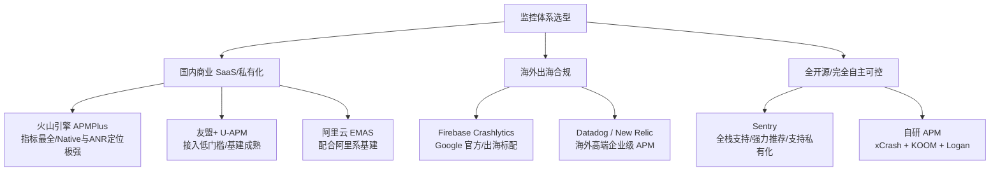

# Android 崩溃治理与线上异常排查全景指南

## 🎯 招聘面试与工程实战核心考点
- **面试官设问**：“线上崩溃除了使用 Bugly 监控，业界还有哪些成熟的技术方案或自研体系？如果是 NDK 崩溃或高版本系统的 ANR，底层是如何捕获和归因的？”
- **深水区追问**：“如果用户反馈页面卡死或者业务逻辑异常但没有 Crash，如何线上排查？为什么传统的 Dump Hprof 不能在线上直接运行？如何设计客户端的‘连续崩溃自愈模式（SafeMode）’？”

---

## 🏢 真实生产业务场景
- **核心链路防护**：电商大促秒杀或金融支付页面，任何 Crash 都会造成直接资损，需要有动态降级与自愈能力。
- **长尾客诉排查**：VIP 客户反馈“点击支付按钮无反应”，但崩溃平台毫无日志，需要具备远程日志动态回捞与行为轨迹回放。
- **海外市场与数据合规**：出海产品无法使用国内商业 SDK，且受限于 GDPR 等隐私法规，需要开源私有化部署的监控系统。

---

## 一、 主流监控平台与第三方库技术选型

在业界落地中，监控体系一般根据业务规模、合规要求和运维预算进行选型：



### 1. 国内主流商业 APM 平台对比
* **火山引擎 APMPlus（字节跳动 Slardar 商业版）**：
  * **优势**：目前国内大厂能力输出最强、指标最全的 APM 之一。不仅涵盖 Java/Native 崩溃，在 Android 8.0~15 高版本系统的 ANR 归因、FD 句柄耗尽、内存暴涨、卡顿掉帧以及耗电分析上具有顶尖的深度。
  * **适用场景**：对稳定性要求极高、有预算且希望开箱即用的大中型 App。
* **友盟+ U-APM**：
  * **优势**：国内老牌统计平台的衍生产品，集成简单，支持基础的 Java/Native Crash、卡顿和自定义异常分析。
  * **不足**：对高版本复杂 ANR 的根因定位和现场还原能力相比字节系产品稍弱。
* **腾讯 Bugly 现状**：
  * 作为国内老牌工具，覆盖率极广；但近年来维护迭代相对放缓，对海外隐私合规、高版本 Android 深度 Native 归因及现代可观测性（Observability）体系的支持相对局限。

### 2. 国际化与出海平台
* **Firebase Crashlytics（Google 官方）**：
  * 出海应用标配，完全免费，与 Google Play Console、BigQuery 深度联动，告警时效性极高。
* **Datadog / New Relic**：
  * 海外头部企业级可观测性平台，支持端到端全链路 Tracing，但成本极其高昂。

### 3. 强烈推荐：开源私有化部署方案 —— Sentry
* **核心优势**：
  * **完全开源且支持私有化 Docker 部署**：极大满足银行、证券、政企及跨境电商对“数据不可出境/不外泄”的严格合规要求。
  * **全栈统一平台**：Android、iOS、Flutter、React Native、Web 前端、Go/Java 后端一套看板，支持分布式链路 Tracing。
  * **强大的 Breadcrumbs（面包屑）系统**：自动记录崩溃前最近发生的 100 步操作轨迹（生命周期、UI 点击、网络状态变化、路由跳转）。
  * **完整的符号化还原**：支持 ProGuard/R8 Mapping 文件以及 NDK `so` 动态库的 symbol 自动解析还原。

---

## 二、 核心捕获原理与底层开源利器（自研/深度定制）

如果需要深度定制 SDK 或自建上报体系，必须掌握底层的捕获机制：

### 1. Java 崩溃捕获机制
Java 层未捕获异常的拦截核心是 JVM 提供的全局未捕获异常处理器：

```kotlin
class CrashHandler private constructor() : Thread.UncaughtExceptionHandler {
    private var defaultHandler: Thread.UncaughtExceptionHandler? = null

    fun init() {
        // 1. 保存系统原有的默认处理句柄（链式调用基础）
        defaultHandler = Thread.getDefaultUncaughtExceptionHandler()
        // 2. 设置当前类为全局异常捕获入口
        Thread.setDefaultUncaughtExceptionHandler(this)
    }

    override fun uncaughtException(thread: Thread, throwable: Throwable) {
        try {
            // 3. 收集设备参数、当前线程状态、面包屑轨迹
            dumpCrashInfo(thread, throwable)
        } catch (e: Throwable) {
            // 关键：防止 dump 过程中再次发生异常造成死锁或静默退出
            Log.e("CrashHandler", "Error while dumping crash", e)
        } finally {
            // 4. 交还给系统默认 Handler 处理，完成崩溃弹窗或终止进程
            defaultHandler?.uncaughtException(thread, throwable)
        }
    }
}
```

### 2. Native (C/C++) 崩溃捕获机制
Native 层的崩溃（如访问空指针野指针、内存越界、除以零）不会抛出 Java 异常，而是触发 Linux 内核信号（Signal）。

* **常见崩溃信号**：
  * `SIGSEGV` (11)：段错误，最常见的野指针访问、非法内存读写。
  * `SIGABRT` (6)：主动中止，如 C++ 调用 `abort()` 或断言 `assert` 失败。
  * `SIGBUS` (7)：总线错误，非对齐的内存访问或物理内存故障。
  * `SIGFPE` (8)：算术异常，如整数除以零。
* **捕获原理（`sigaction`）**：
  * Native 捕获器通过 `sigaction(int signum, const struct sigaction *act, struct sigaction *oldact)` 注册信号处理回调。
  * **栈溢出保护（Alternate Signal Stack）**：如果崩溃原因是 Native 栈溢出（Stack Overflow），原线程的栈已经耗尽，此时无法执行信号处理函数！因此必须使用 `sigaltstack()` 为信号处理器开辟独立的备用栈空间。
* **推荐开源库**：
  * **爱奇艺 [xCrash](https://github.com/iqiyi/xCrash)**：目前国内最稳定轻量的综合捕获库，全面支持 Java、Native、ANR。当发生 Native Crash 时，能输出非常规范的 Tombstone 格式日志（包含 Registers、Backtrace、Memory Near Registers、Open Files 句柄列表）。
  * **Google Breakpad**：跨平台工业级标准，生成 minidump 格式，适合深度 C/C++ 游戏或音视频引擎。

### 3. ANR 捕获与全版本归因
在 Android 8.0+ 之后，Google 收紧了系统权限，应用无权直接读取 `/data/anr/traces.txt`，传统监听手段失效。

* **业界主流的三种捕获方案**：
  1. **SIGQUIT 信号拦截机制（大厂通用标杆）**：
     * **原理**：Android 系统在发生 ANR 时，AMS 会向卡死的目标进程发送 3 号信号 `SIGQUIT`，通知其 dump 线程信息。
     * **实现**：应用在 Native 层利用 `pthread_sigmask` 和 `sigwait` 监听并截获 `SIGQUIT` 信号，在系统 dump traces 的同时在自身进程内 dump 所有活跃线程的调用栈。微信开源的 **Matrix** 和爱奇艺的 **xCrash** 均使用该原理。
  2. **Watchdog 脉冲心跳方案**：
     * **原理**：后台独立线程每隔一定时间（如 2 秒）向主线程 Handler 发送一条心跳消息并标记一个 Flag。若超时（如 5 秒后）主线程仍未处理该标记，判定主线程发生了卡死，子线程主动抓取主线程当前的堆栈。
     * **优缺点**：实现简单纯 Java，但有微弱开销，且心跳周期内可能存在漏报。
  3. **Looper 消息耗时检测（`setMessageLogging`）**：
     * **原理**：`Looper.getMainLooper().setMessageLogging(printer)` 会在主线程每条消息执行的前后分别打印日志字符串（`>>>>> Dispatching to` 和 `<<<<< Finished to`）。
     * **应用**：计算单条消息的分发耗时。如果一条消息执行超过 1~2 秒，即打上卡顿警告标签，是预防 ANR 的最强前置手段。

### 4. OOM 与线上内存泄漏治理
传统的 `LeakCanary` 绝对不能直接上线，因为其底层调用的 `Debug.dumpHprofData()` 会挂起整个虚拟机进程（Stop The World），导致应用卡死几十秒甚至直接引发 ANR。

* **现代线上内存分析利器**：**快手 [KOOM](https://github.com/KwaiAppTeam/KOOM)** / **字节 [Tailor](https://github.com/bytedance/tailor)**
* **解决核心思想**：
  1. **阈值触发**：实时监控应用已用堆内存占比（如 `Runtime.getRuntime().totalMemory() / maxMemory() > 80%`）。
  2. **Fork 子进程 Dump**：利用 Linux `fork()` 创建子进程。根据 Copy-On-Write（写时复制）机制，主进程几乎无感知继续运行（仅卡顿十几毫秒），由 Fork 出来的子进程慢速导出 Hprof。
  3. **端侧内存脱敏与裁剪**：线上 Hprof 文件通常几百兆，无法上传。通过 Hook 机制裁剪掉 Bitmap 像素数组、字符串字符内容等敏感及无用数据，仅保留对象引用链结构，体积从 300MB 压缩至 10~20MB，加密回传。

---

## 三、 线上疑难问题排查的体系化进阶思路

排查线上疑难杂症，不只是“等 Crash 发生”，更多要依靠 **端到端的可观测性链路**：

```
+--------------------------------------------------------------------------+
|                        用户日常操作与系统行为链路                            |
+--------------------------------------------------------------------------+
       |                                              |
       v                                              v
[ 行为面包屑 (Breadcrumbs) ]                [ 高性能加密日志 (Logan/Xlog) ]
  • Activity 生命周期路由                     • 业务核心接口入参/出参
  • 控件点击与弹窗交互                         • 线程池调度与缓存读写
  • 网络切换与前后台切换                       • 本地 mmap 零拷贝写入
       |                                              |
       +----------------------+-----------------------+
                              |
                     【异常分支判定】
                     /              \
        (触发 Crash / ANR)      (未崩溃但客诉：页面空白/卡死)
               |                             |
               v                             v
     [ 现场抓取 + 上下文打包 ]      [ 云端下发指令：定向日志回捞 ]
               |                             |
               +--------------+--------------+
                              |
                              v
                   [ 符号化还原与聚类看板 ]
                              |
                              v
                   [ 动态熔断 / 客户端自愈 ]
```

### 1. 移动端“黑匣子”行为日志回放（Breadcrumbs）
单纯看到一串混淆后的崩溃堆栈，往往由于缺失上下文而根本无法复现（例如 NPE 到底是由于前置哪次接口返回了 null，还是用户快速点击了两次）。

* **做法**：维护一个固定容量（如 50~100 条）的内存环形队列（Ring Buffer），轻量级记录关键事件：
  * **路由行为**：`Lifecycle: Enter OrderDetailActivity -> Finish`
  * **用户交互**：`ViewClick: R.id.btn_submit_order`
  * **网络状态**：`Network: WIFI -> 4G, Request: /api/pay/start (code: 200)`
  * **自定义状态**：`StateChange: UserLoginStatus -> LOGGED_IN`
* 当崩溃发生时，直接将此队列中的上下文伴随堆栈一同落盘上报。

### 2. 高性能加密本地日志回捞（Log Diagnostic）
线上大部分复杂的业务 Bug（如资金结算异常、音视频黑屏、页面无法刷新）**压根没有触发 Crash**，必须依赖业务日志回捞。

* **底层方案**：采用 **美团 Logan** 或 **微信 Mars-xlog**。
  * **为什么不能直接用 `FileWriter`？**：频繁 IO 会造成主线程卡顿，且若在写入时强杀进程或发生 Crash，内核缓冲区的数据将全部丢失。
  * **mmap 机制（内存映射）**：通过 Linux `mmap` 将文件映射到进程虚拟地址空间，写日志如同写内存，由操作系统内核保证刷盘，**即使用户杀进程或瞬时崩溃，日志也不会丢失**。
  * **动态回捞体系**：
    1. 默认日志在端侧以 AES 加密存储，本地保存 3~7 天，过期自动滚动覆盖。
    2. 客服接到用户反馈（提供 UID/设备 DID）后，运营在后台下发回捞任务。
    3. 客户端在下次拉取配置或收到静默 Push 后，将指定时间范围的加密日志上传云端。

### 3. 连续崩溃“自愈模式”（SafeMode）
如果发版后出现致命 Bug 导致应用在冷启动时连续崩溃，用户甚至无法进入主页面拉取配置热修，应用就会彻底瘫痪。

* **实现自愈状态机**：
  * 在独立轻量存储（如 MMKV）中记录 `crash_count` 和 `last_launch_time`。
  * 启动后开启 5~10 秒的“安全计时器”，若在此期间发生崩溃，`crash_count + 1`；若平稳运行超过 10 秒，则将计数重置为 0。
  * **梯度降级自愈策略**：
    * **连续崩溃 1 次**：清除非核心模块的临时内存缓存。
    * **连续崩溃 2 次**：清空 SharedPreferences / 本地数据缓存，关闭所有的动态插件/热修复补丁。
    * **连续崩溃 3 次**：直接拉起极简独立的“安全模式 Activity”，阻断主业务加载，重置数据库或引导用户一键修复、回退默认配置。

### 4. 灰度防护与自动化动态熔断（Feature Flag）
* 所有的重构代码、新业务上线，严禁硬编码直接启用，必须收敛在云端动态开关（Feature Flag）之后。
* 发版必须遵循阶梯式灰度策略（0.1% -> 1% -> 5% -> 20% -> 全量）。
* 搭建服务端实时告警系统：一旦灰度组的 Crash Rate 较基线版本提升超过阈值，系统自动熔断关闭对应功能开关，秒级止损。

---

## 四、 生产排查与高频实战问答

### Q1: 遇到无法重现的“只在特定机型崩溃”且混淆后的长尾问题，排查路径是什么？
* **第一步：看聚合特征**：分析崩溃看板上的机型分布（如是否集中在某一特定芯片平台 MediaTek/高通，或特定厂商定制 ROM 如 MIUI/ColorOS）、OS 版本分布（如仅在 Android 12+）。
* **第二步：还原精准堆栈**：使用该版本对应的 `mapping.txt` 还原代码行号；如果是 Native Crash，使用 `addr2line` 或 `ndk-stack` 结合未裁剪符号表的 `libxxx.so` 还原符号名。
* **第三步：查找机型 Hook 或 ROM 魔改**：很多厂商 ROM 会在系统组件中插入自己的监控（如注入 `View.setOnClickListener`），排查是否因反射找不到特定内部类引发。
* **第四步：利用 Logan 回捞现场**：圈定该特定机型的用户，下发指令拉取完整操作日志和硬件上下文（剩余存储空间、内存占用、CPU 架构）。

### Q2: 为什么 Native Crash 发生时捕获逻辑极易直接死锁？如何规避？
* **核心原因**：信号处理函数（Signal Handler）是由操作系统内核直接中断当前线程上下文并插入执行的。如果发生 Crash 时，线程正处于 `malloc`（持有底层堆内存互斥锁）期间，而信号处理函数内部再次调用了 `malloc`、`printf`、`new` 等函数，就会引发**自死锁（Deadlock）**。
* **规避准则**：在信号处理函数中，**只能调用异步信号安全函数（Async-Signal-Safe Functions）**，如系统调用 `write`、`open`、`read`、`_exit`，严禁进行堆内存动态分配和使用非重入锁。

### Q3: 崩溃率统计口径有哪几种？UV 崩溃率 vs PV 崩溃率的区别？
* **UV 崩溃率（User Crash Rate）**：`发生崩溃的设备数 (Unique Visitors) / 启动 App 的总设备数`。反映的是受影响的用户面有多广，通常作为公司级稳定性考核的核心 KPI。
* **PV 崩溃率（Session Crash Rate）**：`崩溃总次数 (Page Views) / 启动总会话数`。反映的是系统的绝对故障频次；若少数极端用户陷入死循环连续崩溃，会导致 PV 崩溃率极高，但 UV 崩溃率依然处于正常区间。
* **指标建议**：考核以 UV 崩溃率为准，研发排查以两者结合为准。

### Q4: 如何防止接入的第三方 SDK 崩溃直接带崩主宿主应用？
* **动态 Hook 隔离**：在调用第三方 SDK 关键 API 前做 Try-Catch 防护或通过动态代理、字节码插桩（ASM）对第三方 SDK 的调用点注入防御性代码。
* **多进程沙箱隔离**：对于高风险的第三方库（如低质 Web 渲染内核、硬件通信库），将其放置在单独的子进程（`:sandbox_process`）中运行。即使子进程崩溃，主进程可以平稳捕获进程死亡事件并无感拉起重建。

---

## 五、 总结与选型决策速查

| 维度 | 推荐方案 | 核心价值 |
| :--- | :--- | :--- |
| **全栈私有化 / 合规要求** | **Sentry (Docker 自建)** | 免费开源、无数据外泄风险、自带 Breadcrumbs 行为回放 |
| **开箱即用 / 大厂深度** | **火山引擎 APMPlus** | Native 与 ANR 定位极其强大、指标全、大厂同款基建 |
| **出海 / 国际化业务** | **Firebase Crashlytics** | 谷歌生态深度绑定、告警快、完全免费 |
| **Native/ANR 底层自研库** | **爱奇艺 xCrash** | 轻量稳定，输出标准 Tombstone，支持全版本 ANR 信号拦截 |
| **线上内存排查** | **快手 KOOM / 字节 Tailor** | Fork 子进程 Dump，规避 Stop The World 卡顿 |
| **无崩溃客诉日志定位** | **美团 Logan / 微信 Mars-xlog** | mmap 高性能写入，支持后台动态定向回捞 |
