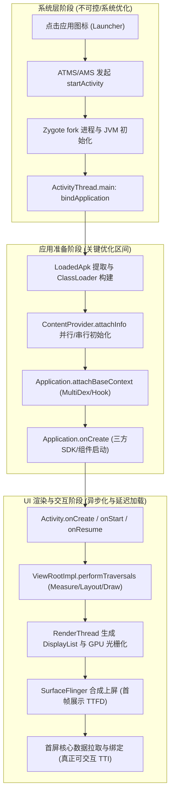
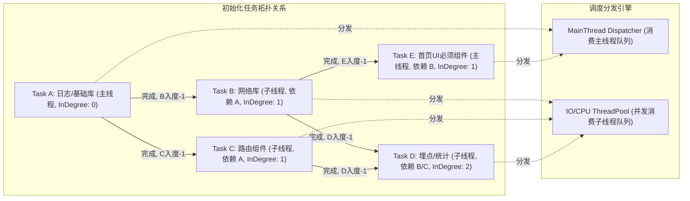
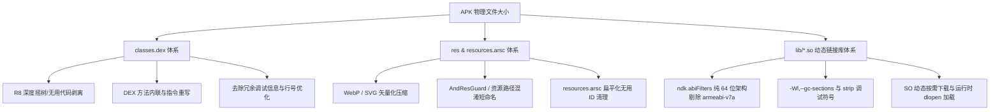
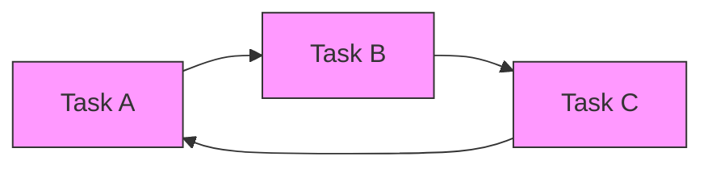
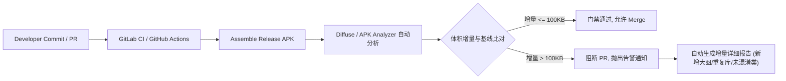

# 极速冷启动秒开有向无环图DAG任务编排与包体积瘦身SOP

冷启动时间与包体积（APK Size）是直接影响 App 下载转化率、用户留存率以及系统存活率的两大核心业务指标。在大型生产级应用中，随着业务膨胀，`Application.onCreate()` 往往沦为数十个 SDK 和业务模块初始化的垃圾场，引发严重的主线程卡顿；同时，DEX 冗余、无用资源堆积和 SO 库暴增不仅拖慢 I/O 加载，还会成倍放大内存开销。本专题从底层拓扑算法、任务调度引擎、App Startup 架构，到 DEX/Resource/SO 三维瘦身技术与 CI/CD 防劣化体系，展开全景工程化剖析。

---

## 核心底层机制与全景架构

### 冷启动全生命周期耗时归因全景

从用户点击桌面图标到首帧可交互（TTI, Time to Interactive），耗时在系统与应用层逐级流转：



### DAG 有向无环图启动调度引擎架构

传统串行初始化必然导致主线程阻塞，而简单的 `AsyncTask` 或线程池并发容易产生竞态死锁与依赖混乱。工业级方案基于 **DAG (Directed Acyclic Graph, 有向无环图)** 实现拓扑排序与动态入度监听：



---

## 源码级/算法物理推导

### DAG 拓扑排序与动态调度器生产级实现

拓扑排序的核心是基于 **Kahn 算法**：
1. 统计每个任务节点的入度（In-Degree，即前置依赖数）；
2. 将入度为 0 的任务推入就绪队列（Ready Queue）；
3. 调度线程池消费就绪任务，任务完成后，遍历其后继节点（Out-Degree 邻接表），将其入度原子递减 1；
4. 当某后继节点入度降为 0 时，该节点进入就绪队列，实现并发驱动与零自旋等待。

#### 核心数据结构与拓扑调度器源码

```kotlin
interface Task {
    val name: String
    val isRunOnMainThread: Boolean
    val dependencies: List<Class<out Task>>
    fun run()
}

class TaskWrapper(
    val task: Task,
    private val dispatcher: StartupDispatcher
) : Runnable {
    // 剩余前置依赖计数 (原子保障线程安全)
    val inDegree = AtomicInteger(task.dependencies.size)
    // 依赖此任务的后继子任务列表
    val dependChildren = mutableListOf<TaskWrapper>()

    override fun run() {
        Trace.beginSection(task.name)
        try {
            task.run()
        } finally {
            Trace.endSection()
            // 任务执行结束，通知所有后继任务
            dispatcher.onTaskCompleted(this)
        }
    }
}

class StartupDispatcher private constructor(
    private val tasks: List<Task>,
    private val cpuExecutor: ExecutorService = Executors.newFixedThreadPool(
        Runtime.getRuntime().availableProcessors().coerceAtLeast(2)
    )
) {
    private val taskMap = ConcurrentHashMap<Class<out Task>, TaskWrapper>()
    private val mainHandler = Handler(Looper.getMainLooper())
    // 闭锁：用于让主线程等待那些必须在 Application 结束前完成的子线程任务
    private val blockCounter = AtomicInteger(0)
    private val countDownLatch = CountDownLatch(1)

    fun start() {
        buildDAG()
        dispatchReadyTasks()
    }

    private fun buildDAG() {
        tasks.forEach { task ->
            taskMap[task::class.java] = TaskWrapper(task, this)
        }

        // 构造出度拓扑邻接表
        taskMap.values.forEach { wrapper ->
            wrapper.task.dependencies.forEach { depClz ->
                val parent = taskMap[depClz]
                    ?: throw IllegalStateException("Dependency ${depClz.simpleName} not found!")
                parent.dependChildren.add(wrapper)
            }
        }
    }

    private fun dispatchReadyTasks() {
        val readyTasks = taskMap.values.filter { it.inDegree.get() == 0 }
        readyTasks.forEach { dispatch(it) }
    }

    fun onTaskCompleted(completedTask: TaskWrapper) {
        // 遍历所有依赖当前节点的后继任务
        completedTask.dependChildren.forEach { child ->
            // 原子递减入度，若降为 0，说明所有前驱已全部就绪
            if (child.inDegree.decrementAndGet() == 0) {
                dispatch(child)
            }
        }
    }

    private fun dispatch(wrapper: TaskWrapper) {
        if (wrapper.task.isRunOnMainThread) {
            if (Looper.myLooper() == Looper.getMainLooper()) {
                wrapper.run()
            } else {
                mainHandler.post(wrapper)
            }
        } else {
            cpuExecutor.execute(wrapper)
        }
    }

    // 主线程等待指定必须完成的核心任务集
    fun awaitMustTasks() {
        if (blockCounter.get() > 0) {
            countDownLatch.await(2000, TimeUnit.MILLISECONDS) // 设置最大超时容灾
        }
    }
}
```

### Jetpack App Startup 原理剖析与痛点

Jetpack App Startup 利用了单个 `InitializationProvider`（继承自 `ContentProvider`）统一管理所有初始化任务，以此规避多个三方 SDK 各自定义 ContentProvider 带来的性能开销。

#### ContentProvider 启动膨胀机制
Android 进程启动时，在 `ActivityThread.handleBindApplication` 中：
```java
// ActivityThread.java
private void handleBindApplication(AppBindData data) {
    ...
    // 1. 创建 LoadedApk 和 Application 实例
    Application app = data.info.makeApplication(data.restrictedBackupMode, null);
    mInitialApplication = app;
    
    // 2. 依次安装并触发所有 AndroidManifest 中声明的 ContentProvider.onCreate
    installContentProviders(app, data.providers);
    
    // 3. 最后才回调 Application.onCreate
    mInstrumentation.callApplicationOnCreate(app);
}
```
若 App 引入了 10 个第三方库，每个库都利用 ContentProvider 偷跑初始化（如 WorkManager、LifecycleProcess、Firebase），主线程将在 `Application.onCreate` 之前串行执行 10 次 IPC 与反射调用，直接白白消耗 200ms~400ms。

#### App Startup 源码执行链
App Startup 声明一个专用的 Provider：
```xml
<provider
    android:name="androidx.startup.InitializationProvider"
    android:authorities="${applicationId}.androidx-startup"
    android:exported="false"
    tools:node="merge">
</provider>
```
在 `InitializationProvider.onCreate()` 中调用 `AppInitializer.getInstance(context).discoverAndInitialize()`：
- 扫描 Manifest 中的 `<meta-data>` 标签；
- 读取继承 `Initializer<T>` 的类；
- 使用 `Set<Class<?>> initializing` 集合通过深度优先搜索（DFS）检测是否存在循环依赖，并递归实例化与回调 `create(Context)`。

**局限性**：App Startup 默认**全部运行在主线程**，且缺少细粒度的线程池分发、优先级抢占、异步等待与闲时加载机制。因此，大厂通常仅借鉴其单个 Provider 思路，底层核心调度全面替换为自研 DAG 拓扑异步引擎。

---

### APK 包体积瘦身三维底层物理推导

APK 物理结构解剖：`classes.dex`（代码）、`res/` & `resources.arsc`（资源）、`lib/`（原生动态库）、`assets/`（静态资源）。瘦身必须针对三大体积大头进行比特级优化。



#### 1. DEX 体系瘦身：R8/ProGuard 底层优化
- **无用代码剥离（Dead Code Elimination）**：从 `keep` 规则指定的根节点（Application、Activity 等）出发，构建全工程方法与类的调用可达性图（Reachability Graph）。未被标记为可达的类、字段和方法直接从 DEX 中剔除。
- **类合并与方法内联（Class Merging & Inlining）**：若某个接口仅有一个实现类，R8 会直接消除接口并将方法下沉合并；若方法体字节码开销小于方法调用协议开销（调用跳转、寄存器保存），R8 将其字节码直接内联到调用处，消除 `invoke-direct` / `invoke-virtual` 指令。
- **行号优化（Line Number Shrinking）**：保留一份 mapping 文件，将 DEX 中的指令行号统一重映射为全局自增 ID，大幅缩减 `DebugInfoItem` 结构占用的物理字节。

#### 2. 资源瘦身：AndResGuard 物理混淆原理
标准打包流程中，`res/layout/activity_main.xml` 会以完整字符串存放在 `resources.arsc` 的常量池中。
- **路径与名称短命名**：AndResGuard 将 `res/layout/activity_main.xml` 映射替换为 `r/l/a.xml`；
- **资源 ID 常量池压缩**：重写 `resources.arsc` 二进制格式，移除未被代码引用的 `string`、`dimen`、`color` 项；
- **7-Zip Extreme 重新压缩**：针对非音频视频等已被系统 mmap 读取的资源，利用 7z 的 Deflate 增强算法以更高压缩比重构 APK ZIP 条目。

#### 3. Native SO 瘦身物理推导
- **ABI 归一化**：仅保留 `arm64-v8a`。放弃 `armeabi-v7a` 可直接节省 50% 以上的 SO 体积。在 Google Play 及国内主流渠道，64 位设备覆盖率已超过 99.5%。
- **Symbol Strip 与 LTO**：
  在 `CMakeLists.txt` 中开启链接时优化（LTO）并移除导出符号：
  ```cmake
  set(CMAKE_C_FLAGS "${CMAKE_C_FLAGS} -flto -fvisibility=hidden -fdata-sections -ffunction-sections")
  set(CMAKE_CXX_FLAGS "${CMAKE_CXX_FLAGS} -flto -fvisibility=hidden -fdata-sections -ffunction-sections")
  set(CMAKE_SHARED_LINKER_FLAGS "${CMAKE_SHARED_LINKER_FLAGS} -Wl,--gc-sections -Wl,--strip-all")
  ```
- **SO 动态下发**：将体积庞大且非冷启动必须的 SO（如音视频编解码 IJKPlayer、深度学习推理引擎 MNN/TFLite）剥离出 APK，应用启动后在后台静默下发至私有目录，运行时使用 `System.load(filePath)` 加载。

---

## 社招高频硬核连环追问

### 追问 1：DAG 调度器中如果存在偶发环形依赖（Cycle Dependency），如何在上线前防御？运行时如何优雅容灾？



#### 深度剖析
- **编译/构建期静态检测**：
  在单元测试或 Gradle 构建插件中，基于构建图算法进行环路检测：
  1. 使用 **DFS + 着色算法**：节点标记为白色（未访问）、灰色（正在递归访问当前路径）、黑色（已完成访问）。若在遍历中访问到灰色节点，即存在环路，抛出构建失败异常。
  2. 使用 **Kahn 拓扑排序算法**：若算法执行完毕后，处理的节点总数小于总注册节点数，说明剩余节点入度均大于 0，存在环路。
- **运行时动态容灾防御**：
  若由于动态注入配置导致运行时构环，调度器绝不能死锁主线程。
  1. 调度器设置超时阈值（如主线程最大阻塞等待 3 秒）；
  2. 若主线程 `CountDownLatch.await()` 超时，记录关键日志上报 APM 监控系统；
  3. 紧急释放闭锁，降级执行后续生命周期，同时异步打印发生死锁的未完成节点入度与依赖链，保证 App 不发生白屏卡死或 ANR。

---

### 追问 2：为什么很多 App 做了多线程异步并发启动后，冷启动时间反而变长了？

#### 深度剖析
这是生产实践中极易出现的**伪优化陷阱**，物理成因包括：
1. **CPU 核心饱和与频繁线程上下文切换（Context Switching）**：
   移动端芯片通常为大小核（big.LITTLE）架构，冷启动时系统会将最高主频大核分配给前台进程。如果盲目创建 10~20 个子线程并发执行任务，线程数量远超 CPU 物理核心数，导致操作系统时间片被严重分片。大量的 CPU 时间被消耗在内核态与用户态切换、寄存器保存恢复、CPU Cache Miss 上，反而剥夺了主线程获取大核 CPU 算力的机会。
2. **锁竞争与资源抢占（Lock Contention）**：
   多个异步任务内部若竞争同一个全局锁（如 `SharedPreferences` 的 XML 读写锁、单例初始化同步块、Hook 操作锁），线程将大量陷入阻塞态（BLOCKED/WAITING），并发蜕化为伪并发。
3. **I/O 寻址带宽挤爆**：
   冷启动阶段伴随大量 DEX 载入、SO 载入、资源解压和配置文件读取，闪存（UFS）处于高负荷读写状态。多个子线程同时执行大量 I/O 读写时，I/O 调度队列拥塞，产生严重的 I/O Wait。

#### 破局策略
- 线程池核心数限制在 `CPU核心数`；
- 使用 `Process.setThreadPriority(Process.THREAD_PRIORITY_BACKGROUND)` 降低子线程抢占权重，确保主线程始终享有高频调度时间片；
- 通过 `Systrace / Perfetto` 观察 CPU 核心利用率，消除多线程竞争导致的空转。

---

### 追问 3：在实施包体积瘦身时，开启 R8 代码混淆后导致线上频繁抛出 `NullPointerException` 或 `ClassNotFoundException`，底层原因是什么？如何建立自动化兜底机制？

#### 深度剖析
R8 相比传统 ProGuard 不仅做了简单的名称混淆，还进行了激进的优化（字节码内联、类合并、字段擦除）：
1. **反射与 JNI 符号丢失**：JNI 通过 `env->GetMethodID(clz, "onCallback", "()V")` 调用 Java 代码，若没有配置精确的 keep 规则，R8 发现该方法在 Java 层无显式调用，会直接将其剥离或重命名为 `a()`，导致 JNI 运行时发生 `NoSuchMethodError`。
2. **Gson / Jackson 反序列化字段丢失**：现代序列化库通过反射读取字段名称，若未被 keep，混淆后字段名变成 `a`、`b`，JSON 字段无法映射，默认值为空从而引发线上不可预期的 `NullPointerException`。
3. **内联与类合并导致泛型签名（Signature）擦除**：反射获取 `getGenericSuperclass()` 获取 Type 发生类转换异常。

#### 自动化兜底机制
- **注解驱动自动化 Keep**：自定义 `@KeepForReflection` 与 `@KeepForJni` 注解，在基类或核心接口打标，配置通用规则：
  ```properties
  -keep @com.example.annotation.KeepForReflection class * { *; }
  -keepclasseswithmembers class * {
      native <methods>;
  }
  ```
- **CI 流水线 DEX 符号差异检测（Diff Tool）**：
  每次编译出 Release 包时，CI 自动提取 mapping.txt 和 DEX 符号表，利用比对工具（如 Diffuse）自动断言关键序列化 Bean、JNI 绑定的类是否被意外缩减或混淆，一旦破坏规则直接阻断流水线合并。

---

## 生产级避坑指南与排障 SOP

### 1. 启动耗时分析黄金工具链与指标标准化

#### 线上指标标准化
- **TTFD (Time To First Display)**：从进程创建到 `Activity.onWindowFocusChanged()` 首帧渲染完成，代表用户看到完整界面的时间。
- **TTI (Time To Interactive)**：从进程创建到首屏骨架屏核心数据绑定完成，且主线程 Looper 队列进入首次 Idle 状态的时间，代表用户可流畅点击操作的时间。

#### 线下排障 SOP：Perfetto / Systrace 追踪实战
在终端执行底层追踪指令：
```bash
# 捕获应用启动期间 10 秒内的 CPU 调度、系统调用及 App 自定义 Trace 节点
python record_android_trace.py \
  -o startup_trace.perfetto-trace \
  -t 10s \
  -b 64mb \
  sched freq am wm gfx view dalvik \
  -a com.example.app
```

在代码关键节点注入跟踪打标：
```java
public class MyApplication extends Application {
    @Override
    public void onCreate() {
        Trace.beginSection("App_OnCreate");
        super.onCreate();
        
        Trace.beginSection("Init_CrashSDK");
        initCrashSdk();
        Trace.endSection();
        
        Trace.endSection(); // end App_OnCreate
    }
}
```

#### Perfetto 剖析三大排障维度
1. **观察 UI Thread 状态柱状图**：
   - 绿色（Running）：正常消耗 CPU，检查是否存在死循环或大算力计算；
   - 蓝色（Runnable）：处于就绪队列但无法被 CPU 执行，说明系统 CPU 满载，需降低子线程并发度；
   - 红色（Uninterruptible Sleep / D-State）：正在进行阻塞性磁盘 I/O 读写，需下放子线程或优化读取；
   - 白色（Sleeping / Blocked）：正在等待锁对象，需排查多线程锁竞争。

---

### 2. 包体积防劣化 CI/CD 工业级门禁 SOP

包体积治理不是一锤子买卖，必须构建持续集成的自动化守门人。



#### CI 门禁自动化检测脚本（Python 生产级模板）

```python
#!/usr/bin/env python3
import sys
import subprocess
import json

THRESHOLD_DEX_KB = 50   # DEX 增量阈值
THRESHOLD_TOTAL_KB = 100 # 总包体积增量阈值

def run_diffuse(old_apk, new_apk):
    # 调用 Diffuse 命令行工具进行 APK 深度二进制比对
    cmd = ["diffuse", "diff", "--apk", old_apk, new_apk, "--output-format", "json"]
    result = subprocess.run(cmd, stdout=subprocess.PIPE, stderr=subprocess.PIPE, text=True)
    if result.returncode != 0:
        raise RuntimeError(f"Diffuse execution failed: {result.stderr}")
    return json.loads(result.stdout)

def verify_apk_growth(diff_data):
    total_delta = diff_data["size"]["compressed_size_delta"] / 1024.0
    dex_delta = diff_data["dex"]["compressed_size_delta"] / 1024.0
    
    print(f"[APK Gatekeeper] Total Delta: {total_delta:.2f} KB, DEX Delta: {dex_delta:.2f} KB")

    violations = []
    if total_delta > THRESHOLD_TOTAL_KB:
        violations.append(f"Total APK growth ({total_delta:.2f} KB) exceeds limit ({THRESHOLD_TOTAL_KB} KB)!")
    if dex_delta > THRESHOLD_DEX_KB:
        violations.append(f"DEX code growth ({dex_delta:.2f} KB) exceeds limit ({THRESHOLD_DEX_KB} KB)!")

    if violations:
        print("\n".join(violations))
        sys.exit(1) # 退出码非 0，强行阻断 CI 流程
    else:
        print("[APK Gatekeeper] APK size check passed cleanly.")

if __name__ == "__main__":
    if len(sys.argv) < 3:
        print("Usage: python apk_gatekeeper.py <base_apk> <target_apk>")
        sys.exit(1)
    diff = run_diffuse(sys.argv[1], sys.argv[2])
    verify_apk_growth(diff)
```

### 3. 极速冷启动与包体积优化 checklist

| 维度 | 检查项 | 生产验收标准 |
| :--- | :--- | :--- |
| **启动调度** | ContentProvider 初始化剥离 | 杜绝业务库自定义 Provider，统一收拢或使用单个 Provider 调度 |
| **启动调度** | DAG 任务拓扑合理性 | 主线程仅保留核心第一屏渲染必需库，次级 SDK 全部异步化或 Idle 加载 |
| **启动调度** | 线程池优先级约束 | 后台子线程必须显式降级为 `THREAD_PRIORITY_BACKGROUND` |
| **包体积** | 资源格式规范 | 所有非透明图片强制转为 WebP，通用图标使用 VectorDrawable |
| **包体积** | 资源名称与路径混淆 | 开启 AndResGuard 或 R8 resources shrink，精简 resources.arsc |
| **包体积** | ABI 动态库约束 | 仅适配 `arm64-v8a`，无用动态库通过插件动态下载加载 |
| **包体积** | 重复依赖与冗余剔除 | CI 门禁严查同一三方库不同版本的传递依赖，杜绝重复打包 |
| **防劣化** | 线上 APM 报警阈值 | P90 冷启动时长大于 1500ms 自动触发系统级降级配置 |
