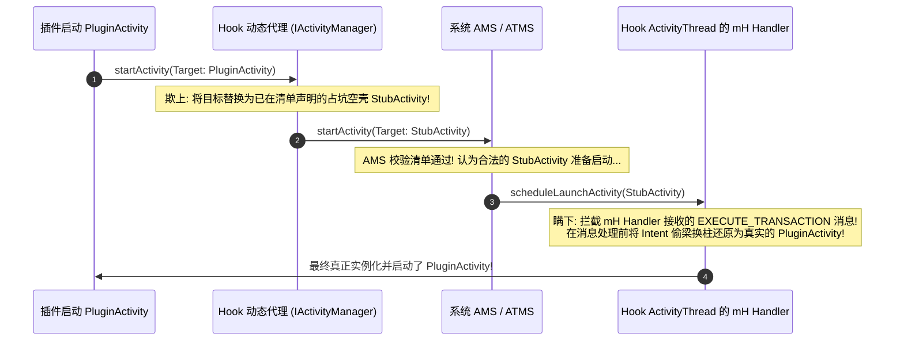

# 热修复与插件化核心原理DexElements合并与资源加载

当线上 App 突发重大紧急 Bug（如主流程崩溃、资损计算错误），如果按部就班走常规的发包、各大应用商店重新审核（耗时数小时到数天）、再等待海量用户更新覆盖，往往黄花菜都凉了。**热修复（HotFix）** 技术能够实现“在用户完全无感知的情况下，后台静默下载几十 KB 的补丁包并快速修复 Bug”。而 **插件化（Pluginization）** 更是将这种能力推向了“免安装动态下发整个业务模块”的极致。本文深入剖析热修复的三大流派底层原理，以及插件化中代码、资源与组件生命周期托管的终极实现。

---

## 核心底层机制与全景架构

### 1. 热修复三大主流技术流派横向对决

```mermaid
flowchart TD
    Hotfix[热修复技术流派] --> Flow1[1. DEX 插桩流派 (Tinker / Qzone)<br/>修改 ClassLoader 的 dexElements 数组]
    Hotfix --> Flow2[2. Native 底层替换流派 (AndFix / Sophix)<br/>直接内存覆盖 ArtMethod 结构体指针]
    Hotfix --> Flow3[3. 编译期插桩流派 (美团 Robust)<br/>在每个方法内部提前埋入静态补丁分支]

    Flow1 --> R1[冷启动生效 (需重启 App)<br/>全 Class 支持, 稳定性最高, 大厂主力!]
    Flow2 --> R2[即时生效 (无需重启)<br/>受不同厂商 ROM 改动影响大, 容易 Native Crash]
    Flow3 --> R3[即时生效 (无需重启)<br/>APK 包体积增大约 3%~5%, 对代码侵入大]
```

---

## 源码级架构物理拆解

### 1. DEX 插桩流派：`dexElements` 数组合并物理实战

基于前篇讲透的 `BaseDexClassLoader` 遍历机制：系统按顺序从前向后遍历 `dexElements` 数组，**一旦在前面的 DEX 找到目标类，就立即返回，后续同名类被彻底遮蔽**。

```mermaid
flowchart LR
    subgraph 原始 App 状态
        E1[dexElements 0: 原始主包 classes.dex (含有 Bug 类)]
    end

    subgraph 热修复合并补丁后
        P[patchElements: 补丁 patch.dex (包含已修复的 Class)] --> Merge[通过反射创建新的 CombinedElements 数组]
        E1 --> Merge
        Merge --> Final[新 dexElements 数组:<br/>[0]: patch.dex (优先被找到并命中!)<br/>[1]: classes.dex (旧 Bug 类被成功遮蔽!)]
    end
```

#### 经典踩坑：`CLASS_ISPREVERIFIED` 标记与 `VerifyError` 崩溃
在 Dalvik 虚拟机时代，DEX 在安装优化（`dexopt`）时，如果发现某个类的方法只引用了当前 DEX 内部的类，没有跨 DEX 引用，虚拟机就会为该类打上 **`CLASS_ISPREVERIFIED`** 标志。
- **灾难**：如果热修复尝试用补丁 DEX 的类去替换它，Dalvik 校验发现该类被打上了预校验标记却引用了外部补丁 DEX，直接抛出 `java.lang.IllegalAccessError` 崩溃！
- **Qzone / Tinker 破解方案**：在编译期通过字节码插桩（ASM），**在所有类的构造函数中强行注入一个引用了独立辅助 DEX（`AntilazyLoad.class`）的代码**，彻底破坏预校验条件，使得所有类均不被打上该标记，保证热修复能安全替换。

---

### 2. 插件化三大核心壁垒与底层破局

插件化要求在宿主 App 没有安装该 APK 的前提下，直接运行插件 APK 的 Activity 和资源：

#### 壁垒 A：插件代码如何加载？
- **破局**：为插件 APK 单独构建一个 `DexClassLoader`，将其父加载器指定为宿主的 `PathClassLoader`（或采用单 ClassLoader 模式直接合并进宿主 `dexElements`）。

#### 壁垒 B：插件的图片与布局资源如何加载？
- **破局**：通过 Java 反射实例化一个隐藏的 `AssetManager`，调用未公开的 `addAssetPath(pluginPath)` 方法，将插件 APK 的物理路径注入其中，再基于该 AssetManager 创建插件专用的 `Resources` 对象：
  ```java
  AssetManager assetManager = AssetManager.class.newInstance();
  Method addAssetPath = AssetManager.class.getDeclaredMethod("addAssetPath", String.class);
  addAssetPath.invoke(assetManager, pluginApkPath);
  Resources pluginResources = new Resources(assetManager, superRes.getDisplayMetrics(), superRes.getConfiguration());
  ```

#### 壁垒 C：插件 Activity 未在宿主 `AndroidManifest.xml` 中注册，如何绕过 AMS 校验？
- **破局：占坑式代理（Hook AMS + Hook `mH` Handler）**：



---

## 社招高频硬核连环追问

### Q1: 资源热修复和插件化中，最棘手的“资源 ID 冲突”是如何发生的？如何解决？
- **考点**：AAPT 资源编译机制与 ID 空间分布。
- **解析**：
  - **冲突成因**：Android 编译资源时，每个资源生成的 32 位 Hex ID 格式为：
    $$\mathbf{0xPPTTEEEE}$$
    - `PP`：Package ID（系统应用为 `0x01`，普通第三方应用强制固定为 `0x7f`）；
    - `TT`：Type 类型（如 `01` 代表 anim，`02` 代表 drawable，`04` 代表 layout 等）；
    - `EEEE`：Entry 条目索引偏移。
    - 宿主和插件如果都按默认打包，它们的 Package ID **全都是 `0x7f`**！当两者资源合并时，相同的资源 ID 对应不同的图片，导致**资源加载错乱、图标串位崩溃**。
  - **解决方案**：在编译插件阶段，修改 `aapt` 工具参数（或通过 Gradle 插件重写 `aaptOptions`），**将插件的 Package ID 定制为非 `0x7f` 的独立段**（例如宿主保留 `0x7f`，插件 A 定制为 `0x71`，插件 B 定制为 `0x72`），在物理 ID 命名空间上彻底隔离。

---

## 生产级避坑指南与排障 SOP

### 1. Android 9.0+ 限制对私有 API 反射（Hidden API Restriction）的破解

从 Android 9.0（Pie）开始，Google 启用了浅黑灰名单机制，直接反射 `addAssetPath` 或 `ActivityThread` 字段会直接抛出 `NoSuchMethodException`。

#### 生产绕过规约：
利用开源著名的 **FreeReflection** 工具，在应用启动的第一时间（`attachBaseContext`），通过修改当前运行时进程的 `RuntimeOptions` 或 Hook 虚拟机的 `hiddenapi_exemptions` 豁免列表，将反射白名单设置为 `*`（全局豁免），保证高版本系统下插件化与热修复反射通道畅通无阻。
