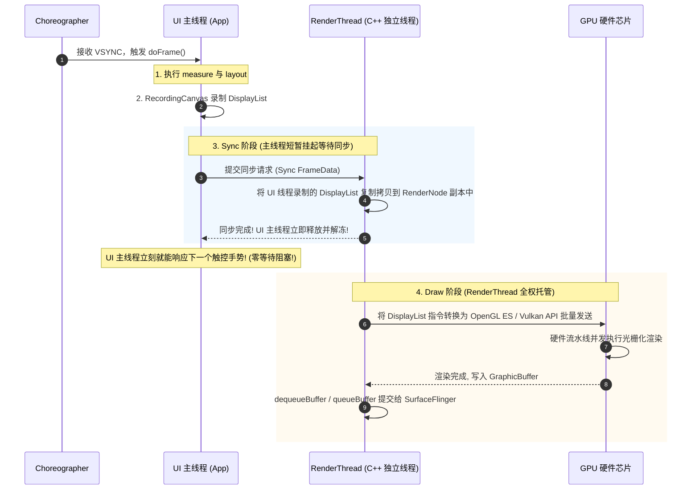

# 硬件加速底层DisplayList-RenderNode与RenderThread渲染管线

Android 图形系统在 Android 3.0（API 11）首次引入了硬件加速（Hardware Acceleration），并在 Android 5.0（API 21）迎来了划时代的飞跃——**独立渲染线程 `RenderThread`**。在开启硬件加速后，UI 主线程从繁重的逐像素绘制中彻底解脱，转为“指令录制者”，真正的 GPU 交互与帧提交全部下沉至 RenderThread。本文深度剖析 **DisplayList 录制架构、RenderNode 属性无损刷新机制，以及 CPU 与 GPU 的跨线程流水线交互**。

---

## 核心底层机制与全景架构

### 1. 软件绘制 vs 硬件加速绘制物理流程对比

```mermaid
flowchart TD
    subgraph 传统软件绘制模式 (Software Rendering)
        S_CPU[UI 主线程 CPU] -->|直接调用 Skia 2D 图像库| S_Calc[逐像素计算并写入内存 Bitmap]
        S_Calc --> S_Lock[Surface.lockCanvas 锁显存]
        S_Lock --> S_Copy[将 CPU 计算好的 Bitmap 拷贝至显存]
        S_Copy --> S_Post[Surface.unlockAndPost]
        Note_S[CPU 承担全部几何与像素光栅化计算, 极度卡顿]
    end

    subgraph 现代硬件加速模式 (Hardware Accelerated)
        H_CPU[UI 主线程 CPU] -->|仅录制绘制指令| H_DL[构建 DisplayList 指令流与 RenderNode]
        H_DL -->|Sync 阶段同步到| H_RT[RenderThread 独立渲染线程]
        H_RT -->|调用 OpenGL ES / Vulkan 驱动| H_GPU[GPU 硬件光栅化芯片]
        H_GPU --> H_FB[极速生成 GraphicBuffer 并提交 SurfaceFlinger]
        Note_H[CPU 与 GPU 双核并行流水线作业, 帧率极致顺滑!]
    end
```

---

## 源码级架构物理拆解

### 1. DisplayList 与 RenderNode 架构设计

在硬件加速模式下，`view.onDraw(canvas)` 传入的 Canvas 实际是 **`RecordingCanvas`**：
1. **指令录制（Recording）**：
   - 开发者调用 `canvas.drawRect()`、`canvas.drawText()` 时，并没有立即点亮任何一个屏幕像素；
   - `RecordingCanvas` 仅仅是将这些操作转换为一系列 **DisplayList 绘图操作指令节点**（如 `DrawRectOp`, `DrawTextOp`），保存在底层的 C++ `RenderNode` 中。
2. **RenderNode 的魔力：属性动画（Property Animator）零重绘开销**：
   - 传统软件绘制下，若给 View 做平移（`translationX`）或缩放（`scaleY`），必须调用 `invalidate()` 重新走一遍完整的 `onDraw()`；
   - **RenderNode 硬件优化**：`translationX`、`scaleY`、`alpha`、`rotation` 在底层都是 RenderNode 的**矩阵变换属性（Transform Matrix）**；
   - 当属性动画更新时，系统**完全不需要重新执行 `onDraw()` 重新录制指令**！只需调用 `RenderNode.setTranslationX()` 更改矩阵参数，RenderThread 在下一次向 GPU 提交时直接应用新矩阵，**开销无限趋近于 0，达成极致顺滑的 120fps 动画！**

---

### 2. UI Thread 与 RenderThread 跨线程流水线

Android 5.0 将绘图流程精准切分为两大异步线程流水线：



---

## 硬件加速的控制粒度与兼容性边界

Android 允许开发者从四个不同层级自由开启或关闭硬件加速：

| 控制层级 | 配置方式 | 典型使用场景 |
| :--- | :--- | :--- |
| **1. Application 级** | `<application android:hardwareAccelerated="true" ...>` | 全局开启（现代 Android 默认全开） |
| **2. Activity 级** | `<activity android:hardwareAccelerated="false" ...>` | 针对某特定页面（如包含不支持硬件加速的图表控件）单页降级关闭 |
| **3. Window 级** | `window.setFlags(FLAG_HARDWARE_ACCELERATED, ...)` | 针对特定弹窗强制开启 |
| **4. View 级** | `view.setLayerType(View.LAYER_TYPE_SOFTWARE, null)` | **最常用！针对某个自定义控件单独使用软件绘制兜底** |

#### 不支持硬件加速的特殊操作排查：
某些古老的 Canvas API 在 GPU 着色器中无法直接硬件映射（例如：在低版本 Android 上带复杂贝塞尔曲线的 `canvas.clipPath()`、部分 `canvas.drawPicture()`）。遇到黑屏或显示异常时，必须使用 `view.setLayerType(View.LAYER_TYPE_SOFTWARE, null)` 进行局部降级。

---

## 社招高频硬核连环追问

### Q1: `setLayerType(View.LAYER_TYPE_HARDWARE, paint)` 的原理是什么？能无脑滥用吗？
- **考点**：硬件离屏缓冲（Off-screen Buffer）与 GPU 显存消耗。
- **解析**：
  - **原理**：该方法会强行在 GPU 显存中开辟一块**离屏渲染纹理（FBO，Frame Buffer Object）**。View 会先渲染到这块独立的纹理上，随后整体作为一个纹理贴图贴到父容器上；
  - **适用场景**：在执行复杂的复合透明度动画（`alpha` 变换）或复杂阴影渲染时，避免子 View 多次重绘；
  - **严禁滥用**：
    1. 每一块离屏纹理都会独占一块高昂的 GPU 显存；
    2. 如果该 View 内部的内容在频繁变动，系统每一帧都需要重新更新离屏纹理，反而产生了额外的双重拷贝开销。动画结束后必须立即调用 `setLayerType(LAYER_TYPE_NONE, null)` 释放显存！

### Q2: 为什么主线程有时并不卡，但界面依然严重掉帧？
- **考点**：`RenderThread` 渲染瓶颈。
- **解析**：
  - 在 Android 5.0+ 之后，**卡顿掉帧并不总是主线程引起的**；
  - 如果 UI 主线程很快完成 DisplayList 录制（仅耗费 2ms），但绘制指令极为复杂（例如包含极大的 Path、超分辨率位图着色、高斯模糊 Shader），**`RenderThread` 与 GPU 渲染耗时了 30ms**；
  - 此时主线程虽然空闲，但 RenderThread 无法及时完成帧提交，BufferQueue 发生堵塞，屏幕依然会剧烈掉帧；
  - 在 Profiler 中排查卡顿，必须同时监控 `Main Thread` 与 `RenderThread` 两个泳道。

---

## 生产级避坑指南与排障 SOP

### 1. 过度绘制（Overdraw）检测与治理 SOP

**物理本质**：在屏幕同一个像素点上，在一帧内被 GPU 反复重绘了多次（例如：Window 默认背景、Layout 容器背景、子 View 背景层叠覆盖）。

#### 治理步骤：
1. **打开手机开发者选项**：
   开启“调试 GPU 过度绘制（Debug GPU Overdraw）” $\rightarrow$ “显示过度绘制区域”；
2. **观察颜色警示**：
   - **原色（无过度绘制）**：每个像素绘制 1 次；
   - **蓝色**：过度绘制 1 次（可接受）；
   - **绿色**：过度绘制 2 次；
   - **粉色/红色**：过度绘制 3 次或 4 次以上（**严重性能缺陷，必须治理！**）；
3. **消除 SOP**：
   - 移除 Activity 根主题的默认背景：`getWindow().setBackgroundDrawable(null)`；
   - 移除包含子 View 的各种父容器（如 `LinearLayout` / `FrameLayout`）的多余 `android:background`；
   - 自定义 View 中利用 `canvas.clipRect()` 仅绘制可见区域，避免全量重绘。
