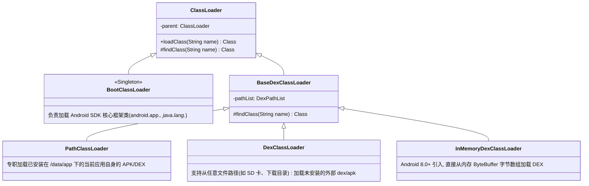
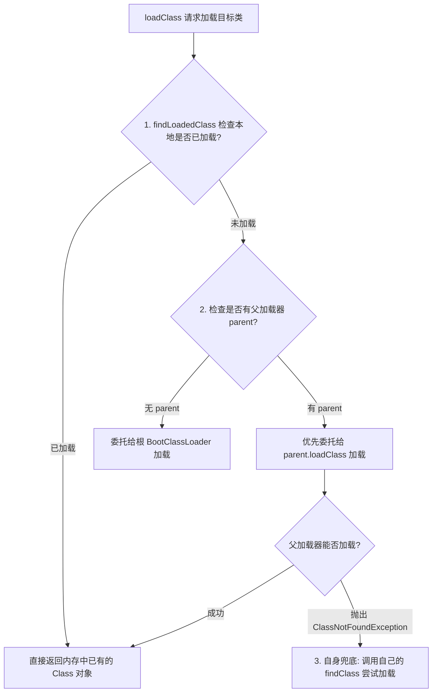

# 类加载器ClassLoader体系与双亲委派机制

在 Java 与 Android 运行时中，**类加载器（ClassLoader）** 扮演着将存储在磁盘或网络中的 `.class` / `.dex` 二进制字节码转化为 JVM / ART 方法区类对象的桥梁。Android 根据移动端特点对标准 JVM ClassLoader 进行了大幅定制，构建了以 **`BaseDexClassLoader`** 为中枢、**`DexPathList` 与 `dexElements`** 为骨架的类加载体系。深入理解其层次模型与双亲委派机制，是掌握热修复、插件化与组件化通信底层原理的核心钥匙。

---

## 核心底层机制与全景架构

### 1. Android ClassLoader 核心继承体系



---

## 源码级架构物理拆解

### 1. 双亲委派模型（Parent-Delegation）执行流程

与标准 Java 一致，Android 的 `ClassLoader#loadClass()` 严格遵循双亲委派安全约定：



#### 双亲委派的核心安全价值：
1. **防止核心类被恶意篡改**：如果黑客在外部 APK 中写了一个同包名的 `java.lang.String` 或 `android.app.Activity`，双亲委派机制会优先委托给顶层的 `BootClassLoader`，系统类始终被最优先加载，**黑客自定义的伪造核心类永远不会被执行**；
2. **避免类的重复加载**：父加载器加载过的 Class，子加载器无需重复解析，节约内存。

---

### 2. 核心架构拆解：`BaseDexClassLoader` 与 `DexPathList`

当父加载器无法加载时，`PathClassLoader` 或 `DexClassLoader` 都会调用其父类 `BaseDexClassLoader#findClass()`：

```java
// dalvik/system/BaseDexClassLoader.java
@Override
protected Class<?> findClass(String name) throws ClassNotFoundException {
    // 委托给内部的 DexPathList 处理
    Class c = pathList.findClass(name, suppressedExceptions);
    if (c == null) {
        throw new ClassNotFoundException(name);
    }
    return c;
}
```

深入 `dalvik/system/DexPathList.java`：
```java
// 核心内部数组：dexElements
private Element[] dexElements;

public Class<?> findClass(String name, List<Throwable> suppressed) {
    // 关键核心：按顺序遍历所有的 Element 节点
    for (Element element : dexElements) {
        // 从当前 Element 持有的 DexFile 中寻找目标类
        Class<?> clazz = element.findClass(name, definingContext, suppressed);
        if (clazz != null) {
            return clazz; // 找到了立即返回，不再继续向后遍历！
        }
    }
    return null;
}
```

#### 关键物理事实：
- `BaseDexClassLoader` 的底层核心是一个 **`Element[] dexElements` 数组**；
- 每一个 `Element` 物理上包装了一个真实的 `.dex` 文件（`DexFile`）；
- **类加载的顺序敏感性**：`DexPathList` 是从下标 `0` 开始按顺序从前向后遍历 `dexElements` 的。**一旦在排在前面的 DEX 中找到了目标 Class，就会立刻终止遍历返回**。排在后面的 DEX 中即便有同名 Class，也会被彻底屏蔽！**这一物理特性直接成为了后续所有“DEX 插桩热修复”的物理基础**。

---

## 社招高频硬核连环追问

### Q1: `PathClassLoader` 与 `DexClassLoader` 在 Android 8.0 之后还有区别吗？
- **考点**：ART 运行时对加载目录安全性的收敛演进。
- **解析**：
  - **在 Android 8.0 之前有重大区别**：
    - `DexClassLoader` 构造函数必须传入一个 `optimizedDirectory` 参数，用于指定释放解压 `.odex` 文件的可写私有路径；而 `PathClassLoader` 没有这个参数，只能加载系统安装目录的应用代码；
  - **在 Android 8.0+ 之后二者完全等价**：
    - Google 废弃了 `optimizedDirectory` 参数（传入会被忽略），内部统一由 ART 虚拟机的全局私有只读缓存目录管理；
    - 源码中 `DexClassLoader` 内部全部直接透传给 `BaseDexClassLoader`，现在 `PathClassLoader` 也完全可以加载未安装的外部 DEX。

### Q2: 什么是 ClassLoader 命名空间（Namespace）隔离机制？它破坏了插件化吗？
- **考点**：Android 7.0+ 针对私有 Native C/C++ 库的严格阻断。
- **解析**：
  - 从 Android 7.0 开始，系统引入了 **ClassLoader Namespace（类加载器命名空间）**；
  - 规定应用通过 Java 反射或 `System.loadLibrary` 时，**严禁加载系统隐藏的私有 C/C++ Native SO 库（如 `libart.so`）**；
  - 若插件通过自定义 ClassLoader 试图调用系统未公开的私有库，会被命名空间机制直接抛出 `UnsatisfiedLinkError`。现代插件化框架必须通过 Hook 命名空间白名单或伪造 Caller 调用者才能绕过。

---

## 生产级避坑指南与排障 SOP

### 1. 动态加载外部 DEX 崩溃排查（代码写入与运行权限）

**事故场景**：线上热修复或插件化在 Android 10+（API 29）下载补丁后，加载崩溃抛出：
`java.io.FileNotFoundException` 或 `SecurityException: Writable dex file is not allowed`。

#### 生产安全规范：
从 Android 10 开始，出于安全防范（防止恶意代码在运行时篡改已加载的 DEX 注入后门），系统要求：
- 存放补丁 DEX 的本地目录必须是**应用私有的 `context.getCodeCacheDir()` 或 `context.getDir("dex", Context.MODE_PRIVATE)`**；
- 将补丁 DEX 文件写入完毕后，**必须立即将其文件属性设置为只读（`file.setReadOnly()`）**，否则在高版本系统上 `BaseDexClassLoader` 会直接拒绝加载可写文件并引爆安全崩溃。
