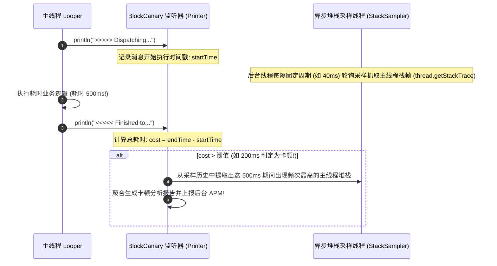

# 线上卡顿监控BlockCanary-Matrix原理与ASM插桩APM实战

在移动端性能治理中，**卡顿（Jank / Freeze）** 比崩溃（Crash）更为普遍，但排查难度却呈指数级上升。线下通过 Systrace / Profiler 可以轻松分析单个用例，但面对线上千万级真实用户五花八门的机型与使用场景，如何以**极低性能开销（< 1% CPU 占用）**精准捕获线上卡顿，并自动还原出**具体是哪个 Java / Kotlin 方法耗时过长（EvilMethod）**？本文深入剖析 **BlockCanary 字符匹配机制**、**Choreographer 帧率监控**，以及大厂主力级 **微信 Matrix 基于 ASM 字节码插桩的方法追踪技术**。

---

## 核心底层机制与全景架构

### 1. 线上卡顿监控三大主流技术流派对决

```mermaid
flowchart TD
    APM[线上卡顿监控技术方案] --> Sol1[1. Looper Printer 字符过滤 (BlockCanary)<br/>监听主线程消息分发前后的系统日志输出]
    APM --> Sol2[2. Choreographer 帧率回调 (FPS 统计)<br/>计算两帧之间的真实物理时间差]
    APM --> Sol3[3. ASM 编译期方法插桩 (微信 Matrix)<br/>在所有方法进出入口插入轻量打点<br/>精准生成真实耗时方法调用树!]

    Sol1 --> R1[实现极简, 零侵入代码<br/>缺点: 存在字符串拼接开销, 堆栈抽样存在盲区]
    Sol2 --> R2[宏观指标监控最佳<br/>缺点: 只能感知丢帧, 无法直接定位具体问题代码行]
    Sol3 --> R3[大厂工业级 APM 标配!<br/>微秒级还原全链路耗时与堆栈, 性能损耗极低]
```

---

## 源码级架构物理拆解

### 1. BlockCanary 核心底层机制：`Looper.setMessageLogging`

在 `Looper.loop()` 核心源码中，隐藏着官方预留的调试后门：

```java
public static void loop() {
    for (;;) {
        Message msg = queue.next();
        // 1. 消息分发前打印日志
        final Printer logging = me.mLogging;
        if (logging != null) {
            logging.println(">>>>> Dispatching to " + msg.target + " " +
                    msg.callback + ": " + msg.what);
        }

        // 2. 真实业务逻辑执行
        msg.target.dispatchMessage(msg);

        // 3. 消息分发结束后打印日志
        if (logging != null) {
            logging.println("<<<<< Finished to " + msg.target + " " + msg.callback);
        }
    }
}
```



#### 物理局限：
- **String 拼接开销**：高频分发消息时，主线程产生大量临时 String，低端机会加剧 GC 内存抖动；
- **抽样盲区**：依赖异步线程定期 `getStackTrace()` 抽样，如果一个消息内部依次调用了 10 个函数，抽样可能恰好错过了真正最耗时的函数。

---

### 2. 微信 Matrix 终极武器：编译期 ASM 字节码插桩（TraceCanary）

为了消除抽样盲区并获取 100% 真实的精确耗时，微信 **Matrix** 采用了编译期字节码插桩：

```mermaid
flowchart TD
    Source[编写的 Java/Kotlin 源代码] --> Gradle[Gradle Transform / AsmClassVisitorFactory]
    
    subgraph ASM 字节码插桩流水线
        Gradle --> MethodEnter[在所有方法的最前端插入: AppMethodBeat.i(methodId)]
        MethodEnter --> OriginalCode[执行原始代码业务]
        OriginalCode --> MethodExit[在所有 return/抛异常出口插入: AppMethodBeat.o(methodId)]
    end
    
    MethodExit --> Bytecode[最终生成的 APK 字节码]
```

#### 运行时数据结构：极其精妙的 `long[]` 环形缓冲区
Matrix 绝不使用高昂的对象封装，而是直接在内存中分配一个固定长度的 **`long[]` 一维数组环形缓冲区（Ring Buffer）**：
- 每个 `long` 占 64 位：
  - **高 1 位**：标记是方法进入（`i`）还是退出（`o`）；
  - **中间 20 位**：存储通过编译期分配的唯一整数 `methodId`（支持百万级方法）；
  - **低 43 位**：记录当前的系统时间戳（以毫秒/微秒计）。
- **极速运算**：进出方法只是一次位运算（Bitwise）与数组下标自增，耗时仅几纳秒！
- **卡顿还原**：当主线程卡顿超过阈值时，读取当前环形缓冲区的切片，通过方法进出栈的配对运算，**瞬间还原出一棵 100% 精确的、带有每个函数独立耗时（Self Cost）的调用火焰图！**

---

## 社招高频硬核连环追问

### Q1: 微信 Matrix 全工程所有方法都插桩，会不会导致 APK 体积暴增？性能开销究竟有多大？
- **考点**：插桩黑白名单过滤与指令裁剪优化。
- **解析**：
  - **体积控制**：Matrix 并不是无脑全量插桩。在 Gradle 编译期，它会自动应用规则过滤：
    1. 过滤空方法、构造函数、纯 Getter/Setter；
    2. 过滤基础系统类与极短的代码块；
    3. 配合黑名单排除无耗时的纯逻辑工具类；
    4. **实际体积增量通常只有 1% ~ 2%**；
  - **性能损耗**：由于底层采用了 `long[]` 纯基本数据类型位运算，无锁、无对象分配，**全量开启下对主线程的额外 CPU 损耗通常严格控制在 1% ~ 3% 以内**，完全符合线上千万级用户灰度抽样采样的要求。

### Q2: 为什么主线程卡顿超过 5 秒会报 ANR，而卡顿监控通常将报警阈值设在 200ms ~ 500ms？
- **考点**：卡顿（Jank）与 ANR 的层级边界。
- **解析**：
  - **ANR 是系统容忍的绝望底线**：当触控事件 5 秒内无法被处理时，系统直接弹窗强制结束应用；
  - **200ms 是用户肉眼感知的明显断层**：在 60Hz 屏幕下，200ms 相当于连续丢掉了整整 12 帧以上，界面已经出现肉眼可察觉的剧烈顿挫；
  - **防患于未然**：只有在线上大量收集 200ms~500ms 的轻微卡顿并持续优化，才能从物理概率上彻底截断恶化为 5 秒大卡顿（ANR）的风险。

---

## 生产级避坑指南与排障 SOP

### 1. 卡顿堆栈分析的三个黄金排查法则

当线上 APM 报警收集到一个耗时长达 800ms 的卡顿报告时：
1. **排查锁竞争（Lock Contention）**：
   - 检查堆栈中是否存在 `java.lang.Thread.State: BLOCKED (on object monitor)`；
   - 排查是否主线程正在等待某个后台子线程持有的锁；
2. **排查 IPC 隐式跨进程调用**：
   - 检查堆栈中是否含有 `android.os.BinderProxy.transact`；
   - 很多系统服务（如 `TelephonyManager.getDeviceId()`、`WifiManager.getConnectionInfo()`）底层都是同步 Binder IPC，一旦系统服务繁忙，主线程被挂起；
3. **排查主线程轻量 I/O 汇聚效应**：
   - 虽然单次 `sp.getString()` 仅耗费 1ms，但在循环中频繁调用 500 次，累加耗时即达 500ms，必须批量缓存优化。
