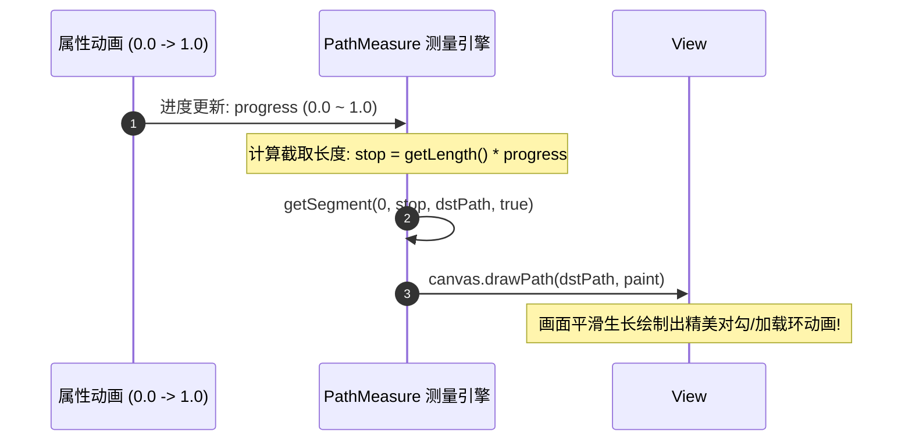

# 自定义View高级绘制Xfermode-PathMeasure与Shader着色器

在构建极富表现力的高阶自定义 UI（如圆形图片、探照灯光效、仪表盘进度环、签名画板、炫酷粒子交互）时，单纯依赖基础的 `drawRect()` 或 `drawCircle()` 往往捉襟见肘。Android 图形系统提供了强大的底层武器库：**PorterDuff 18 种图层混合算法（Xfermode）**、**着色器管线（Shader）** 与 **矢量路径测量引擎（PathMeasure）**。本文深入剖析其图形光栅化数学公式与离屏缓冲机制。

---

## 核心底层机制与全景架构

### 1. Canvas 高阶绘制能力全景拓扑

```mermaid
flowchart TD
    Canvas[Canvas 绘制流水线] --> Xfer[1. Xfermode 图层混合模式<br/>PorterDuffXfermode 18 种数学混合算法<br/>实现任意遮罩、挖孔、镂空、圆角]
    
    Canvas --> Shader[2. Shader 着色器家族<br/>BitmapShader: 纹理贴图<br/>Linear/Radial/SweepGradient: 渐变着色<br/>ComposeShader: 多重混合]
    
    Canvas --> Path[3. Path & PathMeasure 几何拓扑<br/>贝塞尔曲线 (Quad / Cubic)<br/>PathMeasure 路径测量与动态截取]
```

---

## 源码级架构物理拆解

### 1. PorterDuff.Mode 核心数学公式物理推导

在混合模式中，图形由两部分构成：
- **`DST`（Destination，目标图像）**：先画在 Canvas 上的图形（背景图层）；
- **`SRC`（Source，源图像）**：后画在 Canvas 上的图形（前景图层）。

每个像素包含两个分量：颜色值 $C$（RGB）与透明度通道 $\alpha$（Alpha，范围 $[0, 1]$）。

```mermaid
flowchart LR
    DST[DST: 目标图 (先画)] --> Blend{Xfermode 混合运算}
    SRC[SRC: 源图 (后画)] --> Blend
    Blend --> Out[最终合成像素 Result]
```

#### 常见高频模式数学推导：

| 模式名称 | 数学混合物理公式 | 视觉效果 | 经典生产场景 |
| :--- | :--- | :--- | :--- |
| **`SRC_IN`** | $[\alpha_{\text{src}} \cdot \alpha_{\text{dst}},\; C_{\text{src}} \cdot \alpha_{\text{dst}}]$ | 仅在 **两者重叠相交处保留 SRC 的颜色**，其余全透明 | **最经典的圆形头像/异形遮罩裁剪** |
| **`DST_IN`** | $[\alpha_{\text{src}} \cdot \alpha_{\text{dst}},\; C_{\text{dst}} \cdot \alpha_{\text{src}}]$ | 仅在 **两者相交处保留 DST 的颜色**，其余全透明 | 遮罩擦除、刮刮乐效果 |
| **`SRC_OUT`** | $[\alpha_{\text{src}} \cdot (1 - \alpha_{\text{dst}}),\; C_{\text{src}} \cdot (1 - \alpha_{\text{dst}})]$ | 仅在 **不重叠处保留 SRC**，重叠区域变镂空透明 | 镂空引导蒙层（新手教程高亮遮罩） |
| **`CLEAR`** | $[0, 0]$ | 两者相交的像素物理清零（完全透明） | 橡皮擦功能 |

---

### 2. 致命陷阱：为什么 Xfermode 必须配合 `canvas.saveLayer()`？

很多初学者在写 Xfermode 时，经常发现“圆角头像变成了黑底，或者混合完全没有生效”：
- **物理原因**：如果直接在默认 Canvas 上绘制，`DST` 图层的下方**其实还垫着 Activity 默认的白色/黑色 Window 背景**！
- 此时你的 `SRC` 实际上是跟底部的整个不透明窗口在做混合，混合结果被窗口底色污染，导致原本应该变透明的区域变成了黑块！
- **必须开启透明离屏缓冲（Off-screen Buffer）**：
  ```java
  // 1. 开启一个独立的全新透明图层 (保存当前画布状态)
  int saveCount = canvas.saveLayer(0, 0, getWidth(), getHeight(), null, Canvas.ALL_SAVE_FLAG);

  // 2. 绘制目标图 DST (如画一个纯色圆)
  canvas.drawCircle(cx, cy, radius, paint);

  // 3. 设置混合模式
  paint.setXfermode(new PorterDuffXfermode(PorterDuff.Mode.SRC_IN));

  // 4. 绘制源图 SRC (将方形 Bitmap 刷上去，此时只在圆内显示!)
  canvas.drawBitmap(bitmap, 0, 0, paint);

  // 5. 清理模式并合并图层回原画布
  paint.setXfermode(null);
  canvas.restoreToCount(saveCount);
  ```

---

### 3. PathMeasure 路径测量与动态打勾动画

`PathMeasure` 是 Android 提供的矢量路径高级测量工具：
- `getLength()`：精确测量一条闭合或非闭合贝塞尔曲线的物理像素总长度；
- `getSegment(startD, stopD, dstPath, startWithMoveTo)`：截取该路径中任意一段区间的子路径，并将其追加到目标 `dstPath` 中。



---

## 社招高频硬核连环追问

### Q1: 高性能实现“圆形头像”，`Xfermode` 与 `BitmapShader` 谁的性能更好？为什么？
- **考点**：GPU 显存开销与内存离屏缓冲对比。
- **解析**：
  - **`BitmapShader` 性能完胜！**
  - **原因**：
    1. 使用 `Xfermode` 必须强制调用 `canvas.saveLayer()`，这会在 GPU 中开辟一块临时的 **FBO 离屏渲染缓冲区**，涉及额外的图层合成与显存拷贝；
    2. 而 `BitmapShader` 是直接利用 GPU 纹理着色器，在单个绘制 Pass 中把 Bitmap 视作画笔的“墨水”直接涂抹在 `drawCircle()` 内部。**零离屏缓冲，零额外图层拷贝，开销极低**，是业界开源图片库（Glide / Coil）的标准实现。

### Q2: 自定义 View 中使用 `Path` 进行频繁动画重绘时，为什么建议提前调用 `path.reset()` 而不是 `new Path()`？
- **考点**：C++ 底层 SkPath 的复用。
- **解析**：
  - Java 层的 `Path` 实例底层持有一个 C++ 的 `SkPath` 指针；
  - 频繁 `new Path()` 不仅引发 Java 堆 GC，还会导致 Native 堆频繁申请物理内存；
  - `path.reset()` 会清空当前的轮廓数据，但保留底层的连续内存容器，避免物理重分配。

---

## 生产级避坑指南与排障 SOP

### 1. 硬件加速下 `canvas.clipPath()` 锯齿（Aliasing）治理

**现象**：在开启硬件加速的高版本 Android 上，使用 `canvas.clipPath()` 裁剪圆形或圆角时，边缘常常出现难看的白边或粗糙锯齿。

#### 治理方案：
- 不要使用 `clipPath` 进行边缘裁剪；
- 推荐使用 **`ViewOutlineProvider`（轮廓裁剪）**，不仅完美抗锯齿，且直接利用硬件加速进行 GPU 级物理裁剪，支持投射真实的 3D 阴影（`elevation`）：
  ```java
  view.setClipToOutline(true);
  view.setOutlineProvider(new ViewOutlineProvider() {
      @Override
      public void getOutline(View view, Outline outline) {
          outline.setRoundRect(0, 0, view.getWidth(), view.getHeight(), cornerRadius);
      }
  });
  ```
