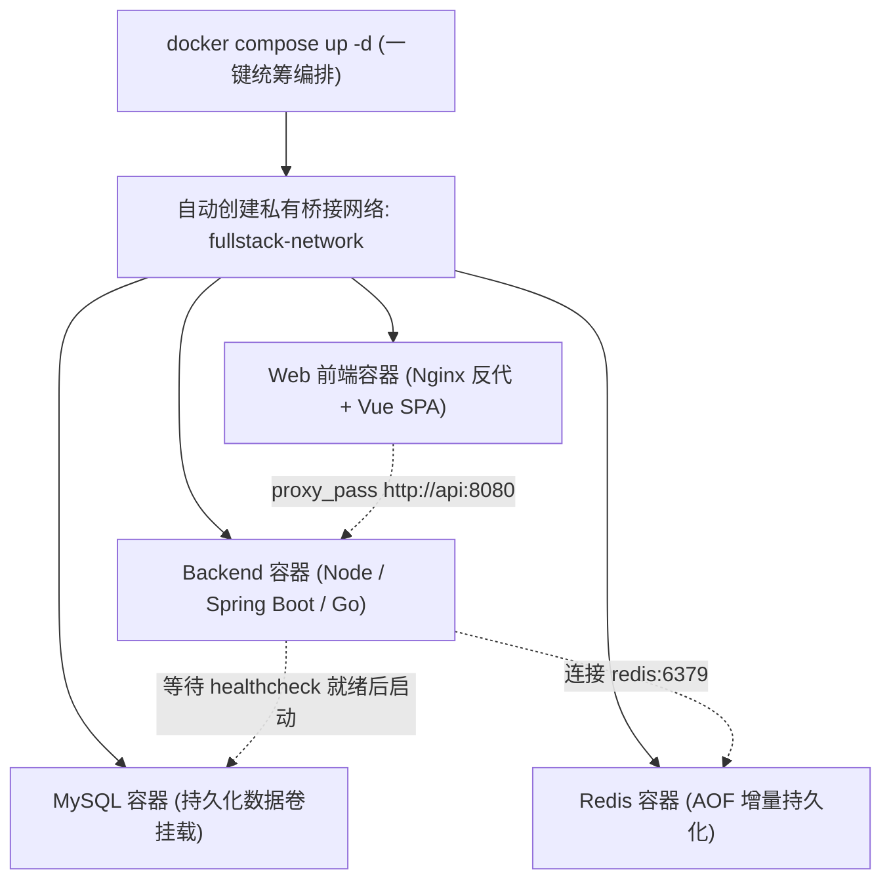

# Docker-Compose全栈一键编排前后端与数据库

## 核心技术原理与实战归纳
- **核心设问与思考**：“在新员工入职或新买云服务器上线时，如果用 `docker run` 一个个手动敲命令启动 5 个服务，极易漏配网络或参数。Docker Compose 是如何通过一份声明式 YAML 文件实现全栈前后端与数据库‘**一条命令、毫秒级一键拉起**’的？”
- **深水区追问**：“为什么在 `docker-compose.yml` 中配置了 `depends_on: [mysql]`，后端 API 启动时却依然大概率崩溃报错 `Communications link failure`？如何结合 **`healthcheck` 健康检查探针** 彻底解决容器启动依赖时序陷阱？”

---

## 一、 Docker Compose 架构全景与全栈一键起服蓝图

Docker Compose 是用于定义和运行**多容器 Docker 应用程序**的官方编排工具。全栈工程师只需维护一份 `docker-compose.yml`，即可将前端、后端、缓存与数据库的所有依赖关系、网络拓扑与持久化数据卷全部代码化（Infrastructure as Code, IaC）。



---

## 二、 工业级全栈 `docker-compose.yml` 生产模板

该模板完整涵盖了**Vue 3 前端 Nginx + 后端业务 API + MySQL 8.0 + Redis 7.0**，开箱即用，规范严苛：

```yaml
version: '3.8'

services:
  # 1. 关系型数据库 MySQL 8.0
  mysql:
    image: mysql:8.0
    container_name: prod-mysql
    restart: unless-stopped
    environment:
      MYSQL_ROOT_PASSWORD: ${DB_ROOT_PASSWORD:-Root_Pass_123}
      MYSQL_DATABASE: ${DB_NAME:-shop_db}
      MYSQL_USER: ${DB_USER:-shop_user}
      MYSQL_PASSWORD: ${DB_PASSWORD:-Shop_Pass_456}
      TZ: Asia/Shanghai # 强制同步容器时区为东八区
    ports:
      # 仅绑定宿主机 127.0.0.1，防范 3306 端口直接裸露在公网被勒索病毒扫描
      - "127.0.0.1:3306:3306"
    volumes:
      - mysql-data:/var/lib/mysql # 命名数据卷持久化数据
      - ./config/mysql/my.cnf:/etc/mysql/conf.d/my.cnf:ro # 挂载字符集与优化配置
    networks:
      - fullstack-net
    # 【核心配置】数据库物理健康检查探针 (解决 depends_on 伪就绪的关键!)
    healthcheck:
      test: ["CMD", "mysqladmin", "ping", "-h", "localhost", "-u", "root", "-p${DB_ROOT_PASSWORD:-Root_Pass_123}"]
      interval: 5s
      timeout: 3s
      retries: 10
      start_period: 15s

  # 2. 高性能缓存 Redis 7.0
  redis:
    image: redis:7.0-alpine
    container_name: prod-redis
    restart: unless-stopped
    # 启动时开启 AOF 增量持久化，并设置强访问密码
    command: ["redis-server", "--requirepass", "${REDIS_PASSWORD:-Redis_Pass_789}", "--appendonly", "yes"]
    ports:
      - "127.0.0.1:6379:6379"
    volumes:
      - redis-data:/data
    networks:
      - fullstack-net
    healthcheck:
      test: ["CMD", "redis-cli", "-a", "${REDIS_PASSWORD:-Redis_Pass_789}", "ping"]
      interval: 5s
      timeout: 3s
      retries: 5

  # 3. 后端业务 API 服务
  backend:
    build:
      context: ./backend
      dockerfile: Dockerfile
    image: shop-backend:latest
    container_name: prod-backend
    restart: unless-stopped
    # 【核心时序控制】必须等待 MySQL 和 Redis 真正通过健康检查后，后端才允许启动！
    depends_on:
      mysql:
        condition: service_healthy
      redis:
        condition: service_healthy
    environment:
      SPRING_DATASOURCE_URL: jdbc:mysql://mysql:3306/${DB_NAME:-shop_db}?useUnicode=true&characterEncoding=utf8mb4&serverTimezone=Asia/Shanghai
      SPRING_DATASOURCE_USERNAME: ${DB_USER:-shop_user}
      SPRING_DATASOURCE_PASSWORD: ${DB_PASSWORD:-Shop_Pass_456}
      SPRING_REDIS_HOST: redis
      SPRING_REDIS_PASSWORD: ${REDIS_PASSWORD:-Redis_Pass_789}
    ports:
      - "127.0.0.1:8080:8080"
    networks:
      - fullstack-net

  # 4. 前端静态 Web (Nginx 网关反代)
  frontend:
    build:
      context: ./frontend
      dockerfile: Dockerfile
    image: shop-frontend:latest
    container_name: prod-frontend
    restart: unless-stopped
    ports:
      # 对外暴露公网 80 端口接收用户流量
      - "80:80"
    depends_on:
      - backend
    networks:
      - fullstack-net

# 声明集中管理的持久化数据卷
volumes:
  mysql-data:
    name: prod-mysql-volume
  redis-data:
    name: prod-redis-volume

# 声明隔离的自定义内部桥接网络
networks:
  fullstack-net:
    name: prod-fullstack-network
    driver: bridge
```

---

## 三、 彻底破解 depends_on 的“伪就绪”时序陷阱

全栈开发在写 Docker Compose 时最普遍的惨痛经历：
> “我在 backend 中明明写了 `depends_on: - mysql`，为什么一执行 `docker compose up`，后端依然因为连不上数据库在启动第 3 秒就报错闪退了？”

### 1. 为什么传统的 `depends_on` 会失效？
- **物理缺陷**：Docker Compose 默认的 `depends_on` **只负责监控操作系统的进程状态**（只要目标容器完成了 `docker run`，容器处于 `Running` 状态，Docker Compose 就认为它已经启动完毕，立即放行启动下一个服务）；
- **数据库冷启动滞后性**：MySQL 容器启动后，其内部需要经历读取 `my.cnf`、初始化 InnoDB 缓冲池、校验 redo log、启动 TCP 监听等漫长过程（耗时通常需要 5~15 秒）。在 MySQL 准备就绪前，后端 API 已经早早发起连接，直接遭遇 `Connection refused` 惨死。

### 2. 标杆破局：`healthcheck` + `service_healthy`
在 Docker Compose v2 中，官方提供了最优雅的工业级解法：
1. 在依赖的被动服务（MySQL/Redis）中声明 `healthcheck` 探针（通过 `mysqladmin ping` 真实检测数据库引擎是否准备好处理查询）；
2. 在调用方（Backend）中将依赖条件显式设置为：
   ```yaml
   depends_on:
     mysql:
       condition: service_healthy
   ```
3. Docker Compose 会**死死卡住后端的启动流程**，直到 MySQL 探针连续返回成功、容器状态变为 `(healthy)` 的那一瞬间，才正式唤醒并启动后端服务，彻底消灭连接竞争条件！

---

## 四、 环境变量安全隔离：`.env` 文件实战

生产环境严禁将数据库密码、Redis 密码明文硬编码在 `docker-compose.yml` 中提交进 Git 仓库。
Docker Compose 默认会自动检测并读取同级目录下的 **`.env`** 文件：

在同级目录下创建 `.env`（并将其加入 `.gitignore` 严禁提交）：
```ini
# 生产敏感密码字典
DB_ROOT_PASSWORD=MySuperSecretRoot_2026!
DB_NAME=mall_production
DB_USER=mall_app_user
DB_PASSWORD=AppUser_Strong_Pass_9988#
REDIS_PASSWORD=Redis_Cluster_Token_666!
```

在 `docker-compose.yml` 中即可通过 `${变量名:-默认值}` 优雅引用，实现代码与环境凭证的绝对解耦。

---

## 五、 Docker Compose 高频运维命令速查

```bash
# 1. 核心起服: 在后台构建镜像并静默启动全套服务 (-d)
docker compose up -d

# 2. 强制重新构建镜像并启动 (代码修改后使用)
docker compose up -d --build

# 3. 实时跟踪所有或单个服务的控制台日志
docker compose logs -f
docker compose logs -f backend

# 4. 查看当前编排下的各容器健康状态与端口映射
docker compose ps

# 5. 重启单个有改动的服务 (秒级生效，不影响其他容器)
docker compose restart backend

# 6. 停止并销毁整套服务架构 (保留数据卷 volumes)
docker compose down

# 7. 彻底推倒重来: 销毁全部容器、网络以及物理数据卷 (-v 慎用!)
docker compose down -v
```

---

## 六、 生产避坑防雷指南

1. **Docker Compose v1 与 v2 的命令差异**：
   - 旧版 v1 是一个独立的 Python 脚本，命令带短横线：`docker-compose up`；
   - 现代版 v2 已经全面由 Go 语言重写并深度集成进 Docker CLI 核心插件，官方标准命令**中间空格无横线**：`docker compose up`，性能比 v1 快 5 倍以上。
2. **容器内部时区（Timezone）错乱**：
   - 默认情况下所有容器内部时区均为世界标准时（UTC 0 时区），导致写进数据库的数据创建时间比北京时间慢 8 个小时；
   - **必配**：在所有服务的 `environment` 中注入环境变量 `TZ: Asia/Shanghai`，使全栈所有容器与宿主机物理时间保持一致。

---

## 七、 面试高频连环追问

### Q1: 在 `docker-compose.yml` 中，如果同时定义了 `ports` 和 `expose`，它们有什么本质区别？
**答**：
- **`ports`（公网/宿主端口映射）**：
  会将容器内部的端口**强行映射并绑定到宿主机的物理网卡与端口上**（例如 `- "8080:8080"`），宿主机外部的所有客户端、外网用户都可以直接通过宿主机 IP 访问该端口；
- **`expose`（仅对内部容器暴露）**：
  **绝对不会在宿主机上映射任何端口**！它仅仅是一个文档声明，告知其他加入了同一个 Docker 网络的容器“该端口可用”。
  在规范的微服务架构中，MySQL、Redis 和内部 API **严禁配置 `ports`**，仅需配置 `expose`（甚至完全不写），外部流量必须强制经过 Nginx 网关进行反向代理，避免底层数据存储裸露在公网被勒索攻击。

### Q2: 如果修改了后端项目的源码，执行 `docker compose up -d` 能够自动更新容器吗？为什么？
**答**：
- **无法自动更新**！
- **底层原理**：`docker compose up -d` 在执行时，会优先检查本地是否已经存在名为 `shop-backend:latest` 的历史镜像。只要该镜像存在，Docker Compose 就会直接复用老旧的旧镜像拉起容器，根本不会主动检测宿主机源代码文件的修改并重新打包；
- **正确姿势**：代码修改后，必须显式追加 `--build` 参数：
  ```bash
  docker compose up -d --build backend
  ```
  该命令会强制触发 Dockerfile 的多阶段重新构建，命中没有修改的缓存层，并在数秒内完成新镜像生成并平滑交替重启该服务。
