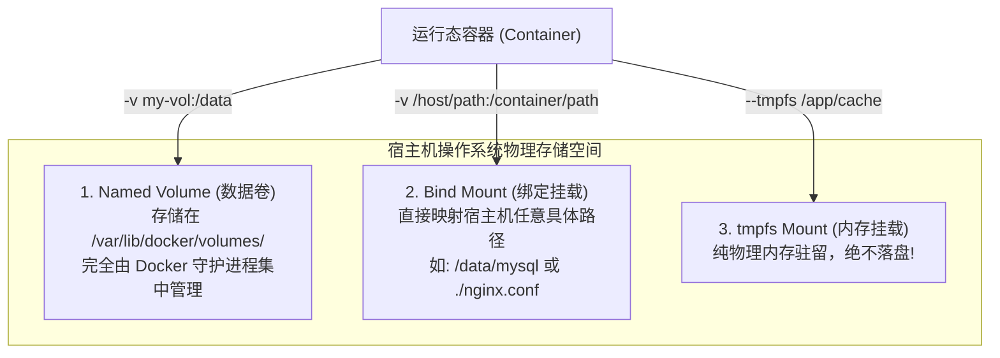
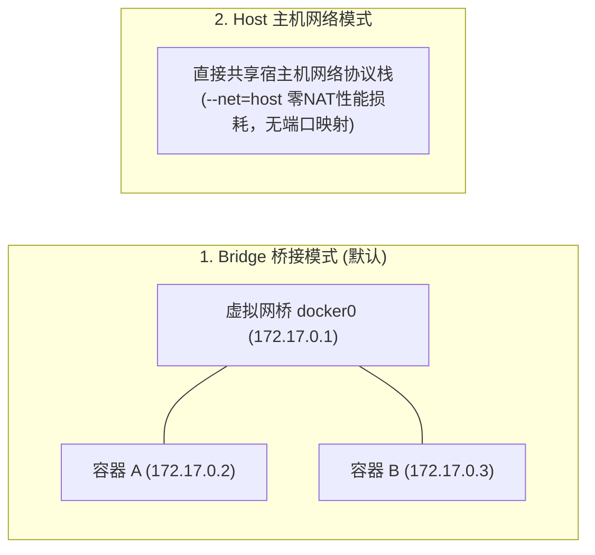

# Docker数据卷Volume持久化与自定义网络通信

## 核心技术原理与实战归纳
- **核心设问与思考**：“为什么 Docker 官方强烈推荐使用 **数据卷（Named Volume）** 而不是任意路径的 **绑定挂载（Bind Mount）** 来持久化 MySQL 数据库？`:ro`（只读挂载）在生产环境中有何安全妙用？”
- **深水区追问**：“两个容器都加入默认的 `bridge` 网络时，为什么执行 `ping backend` 会报错 `Name or service not known`？为什么只有在 **自定义网络（User-defined Bridge）** 下，Docker 才会自动启动内置的 **Embedded DNS Server** 实现基于容器名的自动服务发现？”

---

## 一、 Docker 三大持久化存储模型对比

为了打破容器可写层“随删随丢”的瞬态缺陷，Docker 提供了三种不同的物理存储挂载方式：



### 1. 三大存储机制横向选型矩阵
| 存储机制 | 物理存储宿主位置 | 权限与生命周期管控 | 适用生产业务场景 |
| :--- | :--- | :--- | :--- |
| **Named Volume（数据卷）** | 宿主机受 Docker 保护的目录：`/var/lib/docker/volumes/` | **完全由 Docker 统一管理**。与宿主机文件权限解耦，备份迁移极度标准化。 | **数据库与有状态中间件持久化**（MySQL、PostgreSQL、Redis、MinIO）。 |
| **Bind Mount（绑定挂载）** | 宿主机的**任意绝对或相对物理路径**（如 `/opt/app/nginx.conf`） | 强依赖宿主机文件系统目录权限与所有者 UID，若目录不存在会自动新建。 | **配置文件注入、前端代码实时热重载、本地开发调试**。 |
| **tmpfs Mount（内存挂载）** | 宿主机的**物理 RAM 内存**中 | 容器停止或重启后数据瞬间全部消失，绝不会触碰物理磁盘。 | 存储高敏感密码 Token、高频读写临时 Session（避免磨损 SSD）。 |

---

## 二、 数据卷与绑定挂载生产实战

### 1. 命名数据卷（Volume）最佳运维实战
```bash
# 1. 显式创建一个专有数据卷
docker volume create mysql-data

# 2. 查看数据卷在宿主机上的具体物理真实路径
docker volume inspect mysql-data

# 3. 挂载数据卷运行 MySQL (-v 数据卷名:容器内目标路径)
docker run -d --name prod-mysql \
  -v mysql-data:/var/lib/mysql \
  -e MYSQL_ROOT_PASSWORD=secret \
  mysql:8.0

# 4. 即使删除该容器，数据卷依然完好无损保存在物理机上!
docker rm -f prod-mysql
```

### 2. 绑定挂载（Bind Mount）与 `:ro` 只读保护
为了防止容器内部的代码异常篡改或误删宿主机的核心配置文件，生产环境应严格启用**只读挂载（Read-Only, `:ro`）**：
```bash
docker run -d --name my-nginx \
  -p 80:80 \
  # 将前端 dist 静态文件以只读方式挂载进去 (容器内禁止任何写入修改)
  -v /var/www/dist:/usr/share/nginx/html:ro \
  # 将配置文件以只读方式挂载
  -v /etc/nginx/nginx.conf:/etc/nginx/nginx.conf:ro \
  nginx:alpine
```

---

## 三、 Docker 网络模型深度剖析

Docker 提供了四种开箱即用的核心网络驱动（Network Drivers）：



1. **`bridge`（桥接网络，默认）**：
   - Docker 启动时会在宿主机创建一个名为 `docker0` 的虚拟网桥；
   - 每个容器通过 `veth pair`（虚拟网卡对）一端连在容器内部的 `eth0`，另一端插在宿主机的 `docker0` 网桥上，分配私有局域网 IP（如 `172.17.0.x`）；
   - 容器访问外网依赖 Linux 内核的 **SNAT（源地址转换）**，外网访问容器端口依赖 **DNAT（目标地址端口映射 `-p`）**；
2. **`host`（主机网络）**：
   - 容器**完全不创建自己独立的网络命名空间**，直接共享宿主机的网络协议栈、网卡与全部端口；
   - **优势**：消除了 `docker0` 网桥的 NAT 转发开销，网络性能逼近物理机；
   - **劣势**：容器内部占用的端口就是宿主机真实的物理端口（如容器监听 80，宿主机的 80 端口直接被占用，无法多开容器）。
3. **`none`**：完全断开网络，封闭沙盒环境；
4. **`overlay`**：跨多台物理主机的 Swarm/K8s 分布式容器集群网络。

---

## 四、 默认 bridge vs 自定义 bridge：DNS 自动解析的惊天玄机

全栈开发中最经典的踩坑现场：
> “我启动了一个 MySQL 容器（名字叫 `db`），又启动了一个后端容器（名字叫 `app`）。在后端代码的数据库连接字符串写 `jdbc:mysql://db:3306/test`，为什么后端直接报错报域名解析失败？”

### 1. 为什么默认的 `bridge` 无法通过容器名字通信？
- **物理原因**：在 Docker 默认的 `bridge` 网络中，为了保持向后历史兼容性，**Docker 官方彻底禁用了基于容器名称的内部自动 DNS 服务发现**！
- 在默认 `bridge` 网络里，容器之间只能使用不稳定的内部 IP（如 `172.17.0.2`）通信。但容器一旦重启，IP 会发生漂移，导致全栈配置全部失效。

### 2. 解决方案：创建自定义网络（User-Defined Bridge）
只要我们创建一个专有的自定义网络，并将容器加入其中，**Docker 内核会自动在 `127.0.0.11` 激活内置的嵌入式 DNS 服务器（Embedded DNS Server）**！

```bash
# 1. 创建一个名为 fullstack-net 的自定义桥接网络
docker network create fullstack-net

# 2. 启动 MySQL 容器，加入该网络，容器名为 db
docker run -d --name db --network fullstack-net -e MYSQL_ROOT_PASSWORD=root mysql:8.0

# 3. 启动后端应用容器，加入同一个网络，容器名为 api
docker run -d --name api --network fullstack-net -p 8080:8080 my-backend:latest
```

### 3. 神奇的连通验证：
此时在 `api` 容器内部，可以直接执行：
```bash
docker exec -it api ping db
```
**结果 100% 畅通无阻！** Docker 内部 DNS 会自动将主机名 `db` 动态解析为该容器当前分配的内部 IP，即使 MySQL 容器挂掉重新拉起导致 IP 变动，`api` 容器也绝不受任何影响，实现了真正的**解耦自愈**！

---

## 五、 生产避坑防雷指南

1. **Docker 宿主机端口占用与 `iptables` 冲突**：
   - Docker 在暴露端口（`-p 8080:8080`）时，会在宿主机的 `iptables` 的 `DOCKER` 链中强行插入 DNAT 转发规则；
   - **潜在陷阱**：在 Ubuntu 上，很多开发者以为使用 `ufw deny 8080` 就能关掉端口。**这是极度危险的错误！** 因为 Docker 插入的 iptables 规则优先级**远远高于 UFW 的默认规则**，导致公网依然可以直接访问 8080 端口！
   - 生产若需保护端口仅供内网访问，启动时必须显式指定绑定在本地回环 IP：
     ```bash
     docker run -p 127.0.0.1:8080:8080 ...
     ```

---

## 六、 面试高频连环追问

### Q1: 如果两个独立的 Docker 容器没有配置任何端口映射（没有加 `-p`），它们在同一个自定义网络内部可以互相访问端口吗？
**答**：
- **完全可以，畅通无阻！**
- **底层逻辑**：
  - `-p 宿主端口:容器端口` 的唯一作用是**配置宿主机的 DNAT 转发规则，向宿主机外部（外网用户或其他服务器）暴露端口**；
  - 在同一个 Docker 自定义网络内部，所有的容器都连接在同一个软件虚拟交换机（Bridge 网桥）上，它们处于**同一个扁平的二层局域网广播域内**。容器间直接通过目标容器的名字和内部暴露的端口（如 `http://db:3306`）直接进行点对点通信，根本不需要在宿主机上暴露任何映射端口，这也是最安全、最小化权限的架构设计。

### Q2: 既然 Bind Mount 能直接修改宿主机文件，为什么生产持久化数据库强烈首选 Named Volume？
**答**：
1. **跨平台兼容与路径解耦**：Named Volume 由 Docker 完全接管抽象，屏蔽了底层宿主机操作系统具体物理路径（Windows、macOS、Linux 各不相同）的差异，在编写 Dockerfile 或 Docker Compose 时具有高度的可移植性；
2. **避免宿主机文件权限冲突**：Bind Mount 容易因为宿主机的 UID/GID 权限不一致（例如宿主机目录是 root 创建，而容器内部是 mysql 用户运行），导致容器内部报 `Permission denied` 无法创建数据库表；而 Named Volume 在初始化时，Docker 会自动将挂载目录的属主初始化为容器内部运行用户的 UID/GID；
3. **性能更佳**：在 macOS 或特定分布式环境运行 Docker 时，Named Volume 的底层 I/O 驱动速度显著优于跨文件系统的 Bind Mount。
