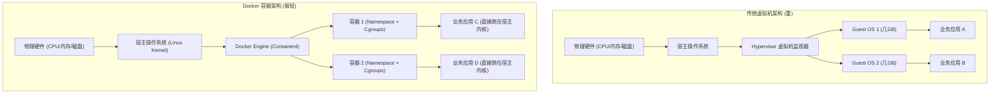
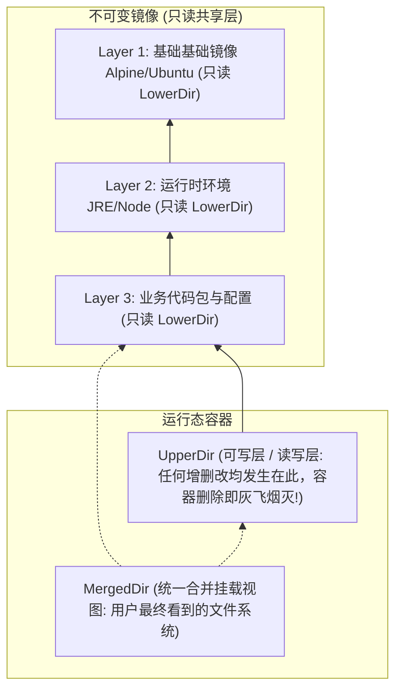

# Docker核心架构镜像容器操作与常用命令速查

## 核心技术原理与实战归纳
- **核心设问与思考**：“传统虚拟机（KVM/VMware）与 Docker 容器在操作系统内核层面有何本质区别？为什么 Docker 启动只要 0.1 秒，而虚拟机要几分钟？Linux 内核的 **Namespace** 与 **Cgroups** 分别负责什么？”
- **深水区追问**：“Docker 镜像是如何通过联合文件系统（Overlay2）实现分层复用与**写时复制（Copy-on-Write, CoW）**的？当一个正在运行的容器被 `docker rm -f` 强制删除后，它产生的所有业务数据去哪了？如何用一行命令安全释放 Docker 霸占的几十 GB 磁盘空间？”

---

## 一、 容器 vs 虚拟机：底层物理隔离机制对比

很多人误以为 Docker 容器是“轻量级的虚拟机”，这在计算机体系结构上是完全错误的。**容器的本质就是宿主机上的一个普通受限进程（Process）**。

| 架构维度 | 传统硬件虚拟化（VMware / KVM） | 现代化容器技术（Docker / Containerd） |
| :--- | :--- | :--- |
| **隔离层级** | **硬件级虚拟化**。依赖 Hypervisor 模拟出虚拟 CPU、网卡、内存和 BIOS。 | **操作系统级隔离**。直接共享并运行在**宿主机的操作系统内核（Host Kernel）**之上。 |
| **操作系统开销** | 每个虚拟机必须独立安装完整的客体操作系统（Guest OS，占用几个 GB 内存）。 | **零额外 OS 开销**。容器内部仅包含应用程序及其依赖的运行库（如 libc）。 |
| **启动耗时** | 需要经历完整的操作系统 BIOS 自检、内核引导与系统初始化（**数十秒至数分钟**）。 | 仅仅是宿主机创建了一个新的隔离进程（**毫秒级 100ms 内瞬间完成**）。 |
| **资源损耗** | 存在两层系统调用转换，CPU 与内存性能损耗约 5%~15%。 | **接近原生物理机裸跑性能**，计算与网络损耗几乎为 0%。 |



---

## 二、 容器底层的两大物理支柱：Namespace 与 Cgroups

Linux 内核通过两套核心技术将一个普通进程包装成“容器”：

### 1. Linux Namespaces（空间隔离：“障眼法，让你以为自己独占整台电脑”）
Namespaces 负责为容器划分出完全独立的视图边界，主要包含 6 大核心维度：
- **PID Namespace**：进程号隔离。容器内部的业务主进程在自己的视野里是 **`PID 1`**，但在宿主机真实全局视角下，它只是一个普通的 PID（如 `PID 18452`）；
- **NET Namespace**：网络协议栈隔离。每个容器拥有自己独立的虚拟网卡（`eth0`）、路由表、iptables 规则与独立的端口空间（容器内的 80 端口与宿主机的 80 端口互不干扰）；
- **MNT Namespace（Mount）**：文件挂载点隔离。容器拥有自己独立的文件系统根目录 `/`，看不到宿主机真实的其他目录；
- **UTS Namespace**：主机名隔离（每个容器可拥有独立的 Hostname）；
- **IPC Namespace**：进程间通信隔离（信号量、共享内存隔离）；
- **USER Namespace**：用户与用户组 UID/GID 隔离（容器内的 root 用户映射为宿主机的普通非 root 用户）。

### 2. Linux Cgroups（Control Groups，资源配额：“金箍棒，限制你的物理消耗”）
Namespaces 只解决了“看不看得见”，没解决“用多少”。若没有 Cgroups，一个容器发生死循环或内存泄漏会瞬间抢光整台服务器的所有 CPU 和物理内存。
- **CPU 限制**：通过 `cpu.cfs_quota_us` 限制容器每秒最多可使用的 CPU 时间片（如最多占用 2 个核心）；
- **Memory 限制**：通过 `memory.limit_in_bytes` 限制容器物理内存上限（如 1GB），一旦超出直接触发容器内部的 OOM 退出，绝不连累宿主机；
- **BlkIO 限制**：限制容器读写磁盘的 IOPS 与字节吞吐带宽。

---

## 三、 Overlay2 联合文件系统与分层写时复制（CoW）

Docker 镜像能够实现极速下载与超高存储利用率，核心源于其采用的 **Overlay2 联合文件系统（UnionFS）**。



### 1. 分层架构原理
- **LowerDir（只读镜像层）**：由 Dockerfile 中每一条构建指令（如 `FROM`, `RUN`, `COPY`）生成，构建完毕后**终生只读、绝对不可变（Immutable）**。多台容器可以同时并发共享底层的同一份只读镜像层，极大节省宿主机磁盘空间；
- **UpperDir（容器可写层）**：容器启动时，Docker 会在只读层顶端动态加盖一层极其轻薄的**可写层（Container Layer）**；
- **MergedDir（合并视图）**：联合文件系统将 UpperDir 和所有 LowerDir 叠合在一起，呈现给用户一个完整的 Linux 文件系统。

### 2. 写时复制（Copy-on-Write, CoW）机理
- **读取文件**：自顶向下检索，如果 UpperDir 没有，直接从底层的 LowerDir 只读层读取；
- **修改文件**：如果要修改 LowerDir 中的文件（如 `/etc/hosts`），Docker 会首先将该文件从只读层**完整拷贝一份到顶部的 UpperDir 可写层中**，随后在可写层中进行修改，底层的只读镜像文件毫发无损！
- **删除文件**：如果删除了只读层的文件，Docker 并不是真正物理抹除，而是在 UpperDir 中创建一个名为 `whiteout` 的特殊遮罩标记文件，使该文件在 Merged 视图中隐藏不可见。

---

## 四、 全栈工程师必备 Docker 命令高频速查

### 1. 容器运行与生命周期管理
```bash
# 后台标准启动容器 (-d: 后台运行, --name: 别名, -p: 端口映射[宿主端口:容器端口], --restart: 挂掉或开机自动拉起)
docker run -d --name my-web -p 80:80 --restart=always nginx:alpine

# 查看所有正在运行的容器 (带 -a 查看包括已停止的历史容器)
docker ps -a

# 启动、优雅停止、强制强杀、重启容器
docker start my-web
docker stop my-web    # 发送 SIGTERM，给容器 10 秒时间优雅保存退场
docker kill my-web    # 强制发送 SIGKILL 瞬间秒杀
docker restart my-web

# 强制删除容器 (-f: 即使处于 Running 状态也直接删除)
docker rm -f my-web
```

### 2. 容器内部调试与诊断（必背神技）
```bash
# 1. 实时跟踪查看容器控制台输出日志 (-f: 类似 tail -f, --tail 100: 看最后100行, -t: 显示时间戳)
docker logs -f --tail 100 my-web

# 2. 进入正在运行的容器内部交互终端 (-it: 分配伪终端并保持标准输入打开)
docker exec -it my-web sh
# (注: Alpine 基础镜像默认没有 bash，必须使用 sh；Ubuntu/Debian 基础镜像可使用 bash)

# 3. 查看容器底层极其详尽的元数据 JSON (网络IP、挂载点、环境变量、退出码)
docker inspect my-web

# 4. 实时动态监控所有容器的 CPU 算力、内存占用百分比与网络 I/O
docker stats
```

### 3. 宿主机与容器双向拷贝文件
```bash
# 从容器内部把配置文件拷贝到宿主机当前目录
docker cp my-web:/etc/nginx/nginx.conf ./nginx.conf

# 从宿主机把修改后的配置拷回容器
docker cp ./nginx.conf my-web:/etc/nginx/nginx.conf
```

### 4. 磁盘大扫除与垃圾清理（拯救满载磁盘）
长期运行 Docker 的服务器容易积攒数千个僵尸层和无用镜像：
```bash
# 1. 查看 Docker 占用的磁盘分布概览
docker system df

# 2. 核心大扫除杀招: 一键清理所有已停止的容器、未被使用的网络与虚悬未打标镜像 (<none>)
docker system prune -f

# 3. 彻底彻底深度大扫除 (连同未被任何容器引用的所有未使用镜像全部抹除):
docker system prune -a --volumes -f
```

---

## 五、 生产避坑防雷指南

1. **容器无状态原则与数据丢失陷阱**：
   - 容器的可写层（UpperDir）的生命周期**与容器生命周期完全绑定**！执行 `docker rm my-mysql` 删除容器的瞬间，可写层中的所有数据（包括 MySQL 数据库、用户上传的文件）会被**操作系统瞬间抹除且不可逆恢复**；
   - **铁律**：有状态数据（数据库文件、上传附件、配置文件）**绝对严禁直接保存在容器可写层内部**，必须通过数据卷（Volume）或目录挂载（Bind Mount）持久化到宿主机物理磁盘上！
2. **`docker run` 中的 `--restart` 策略选型**：
   - 生产环境建议必须带上 `--restart=unless-stopped` 或 `--restart=always`，确保云服务器在重启、系统升级或容器意外崩溃时，Docker Daemon 能够毫秒级自动将其拉起自愈。

---

## 六、 面试高频连环追问

### Q1: 在执行 `docker exec -it <container_id> sh` 时，操作系统底层到底发生了什么？它是新起了一个容器吗？
**答**：
- **并非新起容器**：`docker exec` **绝对没有创建任何新的容器**；
- **底层物理机制（加入已有的 Namespace）**：
  操作系统在宿主机上启动了一个新的 `sh` 进程，并借助 Linux 内核的 **`setns()` 系统调用**，将这个新起的 `sh` 进程强行加入到了目标容器已经存在的 **PID、NET、MNT、IPC 等特定 Namespaces 隔离空间中**！
- 此时该 `sh` 进程的视图被篡改为与容器内部一模一样，因此能够直接看到容器内的所有进程和文件，当开发者执行 `exit` 退出时，仅仅退出了这个辅助调试的 `sh` 进程，容器本身的业务进程毫发无损。

### Q2: 什么是虚悬镜像（Dangling Image）？它是怎么产生的？如何识别与清理？
**答**：
- **概念表象**：执行 `docker images` 时，看到镜像名称（Repository）和标签（Tag）均显示为 **`<none>:<none>`** 的无名幽灵镜像；
- **产生根因**：通常发生在**自动化迭代构建**时。例如原本存在一个 `myapp:latest`（镜像 ID 为 `aaa`）。当我们使用相同的名称重新构建了一份新镜像 `myapp:latest`（镜像 ID 变成了 `bbb`）。此时系统中的旧镜像 `aaa` 的标签名被剥夺，沦为了既没有名字也没有标签的孤儿镜像（但仍然占用真实的物理磁盘）；
- **快速清理**：
  ```bash
  # 列出所有虚悬镜像
  docker images -f "dangling=true"
  # 一键精准批量删除全部虚悬镜像
  docker rmi $(docker images -f "dangling=true" -q)
  ```
