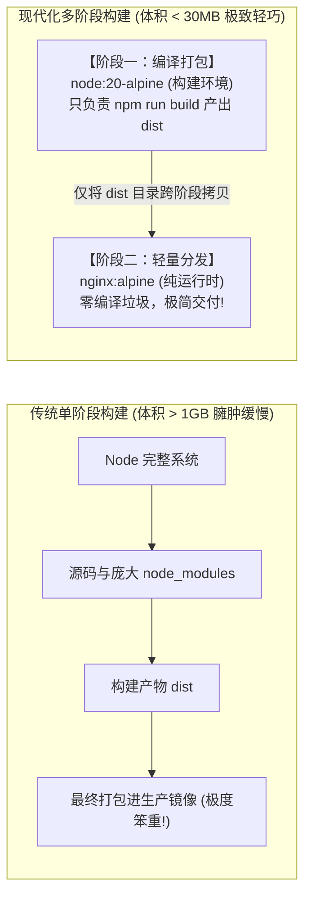

# Docker生产级Dockerfile编写规范与多阶段瘦身

## 核心技术原理与实战归纳
- **核心设问与思考**：“初级工程师构建出的 Node.js 或 Spring Boot 镜像动辄高达 1GB~2GB，为什么资深架构师构建出的镜像仅有 30MB~80MB？**多阶段构建（Multi-Stage Builds）**的物理本质是什么？”
- **深水区追问**：“为什么将 `COPY . .` 写在 `npm install` 之前会导致 CI/CD 每次构建都慢得像蜗牛？`ENTRYPOINT` 与 `CMD` 在底层进程启动时到底有何本质区别？如何防范将 `.env` 敏感密钥打包进镜像？”

---

## 一、 镜像暴瘦的核心利器：多阶段构建（Multi-Stage Builds）

在传统单一构建模式下，镜像必须同时包含**“代码编译环境（如 Node.js、JDK、Maven、编译器）”**与**“生产运行环境”**，导致大量只在编译时用一次的垃圾工具（如几百兆的 `node_modules`、Maven 缓存）永久固化在镜像内。



### 1. 前端 Vue 3 / React 多阶段构建工业级模板（1GB 锐减至 25MB）
```dockerfile
# ================= 阶段一：源码编译构建阶段 =================
FROM node:20-alpine AS builder
WORKDIR /app

# 利用 Docker 分层缓存：仅先拷贝依赖描述文件
COPY package.json package-lock.json ./

# 安装依赖 (生产推荐 npm ci，基于锁文件精确安装且速度更快)
RUN npm ci

# 拷贝全量业务代码并执行打包
COPY . .
RUN npm run build

# ================= 阶段二：生产轻量极速分发阶段 =================
# 选用精简的 Nginx Alpine 镜像作为基座 (仅约 20MB)
FROM nginx:alpine

# 核心安全规范：移除 Nginx 默认占位的欢迎页面
RUN rm -rf /usr/share/nginx/html/*

# 【核心指令】仅从第一阶段 builder 中将构建产物 dist 拷贝进来!
COPY --from=builder /app/dist /usr/share/nginx/html

# 替换我们自定义的高性能生产 Nginx 配置文件 (支持 SPA try_files)
COPY nginx.conf /etc/nginx/conf.d/default.conf

# 暴露端口与健康检查
EXPOSE 80

# 以前台守护方式启动 Nginx (PID 1)
CMD ["nginx", "-g", "daemon off;"]
```

---

### 2. 后端 Spring Boot 多阶段构建工业级模板（800MB 锐减至 85MB）
```dockerfile
# ================= 阶段一：Maven 编译构建打包 =================
FROM maven:3.9-eclipse-temurin-17-alpine AS builder
WORKDIR /workspace

# 先拷贝 pom.xml 预拉取依赖并充分利用 Docker 缓存
COPY pom.xml .
RUN mvn dependency:go-offline -B

# 拷贝源码并执行打包 (跳过单元测试加快打包速度)
COPY src ./src
RUN mvn clean package -DskipTests

# ================= 阶段二：JRE 轻量生产运行 =================
# 仅使用 JRE 运行时镜像，绝不包含完整的编译 JDK
FROM eclipse-temurin:17-jre-alpine
WORKDIR /app

# 【核心安全规范】严禁使用 root 权限运行应用！新建受限的专用普通用户与组
RUN addgroup -S appgroup && adduser -S appuser -G appgroup
USER appuser

# 从编译阶段拷贝最终打出的 Fat Jar
COPY --from=builder /workspace/target/*.jar /app/app.jar

# 配置 JVM 容器感知内存自适应参数
ENV JAVA_OPTS="-XX:+UseContainerSupport -XX:MaxRAMPercentage=75.0 -XX:+UseG1GC"

EXPOSE 8080

# 使用标准的 Exec 格式启动应用
ENTRYPOINT ["sh", "-c", "java $JAVA_OPTS -jar /app/app.jar"]
```

---

## 二、 极致加速：彻底利用 Docker 镜像分层缓存（Layer Cache）

Docker 在构建镜像时，会为 Dockerfile 中的**每一条指令计算一个哈希校验值**。如果某一步的指令和输入文件未发生任何修改，Docker 会直接命中本地的构建缓存（`Using cache`），瞬间跳过该步骤！

### 1. 致命劣质写法 vs 优雅高效写法
- **劣质写法（每次改动一行业务代码，都要重新下十几分钟 npm 依赖）**：
  ```dockerfile
  COPY . .             # 只要改了任何一行业务代码，这一步的缓存瞬间失效！
  RUN npm install      # 缓存断裂，导致每次必须全量重新走网络下载数万个依赖包！
  ```
- **优雅标准写法（变动最小的写在前面，变动频繁的写在后面）**：
  ```dockerfile
  # 步骤 1: 仅拷贝依赖定义文件
  COPY package.json package-lock.json ./
  # 步骤 2: 安装依赖 (只要没新增依赖包，这一步 100% 命中缓存，0秒瞬间通过！)
  RUN npm ci
  # 步骤 3: 最后才拷贝频繁变动的业务代码
  COPY . .
  RUN npm run build
  ```

---

## 三、 绝对不可忽视的 `.dockerignore` 规约

在执行 `docker build -t app .` 时，客户端的第一步动作是将当前目录下的所有文件作为**构建上下文（Build Context）**打包传输给 Docker Daemon 守护进程。
如果项目中包含了未排除的本地开发垃圾，会导致构建上下文高达数个 GB，不仅极慢，还会导致代码泄漏！

在项目根目录必须创建 `.dockerignore`：
```text
# 排除本地依赖与编译临时产物
node_modules
npm-debug.log
dist
target
*.jar

# 排除版本控制与敏感隐私
.git
.gitignore
.env
.env.local
*.pem
*.key

# 排除本地 IDE 缓存
.idea
.vscode
*.sublime-project
.DS_Store
```

---

## 四、 生产级 Dockerfile 编写五大军规

1. **基础镜像选型：优先选择 `-alpine` 或 `-slim`**
   - 官方完整 Ubuntu/Debian 基础镜像自带各种无用库，体积动辄 200MB~800MB；
   - `alpine` 极其轻巧（仅约 5MB），`debian-slim` 仅约 30MB，能大幅缩短镜像拉取与推流时间；
2. **合并多条 RUN 指令，杜绝层级膨胀与缓存残留**
   ```dockerfile
   # 错误写法: 产生 3 个独立的只读层，中间缓存垃圾被永久固化在历史层中!
   RUN apt-get update
   RUN apt-get install -y curl
   RUN rm -rf /var/lib/apt/lists/*

   # 正确规范写法: 合并在单条指令中，且务必在同一层中清理安装缓存!
   RUN apt-get update && apt-get install -y --no-install-recommends \
       curl \
    && rm -rf /var/lib/apt/lists/*
   ```
3. **永远为基础镜像锁定固定版本号**
   - **严禁使用 `FROM node:latest` 或 `FROM alpine:latest`**！因为 `latest` 随时会被上游官方更新，导致某天自动化流水线突然因为底层版本差异或不兼容语法打包失败，**必须显式锁定版本（如 `FROM node:20.12.2-alpine`）**。

---

## 五、 ENTRYPOINT vs CMD 的本质区别与最佳实践

很多全栈开发者分不清 `ENTRYPOINT` 与 `CMD`，甚至发生参数被覆盖丢失的问题：

| 指令 | 核心职责 | 能否在 `docker run` 时被轻松覆盖替换？ |
| :--- | :--- | :--- |
| **`ENTRYPOINT`** | 定义容器启动时必须执行的**固定可执行程序（入口主体）**。 | **不可直接覆盖**（除非显式指定 `--entrypoint` 参数）。 |
| **`CMD`** | 为 `ENTRYPOINT` 提供**默认的备选参数**，或单独提供默认运行指令。 | **极其容易被覆盖**（`docker run <image> <param>` 后面的参数会无脑直接覆盖 `CMD`）。 |

### 生产最佳黄金拍档组合：
```dockerfile
# 固定可执行程序主体
ENTRYPOINT ["nginx"]

# 提供默认传参 (前台运行)
CMD ["-g", "daemon off;"]
```
- **默认执行**：`docker run my-nginx` $\rightarrow$ 最终执行命令为 `nginx -g "daemon off;"`；
- **排错覆盖参数**：`docker run my-nginx -V` $\rightarrow$ 传递的 `-V` 自动替换掉 CMD，最终执行 `nginx -V` 打印版本。

---

## 六、 面试高频连环追问

### Q1: 为什么容器安全准则中强制要求“不能在容器内以 root 身份运行业务应用”？如果被黑客攻击会怎样？
**答**：
- **容器与宿主共享内核**：容器并没有真正的硬件沙箱，它的所有系统调用直接打在宿主机 Linux 内核上；
- **越狱逃逸灾难**：如果容器以 `root` 身份运行，一旦该服务存在已知漏洞（如任意文件读写、内核提权或挂载了 Docker Socket `/var/run/docker.sock`），黑客在容器内拿到的就是顶级的 `root` 权限。黑客可轻松借助挂载漏洞逃逸到**宿主机的真实操作系统上**，肆意读取其他容器甚至宿主机的密码文件并植入勒索病毒；
- **非 root 降权**：通过在 Dockerfile 中显式创建普通用户并声明 `USER appuser`，即使黑客攻破应用，也仅仅拿到一个被严格沙盒限制的低权限用户，无法安装软件、无法访问外部挂载，彻底阻断了容器逃逸的路径。

### Q2: 既然 Alpine 镜像只有 5MB，为什么很多中大厂在生产运行 Java 或 Python 时反而更推荐选用 Debian-slim？
**答**：
- **C 语言标准库的兼容性差异**：
  - 标准 Linux（Ubuntu/Debian/CentOS）底层使用的是 **`glibc`**；
  - Alpine 为了追求极致的小巧，剔除了 glibc，改用了轻量级的 **`musl-libc`**；
- **潜在生产隐患**：
  很多 Java 高性能组件（如 Netty 依赖的 JNI 动态链接库、RocksDB）、Python 科学计算包（如 NumPy、Pandas）都是基于 `glibc` 预编译编译好的。在 `musl-libc` 的 Alpine 上运行时，可能会遭遇缺失动态库报错、性能吞吐下降（DNS 解析在 Alpine 上存在已知的单线程串行 Bug），甚至发生偶发的 JVM Crash 崩溃。因此对底层原生系统调用要求极高的重载应用，选用基于 `glibc` 的 **`debian-slim`（仅 30MB 左右）** 更加稳妥健壮。
