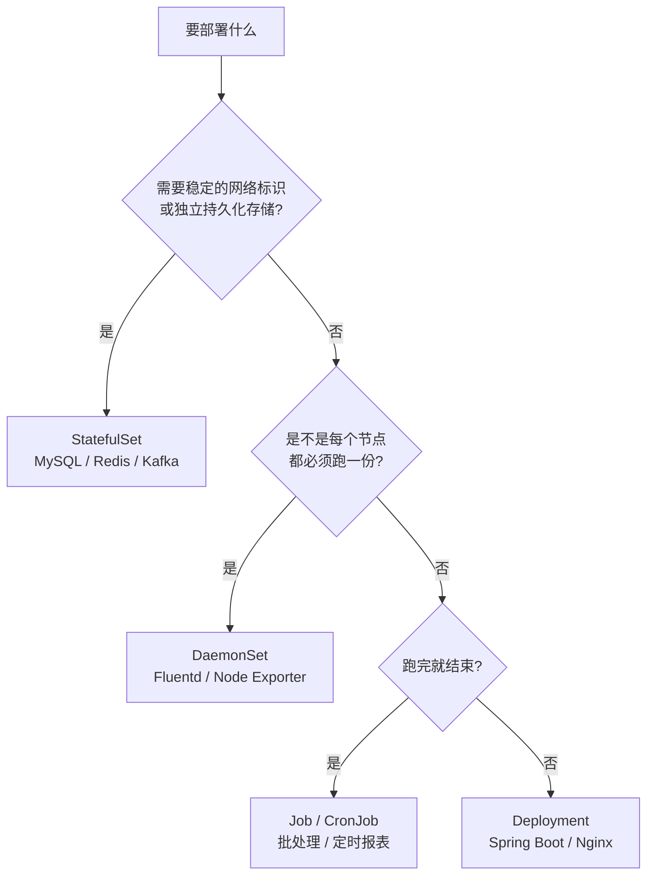
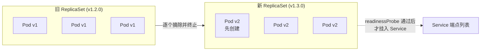
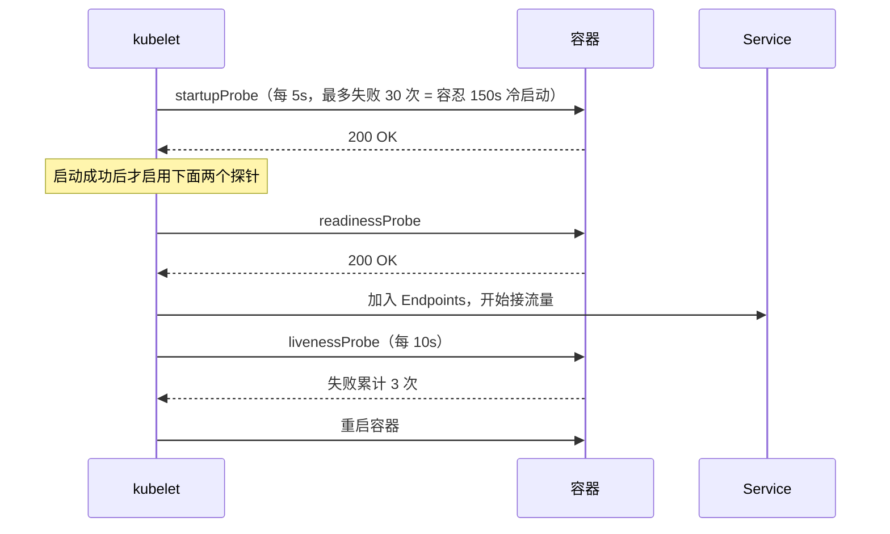

# K8s 工作负载与发布策略实战

## 使用入口：先解决问题，再做验证

选择控制器并安全发布新版本。

**先做基本操作**：先部署一个无状态服务并观察 rollout，验证探针、失败和回滚，再比较控制器与更新策略。初次学习可先完成[本模块基础实践](/doc/DevOps/部署运维基本使用与故障排查)。

**再逐步深入**：基本 API 与输入输出 → 常见失败和使用边界 → 场景排查与优化 → 本文机制分析与源码。面试先讲用途和自己的操作过程，再回答场景与原理追问。

> **一句话看懂**：Deployment 管无状态、StatefulSet 管有状态；发布不是「停服重启」，而是**新旧两套 ReplicaSet 交替扩缩 + 探针做流量门禁**，有助于保持服务，但还依赖容量、优雅终止、流量排空和版本兼容。

## 30 秒速览

| 需求 | 用哪个 | 关键理由 |
| :--- | :--- | :--- |
| 普通后端服务 / 前端静态站 | `Deployment` | Pod 无身份、可任意替换，滚动更新天然支持 |
| MySQL / Redis / Kafka / ES | `StatefulSet` | 需要固定网络标识 + 每副本独立存储卷 |
| 每节点跑一个（日志采集、监控 Agent） | `DaemonSet` | 节点加入集群时自动部署 |
| 一次性任务 / 定时任务 | `Job` / `CronJob` | 跑完即止，失败可重试 |
| 零停机发版 | `RollingUpdate` + 探针 | `maxSurge` 先起新的，`maxUnavailable: 0` 不减旧的 |

---

## 一、四类工作负载怎么选



| 控制器 | Pod 名字 | 存储 | 扩缩顺序 | 删除时会怎样 |
| :--- | :--- | :--- | :--- | :--- |
| `Deployment` | 随机后缀 `xxx-7d9f8b-abcde` | 共享或无状态 | 并行 | 直接重建，无身份记忆 |
| `StatefulSet` | 固定 `mysql-0`、`mysql-1` | 每副本一个 PVC | **按序 0→N 启、N→0 停** | 名字与卷绑定不变，PVC 默认保留；可受 PVC 保留策略影响 |
| `DaemonSet` | 每节点一个 | 通常 hostPath | 随节点增减 | 节点下线即移除 |
| `Job` | 一次性 | 可选 | 按 `parallelism` | 完成后 Pod 保留供查日志 |

- **StatefulSet 必须配 Headless Service**（`clusterIP: None`），才能让 `mysql-0.mysql-svc` 这样的 DNS 稳定解析到固定 Pod。
- PVC 的生命周期独立于 Pod：`kubectl delete pod` 不会丢数据，`kubectl delete pvc` 才会（还取决于回收策略）。

---

## 二、滚动更新如何降低中断风险



**执行顺序是关键**：先按 `maxSurge` 多起一个新 Pod → 等 `readinessProbe` 返回 200 才把它加入 Service 端点 → 再按 `maxUnavailable` 停一个旧 Pod → 循环。此机制维持副本可用数量，但连接排空、端点传播、探针准确性和版本兼容仍会影响单次请求。

### `maxSurge` / `maxUnavailable` 组合速查

| 组合 | 更新期间总副本数 | 资源开销 | 适用 |
| :--- | :--- | :--- | :--- |
| `maxSurge: 1, maxUnavailable: 0` | 3 → 4 → 3 | 需多 1 个 Pod 的余量 | 常见配置；仍需额外容量与终止保护 |
| `maxSurge: 0, maxUnavailable: 1` | 3 → 2 → 3 | 无额外资源 | 资源紧张、允许短暂少一个副本 |
| `maxSurge: 25%, maxUnavailable: 25%` | 弹性 | 中等 | 副本数多、追求速度 |
| `Recreate`（全删再起） | 3 → **0** → 3 | 最低 | 仅允许停机的离线系统，新旧版本不兼容时用 |

> 二者**不能同时为 0**，否则既不能多起也不能少一个，更新会直接卡死。

### 发布与回滚命令

```bash
kubectl set image deployment/mall-order-service order-app=registry.example.com/mall/order-service:v1.3.0 -n production
kubectl rollout status deployment/mall-order-service -n production     # 观察滚动过程
kubectl rollout history deployment/mall-order-service -n production     # 查看版本记录
kubectl rollout undo deployment/mall-order-service -n production        # 回退上一模板；完成时间取决于镜像、探针和资源
kubectl rollout pause  deployment/mall-order-service -n production      # 暂停更新；不能保证精确的金丝雀流量比例
kubectl rollout resume deployment/mall-order-service -n production      # 验证无误后继续
```

---

## 三、三大探针与生产加固 YAML



| 探针 | 问的问题 | 失败动作 | 必须避免的错配 |
| :--- | :--- | :--- | :--- |
| `startupProbe` | 启动完了吗 | 阻止另两探针 | 不配 → 慢启动应用被 liveness 反复杀，陷入 CrashLoop |
| `readinessProbe` | 能接客吗 | 摘出 Endpoints（**不重启**） | 探针里查 DB/下游，依赖一抖全副本被摘，服务整体 404 |
| `livenessProbe` | 还活着吗 | 杀容器重启 | 检查了外部依赖 → 下游故障引发本服务无意义重启风暴 |

**探针就该只检查自己进程是否健康**，用 `/actuator/health/liveness` 这类不含外部依赖的端点（Spring Boot 的 liveness/readiness 探针组天然做了这个隔离）。

### 完整加固版 Deployment

```yaml
apiVersion: apps/v1
kind: Deployment
metadata:
  name: mall-order-service
  namespace: production
spec:
  replicas: 3
  minReadySeconds: 10                 # 新 Pod 就绪后稳定 10s 才算可用，防抖动误判
  progressDeadlineSeconds: 600        # 10 分钟没滚动完就标记失败
  revisionHistoryLimit: 5             # 保留 5 个历史 ReplicaSet 供回滚
  strategy:
    type: RollingUpdate
    rollingUpdate:
      maxSurge: 1
      maxUnavailable: 0
  selector:
    matchLabels: { app: mall-order }
  template:
    metadata:
      labels: { app: mall-order }
    spec:
      terminationGracePeriodSeconds: 45   # 给 in-flight 请求留够收尾时间
      securityContext:
        runAsNonRoot: true
        runAsUser: 1000
        fsGroup: 1000
      containers:
      - name: order-app
        image: registry.example.com/mall/order-service:v1.3.0
        ports:
        - containerPort: 8080
        resources:
          requests: { cpu: "500m", memory: "512Mi" }
          limits:   { cpu: "2000m", memory: "1024Mi" }
        securityContext:
          allowPrivilegeEscalation: false
          readOnlyRootFilesystem: true
          capabilities: { drop: ["ALL"] }
        lifecycle:
          preStop:
            exec:
              command: ["sh", "-c", "sleep 10"]   # 先从 Endpoints 摘除，再等存量请求收尾
        startupProbe:
          httpGet: { path: /actuator/health/liveness, port: 8080 }
          periodSeconds: 5
          failureThreshold: 30                    # 容忍最长 150s 冷启动
        readinessProbe:
          httpGet: { path: /actuator/health/readiness, port: 8080 }
          periodSeconds: 5
          failureThreshold: 3
        livenessProbe:
          httpGet: { path: /actuator/health/liveness, port: 8080 }
          periodSeconds: 10
          failureThreshold: 3
        volumeMounts:
        - name: tmp
          mountPath: /tmp                         # readOnlyRootFilesystem 下给临时目录开洞
      volumes:
      - name: tmp
        emptyDir: {}
```

**为什么 `preStop: sleep 10` 能消除发版瞬间的 502**：Pod 被删时，kubelet 发 SIGTERM 与「从 Endpoints 摘除」是**并行**发生的，而 kube-proxy 更新 iptables/IPVS 规则有延迟。若应用立刻关闭，这几百毫秒内仍会有流量打到一个已关闭的端口。先 sleep 一小段时间等规则收敛，再优雅停机，是低成本高收益的标配。

---

## 四、高频追问与回答要点

| 追问 | 高分特征 | 低分特征 |
| :--- | :--- | :--- |
| 「滚动更新为什么不丢请求？」 | 说清新 RS 先扩容 → readiness 通过才入 Endpoints → 再缩旧 RS，并补 `preStop` 解决规则收敛延迟 | 只答「K8s 自动一个一个换」 |
| 「`readinessProbe` 和 `livenessProbe` 挂了分别会怎样？」 | 前者摘流量不重启、后者杀容器重启；并指出探针不应检查外部依赖 | 把两者都说成「会重启」 |
| 「Spring Boot 启动 30s，只配 liveness 会怎样？」 | 引入 startupProbe，说明 failureThreshold × periodSeconds 覆盖冷启动窗口，否则陷入 CrashLoopBackOff | 只答「把 initialDelaySeconds 调大」（镜像变慢就失效） |
| 「StatefulSet 和 Deployment 的本质区别？」 | 固定网络标识 + 按序启停 + 每副本独立 PVC，配合 Headless Service 提供稳定 DNS | 只答「一个有无状态一个有状态」 |
| 「回滚是重新部署旧镜像吗？」 | 指出 Deployment 保留历史 ReplicaSet，`rollout undo` 直接切回旧 RS 的 pod template，秒级生效 | 答「重新 apply 旧 YAML」 |

> 总览与架构图见 [K8s 生产级容器编排与核心架构全解](/doc/DevOps/K8s生产级容器编排与核心架构全解)；网络与存储见 [网络与存储体系全解](/doc/DevOps/K8s网络与存储体系全解)；线上故障排查见 [生产治理与故障排查](/doc/DevOps/K8s生产治理与故障排查)。
