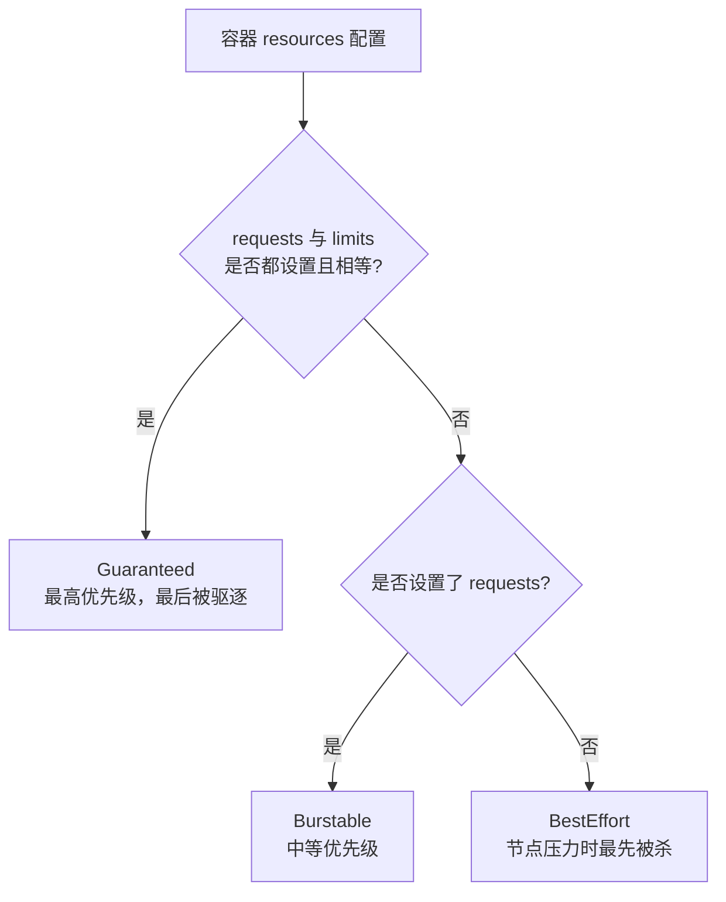
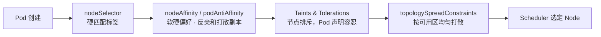
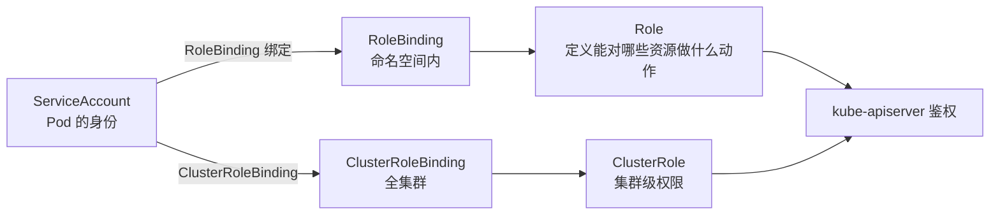
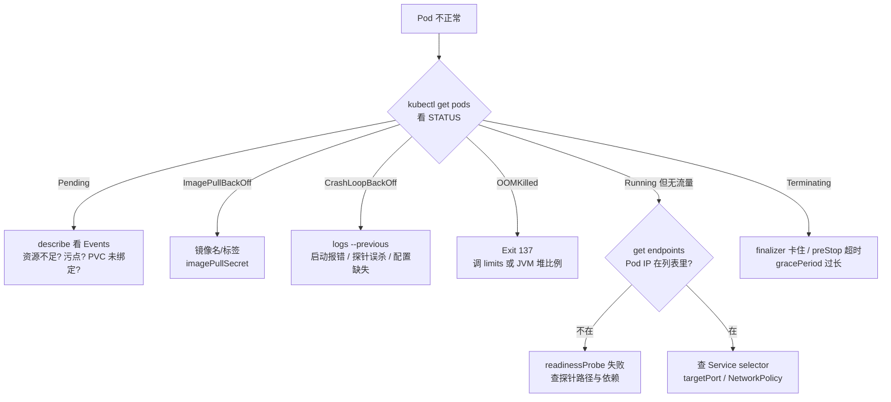

# K8s 生产治理与故障排查

## 使用入口：先解决问题，再做验证

限制资源并恢复异常工作负载。

**先做基本操作**：先用 describe、events 和 previous logs 分类 Pending/CrashLoop/OOM，验证修复，再讲调度与 QoS。初次学习可先完成[本模块基础实践](/doc/DevOps/部署运维基本使用与故障排查)。

**再逐步深入**：基本 API 与输入输出 → 常见失败和使用边界 → 场景排查与优化 → 本文机制分析与源码。面试先讲用途和自己的操作过程，再回答场景与原理追问。

> **一句话看懂**：线上事故 80% 落在「**资源、调度、权限、探针**」四件事上，排查有固定决策树——先看 Pod 状态和 Events，再看资源与调度，最后看网络与依赖，不要一上来就翻应用日志。

## 30 秒速览

| 现象 | 第一反应 | 一条命令 |
| :--- | :--- | :--- |
| Pod 一直 `Pending` | 调度不下去（资源不足 / 污点 / PVC 未绑定） | `kubectl describe pod <name>` 看 Events |
| `CrashLoopBackOff` | 进程起来就退出（配置错 / 启动即报错 / 探针误杀） | `kubectl logs <pod> --previous` |
| `OOMKilled` | 内存超 `limits`，或 JVM 堆 + 元空间 + 直接内存算漏了 | `kubectl describe pod` 看 Last State |
| `ImagePullBackOff` | 镜像名/标签错、私有仓库没配 imagePullSecret | `kubectl describe pod` 看 Events |
| `Running` 但流量 502 | readinessProbe 未通过，Pod 不在 Endpoints | `kubectl get endpoints <svc>` |
| 服务偶发慢但没报错 | CPU 被 `limits` 节流（throttling） | 看 `container_cpu_cfs_throttled_seconds_total` |

---

## 一、资源配额与 QoS：OOMKilled 的根因



| QoS 等级 | 判定 | 节点内存不足时 |
| :--- | :--- | :--- |
| `Guaranteed` | requests == limits（CPU 与内存都设且相等） | 最后被驱逐，适合数据库、核心服务 |
| `Burstable` | 设了 requests，但 limits 更大或没设 limits | 中间 |
| `BestEffort` | requests 和 limits 都没设 | **最先被杀**，生产禁止 |

### 两个常被混淆的机制

| 维度 | CPU limits | Memory limits |
| :--- | :--- | :--- |
| 超限后果 | **节流（throttled）**，进程变慢但不会被杀 | **直接 OOMKilled**，容器被杀重启 |
| 线上表现 | RT 毛刺、偶发超时，很难查 | CrashLoopBackOff + `Exit Code 137` |
| 生产建议 | 核心服务可不设 CPU limits，只设 requests（避免无谓节流） | 必须设，且要留足非堆内存余量 |

**Java 应用最经典的 OOM 误算**：容器 `limits.memory = 1Gi`，JVM 却设了 `-Xmx1g`。JVM 总内存 = 堆 + 元空间 + 线程栈 + 直接内存（Netty/NIO）+ GC 结构，实际会超过 1Gi，于是被内核 OOMKilled。正确做法是堆设为 limit 的 60~70%，或使用 JDK 10+ 的 `-XX:+UseContainerSupport` 配合 `-XX:MaxRAMPercentage=70.0`。

---

## 二、调度三件套：让 Pod 去该去的节点



| 手段 | 作用方向 | 典型用法 |
| :--- | :--- | :--- |
| `nodeSelector` | Pod → Node 硬性匹配 | 只跑在 `ssd=true` 或 GPU 节点 |
| `nodeAffinity` | 硬/软偏好，表达式更丰富 | `preferredDuringScheduling` 优先但不强制 |
| `podAntiAffinity` | Pod ↔ Pod 排斥 | **同一服务的 3 个副本分散到不同节点**，防单点 |
| `Taints/Tolerations` | Node 主动排斥 Pod | 专用节点只给特定业务；`NoExecute` 会驱逐已有 Pod |
| `topologySpreadConstraints` | 按 zone/host 打散 | 跨可用区容灾 |

```yaml
spec:
  affinity:
    podAntiAffinity:
      requiredDuringSchedulingIgnoredDuringExecution:
      - labelSelector:
          matchExpressions:
          - key: app
            operator: In
            values: [mall-order]
        topologyKey: kubernetes.io/hostname    # 同 app 的副本不落同一节点
  tolerations:
  - key: "dedicated"
    operator: "Equal"
    value: "order"
    effect: "NoSchedule"
```

---

## 三、弹性伸缩：四种 HPA 别混用

| 方案 | 伸缩对象 | 依据 | 适用 |
| :--- | :--- | :--- | :--- |
| **HPA** | Pod 副本数 | CPU/内存/自定义指标（Prometheus Adapter） | 无状态服务，最常用 |
| **VPA** | 单个 Pod 的 requests/limits | 历史用量推荐值 | 长期容量校准（与 HPA 同用会冲突） |
| **KEDA** | Pod 副本数（可缩到 0） | MQ 队列长度、Kafka lag 等外部事件 | 异步任务消费者、事件驱动 |
| **Cluster Autoscaler** | **节点数量** | Pending Pod 无处调度 | HPA 扩了但节点资源不够时兜底 |

```yaml
apiVersion: autoscaling/v2
kind: HorizontalPodAutoscaler
metadata:
  name: mall-order-hpa
spec:
  scaleTargetRef: { apiVersion: apps/v1, kind: Deployment, name: mall-order-service }
  minReplicas: 3
  maxReplicas: 20
  metrics:
  - type: Resource
    resource:
      name: cpu
      target: { type: Utilization, averageUtilization: 65 }
  behavior:
    scaleDown:
      stabilizationWindowSeconds: 300    # 缩容冷静期 5min，防指标抖动反复扩缩
      policies:
      - type: Percent
        value: 50
        periodSeconds: 60
```

- **扩缩抖动**是 HPA 最常见的生产问题：指标一抖就频繁增减 Pod。靠 `stabilizationWindowSeconds`（缩容冷静期）+ 扩容限速策略解决。
- HPA 依赖 **metrics-server**；没装时 `kubectl get hpa` 的 TARGETS 会一直显示 `<unknown>`。
- 只设 requests 不设 limits 的服务，HPA 的 `averageUtilization` 以 requests 为分母计算，含义要搞清楚。

---

## 四、RBAC：最小权限



```yaml
apiVersion: v1
kind: ServiceAccount
metadata:
  name: order-app
  namespace: production
---
apiVersion: rbac.authorization.k8s.io/v1
kind: Role
metadata:
  name: config-reader
  namespace: production
rules:
- apiGroups: [""]
  resources: ["configmaps"]
  verbs: ["get", "list", "watch"]     # 只读，不给 create/update/delete
---
apiVersion: rbac.authorization.k8s.io/v1
kind: RoleBinding
metadata:
  name: order-read-config
  namespace: production
subjects:
- kind: ServiceAccount
  name: order-app
roleRef: { kind: Role, name: config-reader, apiGroup: rbac.authorization.k8s.io }
```

- **生产铁律**：应用 Pod 不要绑 `cluster-admin`；默认 ServiceAccount 权限虽小，但也应显式创建专用 SA 并设置 `automountServiceAccountToken: false`（除非应用确需调 K8s API）。
- `Role` / `RoleBinding` 是命名空间级，`ClusterRole` / `ClusterRoleBinding` 是全集群级，排查「403 Forbidden」先确认绑的是哪一层。

---

## 五、故障排查决策树（照着走即可）



### 速查表

| 命令 | 用途 |
| :--- | :--- |
| `kubectl describe pod <p> -n <ns>` | **首选**，Events 里通常直接写了原因 |
| `kubectl logs <p> -c <container> --previous` | 看上一次崩溃前的日志 |
| `kubectl get events -n <ns> --sort-by=.lastTimestamp` | 按时间看命名空间全局事件 |
| `kubectl get endpoints <svc> -n <ns>` | 确认哪些 Pod 真的在接流量 |
| `kubectl top pod / top node` | 实时资源（需 metrics-server） |
| `kubectl exec -it <p> -- sh` | 进容器验证 DNS、端口、依赖连通性 |
| `kubectl get pod <p> -o yaml \| grep -A5 lastState` | 确认上次退出码与原因 |

### 排查顺序的经验法则

1. **先看 Events，再看日志**：`describe` 的 Events 通常直接告诉你「0/3 nodes are available: insufficient cpu」，比翻应用日志快得多。
2. **区分「调度失败」和「启动失败」**：Pending 是前者（Scheduler 层），CrashLoop 是后者（容器进程层），排查方向完全不同。
3. **Running ≠ Ready ≠ 能接流量**：这三个状态要分开看，502 类问题几乎都在 Endpoints 这一层。
4. **别忽略节点层**：节点 `NotReady`、磁盘压力 `DiskPressure`、镜像盘满，都会表现为一批 Pod 同时异常。

---

## 六、高频追问与回答要点

| 追问 | 高分特征 | 低分特征 |
| :--- | :--- | :--- |
| 「Pod 一直 Pending 怎么查？」 | `describe` 看 Events，按「资源不足 / 亲和性无匹配 / 污点未容忍 / PVC 未绑定」四类分治 | 只答「加节点」 |
| 「OOMKilled 和 CPU throttling 区别？」 | 内存超限被杀（Exit 137）、CPU 超限只节流变慢；并指出 JVM 非堆内存要留余量 | 都说成「资源不够，调大 limits」 |
| 「HPA 为什么反复扩缩？」 | 指标抖动 + 缺少 `stabilizationWindowSeconds` 缩容冷静期，配合自定义指标平滑 | 答「阈值设太低」 |
| 「Running 但访问 502？」 | 检查 `kubectl get endpoints`，定位 readinessProbe 或 selector / targetPort 错配 | 直接去翻应用日志 |
| 「HPA 扩了但 Pod 还是 Pending？」 | 指出 HPA 只管副本数，节点资源要靠 Cluster Autoscaler 扩节点 | 答「HPA 没生效」 |

> 架构总览见 [K8s 生产级容器编排与核心架构全解](/doc/DevOps/K8s生产级容器编排与核心架构全解)；发布与探针见 [工作负载与发布策略实战](/doc/DevOps/K8s工作负载与发布策略实战)；网络存储见 [网络与存储体系全解](/doc/DevOps/K8s网络与存储体系全解)。
