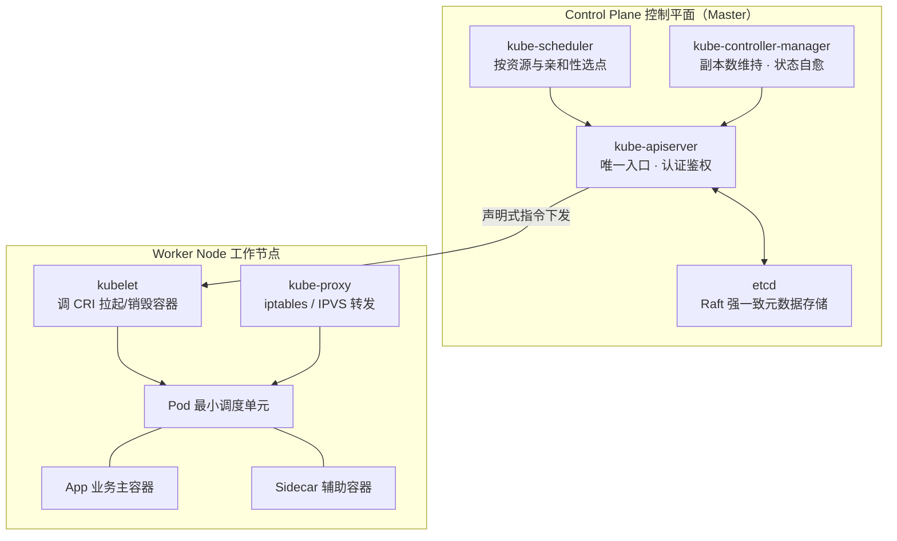
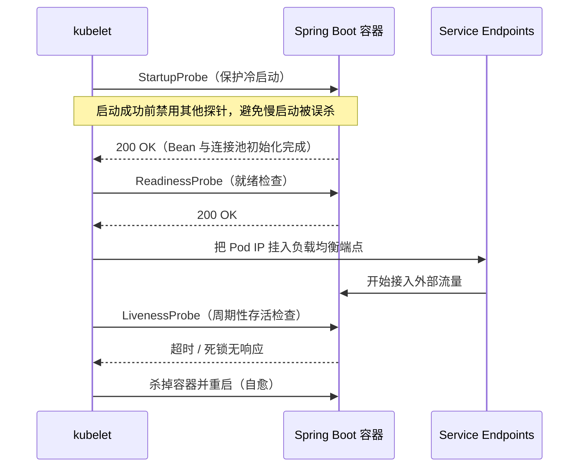
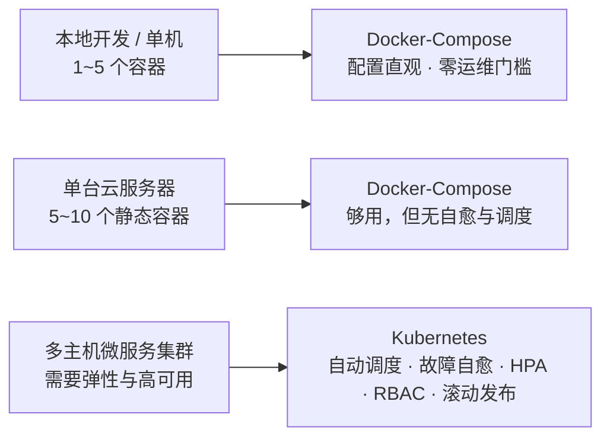

# K8s 生产级容器编排与核心架构全解

## 使用入口：先解决问题，再做验证

用声明式资源部署和维护多副本应用。

**先做基本操作**：先 apply 测试 Deployment/Service，查看 Pod、日志与访问，再学习控制面和调度。初次学习可先完成[本模块基础实践](/doc/DevOps/部署运维基本使用与故障排查)。

**再逐步深入**：基本 API 与输入输出 → 常见失败和使用边界 → 场景排查与优化 → 本文机制分析与源码。面试先讲用途和自己的操作过程，再回答场景与原理追问。

> **一句话看懂**：K8s 是一台「声明式状态机」——你把**期望状态**（几个副本、什么镜像、多少资源）写进 YAML 交给 API Server，控制器就不停比对**实际状态**并自动收敛。副本挂了自动拉起、节点满了自动换节点、版本更新自动交替替换，都源于这一件事。

## 🎯 核心技术原理与实战归纳

- **核心设问**：Kubernetes 整体架构由哪些核心组件构成？Control Plane 与 Worker Node 如何协同调度？
- **深水区追问**：Deployment 如何配合探针、容量和优雅终止降低滚动发布中断？LivenessProbe 与 ReadinessProbe 的区别是什么，为什么刚启动的 Spring Boot 容器经常被流量打死？Docker-Compose 与 K8s 的本质分水岭在哪里？

### 30 秒速览

| 你想问的 | 答案 | 深入阅读 |
| :--- | :--- | :--- |
| K8s 到底管什么 | 管「Pod 该跑在哪、跑几个、挂了怎么办」 | 本文第一节 |
| 最小单位是什么 | **Pod**（不是容器），Pod 内容器共享网络命名空间与存储卷 | 本文第二节 |
| 流量怎么找到 Pod | Service 提供固定入口，Ingress 提供集群 7 层统一网关 | [网络与存储体系全解](/doc/DevOps/K8s网络与存储体系全解) |
| 发版为什么不中断 | ReplicaSet 交替 + 探针做流量门禁 | [工作负载与发布策略实战](/doc/DevOps/K8s工作负载与发布策略实战) |
| 线上 Pod 起不来怎么查 | Pending / CrashLoopBackOff / OOMKilled 各有固定排查路径 | [生产治理与故障排查](/doc/DevOps/K8s生产治理与故障排查) |

---

## 一、架构全景：控制面与工作节点



**读图顺序**：所有写操作只经过 `kube-apiserver` → 状态只存 `etcd` → `scheduler` 负责挑节点、`controller-manager` 负责对齐副本数 → 指令落到节点上的 `kubelet` 真正拉起 Pod → `kube-proxy` 把 Service 虚拟 IP 转发到 Pod。

### 1. Control Plane 核心组件职责

| 组件 | 职责 | 挂了会怎样 |
| :--- | :--- | :--- |
| `kube-apiserver` | 集群唯一暴露入口，负责认证、鉴权、准入控制与 API 分发 | 集群不可管理，但**已运行的 Pod 不受影响** |
| `etcd` | Raft 强一致 KV 库，保存全量集群状态 | 集群失去状态，必须优先保证奇数节点高可用 |
| `kube-scheduler` | 依据 CPU/内存余量、亲和性/反亲和性、污点容忍度，为新 Pod 选节点 | 新 Pod 全部卡在 `Pending` |
| `kube-controller-manager` | 维护期望状态（副本控制器、节点故障检测等） | 副本挂了没人补，失去自愈能力 |

### 2. Worker Node 核心组件职责

- **kubelet**：每个节点上的 Agent，监听 API Server 指令，调用容器运行时（Containerd / CRI-O）拉起、监控、销毁容器。
- **kube-proxy**：维护节点上的网络规则（Linux `iptables` 或性能更高的 `IPVS`），实现 Service 虚拟 IP 到 Pod 的负载分发。
- **容器运行时**：K8s 1.24 起移除内置 Docker Shim，统一走 **CRI** 接口（Containerd 为主流），这是「K8s 不支持 Docker」这一说法的真实来源——不支持的是 dockershim，不是镜像格式。

---

## 二、核心对象速查

| 对象 | 定位 | 一句话记忆 |
| :--- | :--- | :--- |
| **Pod** | 最小调度与管理单元 | 同 Pod 内容器共享 IP、localhost 与存储卷 |
| **Deployment** | 无状态应用（Spring Boot、Vue Nginx） | 声明式扩缩容 + 滚动更新 + 秒级回滚 |
| **StatefulSet** | 有状态应用（MySQL、Redis、Kafka） | 固定网络标识 Pod-0/1 + 独立绑定的 PVC |
| **Service** | 一组 Pod 的固定访问抽象 | Pod 会漂移，Service IP 不变 |
| **Ingress** | 集群 7 层反向代理入口 | 域名、路径分发、TLS 卸载 |
| **ConfigMap / Secret** | 配置与密钥解耦 | 改配置不用重新打镜像 |
| **PV / PVC / StorageClass** | 存储与 Pod 生命周期解耦 | Pod 删了数据还在 |

> 更细的四类 Service、CNI 网络模型、PV/PVC 绑定流程见 [网络与存储体系全解](/doc/DevOps/K8s网络与存储体系全解)。

---

## 三、生命周期门禁：三大探针



| 探针 | 判定的是 | 失败后果 | 配错典型 |
| :--- | :--- | :--- | :--- |
| `startupProbe` | 应用是否已启动完成 | 不重启，只是阻止另两个探针生效 | 不配，慢启动应用被 liveness 反复杀 |
| `readinessProbe` | 能否**接流量** | 从 Service 端点摘除（不重启） | 配成查数据库，DB 抖动导致全副本被摘 |
| `livenessProbe` | 是否**需要重启** | 杀容器重建 | `initialDelaySeconds` 太短，冷启动期被误杀 |

**生产重大事故：Spring Boot 冷启动被流量打崩**
启动需 15~30 秒（加载 Bean、初始化连接池）。容器刚 Running 就接入高并发流量，应用尚未就绪 → 大量 502 / Connection Refused，CPU 打满宕机。正确组合是 `startupProbe` 兜住冷启动 + `readinessProbe` 控制流量准入，两者缺一不可。

---

## 四、生产级 Deployment & Service YAML（MVP）

```yaml
# backend-deployment.yaml
apiVersion: apps/v1
kind: Deployment
metadata:
  name: mall-order-service
  namespace: production
  labels:
    app: mall-order
spec:
  replicas: 3                         # 维持 3 个副本
  strategy:
    type: RollingUpdate
    rollingUpdate:
      maxSurge: 1                     # 更新期间最多多创建 1 个 Pod（允许 4 个）
      maxUnavailable: 0               # 更新策略不主动减少可用副本；仍需探针和终止保护
  selector:
    matchLabels:
      app: mall-order
  template:
    metadata:
      labels:
        app: mall-order
    spec:
      containers:
      - name: order-app
        image: registry.example.com/mall/order-service:v1.2.0
        imagePullPolicy: IfNotPresent
        ports:
        - containerPort: 8080
        resources:
          requests:
            cpu: "500m"
            memory: "512Mi"
          limits:
            cpu: "2000m"
            memory: "1024Mi"          # 超出触发 OOMKilled
        livenessProbe:
          httpGet:
            path: /actuator/health/liveness
            port: 8080
          initialDelaySeconds: 40
          periodSeconds: 10
        readinessProbe:
          httpGet:
            path: /actuator/health/readiness
            port: 8080
          initialDelaySeconds: 25
          periodSeconds: 5
        env:
        - name: SPRING_PROFILES_ACTIVE
          value: "prod"
        - name: DB_PASSWORD
          valueFrom:
            secretKeyRef:
              name: db-secret
              key: password
---
apiVersion: v1
kind: Service
metadata:
  name: mall-order-service
  namespace: production
spec:
  type: ClusterIP                     # 仅集群内部可访问
  selector:
    app: mall-order
  ports:
  - port: 8080
    targetPort: 8080
```

> 上面的清单缺了 `startupProbe`、`securityContext`、`preStop` 与 `terminationGracePeriodSeconds`，完整加固版见 [工作负载与发布策略实战](/doc/DevOps/K8s工作负载与发布策略实战)。

---

## 五、Docker-Compose vs Kubernetes：分水岭在哪



**本质区别不是「容器数量」，而是有没有「期望状态 + 控制器循环」**：Compose 是一次性把容器拉起来，起完就结束；K8s 持续比对并收敛状态，节点宕机后 Pod 会自动在别的节点重建。跨过这条线，才值得付 K8s 的运维复杂度。

---

## 六、进阶三篇

| 篇目 | 解决什么问题 |
| :--- | :--- |
| [K8s 工作负载与发布策略实战](/doc/DevOps/K8s工作负载与发布策略实战) | 四类控制器怎么选、滚动更新如何降低中断、探针完整加固 YAML、回滚命令 |
| [K8s 网络与存储体系全解](/doc/DevOps/K8s网络与存储体系全解) | 流量怎么进集群、Service 四类型、Ingress、CNI、PV/PVC/StorageClass、ConfigMap 热更新坑 |
| [K8s 生产治理与故障排查](/doc/DevOps/K8s生产治理与故障排查) | QoS 与 OOMKilled、调度三件套、HPA、RBAC、Pod 异常排查决策树 |
