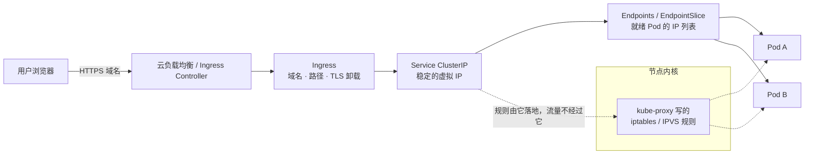
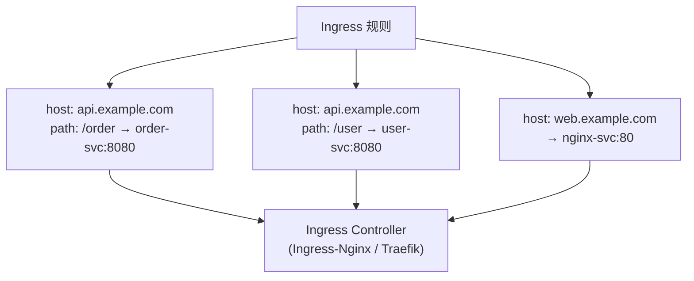
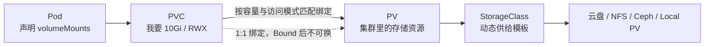

# K8s 网络与存储体系全解

## 使用入口：先解决问题，再做验证

让服务可访问并让数据跨 Pod 重建保留。

**先做基本操作**：先验证 Service、DNS、端口与 PVC 挂载，测试重建和外部访问，再追踪网络/存储路径。初次学习可先完成[本模块基础实践](/doc/DevOps/部署运维基本使用与故障排查)。

**再逐步深入**：基本 API 与输入输出 → 常见失败和使用边界 → 场景排查与优化 → 本文机制分析与源码。面试先讲用途和自己的操作过程，再回答场景与原理追问。

> **一句话看懂**：Pod 会随时漂移重建，所以需要 **Service 给一个永不变化的地址**、**Ingress 给集群一个统一入口**；Pod 里的数据会随容器销毁，所以需要 **PVC 把存储从 Pod 生命周期里解耦出来**。

## 30 秒速览

| 问题 | 答案 |
| :--- | :--- |
| 集群外请求怎么进到 Pod | `Ingress → Service → Endpoints → Pod` |
| 集群内服务怎么互相找到 | CoreDNS 解析 `服务名.命名空间.svc.cluster.local` |
| Service 的四类区别 | `ClusterIP`（内部）/ `NodePort`（节点端口）/ `LoadBalancer`（云厂商 LB）/ `ExternalName`（CNAME 到外部） |
| Service 真的在转发流量吗 | **不是**，它只是规则；真正转发的是 kube-proxy 写的 iptables / IPVS 规则 |
| 数据怎么不丢 | `Pod → PVC → PV → StorageClass → 实际存储` |
| 改配置要不要重启 Pod | ConfigMap 以环境变量注入**不会**热更新；挂载为文件会（但 `subPath` 不会） |

---

## 一、一条请求的完整路径



**最容易答错的一点**：Service 的 ClusterIP 是一个**虚拟 IP，ping 不通，也没有进程在监听**。它只是 kube-proxy 写进内核转发规则的一条记录；请求发到 ClusterIP 后被 DNAT 成某个真实 Pod IP。所以 `readinessProbe` 失败的 Pod 会被从 Endpoints 摘掉，本质就是不再被写进这条规则。

### kube-proxy 两种模式

| 模式 | 转发机制 | 复杂度 | 适用 |
| :--- | :--- | :--- | :--- |
| `iptables` | 逐条规则线性匹配，随机选后端 | O(n)，Service 上千后规则链变长、延迟上升 | 小集群（默认） |
| `IPVS` | 内核 LVS 哈希表，支持 rr/lc/dh/sh 等调度算法 | O(1) | **生产大集群**，Service/Pod 数量多 |
| `eBPF`（Cilium） | 绕过 iptables，sock 层直接转发 | 最优 | 高性能 / 服务网格场景 |

---

## 二、Service 四类型速查

| 类型 | 暴露范围 | 访问方式 | 典型用途 |
| :--- | :--- | :--- | :--- |
| `ClusterIP` | 仅集群内 | `svc-name.ns.svc.cluster.local:port` | **默认**，微服务间调用 |
| `NodePort` | 集群外可达 | `任意节点IP:30000-32767` | 临时调试、无云 LB 的裸机 |
| `LoadBalancer` | 公网 | 云厂商自动创建 LB 并指向 NodePort | 生产对外服务（每个 Service 一个 LB，贵） |
| `ExternalName` | 仅 DNS 层 | 返回 CNAME，如 `mysql.rds.aliyun.com` | 把集群外数据库映射成内部服务名 |

> 生产里通常**只开一个 LoadBalancer 给 Ingress Controller**，其余全用 ClusterIP，避免为每个服务单独买 LB。

```yaml
# Headless Service：StatefulSet 的固定 DNS 基石
apiVersion: v1
kind: Service
metadata:
  name: mysql
spec:
  clusterIP: None          # 不分配虚拟 IP，DNS 直接返回各 Pod IP
  selector: { app: mysql }
  ports:
  - port: 3306
```
配上 StatefulSet 后，`mysql-0.mysql.default.svc.cluster.local` 会稳定指向第 0 个副本，主从选举、数据分片都依赖这个稳定性。

---

## 三、Ingress：七层统一入口



```yaml
apiVersion: networking.k8s.io/v1
kind: Ingress
metadata:
  name: mall-gateway
  annotations:
    nginx.ingress.kubernetes.io/rewrite-target: /
    nginx.ingress.kubernetes.io/proxy-read-timeout: "60"   # SSE / 大文件上传常要调大
spec:
  ingressClassName: nginx
  tls:
  - hosts: [api.example.com]
    secretName: example-tls                               # TLS 在入口统一卸载
  rules:
  - host: api.example.com
    http:
      paths:
      - path: /order
        pathType: Prefix                                 # Prefix / Exact / ImplementationSpecific
        backend:
          service:
            name: mall-order-service
            port: { number: 8080 }
```

- **Ingress 只是规则声明，真正干活的是 Ingress Controller**（一个独立部署的 Pod）。没装 Controller，apply 了 Ingress 也不会有任何效果，这是新手最常见的困惑。
- `pathType: Exact` 是精确匹配；`Prefix` 按路径前缀，长路径优先。
- 新一代替代方案是 **Gateway API**（`Gateway` / `HTTPRoute`），把角色拆成基础设施提供方与业务方，表达能力更强；Ingress 目前已冻结特性，只做维护。

---

## 四、存储三层抽象



| 概念 | 谁创建 | 类比 | 关键点 |
| :--- | :--- | :--- | :--- |
| `PV` | 运维 / StorageClass 自动创建 | 一块已经格式化好的硬盘 | 集群级资源，不属于任何命名空间 |
| `PVC` | 业务方声明 | 「我要一块 10G 可读写的盘」 | 命名空间级，与 PV **1:1 绑定** |
| `StorageClass` | 运维 | 供给模板 | 有它才能**动态供给**，否则要手工预先建 PV |
| `emptyDir` | 随 Pod 创建 | 临时目录 | Pod 删除即清空，适合缓存 / 临时文件 |
| `hostPath` | 挂载宿主机路径 | 节点本地目录 | 强依赖节点，Pod 漂移后数据「不见了」，生产慎用 |

### 访问模式与回收策略

| 访问模式 | 含义 | 常见后端 |
| :--- | :--- | :--- |
| `RWO`（ReadWriteOnce） | 单节点读写 | 云硬盘（绝大多数块存储） |
| `ROX`（ReadOnlyMany） | 多节点只读 | 配置分发 |
| `RWX`（ReadWriteMany） | 多节点读写 | NFS / CephFS / 对象存储网关 |

```yaml
apiVersion: v1
kind: PersistentVolumeClaim
metadata:
  name: mysql-data
spec:
  accessModes: ["ReadWriteOnce"]
  storageClassName: alicloud-disk-ssd
  resources:
    requests: { storage: 100Gi }
---
# StatefulSet 用 volumeClaimTemplates 给每个副本自动建一个独立 PVC
apiVersion: apps/v1
kind: StatefulSet
metadata:
  name: mysql
spec:
  serviceName: mysql
  replicas: 3
  volumeClaimTemplates:
  - metadata: { name: data }
    spec:
      accessModes: ["ReadWriteOnce"]
      resources: { requests: { storage: 100Gi } }
```

- **PV 回收策略**：`Retain`（保留数据，生产数据库推荐）、`Delete`（随 PVC 删除云盘，危险）、`Recycle`（已废弃）。
- **PVC 删除 ≠ 数据立即消失**：`Retain` 下 PV 变成 `Released`，需要运维手工清理或复用。
- 数据库上 K8s 的争议点就在这里：需要 RWX/本地盘、备份、主从切换、有状态升级编排，复杂度远高于无状态服务。生产更常见的选择仍是**托管数据库 + K8s 只跑应用**。

---

## 五、ConfigMap / Secret 与热更新陷阱

| 注入方式 | 是否热更新 | 说明 |
| :--- | :--- | :--- |
| `env` / `envFrom` | **不更新** | 环境变量在进程启动时就固定了，必须重启 Pod |
| 挂载为文件（volume） | **会更新**（有延迟） | kubelet 周期性同步，通常 10~60s；应用需自己监听文件变化或重载 |
| 挂载时用了 `subPath` | **不更新** | subPath 挂载的是单个文件快照，符号链接不会更新，这是最隐蔽的坑 |
| `Secret` | 同 ConfigMap | 仅是 base64 编码，**不是加密**；生产应配合 KMS / Sealed Secrets / Vault |

```bash
# 改了 ConfigMap 想立刻生效，推荐用 checksum 注解触发滚动更新
kubectl patch deployment mall-order-service -n production \
  -p '{"spec":{"template":{"metadata":{"annotations":{"config-hash":"'$(kubectl get cm app-config -o yaml | sha256sum | cut -d" " -f1)'"}}}}}'
```

把配置内容的 hash 写进 pod template 的 annotation，配置一变 hash 就变，Deployment 自动触发一次滚动更新——这是让配置变更可靠生效的标准做法。

---

## 六、高频追问与回答要点

| 追问 | 高分特征 | 低分特征 |
| :--- | :--- | :--- |
| 「ClusterIP 能 ping 通吗？」 | 明确说是虚拟 IP、无进程监听，转发由 kube-proxy 的 iptables/IPVS 规则完成 | 答「能，它是个网卡」 |
| 「Ingress 和 Service 什么关系？」 | Ingress 管 7 层域名/路径，Service 管 4 层负载；且点出 Ingress 需 Controller 才生效 | 把两者都说成「负载均衡」 |
| 「Pod 重建后数据为什么还在？」 | 讲清 PVC 与 Pod 生命周期解耦、1:1 绑定 PV、StatefulSet 的 volumeClaimTemplates | 只答「用了持久化卷」 |
| 「ConfigMap 改了为什么没生效？」 | 分三种注入方式回答，并点破 `subPath` 不更新的坑 + checksum 触发滚动 | 只答「重启一下 Pod」 |
| 「Service 上千后变慢怎么优化？」 | iptables O(n) → IPVS O(1)，或上 eBPF/Cilium | 答「加机器」 |

> 架构总览见 [K8s 生产级容器编排与核心架构全解](/doc/DevOps/K8s生产级容器编排与核心架构全解)；发布与探针见 [工作负载与发布策略实战](/doc/DevOps/K8s工作负载与发布策略实战)；故障排查见 [生产治理与故障排查](/doc/DevOps/K8s生产治理与故障排查)。
