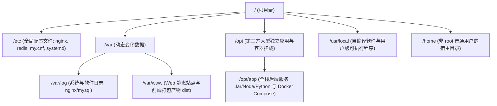

# Linux基础命令-文件目录权限管理与SSH免密登录全解

## 核心技术原理与实战归纳
- **核心设问与思考**：“登录一台全新的 Linux 云服务器，如何规范规划全栈项目的文件落地目录？为什么私钥文件权限必须严格设为 `400` 或 `600`，否则 SSH 会直接报错拒绝连接？`chmod 755` 与 `chmod 644` 背后的二进制位权到底是如何计算的？”
- **深水区追问**：“线上磁盘快满了，如何用一行 `find` 命令安全清理 7 天前的过期日志？当本地开发机无法直接访问内网生产 MySQL 时，如何通过 SSH 隧道（本地端口转发 `-L`）实现安全的本地 GUI 直连管理？”

---

## 一、 Linux 生产文件系统拓扑与全栈核心目录规划

Linux 采用单根树状虚拟文件系统（VFS），全栈工程师登录服务器后，必须清晰掌握核心系统目录的物理职责，杜绝将业务项目随意堆放在 `/root` 或根目录下：



### 1. 全栈生产环境目录落地推荐规约
- `/var/www/html/<project-name>/`：存放前端 Vue/React/UniApp 编译生成的静态网页资源（`dist/`）；
- `/opt/projects/<project-name>/`：存放后端 API 项目（Jar 包、Node.js 源码、`docker-compose.yml`、环境变量 `.env`）；
- `/var/log/<project-name>/`：业务软件专有日志输出目录；
- `/etc/nginx/conf.d/`：Nginx 子虚拟主机独立配置文件。

---

## 二、 文件与目录操作高频命令避坑实战

### 1. 浏览与空间辨识
```bash
# -l: 详细列表, -h: 人性化容量单位(KB/MB/GB), -a: 显示包含隐藏文件(如 .env, .git)
ls -lha /opt/projects

# 打印当前所在绝对物理路径
pwd

# 创建多级目录（-p: 自动递归创建缺失的父级目录，且已存在时不报错）
mkdir -p /opt/projects/shop-api/logs
```

### 2. 复制与移动（保留元属性）
```bash
# -r: 递归复制目录, -p: 保留文件修改时间、创建者、权限属性（极其重要！）
cp -rp /var/www/dist /var/www/dist_backup_$(date +%Y%m%d)

# 移动或重命名
mv /tmp/app.jar /opt/projects/shop-api/app.jar
```

### 3. 删除操作与“防误删自救防线”
在生产环境执行 `rm -rf` 属于 P0 级高危动作。建议规范如下：
```bash
# 严禁在生产执行: rm -rf / 或 rm -rf /* 或 rm -rf $DIR/ (变量未定义时等价于删根目录)

# 推荐姿势 1: 先进入目标目录，再做相对路径删除
cd /var/log/nginx && rm -f access.log.old

# 推荐姿势 2: 建立安全的别名防手抖（在 ~/.bashrc 中配置）
alias rm='rm -i'
```

---

## 三、 Linux 权限模型（rwx）与 chmod/chown 深度拆解

Linux 文件权限针对三类身份进行隔离：**所有者（User, u）**、**所属用户组（Group, g）** 和 **其他访客（Other, o）**。

### 1. 权限字符与八进制数值映射
每个身份拥有 3 个读写执行位：
- **`r`（Read，读取）**：数值 **4**（二进制 `100`）。对文件允许查看内容（`cat`）；对目录允许列出文件名（`ls`）；
- **`w`（Write，修改）**：数值 **2**（二进制 `010`）。对文件允许修改内容；对目录允许新建、重命名、删除内部文件（即使文件本身只读，只要目录有 w 权限依然可删！）；
- **`x`（Execute，执行）**：数值 **1**（二进制 `001`）。对文件允许当作程序运行（`./script.sh`）；对目录允许作为工作路径进入（`cd`）。

```text
-  r w x  r - x  r - -    1  www-data  www-data  4096  Nov 17 12:00  index.html
┬  ─────  ─────  ─────
│    │      │      │
│    │      │      └── 其他用户 (o): r-- = 4 (只读)
│    │      └──────── 所属组 (g):   r-x = 4 + 1 = 5 (读+进入)
│    └─────────────── 所有者 (u):   rwx = 4 + 2 + 1 = 7 (读写执行)
└──────────────────── 文件类型 (-: 普通文件, d: 目录, l: 软链接)
```

### 2. 全栈生产权限配置黄金法则
- **普通静态 Web 文件 / 配置文件**：权限设为 **`644`**（`rw-r--r--`，所有者可写，其他人只读）；
- **可执行目录**：权限设为 **`755`**（`rwxr-xr-x`，所有人可进可读，仅所有者可增删修改）；
- **生产敏感密钥文件（如 SSH 私钥、数据库凭据）**：权限严格设为 **`600`** 或 **`400`**（仅所有者可读写，任何组和其他人禁止访问，否则 SSH 会直接触发 `Permissions 0644 for 'id_rsa' are too open` 拒绝握手）；
- **绝对禁止全开权限**：严禁在生产执行 `chmod -R 777`！这是安全渗透的最直接切入点。

```bash
# 递归修改项目所有者为 Web 服务专用用户 www-data
chown -R www-data:www-data /var/www/dist

# 仅将所有文件设为 644，所有目录设为 755 的标准优雅写法:
find /var/www/dist -type f -exec chmod 644 {} +
find /var/www/dist -type d -exec chmod 755 {} +
```

---

## 四、 find 高级文件检索与批量自动化运维

线上服务持续运行数月后，日志容易堆满磁盘。`find` 是定位与批量清理大文件、过期日志的利器：

```bash
# 1. 查找 /var/log 下大于 500MB 的大文件
find /var/log -type f -size +500M -exec ls -lh {} \;

# 2. 查找 7 天前修改过的 .log 日志并安全删除
find /var/log/app -name "*.log" -type f -mtime +7 -exec rm -f {} \;

# 3. 查找过去 30 分钟内被修改过的所有配置文件（快速定位谁改动了线上生产）
find /etc -type f -mmin -30
```

---

## 五、 SSH 密钥免密登录与端口转发隧道实战

### 1. SSH 非对称加密免密登录原理
1. 本地客户端通过 `ssh-keygen` 生成一对公私钥（公钥 `id_rsa.pub`，私钥 `id_rsa`）；
2. 将公钥内容追加到云服务器目标用户的 `~/.ssh/authorized_keys` 中；
3. 客户端发起连接时，服务器生成一个随机字符串（Challenge）并用公钥加密发回；
4. 客户端用私钥解密并回传哈希签名，服务端校验成功后放行登录，全程无需明文密码。

```bash
# 1. 本地生成现代高强度 Ed25519 密钥对（推荐优于旧版 RSA）
ssh-keygen -t ed25519 -C "admin@company.com"

# 2. 一键将公钥分发至远程服务器
ssh-copy-id -i ~/.ssh/id_ed25519.pub root@123.56.78.90
```

### 2. 本地配置 `~/.ssh/config` 管理多台服务器
避免每次连接输入冗长的 `ssh root@123.56.78.90 -p 2222`，在本地 `~/.ssh/config` 维护别名：
```text
Host prod-server
    HostName 123.56.78.90
    User root
    Port 2222
    IdentityFile ~/.ssh/id_ed25519
    ServerAliveInterval 60
```
配置后终端直接执行：`ssh prod-server` 即可秒级免密登入。

### 3. SSH 端口转发（安全访问内网数据库的神技）
**场景痛点**：生产环境 MySQL 部署在阿里云专有网络 VPC 内（IP 为 `192.168.1.10:3306`），出于安全考虑严禁向外网暴露 3306 端口。本地开发人员如何用 Navicat 或 DBeaver 直连调试？

```bash
# 本地端口转发 (Local Port Forwarding: -L [本地端口]:[内网目标IP]:[内网目标端口])
ssh -N -L 33306:192.168.1.10:3306 root@123.56.78.90 -p 22
```
- 参数说明：`-N` 表示不执行远程 Shell（仅做转发）；`-L` 将本地虚拟端口 `33306` 经由公网跳板机安全加密通道打通到远程内网 `3306`；
- 此时本地数据库客户端只需连接 `127.0.0.1:33306`，流量即全链路高强度加密穿透至内网 MySQL！

---

## 六、 生产避坑防雷指南

1. **`.ssh/authorized_keys` 权限陷阱**：
   - 远程服务器上的 `~/.ssh` 目录权限必须为 **`700`**；
   - `~/.ssh/authorized_keys` 文件权限必须为 **`600`** 或 **`644`**；
   - 若所属目录对其他组有写权限，SSH 安全模块（StrictModes）将拒绝读取公钥导致免密失效！
2. **软链接（Symbolic Link）与硬链接（Hard Link）选型**：
   - `ln -s /opt/projects/v1.0.2 /opt/projects/current`：生产发版推荐使用**软链接**做原子切换（蓝绿发布），回滚仅需重新指向旧目录；
   - 硬链接不能跨越文件系统分区，且不能对目录创建硬链接。

---

## 七、 面试高频连环追问

### Q1: 目录的 `r` 权限和 `x` 权限有什么本质区别？若一个目录只有 `r` 没有 `x` 权限会发生什么？
**答**：
- 目录的 `r` 权限仅允许**读取该目录下的文件名清单**（即执行 `ls` 可以看到内部有哪些文件名字）；
- 目录的 `x` 权限代表**能够进入该目录并访问其内部文件的元数据与 inode 属性**（即能否执行 `cd` 进入该目录，以及能否 `ls -l` 查看文件的详细大小、权限和内容）；
- **实测表现**：若某目录权限为 `chmod 444 dir`（只有读无执行），用户执行 `ls dir` 能看到文件名，但所有文件的大小、权限全部显示为 `?`，且执行 `cd dir` 会直接抛出 `Permission denied`，更无法读取目录内的任何文件内容。

### Q2: 为什么从 GitHub 拷贝私钥到服务器后，执行 SSH 命令会报错 `Permissions 0644 for 'id_rsa' are too open`？
**答**：
SSH 协议要求私钥必须具备极高的私密性。如果私钥文件的权限是 `644`，意味着操作系统上的其他本地用户（Group 和 Other）都有权读取该私钥，可能导致密钥泄露。OpenSSH 客户端对此做了强制安全校验：一旦发现私钥文件权限非所有者可读或对其他人开放，会主动拒绝加载该私钥并中断连接。
**根治方法**：执行 `chmod 600 id_rsa`，使权限收敛为仅当前登录所有者可读写。
