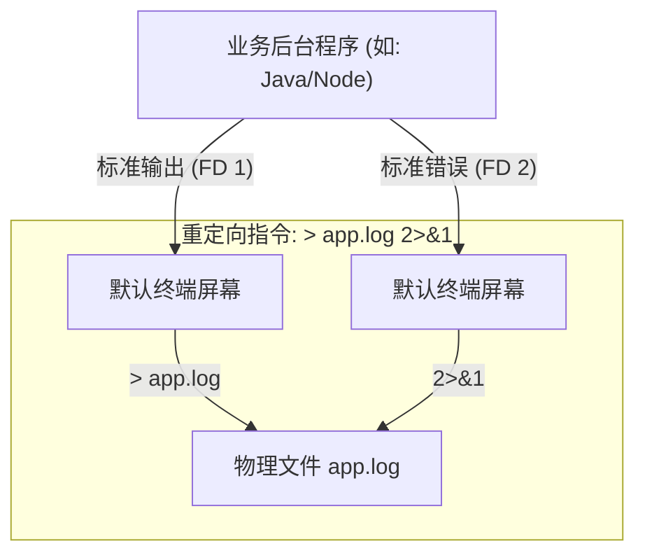

# Linux文本三剑客-grep-awk-sed生产日志过滤实战

## 核心技术原理与实战归纳
- **核心设问与思考**：“线上日志文件高达 10GB 时，为什么绝对严禁执行 `vim app.log`？如何用一行命令在数百万行日志中瞬间捕获包含 `Exception` 的异常，并提取其前后 10 行堆栈信息？”
- **深水区追问**：“网站突发流量暴增怀疑遭受 CC 攻击，如何用 `awk` 统计 Nginx 日志中请求频次 Top 10 的客户端 IP？执行 `nohup ./app > app.log 2>&1 &` 中，`2>&1` 的数字和符号到底在操作系统内核代表什么含义？”

---

## 一、 为什么生产环境严禁直接用 vim 打开大日志？

- **`vim` 的物理工作机制**：`vim` 打开文件时，会尝试将**整个文件的全部内容一次性分配并加载到物理内存**中，并建立交换文件（`.swp`）。面对几个 G 的日志文件，`vim` 会瞬间将云服务器内存吃光，直接触发 Linux 内核的 **OOM Killer** 强制杀死核心业务进程（如 MySQL 或 Java）；
- **正确姿势（基于流式 Stream 机制的三剑客）**：`grep`、`awk`、`sed` 以及 `tail`/`less` 采用**流式管道缓冲（Line-by-Line Streaming）**机制，每次仅在内存中驻留单行或小块缓冲区，处理 100GB 巨型日志内存占用也仅有几兆，绝对平稳安全。


---

## 二、 grep：精准检索与异常堆栈上下文捕获

`grep`（Global Regular Expression Print）是快速定位文本模式与排查异常的第一道防线。

### 1. 核心高频选项速查
| 选项 | 作用 | 生产高频使用场景 |
| :--- | :--- | :--- |
| **`-n`** | 显示匹配行的物理行号 | 精准定位错误出现在第几行，方便对照代码排查 |
| **`-i`** | 忽略英文字母大小写 | 匹配 `error`、`ERROR`、`Error` 全部变体 |
| **`-r` / `-R`** | 递归检索指定目录下的全部子文件 | 在数十个微服务日志目录中全局搜索 TraceId |
| **`-v`** | 反向匹配（排除包含指定字符的行） | 过滤掉大量的心跳日志或健康检查 `grep -v "health"` |
| **`-E`** | 启用扩展正则表达式（ERE） | 支持 `|`（或）逻辑，匹配多个关键词 |

### 2. 生产高频实战：捕获前后上下文堆栈（-A, -B, -C）
线上排查空指针或数据库异常时，仅定位到 `NullPointerException` 那一行毫无意义，必须连带捕获其上下游的方法调用栈：
```bash
# -A 10 (After): 匹配到关键词后，连带打印其后 10 行
# -B 5  (Before): 匹配到关键词前，连带打印其前 5 行
# -C 5  (Context): 匹配到关键词前后各打印 5 行（等价于 -A 5 -B 5）
grep -n -C 5 "NullPointerException" /var/log/app/spring.log

# 生产级：同时匹配多个严重错误并忽略大小写
grep -E -i -n -A 8 "error|exception|fatal|panic" /var/log/app/access.log | head -n 30
```

---

## 三、 awk：列格式化与日志数据统计神器

如果说 `grep` 擅长“按行找”，那么 `awk` 就是专门用来“**按列切分、聚合、计算与出报表**”的专业分析语言。

### 1. 核心内置变量与执行拓扑
`awk` 默认以**空格或制表符**作为列分隔符，将每行数据切分为多个字段：
- **`$0`**：代表当前整行原始文本；
- **`$1`, `$2`, `$3`...**：代表第 1 列、第 2 列、第 3 列；
- **`$NF`**：代表当前行的**最后一列**（NF = Number of Fields 字段总数）；
- **`NR`**：当前处理行的行号（Number of Record）。

### 2. 实战案例 1：分析 Nginx 日志统计攻击 IP Top 10
Nginx 标准访问日志格式：
```text
123.56.78.90 - - [17/Nov/2026:12:00:01 +0800] "GET /api/pay HTTP/1.1" 200 1024 ...
```
需求：从包含数百万行的 `access.log` 中找出请求频次最高的 10 个客户端 IP。
```bash
awk '{print $1}' /var/log/nginx/access.log | sort | uniq -c | sort -nr | head -n 10
```
- **步骤推导**：
  1. `awk '{print $1}'`：仅提取每行的第 1 列（客户端 IP）；
  2. `sort`：对提取出来的 IP 排序，使相同 IP 相邻；
  3. `uniq -c`：统计每个相邻唯一 IP 出现的次数并输出计数前缀；
  4. `sort -nr`：以纯数字（`-n`）逆序降序（`-r`）排列；
  5. `head -n 10`：截取前 10 个频次最高的 IP。

### 3. 实战案例 2：统计非 200 的异常 HTTP 状态码分布
```bash
# 假设状态码在 Nginx 日志中位于第 9 列
awk '$9 != 200 {print $9}' /var/log/nginx/access.log | sort | uniq -c | sort -nr
```

---

## 四、 sed：流编辑器与非交互式批量替换

`sed`（Stream Editor）擅长在不打开文件的情况下，**对文本进行自动化的增删改查与正则替换**。

### 1. 文本替换黄金语法：`s/原文本/新文本/g`
```bash
# 1. 预览替换结果（直接输出到终端，不修改原物理文件）
sed 's/http:\/\/localhost:8080/https:\/\/api.company.com/g' config.js

# 2. 原地修改文件（-i 表示 in-place 直接修改物理文件内容）
# 生产避坑铁律：执行 -i 时强烈建议带后缀自动备份！
sed -i.bak 's/DEBUG/INFO/g' /opt/app/application.yml
# 此时会原地修改 application.yml，并自动生成一份修改前的备份文件 application.yml.bak！
```

### 2. 截取指定行号区间的日志
```bash
# -n 抑制默认输出，1000,1050p 仅打印第 1000 行到 1050 行的内容
sed -n '1000,1050p' /var/log/app/app.log
```

---

## 五、 管道符与重定向：彻底搞懂 `2>&1` 的底层玄机

Linux 操作系统启动任何进程时，内核默认会为其打开三个标准文件描述符（File Descriptor, FD）：
- **`0`：标准输入（stdin）**，默认来自键盘；
- **`1`：标准输出（stdout）**，默认输出到终端屏幕；
- **`2`：标准错误（stderr）**，默认输出到终端屏幕。



### 1. 命令深度拆解：`nohup ./app > app.log 2>&1 &`
- **`nohup`**：忽略挂起信号（HUP），当开发者关闭 SSH 终端时进程不被操作系统终止；
- **`> app.log`**：等价于 `1 > app.log`，即将标准输出（FD 1）重定向写入 `app.log`；
- **`2>&1`**：
  - `2>` 表示重定向标准错误；
  - `&1` 表示**标准文件描述符 1 的物理引用**；
  - 含义为：“将标准错误（FD 2）也绑定并合并写入到标准输出（FD 1）所指向的 `app.log` 文件中”；
  - 若写成 `2>1`，操作系统会错误地在当前目录下创建一个名为 `1` 的物理文件并将错误写进去！
- **最后末尾的 `&`**：让整个命令行放入 Linux 后台异步运行。

---

## 六、 生产避坑防雷指南

1. **日志文件快速清空规约**：
   - 线上如果某个 `.log` 文件被程序持续持有文件句柄写入，**严禁执行 `rm -f app.log`**！因为如果文件被删除但进程未关闭该句柄，磁盘空间根本不会释放（产生 `deleted` 幽灵空间），且会导致程序写日志丢失；
   - **正确清空日志姿势**：
     ```bash
     # 使用黑洞重定向瞬间清空内容，同时保留原有文件 inode 与句柄
     > /var/log/app/huge.log
     # 或
     cat /dev/null > /var/log/app/huge.log
     ```
2. **`uniq` 前必须先 `sort`**：
   - `uniq` 的工作原理是比对**相邻行**。如果相同的数据分散在第一行和第一百行，单独执行 `uniq` 完全无法去重，必须形成 `sort | uniq -c` 组合拳。

---

## 七、 面试高频连环追问

### Q1: 如果线上有一个 50GB 的 access.log，如何快速提取今天中午 12:00 到 12:05 分之间的全部日志？
**答**：
结合 `sed` 的正则范围匹配或 `awk` 范围模式匹配流式提取，无需载入内存：
```bash
# 基于 sed 范围匹配（匹配起始时间点到结束时间点）
sed -n '/17\/Nov\/2026:12:00:00/,/17\/Nov\/2026:12:05:00/p' access.log > target_1200_1205.log
```
该命令会从首个匹配 `12:00:00` 的行开始持续流式输出，直到遇到 `12:05:00` 为止，耗时仅需数十秒，内存占用保持在几兆以内。

### Q2: 为什么 `nohup ./app > app.log 2>&1 &` 中，`> app.log` 必须写在 `2>&1` 的前面？反过来写会怎样？
**答**：
命令行解析是**从左向右严格按顺序进行文件描述符绑定**的：
- **正确顺序（`> app.log 2>&1`）**：
  1. 先将 FD 1（标准输出）重定向到 `app.log` 文件；
  2. 再将 FD 2（标准错误）复制并绑定到当前 FD 1 所指向的目标（即 `app.log`）；
  3. 最终两者都成功指向 `app.log`；
- **反过来写（`2>&1 > app.log`，错误）**：
  1. 首先执行 `2>&1`：此时 FD 1 依然指向默认的终端屏幕，因此 FD 2 也被绑定到了终端屏幕；
  2. 随后执行 `> app.log`：此时仅将 FD 1 重定向到了 `app.log`；
  3. **后果**：只有标准正常输出会写入 `app.log`，所有的错误信息（stderr）依然会被打印到屏幕上而无法被记录在文件中！
