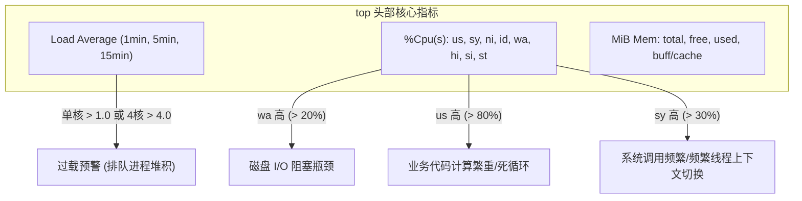

# Linux系统监控-top-htop-free-df-iostat性能分析

## 核心技术原理与实战归纳
- **核心设问与思考**：“收到报警短信‘服务器 Load Average > 4’，怎么结合物理 CPU 核心数判断系统是否真正超载？`free -m` 显示 free 只剩 50MB，系统真的发生内存泄漏了吗？为什么系统提示 `No space left on device`，但 `df -h` 显示磁盘明明还剩 100GB？”
- **深水区追问**：“在 `top` 视图中，`%Cpu(s)` 的 `us` 高、`sy` 高与 `wa` 高分别代表后端代码遭遇了什么类型的物理瓶颈？如何用 `iostat` 判定磁盘是否已经处于饱和打满状态？”

---

## 一、 top 与 htop：系统全景与 CPU/负载深度拆解

`top` 是 Linux 诊断系统整体运行健康度的首选入口。



### 1. Load Average（系统平均负载）黄金判定法则
- **物理定义**：在特定时间间隔内，处于**可运行状态（Running / Runnable，R 状态）**和**不可中断睡眠状态（Uninterruptible Sleep，D 状态，通常在等待磁盘 I/O）**的平均进程数；
- **核心对照标准（必须结合 CPU 物理总核数核算）**：
  - 查看服务器 CPU 逻辑总核数：`grep -c 'processor' /proc/cpuinfo`；
  - 若为 **4 核 CPU**：
    - Load = **2.0**：系统负载为 50%，运行流畅；
    - Load = **4.0**：系统刚好达到 100% 满载负荷，无排队积压；
    - Load = **8.0**：系统严重超载 100%，有大量进程在排队抢占 CPU 或阻塞等待磁盘！
  - **时序趋势判断**：对比 1 分钟、5 分钟、15 分钟的值。若 $1\text{min} > 5\text{min} > 15\text{min}$，说明负载正在急剧上升突刺；反之说明峰值已过，正在平稳回落。

### 2. %Cpu(s) 各关键指标的排错映射
- **`us`（User CPU time）**：用户态空间代码执行耗时百分比。若 `us` 居高不下（> 80%），表明**业务代码在执行复杂算法、密集的 JSON 序列化、正则表达式回溯或死循环**；
- **`sy`（System CPU time）**：内核态系统调用耗时。若 `sy` 过高（> 30%），表明系统频繁进行线程上下文切换（Context Switch）、大量的系统中断或过高并发的网络套接字收发；
- **`wa`（I/O Wait）**：CPU 等待磁盘 I/O 完成的时间。若 `wa` 飙升，说明 **CPU 正在干等磁盘写入，瓶颈绝对在磁盘 I/O（如慢 SQL 刷盘、大量无序小文件写入）**；
- **`id`（Idle）**：CPU 完全空闲的百分比。

### 3. top 必备交互快捷键
- **`P`**（大写）：按 **CPU 占用率** 降序排列（找高 CPU 消耗元凶）；
- **`M`**（大写）：按 **内存占用率** 降序排列（找高内存消耗元凶）；
- **`1`**（数字 1）：展开显示每一个独立 CPU 核心的负载状况；
- **`c`**：展开显示进程完整的命令行启动参数与绝对路径。

---

## 二、 free -m：彻底搞懂真实可用内存与 Buff/Cache

在终端执行 `free -m`（以 MB 为单位）时，典型输出如下：
```text
               total        used        free      shared  buff/cache   available
Mem:           15822        4120         128         120       11574       11250
Swap:           2047           0        2047
```

### 1. 为什么“`free` 接近 0”完全不等于内存不足？
- **Linux 内存设计哲学**：“空闲的物理内存就是极大的硬件浪费（Free memory is wasted memory）”；
- Linux 内核会尽可能地将系统中当前未被使用的空闲物理内存，借用来充当 **`buff/cache`（缓冲区和页缓存）**，用于加速磁盘文件读写；
- **自动释放回收机制**：一旦后台业务应用程序（如 Java 或 MySQL）需要向系统申请新的内存时，Linux 内核的内存回收守护进程（`kswapd`）会**毫秒级自动将 `buff/cache` 中的无用缓存无损释放**，重新转变为应用程序的堆内存！
- **全栈判定准则**：
  - **严禁看 `free` 字段**（图中仅剩 128MB）；
  - **必须看 `available` 字段**（图中高达 11250MB，约 11GB，说明真实可用内存极其充沛，系统非常健康！）。

### 2. Buffer 与 Cache 的物理本质差异
- **`Buffer`（缓冲区）**：用于**写操作**的暂存。将零碎的分散写入打包汇总，顺序批量刷写到磁盘块设备；
- **`Cache`（缓存区）**：用于**读操作**的加速。将从磁盘读取过的数据页缓存在内存的 Page Cache 中，下次读取直接命中内存，避免物理磁盘 I/O。

---

## 三、 df 与 du：磁盘空间暴满与 Inode 节点耗尽排查

当线上服务突然抛出 `No space left on device` 时，通常有两大物理诱因：**磁盘存储字节数（Blocks）耗尽** 或 **文件索引节点（Inode）耗尽**。

### 1. 维度一：物理存储容量排查（df -h 与 du）
```bash
# 1. 查看各个磁盘分区的空间使用率 (-h 人性化单位)
df -h

# 2. 定位根目录或挂载点下哪个文件夹占用了最多空间
du -sh /* 2>/dev/null | sort -hr | head -n 10
```

### 2. 维度二：Inode 节点耗尽排查（极具隐蔽性的线上灾难）
- **物理原理**：文件系统除了要为文件内容分配数据块，还必须为每个文件分配一个固定的元数据索引节点（Inode，记录文件权限、所有者、修改时间与数据块指针）。**磁盘创建分区时，Inode 的总数量是固定分配好的**；
- **现象**：执行 `df -h` 发现磁盘只用了 40%（还有几十上百 GB 空闲），但系统却无法创建任何新文件并报错 `No space left on device`！
- **排查与根除**：
  ```bash
  # 1. 检查各分区的 Inode 使用百分比 (-i)
  df -i
  # 若发现 IUse% 显示 100%，确诊为 Inode 耗尽！

  # 2. 统计哪个目录产生了海量微小碎片文件（通常是数百万个小缓存/临时 session/垃圾邮件）
  find /var/spool /tmp /var/cache -type d -size +1M
  ```

---

## 四、 iostat：磁盘 I/O 吞吐与物理瓶颈定位

`iostat`（属于 `sysstat` 工具包）是监测物理磁盘 I/O 是否达到硬件极限的核心工具。

```bash
# -x: 显示扩展详细指标, 1: 每隔 1 秒刷新一次, 5: 共采集 5 次
iostat -x 1 5
```

### 核心指标分析：
```text
Device    r/s     w/s     rkB/s     wkB/s  rrqm/s  wrqm/s  %rrqm  %wrqm   r_await   w_await   aqu-sz   %util
sda      12.00  350.00    120.0   15200.0    0.00   80.00   0.0%  18.6%      1.20     15.80     3.20   92.50
```
1. **`%util`（设备使用率）**：最重要的瓶颈指标！代表该磁盘在一秒内有多少比例的时间在执行物理读写。**若 `%util` 持续逼近 90%~100%，说明该磁盘物理寻道与吞吐已达极限，I/O 彻底饱和**；
2. **`r_await` 与 `w_await`**：读/写请求从排队到完成的平均耗时（毫秒）。现代 SSD 的耗时应在 1~5ms 左右，若 `w_await` 飙升至数十毫秒甚至几百毫秒，说明磁盘严重拥堵；
3. **`aqu-sz`（平均请求队列长度）**：等待处理的 I/O 请求数量。大于 2~3 表明积压严重。

---

## 五、 生产避坑防雷指南

1. **手动清理系统 Page Cache 的正确规范**：
   - 在内存极度紧张时，有些工程师习惯执行 `echo 3 > /proc/sys/vm/drop_caches` 清理缓存；
   - **高危禁忌**：在执行释放前，**必须先执行 `sync` 命令**，将内存中尚未刷盘的脏页数据强行同步落盘！否则可能导致未保存的文件数据丢失。同时清理缓存后磁盘 I/O 会瞬时出现剧烈抖动（因为随后的所有读取全部穿透到物理磁盘）。
2. **Swap 交换分区的设置建议**：
   - 生产环境建议将 Linux 内核参数 `vm.swappiness` 设为 `1` 或 `10`（默认通常是 60），指示内核优先保留物理内存，极力避免使用缓慢的磁盘 Swap 分区，杜绝 Java/Node 服务发生卡顿停顿。

---

## 六、 面试高频连环追问

### Q1: 某台服务器 Load Average 高达 20，但查看 CPU 使用率 `%Cpu(s)` 的 `id` 空闲率高达 85%，这是什么原因导致的？如何排查？
**答**：
- **根本原因**：Load Average 统计的是**处于 R 状态（可运行）**以及**处于 D 状态（不可中断睡眠状态）**的总进程数。
- 当 CPU 空闲（`id` 高）而 Load 极高时，说明系统中几乎没有进程在消耗 CPU 算力进行运算，而是**有海量的进程卡死在 D 状态（不可中断等待）中**！
- **典型场景**：
  1. 物理磁盘 I/O 发生严重阻塞或坏道（`%Cpu(s)` 的 `wa` 很高）；
  2. 挂载了远程网络共享文件系统（如 NFS/NAS），而远程网络中断或存储服务挂掉，导致访问该挂载目录的所有系统调用进程全部卡死在内核态等待响应；
- **排查手段**：执行 `ps -eo state,pid,cmd | grep "^D"`，瞬间揪出所有卡在 D 状态的进程及其对应的命令，快速解除网络挂载或重启故障存储。

### Q2: 磁盘空间告警 100%，执行了 `rm -f /var/log/app.log` 删除了 20GB 大文件，为什么 `df -h` 依然显示空间 100% 满载没有释放？
**答**：
- **物理机制**：Linux 下删除一个文件的本质是将其目录项（dentry）解除链接（引用计数减 1）。但只要**仍有正在运行的进程打开并持有该文件的文件描述符（FD）**，该文件的数据块（Data Blocks）就不会被操作系统物理回收！
- **排查命令**：
  ```bash
  lsof | grep deleted
  ```
  该命令会列出所有“已被标记删除，但仍被活跃进程句柄占用”的文件、进程 PID 与占用体积。
- **根除方法**：
  1. 重启持有该句柄的对应应用程序进程（如 `systemctl restart app`），进程退出后操作系统会自动物理回收空间；
  2. 若不能重启进程，可通过该进程的虚拟文件描述符瞬间清空内容释放磁盘空间：
     ```bash
     cat /dev/null > /proc/<PID>/fd/<FD_NUM>
     ```
