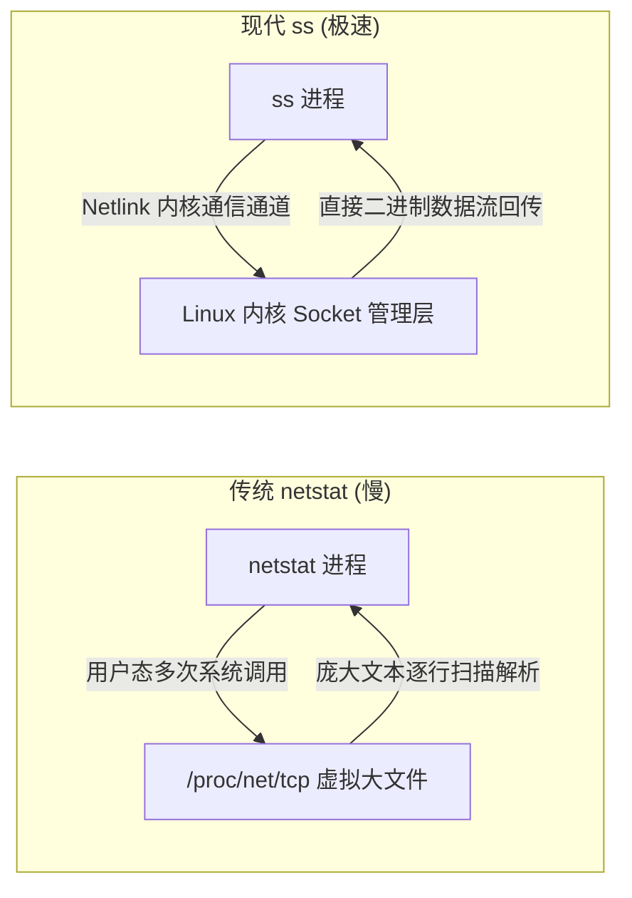

# Linux网络排障-netstat-ss-lsof-curl网络调试

## 核心技术原理与实战归纳
- **核心设问与思考**：“在高并发生产服务器上执行 `netstat -an` 为什么可能会导致全系统 CPU 飙升卡顿？执行 `ss -tlnp` 查看到的 `Send-Q` 与 `Recv-Q` 在监听（LISTEN）状态和连接建立（ESTABLISHED）状态下有何截然相反的物理含义？”
- **深水区追问**：“启动 Spring Boot 或 Node 服务频繁遇到 `Address already in use`，如何快速定位其父子进程？线上接口调用慢，如何使用 `curl` 的 `--write-out` 参数精确测量一个 HTTP 请求在 DNS 解析、TCP 握手、TLS 握手及首字节返回（TTFB）的阶段耗时？”

---

## 一、 ss 为什么彻底取代 netstat？底层内核机制对比

在早期 Linux 运维中，`netstat` 是网络连接排查的标配。但现代 Linux 发行版（Ubuntu 20.04+、CentOS 7+）已将 `netstat` 列为废弃工具（Deprecated），官方全面推荐使用 **`ss`（Socket Statistics）**。

| 对比维度 | 传统 `netstat` | 现代 `ss`（Socket Statistics） |
| :--- | :--- | :--- |
| **数据采集机制** | 遍历读取内核虚拟文件系统 `/proc/net/tcp`。 | 基于 Linux **Netlink 套接字机制**直接向内核空间发起高效交互。 |
| **高并发耗时性能** | 当系统存在数十万连接时，逐行扫描解析 `/proc` 文件会消耗数十秒并引发剧烈 CPU 抖动。 | 在内核直接完成数据流式抽取，数十万连接检索**毫秒级完成（快数十倍）**。 |
| **功能扩展** | 过滤功能弱，依赖管道 `grep` 过滤。 | 原生支持复杂的内置过滤表达式（按端口、状态直接过滤）。 |



---

## 二、 ss 高频排查实战与 Send-Q/Recv-Q 核心玄机

### 1. 核心常用选项：`-tlnp`
```bash
# -t: TCP协议, -l: 仅列出处于监听状态(LISTEN)的套接字, -n: 显示数字端口(不进行DNS反查), -p: 显示所属进程名与PID
ss -tlnp
```

典型输出解读：
```text
State      Recv-Q Send-Q   Local Address:Port    Peer Address:Port   Process
LISTEN     0      128      0.0.0.0:8080          0.0.0.0:*           users:(("java",pid=12345,fd=40))
LISTEN     0      511      127.0.0.1:6379        0.0.0.0:*           users:(("redis-server",pid=1024,fd=6))
```

### 2. 核心考点：Recv-Q 与 Send-Q 在不同状态下的物理含义
很多开发者以为 `Recv-Q` 始终是“接收缓冲区未读字节”，但在网络排查中，其含义由 `State` 决定：
- **当 Socket 处于 `LISTEN`（监听）状态时**：
  - **`Send-Q`**：代表该端口的全连接队列最大容量限制（Backlog 最大长度，受 `somaxconn` 与应用程序参数限制，如 128 或 511）；
  - **`Recv-Q`**：代表**当前全连接队列中正在排队等待应用进程调用 `accept()` 取走的连接数**！
  - **故障预警**：若处于 `LISTEN` 状态下的 `Recv-Q > Send-Q`（或持续接近最大值），说明**应用程序由于处理慢或卡死，无法及时 `accept` 新连接，客户端此时将发生大量连接超时或被丢弃（Drop）**！
- **当 Socket 处于 `ESTABLISHED`（已连接）状态时**：
  - **`Recv-Q`**：已由操作系统 TCP 栈接收但尚未被用户应用程序读取（`read()`）的字节数；
  - **`Send-Q`**：已发送但尚未收到对端 ACK 确认的字节数（或未发出的字节数）。

### 3. ss 高级原生过滤语法
```bash
# 1. 仅查看指定本地端口的监听情况
ss -tlnp sport = :8080

# 2. 统计系统中各个 TCP 状态的连接分布计数
ss -s

# 3. 筛选所有处于 TIME_WAIT 状态的连接
ss -tan state time-wait
```

---

## 三、 lsof -i：端口冲突秒级定位与僵死进程终结

在本地或服务器启动项目时，最常见的报错是：`java.net.BindException: Address already in use: bind`。

### 1. 快速精准定位霸占端口的进程
```bash
# 查看占用 8080 端口的进程详情
lsof -i :8080
```
典型输出：
```text
COMMAND   PID     USER   FD   TYPE DEVICE SIZE/OFF NODE NAME
java    12345 www-data   40u  IPv4 123456      0t0  TCP *:8080 (LISTEN)
```

### 2. 强行终止与清理
```bash
# 确认 PID 为 12345，执行优雅终止
kill 12345

# 若无响应，执行强制终结
kill -9 12345
```

---

## 四、 curl 现代全栈网络调试神技

`curl` 是全栈工程师在服务器上模拟 HTTP/HTTPS 请求、测试接口连通性与测量性能的瑞士军刀。

### 1. 核心基础选项速查
```bash
# 1. -I (仅拉取 HTTP 响应头，查看状态码、缓存头与 Server)
curl -I https://api.company.com/health

# 2. -v (Verbose 输出最详细的全链路过程: DNS解析IP、TCP三次握手、TLS协商证书)
curl -v https://api.company.com/users

# 3. -k (跳过不安全的自签名 SSL 证书校验)
curl -k https://192.168.1.10:8443/

# 4. 模拟 POST 发送 JSON 报文
curl -X POST https://api.company.com/order \
     -H "Content-Type: application/json" \
     -H "Authorization: Bearer my_token" \
     -d '{"order_id": "1001", "amount": 99.0}'
```

### 2. 高阶神技：一行命令精确测量 HTTP 请求全阶段耗时分布
全栈接口排错时，前端抱怨“接口耗时 2 秒”，到底是卡在 DNS、TCP 握手、TLS 握手还是后端业务逻辑计算慢？通过 `curl` 模板可实现毫秒级拆解：

```bash
curl -w "\n================ 链路耗时分析 ================\n\
DNS 解析耗时        (time_namelookup):   %{time_namelookup} 秒\n\
TCP 握手建立耗时    (time_connect):      %{time_connect} 秒\n\
TLS 安全协商耗时    (time_appconnect):   %{time_appconnect} 秒\n\
发送请求至首字节到达 (time_starttransfer):%{time_starttransfer} 秒\n\
HTTP 请求全生命周期 (time_total):        %{time_total} 秒\n\
==============================================\n" \
-o /dev/null -s https://api.company.com/orders
```
- **解读关键点**：
  - 若 `time_namelookup` 占了大半：说明内网或本地 DNS 服务器响应迟钝，需配置可靠的 DNS（如 `223.5.5.5`）；
  - 若 `time_connect` 很长：说明跨网络物理延迟高或防火墙丢包；
  - 若从 `time_appconnect` 到 `time_starttransfer`（即 **TTFB，Time To First Byte**）极长：**说明瓶颈 100% 在后端数据库查询或业务代码计算本身**！

---

## 五、 tcpdump：生产级网络抓包实战

在遇到跨服务调用网络丢包、连接被强行 Reset（RST）时，`tcpdump` 是最底层的真相还原工具。

```bash
# 1. 抓取网卡 eth0 上 8080 端口的所有 TCP 数据包 (-nn 显示数字IP与端口不反查，-v 详细)
tcpdump -i eth0 port 8080 -nn -v

# 2. 抓取与特定目标 IP 通信的数据包并写入文件供 Wireshark 分析
tcpdump -i any host 123.56.78.90 -w /tmp/capture.pcap
```

---

## 六、 生产避坑防雷指南

1. **`0.0.0.0` vs `127.0.0.1` 监听绑定避坑**：
   - 很多初级工程师在配置文件中把服务绑定在 `127.0.0.1:8080`，结果导致通过云服务器公网 IP 或同一内网其他机器无法访问；
   - **规则**：若希望外部公网或其他容器能够访问，服务必须绑定监听在 **`0.0.0.0:8080`**（代表绑定在宿主机的所有网络接口上）；
2. **防火墙与安全组双层防线**：
   - 云服务器排查网络不通时，必须依次核验两道门禁：
     1. **云厂商控制台安全组规则（Security Group）**：是否放行了对应协议与端口入方向；
     2. **操作系统本地防火墙（UFW / firewalld / iptables）**：是否拦截了连接。

---

## 七、 面试高频连环追问

### Q1: 在高并发场景下，执行 `ss -tlnp` 发现 80 端口的 `Recv-Q` 长期维持在一个较高数值，甚至等于 `Send-Q`，这是什么原因？如何根治？
**答**：
- **原因剖析**：处于 LISTEN 状态下的 `Recv-Q` 达到上限，说明 **TCP 全连接队列（Accept Queue）被打满溢出**。
  客户端发起的 TCP 三次握手已经由操作系统内核完成，内核将连接放入全连接队列后，等待应用程序调用 `accept()` 取走。如果应用程序的工作线程（如 Nginx Worker 或 Tomcat 线程池）全部被慢请求占满阻塞，无法及时调用 `accept()` 处理，全连接队列就会堆满并开始丢弃后续的 ACK 报文，导致客户端表现为连接超时；
- **排查根治**：
  1. 优化后端慢接口，释放应用处理线程；
  2. 调大操作系统的全连接队列参数：修改 `/etc/sysctl.conf` 中的 `net.core.somaxconn = 2048` 并执行 `sysctl -p`；
  3. 调大应用程序自身的 backlog 参数（如 Nginx 配置 `listen 80 backlog=2048;`）。

### Q2: 客户端连接服务端偶发报 `Connection reset by peer`，这与 `Connection refused` 在底层内核行为上有何不同？
**答**：
- **`Connection refused`**：客户端发送了 SYN 请求连接报文，但服务端的目标端口**没有任何进程在监听（端口未开启或进程已宕机）**。服务端内核的 TCP 栈直接向客户端回送一个 RST 报文中断连接；
- **`Connection reset by peer`**：双方**已经建立了正常的 TCP 连接**，但在随后的数据传输中，服务端的进程突然崩溃中断、主动调用了强制关闭（带有 `SO_LINGER` 配置）、或者网络链路上防火墙中途重置了连接，服务端直接强行发送了 RST 报文，导致客户端在执行读写时抛出此异常。
