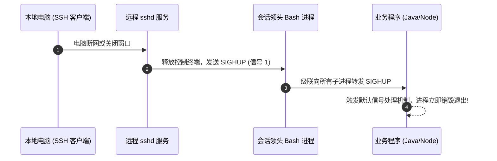

# Linux进程管理-后台运行nohup-tmux与Systemd服务守护实战

## 核心技术原理与实战归纳
- **核心设问与思考**：“在终端里启动了 Node.js 或 Java 服务，为什么一旦断开 SSH 连接或笔记本合上盖子，服务器上的程序就瞬间被杀了？内核发送的 **SIGHUP** 信号到底是如何级联传递的？”
- **深水区追问**：“`nohup`、`tmux` 与 `Systemd` 三者在全栈研发与生产运维中的选型边界是什么？如何手写一个工业级的 `.service` 文件，实现全栈后端服务的‘**崩溃 5 秒自动重启自愈**’、‘**开机无感自启**’以及‘**限制单进程物理内存上限**’？”

---

## 一、 为什么断开 SSH 终端，程序会被操作系统瞬间杀死？

### 1. 会话（Session）、控制终端与 SIGHUP 内核机制
在 Linux 操作系统中，进程是按**层级树状拓扑**管理的：
1. 当你通过 SSH 登录服务器时，系统为你分配一个伪终端（pty），并创建一个新的**会话（Session）**，启动一个 Bash Shell 作为该会话的领头进程（Session Leader）；
2. 当你在该 Shell 中直接运行 `node server.js` 时，该程序作为 Bash 的**子进程**运行在当前前台进程组中；
3. **断开终端灾难**：当你主动关闭 SSH 客户端窗口、网络断开或电脑睡眠时，SSH 守护进程（sshd）检测到连接中断，内核会向会话领头进程发送一个 **`SIGHUP`（Signal Hangup，挂断信号，信号编号为 1）**；
4. **级联诛杀**：Bash 接收到 `SIGHUP` 后，默认会将该信号广播转发给其创建的**所有子进程和关联进程组**。大多数应用程序没有显式捕获处理 `SIGHUP`，其默认行为就是**立即退出终止**！



---

## 二、 三大方案横向选型矩阵

| 工具方案 | 核心定位与设计初衷 | 进程崩溃能否自动拉起？ | 能否开机自动启动？ | 推荐适用场景 |
| :--- | :--- | :---: | :---: | :--- |
| **`nohup ... &`** | 纯命令行忽略 SIGHUP 信号，将进程放入后台。 | ❌ 否（挂了就真挂了） | ❌ 否（服务器重启即丢） | 临时运行耗时几十分钟的数据导出、单次脚本执行。 |
| **`tmux`** | 终端多路复用器，在操作系统内部维持持久的伪终端会话。 | ❌ 否 | ❌ 否 | **本地与远程日常开发调试**、实时看多服务日志（窗口分割）。 |
| **`Systemd`** | 现代 Linux 操作系统的绝对内核级服务管理器（PID 1）。 | ✅ **是（毫秒级自动拉起）** | ✅ **是（开机无感自启）** | **所有长期生产运行的核心后端服务**（API、工作流、自建组件）。 |

---

## 三、 nohup：轻量级后台运行

`nohup`（No Hangup）的核心功能就是**告诉操作系统忽略对该程序发出的 `SIGHUP` 信号**，即使父进程退出，该进程会被系统的 `systemd`（PID 1）收养成为孤儿守护进程，继续平稳运行。

```bash
# 生产标准写法：重定向标准输出与标准错误并放入后台
nohup java -Xms512m -Xmx1024m -jar /opt/app/api.jar > /var/log/app/api.log 2>&1 &

# 查看后台任务的 PID
echo $!
```

---

## 四、 tmux：全栈开发必备的终端复用器神技

`tmux` 的核心价值在于：**把“终端会话”从网络连接中彻底剥离出来，寄宿在服务器后台**。你在里面开着日志监控、编辑代码，只要不主动关闭，哪怕断开 SSH 一万次，下次重新连上后执行 `tmux attach`，窗口、光标、命令历史**如同从未离开过一样完整复原**！

### 1. 核心极简工作流
```bash
# 1. 创建并进入一个名为 dev 的独立会话
tmux new -s dev

# 2. 在 tmux 内部随意启动你的项目或跑长任务:
# npm run dev 或 python train.py

# 3. 分离并挂起会话 (Detach): 
# 按下快捷键: Ctrl + b，松开后紧接着按 d 键
# 此时终端提示 [detached]，你已安全返回普通命令行，可随时安全关闭电脑！

# 4. 下次重新登录服务器后，一键恢复现场 (Attach):
tmux attach -t dev

# 5. 查看当前后台所有运行的 tmux 会话
tmux ls

# 6. 彻底销毁不需要的会话
tmux kill-session -t dev
```

---

## 五、 Systemd：生产级守护进程工业化落地实战

在真实生产环境下，严禁直接使用 `nohup` 运行生产服务。必须交由系统的 **Systemd** 进行统一生命周期托管。

### 1. 手写工业级 Service 配置文件
假设我们在 `/opt/projects/shop-api` 下有一个 Node.js 或 Java 编写的后端服务，创建专属服务文件：
```bash
sudo vim /etc/systemd/system/shop-api.service
```

写入标准规范配置：
```ini
[Unit]
Description=Shop API Backend Production Service
Documentation=https://api.company.com/docs
# 依赖网络服务与时间同步就绪后才启动
After=network.target network-online.target
Wants=network-online.target

[Service]
Type=simple
# 核心安全规范：使用专门的非 root 普通系统用户运行，隔离越权风险
User=www-data
Group=www-data

# 指定服务的工作目录与启动命令（绝对路径）
WorkingDirectory=/opt/projects/shop-api
ExecStart=/usr/bin/node /opt/projects/shop-api/server.js
# 若为 Java 服务示例:
# ExecStart=/usr/bin/java -Xms512m -Xmx1024m -jar /opt/projects/shop-api/app.jar

# 优雅停机信号 (默认 SIGTERM)
KillSignal=SIGTERM
TimeoutStopSec=30s

# 【核心自愈特性】进程意外崩溃时自动重启！
Restart=always
# 崩溃后等待 5 秒再自动拉起，避免瞬间无限死循环重试
RestartSec=5s

# 【核心资源限制】限制该进程物理内存上限为 1.5GB，超出直接被操作系统限制，防止撑爆整台云主机
MemoryMax=1536M

# 环境变量注入
Environment=NODE_ENV=production
Environment=PORT=8080

[Install]
# 允许多用户模式下随系统开机自启
WantedBy=multi-user.target
```

### 2. Systemd 生产管理指令全集
```bash
# 1. 新建或修改 .service 文件后，必须让 systemd 重新加载配置字典！
systemctl daemon-reload

# 2. 启动服务并设置为开机自启（--now 表示立即启动并同时使能自启）
systemctl enable --now shop-api

# 3. 查看服务运行状态与近期的崩溃/启动日志
systemctl status shop-api

# 4. 重启与停止
systemctl restart shop-api
systemctl stop shop-api
```

### 3. 日志追踪：配合 journalctl 实时排错
由 Systemd 托管的进程，其标准输出和错误会自动汇聚到 Linux 系统的统一日志组件 `systemd-journald` 中：
```bash
# -u 指定单元名称, -f 类似 tail -f 实时滚动跟踪, -n 100 查看最新 100 行
journalctl -u shop-api -f -n 100

# 仅查看今天以来的错误日志 (-p err)
journalctl -u shop-api --since today -p err
```

---

## 六、 生产避坑防雷指南

1. **Systemd 中的绝对路径铁律**：
   - 在 `.service` 文件的 `ExecStart` 指令中，**执行程序和文件路径必须写绝对路径**（如 `/usr/bin/node`，不能直接写 `node`）！因为 Systemd 不会加载普通用户的 `~/.bashrc` 中的环境变量 PATH。
   - 可通过 `which node` 或 `which java` 获取二进制执行文件的绝对路径。
2. **`Restart=always` 与健康退出的区分**：
   - 若配置 `Restart=on-failure`：表示仅在进程异常退出（返回退出码非 0 或被信号强杀）时才自动重启；如果是管理员手动执行 `systemctl stop`（返回退出码 0），Systemd 不会再次重启它。这是防止“想关却关不掉”的标准配置。

---

## 七、 面试高频连环追问

### Q1: 在生产环境中，为什么不能直接使用 root 用户运行 Web 业务服务？Systemd 是如何做安全权限隔离的？
**答**：
- **安全风险**：如果以 `root` 用户运行 Web 服务（如 Node/Java/Python），一旦应用存在远程代码执行（RCE）或任意文件上传漏洞，黑客拿到的就是宿主机的顶级最高权限 `root`，可以随意植入挖矿木马、修改 `/etc/shadow` 或擦除全盘数据；
- **Systemd 安全收敛**：
  在 `.service` 文件中通过配置 `User=www-data` 和 `Group=www-data`，Systemd 会在底层调用 `setuid()` 系统调用将进程权限彻底降级为受限普通用户。即使服务被渗透攻破，黑客也无法读取其他系统目录和凭证，极大收敛了爆炸半径。

### Q2: 什么是僵尸进程（Zombie Process）？它们占用物理内存吗？如何定位与清理？
**答**：
- **概念成因**：子进程已经运行完毕退出，其占用的代码段、数据段和物理内存已经被操作系统释放收回；但其父进程**没有调用 `wait()` 或 `waitpid()` 读取子进程的退出状态信息**，导致该子进程在操作系统进程表（Process Table）中仍然保留了一个由其 PID 和退出码构成的槽位（Task Struct），此时该子进程处于 `Z`（Zombie）状态；
- **内存占用**：僵尸进程**不占用任何物理内存和 CPU 资源**！但如果系统中产生大量僵尸进程，会霸占宝贵且有限的 **PID 进程号资源**（Linux 系统默认最大 PID 数量为 32768），导致系统无法创建任何新进程并报错 `fork: Resource temporarily unavailable`；
- **清理方案**：
  由于僵尸进程本身已经死亡，执行 `kill -9 <Zombie_PID>` 完全无效！**必须找到并杀死该僵尸进程的“父进程（Parent PID）”**，父进程死后，僵尸进程会被系统的 `PID 1`（Systemd）领养并自动调用 `wait()` 彻底收尸注销。
