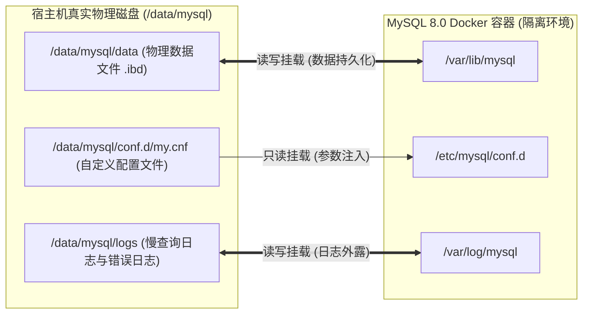

# MySQL-Docker容器化运维数据持久化与自动备份

## 核心技术原理与实战归纳
- **核心设问与思考**：“直接运行 `docker run -d mysql` 上线有多危险？如何通过数据卷挂载保证容器销毁重建时底层业务数据 100% 物理完好？如何通过挂载自定义 `my.cnf` 彻底根除 `utf8mb4` 字符集乱码与默认时区慢 8 小时的问题？”
- **深水区追问**：“宿主机本身没有安装任何 MySQL 客户端工具，如何通过 `docker exec` 结合 Linux Crontab 定时器，在每天凌晨 02:00 自动完成非阻塞逻辑全备、Gzip 压缩并自动轮转清理 30 天前的陈旧归档？”

---

## 一、 MySQL 8.0 容器化生产部署标准物理拓扑

在生产环境中运行 MySQL 容器，**必须严格遵循“配置、数据、日志三态物理外挂”**原则，严禁将任何持久化数据存放在容器临时可写层中：



---

## 二、 生产级 Docker Run 单机部署标准实战

### 1. 宿主机准备目录与权限
```bash
# 创建专门的持久化宿主目录
sudo mkdir -p /data/mysql/{data,conf.d,logs}

# 赋权（MySQL 容器内部的 mysql 用户 UID 通常为 999）
sudo chown -R 999:999 /data/mysql/data /data/mysql/logs
```

### 2. 准备自定义生产配置文件：`/data/mysql/conf.d/my.cnf`
```ini
[mysqld]
# 基础连接与线程池
default_authentication_plugin=mysql_native_password
max_connections = 1000
max_connect_errors = 1000
wait_timeout = 600
interactive_timeout = 600

# 【核心防乱码规约】强制使用 utf8mb4 (全面兼容 Emoji 表情与生僻字)
character-set-server = utf8mb4
collation-server = utf8mb4_unicode_ci

# 【核心时区同步】强制设置为东八区北京时间 (彻底根治写入时间慢 8 小时)
default-time-zone = '+08:00'

# 缓冲池调优 (单机独立服务器建议设为物理总内存的 60%~75%)
innodb_buffer_pool_size = 2G
innodb_log_buffer_size = 32M
innodb_flush_log_at_trx_commit = 1
sync_binlog = 1

# 慢查询日志追踪
slow_query_log = 1
slow_query_log_file = /var/log/mysql/slow.log
long_query_time = 1.0
log_error = /var/log/mysql/error.log

[client]
default-character-set = utf8mb4

[mysql]
default-character-set = utf8mb4
```

### 3. 执行生产级容器启动指令
```bash
docker run -d \
  --name prod-mysql \
  --restart=unless-stopped \
  -p 127.0.0.1:3306:3306 \
  -e MYSQL_ROOT_PASSWORD='YourStrongRootPassword_2026!' \
  -e TZ=Asia/Shanghai \
  -v /data/mysql/data:/var/lib/mysql \
  -v /data/mysql/conf.d:/etc/mysql/conf.d:ro \
  -v /data/mysql/logs:/var/log/mysql \
  mysql:8.0
```
- **安全防雷注意**：`-p 127.0.0.1:3306:3306` 仅允许宿主机本地回环访问，**严禁使用 `-p 3306:3306` 直接向公网暴露**，防止被黑产扫描撞库勒索！

---

## 三、 自动化定时备份与日志轮转 SOP（全栈生产核心）

全栈运维最关键的安全底线：**数据库每天必须自动执行冷备或热备，且备份文件必须自动压缩归档**。
即使宿主机没有安装 `mysqldump`，我们也完全可以**借用容器内部自带的工具**在宿主机上生成归档文件！

### 1. 编写生产级备份脚本：`/opt/scripts/backup_mysql.sh`
```bash
#!/bin/bash
# ========================================================
# 生产 MySQL 自动化定时逻辑备份与轮转脚本
# ========================================================

# 配置参数
CONTAINER_NAME="prod-mysql"
DB_USER="root"
DB_PASS="YourStrongRootPassword_2026!"
BACKUP_DIR="/data/mysql/backups"
DATE_STR=$(date +%Y%m%d_%H%M%S)
BACKUP_FILE="${BACKUP_DIR}/full_backup_${DATE_STR}.sql.gz"
LOG_FILE="${BACKUP_DIR}/backup.log"

# 创建备份目录
mkdir -p ${BACKUP_DIR}

echo "[$(date '+%Y-%m-%d %H:%M:%S')] 开始执行 MySQL 自动全量逻辑备份..." >> ${LOG_FILE}

# 【核心备份指令】通过 docker exec 在容器内执行 mysqldump，在宿主机端通过 gzip 流式压缩落盘
# --single-transaction: 对 InnoDB 引擎执行一致性快照读，全程不锁表、业务无感！
# --quick: 强制行级流式拉取，防止大表撑爆内存
# --routines --triggers --events: 完整备份存储过程、触发器与事件
docker exec ${CONTAINER_NAME} mysqldump \
  -u${DB_USER} \
  -p${DB_PASS} \
  --single-transaction \
  --quick \
  --routines \
  --triggers \
  --events \
  --all-databases \
  2>> ${LOG_FILE} | gzip > ${BACKUP_FILE}

# 检查执行状态码
if [ $? -eq 0 ] && [ -s ${BACKUP_FILE} ]; then
    echo "[$(date '+%Y-%m-%d %H:%M:%S')] 备份成功! 文件: ${BACKUP_FILE}, 大小: $(du -h ${BACKUP_FILE} | awk '{print $1}')" >> ${LOG_FILE}
else
    echo "[$(date '+%Y-%m-%d %H:%M:%S')] 【严重错误】MySQL 自动备份执行失败，请速排查!" >> ${LOG_FILE}
    exit 1
fi

# 【自动生命周期轮转】自动扫描并安全删除 30 天前的历史陈旧备份压缩包，防止堆满磁盘
find ${BACKUP_DIR} -name "full_backup_*.sql.gz" -type f -mtime +30 -exec rm -f {} \;
echo "[$(date '+%Y-%m-%d %H:%M:%S')] 已完成 30 天前过期备份文件自动清理." >> ${LOG_FILE}
```

### 2. 配置 Linux Crontab 定时器
```bash
# 1. 赋予脚本执行权限
chmod +x /opt/scripts/backup_mysql.sh

# 2. 编辑当前用户的定时任务
crontab -e

# 3. 追加以下行: 每天凌晨 02:30 分自动静默执行备份
30 2 * * * /opt/scripts/backup_mysql.sh >/dev/null 2>&1
```

---

## 四、 灾难恢复演练 SOP（从备份还原数据库）

当线上发生误删表数据或数据库彻底损毁时，如何从 `.sql.gz` 备份快速完成无损恢复：

```bash
# 步骤 1: 确定要恢复的备份文件 (例如 full_backup_20261117_023000.sql.gz)
BACKUP_TAR="/data/mysql/backups/full_backup_20261117_023000.sql.gz"

# 步骤 2: 通过 gunzip 流式解压并通过管道喂入 docker exec 容器恢复
gzip -dc ${BACKUP_TAR} | docker exec -i prod-mysql mysql -uroot -pYourStrongRootPassword_2026!

# 步骤 3: 恢复完成校验
docker exec -it prod-mysql mysql -uroot -pYourStrongRootPassword_2026! -e "SHOW DATABASES; SELECT COUNT(*) FROM my_db.users;"
```

---

## 五、 生产避坑防雷指南

1. **容器内部权限拒绝 `Permission denied` 陷阱**：
   - 当把宿主机的新目录挂载到容器的 `/var/lib/mysql` 时，MySQL 容器启动可能崩溃报 `chown: changing ownership of '/var/lib/mysql': Permission denied`；
   - **根本原因**：MySQL 官方镜像内部是使用内置普通用户 `mysql`（UID 固定为 `999`）运行的。如果宿主机目录是由 `root` 创建且权限仅为 755，容器内的 `mysql` 用户没有写权限；
   - **根除方法**：启动前在宿主机执行 `sudo chown -R 999:999 /data/mysql/data`。
2. **`mysqldump` 警告与 `--single-transaction` 必加**：
   - 生产环境对生产库执行逻辑备份，**必须显式加上 `--single-transaction`**！
   - 若不加该参数，`mysqldump` 默认会执行 `LOCK TABLES`，对全库施加全局读锁，导致备份期间系统内**所有的下单、支付等写入事务全部卡死超时崩溃**！加上该参数后，基于 InnoDB 的 MVCC 快照读，实现 100% 线上零锁无感备份。

---

## 六、 面试高频连环追问

### Q1: 在使用 Docker 运行 MySQL 容器时，如果将宿主机的同一个数据卷挂载给两个并发运行的 MySQL 容器，会发生什么？为什么？
**答**：
- **灾难性后果**：会导致数据库物理文件发生严重的**数据错乱与底层 Page 损坏，两台容器最终均会因为段错误（Crash）崩溃**！
- **底层原理**：
  InnoDB 存储引擎在设计上假设它对底层的物理数据文件（`.ibd` 和 `ibdata1`）拥有**绝对排他的独占访问权**。InnoDB 依靠内存中的 Buffer Pool 维护脏页，并在自身进程内部维护文件锁、内存锁与 Redo Log LSN 序列号。如果两个独立的 MySQL 实例同时读写同一份物理文件，由于两者内存不互通，各自向磁盘覆写相同的数据页块，导致文件校验和（Checksum）完全错乱，直接报物理断裂崩溃。

### Q2: 既然已有基于 `mysqldump` 的全量备份，为什么高要求的金融级生产系统还需要开启 Binlog 增量归档？
**答**：
- **全量逻辑备份的 RPO 缺陷**：
  全量备份通常是一天执行一次（如每天凌晨 02:00）。如果数据库在当天下午 16:00 突然发生硬盘损毁，如果仅依赖全量备份恢复，**从凌晨 02:00 到下午 16:00 之间的整整 14 个小时的所有业务增量数据将全部永久丢失（RPO = 14小时）**！
- **Binlog 增量配合实现秒级恢复（PITR）**：
  开启 Binlog 后，所有发生在全量备份之后的新增、修改、删除 SQL 事务全部实时按顺序记录在 Binlog 文件中。灾难发生时，先通过凌晨的全量备份恢复出基础骨架，再利用 `mysqlbinlog --start-datetime` 重放当天 02:00 到 16:00 之间的全部增量日志，实现**数据零丢失、精准恢复到事故发生前一秒的任意时间点（Point-in-Time Recovery）**。
