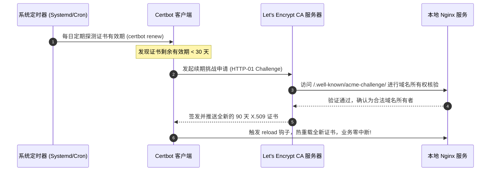
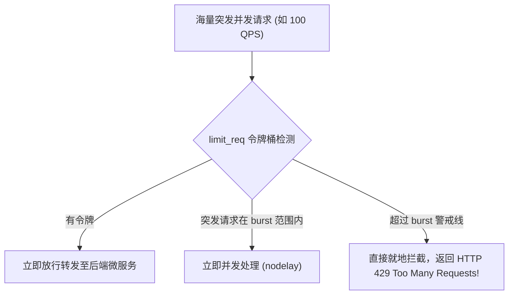

# Nginx-SSL证书自动化Let's-Encrypt与限流防刷

## 核心技术原理与实战归纳
- **核心设问与思考**：“商业 SSL 证书动辄数千元且每年需手动更换，如何通过 Certbot 实现 Let's Encrypt 免费证书的‘一次配置、终生全自动轮换续期’？如何将 80 端口的所有流量以 301 永久重定向标准无缝切换至 HTTPS 443 并开启 HTTP/2？”
- **深水区追问**：“当黑产团队利用脚本每秒数千次恶意刷你的短信验证码或下单接口时，如何在流量穿透打垮后端数据库之前，直接在 Nginx 接入层利用 **`limit_req`（令牌桶算法）** 瞬间实施毫秒级封杀并返回 HTTP 429？”

---

## 一、 Let's Encrypt 免费 SSL 证书与 Certbot 自动续签实战

[Let's Encrypt](https://letsencrypt.org/) 是由国际顶级开源组织维护的免费、自动化数字证书认证机构（CA）。其签发的证书有效期固定为 90 天，官方推荐通过 **Certbot** 自动化工具实现每 60 天自动静默续签，彻底杜绝证书到期业务瘫痪的惨剧。



### 1. Certbot 一键申请实战（Ubuntu / Debian 标杆步骤）
```bash
# 1. 安装 Certbot 与 Nginx 插件 (推荐使用官方推荐的 snap)
sudo snap install core && sudo snap refresh core
sudo snap install --classic certbot
sudo ln -s /snap/bin/certbot /usr/bin/certbot

# 2. 一键自动扫描 Nginx 配置、申请证书并自动注入 SSL 配置:
sudo certbot --nginx -d api.company.com -d www.company.com
```

### 2. 演练与验证自动续签机制
Certbot 会在系统后台自动注入 Systemd 定时器（`certbot.timer`）。我们可通过模拟干跑（Dry Run）验证全流程链路：
```bash
# 模拟执行一次自动续订，验证网络握手与 Nginx 重载逻辑
sudo certbot renew --dry-run
```
只要输出中显示 `Congratulations, all simulated renewals succeeded`，即可彻底高枕无忧。

---

## 二、 生产级 HTTPS 与 TLS 1.3 加密标准模板

很多团队的 SSL 配置停留在十年前，依然开启着被淘汰的不安全老旧协议（如 TLS 1.0/1.1），存在巨大的安全审计合规漏洞。以下为符合 Mozilla 现代安全标准的工业级配置：

```nginx
# 1. 强制 80 端口 HTTP 请求以 301 永久重定向跳转至 HTTPS
server {
    listen 80;
    listen [::]:80;
    server_name api.company.com;

    # 301 永久重定向，保留原始 URI 和全部查询参数
    return 301 https://$host$request_uri;
}

# 2. 核心 443 端口 HTTPS 虚拟主机
server {
    # 启用 SSL 并开启 HTTP/2 协议支持 (提升多路复用与并发传输性能)
    listen 443 ssl http2;
    listen [::]:443 ssl http2;
    server_name api.company.com;

    # 证书与私钥的物理路径
    ssl_certificate /etc/letsencrypt/live/api.company.com/fullchain.pem;
    ssl_certificate_key /etc/letsencrypt/live/api.company.com/privkey.pem;

    # 【核心安全协议规约】严禁开启 SSLv2/SSLv3/TLSv1.0/TLSv1.1，仅放行现代最高安全协议
    ssl_protocols TLSv1.2 TLSv1.3;

    # 配置现代加密套件，禁用弱密钥加密算法
    ssl_ciphers ECDHE-ECDSA-AES128-GCM-SHA256:ECDHE-RSA-AES128-GCM-SHA256:ECDHE-ECDSA-AES256-GCM-SHA384:ECDHE-RSA-AES256-GCM-SHA384;
    ssl_prefer_server_ciphers on;

    # 【核心性能优化】开启 SSL 会话缓存，避免重复昂贵的非对称握手运算
    ssl_session_cache shared:SSL:10m; # 10MB 共享缓存可容纳约 40000 个活跃 Session
    ssl_session_timeout 1d;           # 缓存超时保持 1 天
    ssl_session_tickets off;

    # 开启 OCSP Stapling (在线证书状态协议装订，加速首次 TLS 握手)
    ssl_stapling on;
    ssl_stapling_verify on;
    resolver 8.8.8.8 223.5.5.5 valid=300s;
    resolver_timeout 5s;

    # 开启 HSTS (严格传输安全头，强制客户端浏览器未来 1 年内禁止任何纯 HTTP 请求)
    add_header Strict-Transport-Security "max-age=31536000; includeSubDomains" always;

    location / {
        proxy_pass http://127.0.0.1:8080;
        proxy_set_header Host $host;
        proxy_set_header X-Real-IP $remote_addr;
        proxy_set_header X-Forwarded-For $proxy_add_x_forwarded_for;
        proxy_set_header X-Forwarded-Proto https;
    }
}
```

---

## 三、 高并发防刷：limit_req 令牌桶限流与 limit_conn 连接限制

当全栈项目遇到爬虫抓取、短信接口被恶意刷取或黑客 CC 攻击时，必须在 Nginx 层面实施**物理级入口限流**。

### 1. 核心数学模型：令牌桶算法（Token Bucket）
- Nginx 以恒定速率（如每秒 5 个）往桶里添加令牌（Token）；
- 客户端的每个请求到达时必须从桶中拿走一个令牌，拿到了才被放行转发给后端；
- **突发流量缓冲（`burst`）**：若一瞬间来了 15 个请求，超出速率的部分可以放入 `burst` 缓冲区排队；
- **非阻塞快速失败（`nodelay`）**：在缓冲空间内立即并发处理，超出桶容量的请求直接无情切断并返回错误码（如 429）。



### 2. 生产级限流配置实战
在 `http` 块和对应 `location` 块中配置：

```nginx
http {
    # 1. 声明限流内存区域:
    # $binary_remote_addr: 采用紧凑二进制存储客户端 IP (IPv4 仅占 4 字节，节约内存)
    # zone=api_limit:10m: 开辟 10MB 共享内存池 (可追踪约 16 万个独立 IP)
    # rate=5r/s: 严格限制单 IP 的请求速率为每秒 5 次
    limit_req_zone $binary_remote_addr zone=api_limit:10m rate=5r/s;

    # 2. 声明连接数限制区域 (限制单个 IP 允许保持的最大并发 TCP 连接数)
    limit_conn_zone $binary_remote_addr zone=conn_limit:10m;

    # 自定义超频拦截时返回的 HTTP 状态码 (默认 503，推荐改为符合 RESTful 标准的 429 Too Many Requests)
    limit_req_status 429;
    limit_conn_status 429;

    server {
        listen 443 ssl http2;
        server_name api.company.com;

        # 针对敏感的登录接口、发短信接口或支付接口进行严苛限流:
        location /api/v1/auth/send-code {
            # burst=10: 允许瞬时突发缓冲 10 个请求
            # nodelay: 突发范围内的请求立即处理，不强加 sleep 延迟等待; 超出部分瞬间抛 429
            limit_req zone=api_limit burst=10 nodelay;

            # 限制该 IP 与该接口最多同时保持 2 个并发长连接
            limit_conn conn_limit 2;

            proxy_pass http://127.0.0.1:8080;
        }

        # 普通无限制接口
        location / {
            proxy_pass http://127.0.0.1:8080;
        }
    }
}
```

---

## 四、 生产避坑防雷指南

1. **白名单机制（防误伤自己人与监控探针）**：
   - 生产环境中，公司的办公室出口 IP、内网监控探针、定时任务机器可能会在短时间内发起大量请求。如果统一强制限流，会导致监控系统自己先被拦截报警；
   - **解决方案（`geo` 模块白名单结合）**：
     ```nginx
     geo $limit_whitelist {
         default 1;
         127.0.0.1 0;       # 本机不限流
         192.168.0.0/16 0;  # 内网不限流
         123.56.78.90 0;    # 办公室固定公网 IP 不限流
     }
     map $limit_whitelist $limit_key {
         0 "";                 # 白名单用户的 key 置空，Nginx 对空 key 自动跳过限流
         1 $binary_remote_addr; # 普通外部用户按 IP 限流
     }
     limit_req_zone $limit_key zone=api_limit:10m rate=5r/s;
     ```
2. **`burst` 不加 `nodelay` 的灾难**：
   - 如果配置 `limit_req zone=api_limit burst=10;` 而**没有写 `nodelay`**，Nginx 会采用严格的漏桶排队逻辑，把这 10 个突发请求按每秒固定间隔均匀串行吐出，客户端表现为**接口卡顿数秒才返回**，极度损害用户体验！全栈生产业务**强烈推荐必加 `nodelay`**。

---

## 五、 面试高频连环追问

### Q1: 在 Nginx 限流配置中，为什么使用 `$binary_remote_addr` 而不是普通的 `$remote_addr`？
**答**：
- **内存消耗相差数倍**：
  - 普通的 `$remote_addr` 是存储为一个纯 ASCII 字符串（如 `"192.168.100.200"`），占用 7 到 15 个字节；
  - `$binary_remote_addr` 则是以**原始二进制格式**直接存储 IP 地址，一个标准的 IPv4 地址仅固定占用 **4 个字节**（IPv6 也仅占 16 字节）；
- **生产容量推导**：在 `limit_req_zone` 开辟的 10MB 共享内存中，若使用 `$binary_remote_addr`，单条状态记录大约仅需 64 字节，可同时精确追踪管理 **16 万个并发独立客户端 IP** 的访问状态；若使用普通字符串，容量将缩水一大半，高并发攻击下极易打满限流字典内存。

### Q2: 什么是 HTTP 301 永久重定向与 302 临时重定向？为什么从 HTTP 跳转 HTTPS 必须使用 301？
**答**：
- **`301 Moved Permanently`（永久重定向）**：
  告知客户端和搜索引擎爬虫，该资源已经终生、永久性地迁移到了新的 HTTPS 地址。
  **浏览器收到 301 后，会直接将该映射持久化缓存在本地磁盘中**！下次用户在地址栏手动输入 `http://` 时，浏览器甚至根本不再向 80 端口发送任何网络请求，而是直接在本地将其替换为 `https://` 发起连接，彻底省去了一次 HTTP 网络往返跳转延迟，并有利于 SEO 权重迁移；
- **`302 Found`（临时重定向）**：
  仅表示本次临时跳转，浏览器不会对目标做任何持久缓存，每次输入仍然会向 80 端口发起请求，白白增加一次网络 RTT 延迟开销，且存在明文降级被劫持的安全风险。
