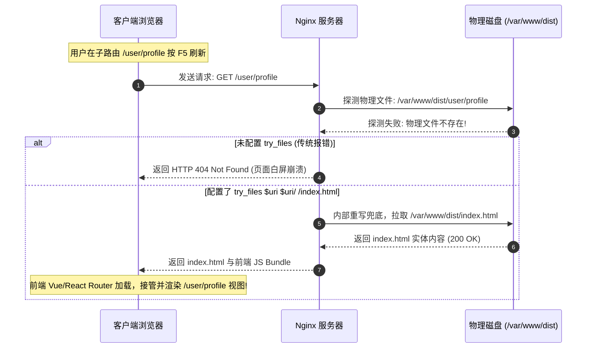

# Nginx前端SPA托管try_files防404与静态缓存

## 核心技术原理与实战归纳
- **核心设问与思考**：“Vue 3 / React 单页应用采用 HTML5 History 路由模式部署上线后，从首页点击跳转都很正常，为什么一旦在子路由（如 `/dashboard/profile`）按下浏览器刷新键，瞬间就会跳出 Nginx 刺眼的 `404 Not Found`？`try_files $uri $uri/ /index.html;` 的底层磁盘寻址推导时序到底是怎样的？”
- **深水区追问**：“为什么前端重新打包发布后，很多用户反馈‘页面白屏’或‘必须强制按 Ctrl+F5 才能看到更新’？如何通过 Nginx 精准实现 `index.html` 零缓存与打包静态资源（JS/CSS）一年超级强缓存的工业级架构？”

---

## 一、 为什么 SPA 单页应用的 History 模式刷新会报 404？

### 1. Hash 路由 vs History 路由在网络层面的本质差异
- **Hash 路由（带有 `#`，如 `https://domain.com/#/user/profile`）**：
  - 浏览器向 Nginx 发送 HTTP GET 请求时，根据 HTTP 规范，**`#` 及其后面的内容仅用于浏览器本地锚点，绝不会被打包发送给服务器**；
  - 无论在哪个页面刷新，浏览器向 Nginx 发起的请求永远都是 `GET /`，Nginx 顺理成章返回磁盘上的根入口文件 `index.html`，随后前端 Router 读取 `#` 后的路径渲染对应组件，永远不会发生 404；
- **HTML5 History 路由（现代优雅 URL，如 `https://domain.com/user/profile`）**：
  - 路径中没有 `#`，浏览器在当前页面按下 F5 刷新时，会直接向 Nginx 发起真实的物理网络请求：`GET /user/profile HTTP/1.1`；
  - Nginx 收到该请求后，默认会在 Web 根目录（如 `/var/www/dist`）下寻找名为 `user/profile` 的物理静态文件；
  - **物理真相**：单页应用打包后，磁盘根目录下**只有一个独苗 `index.html` 以及 `assets/` 文件夹**，根本不存在物理的 `/user/profile` 目录或文件！Nginx 找不到该物理实体，只能老老实实回送 HTTP `404 Not Found` 错误。



---

## 二、 try_files 逐级探测时序深度推导

要根治 History 刷新 404 问题，必须使用 Nginx 专有的 `try_files` 指令。

```nginx
location / {
    root   /var/www/dist;
    index  index.html;
    # 核心救命指令:
    try_files $uri $uri/ /index.html;
}
```

### `try_files` 三段式物理寻址步骤详解：
1. **第一段：`$uri`（物理静态文件精准命中）**
   - 检查请求是否对应磁盘上一个真实存在的文件；
   - 例如用户请求 `https://domain.com/assets/index.a1b2c3.js`，Nginx 会探测 `/var/www/dist/assets/index.a1b2c3.js` 是否存在。如果存在，立即直接以静态文件形式（200 OK）返回给客户端；
2. **第二段：`$uri/`（物理目录实体探测）**
   - 若不是具体文件，探测请求是否对应一个真实存在的物理文件夹；
   - 例如访问 `https://domain.com/docs/`，若 `/var/www/dist/docs/` 目录存在，则寻找该目录下的 `index.html`；
3. **第三段：`/index.html`（内部重写兜底，SPA 核心）**
   - 如果上述物理文件和物理目录均不存在（例如用户刷新 `/user/profile`），Nginx 会执行**内部重定向（Internal Rewrite）**；
   - Nginx 将请求内部重写为 `/index.html`，将磁盘上唯一的单页入口 `index.html` 内容原封不动吐给客户端；
   - 客户端浏览器拿到 `index.html` 后，加载其引用的 JS 代码，前端路由（Vue Router / React Router）自动捕获当前浏览器的 `window.location.pathname`，在内存中精准将页面组件渲染出来！

---

## 三、 前端发版静态缓存黄金架构（彻底告别强制刷新）

全栈开发经常遭遇的上线事故：“**代码明明重新打包上传了，但老用户访问看到的依然是旧系统，必须按 Ctrl+F5 强刷才生效；甚至因为旧的 `index.html` 引用了已被覆盖删除的旧哈希 JS，导致页面直接报 ChunkLoadError 白屏！**”

### 根治原则：两极分化缓存策略（Html 绝不缓存，资源永久缓存）

```nginx
server {
    listen 80;
    server_name www.company.com;
    root /var/www/dist;

    # 1. 核心单页 HTML 文件: 必须绝对禁止协商/强缓存!
    location = /index.html {
        # 强制浏览器每次必须向服务器发起请求校验，绝不缓存
        add_header Cache-Control "no-cache, no-store, must-revalidate";
        add_header Pragma "no-cache";
        expires 0;
    }

    # 2. 前端构建产物 (JS/CSS/图片/字体): 带 Hash 签名，配置长达 1 年的超级强缓存!
    location ~* \.(js|css|png|jpg|jpeg|gif|ico|svg|woff|woff2|ttf|eot)$ {
        # 缓存 365 天 (单位: 1 年)
        expires 365d;
        # public: 允许中间 CDN 与浏览器强缓存; immutable: 承诺内容绝对永不修改，连 304 校验都省去!
        add_header Cache-Control "public, max-age=31536000, immutable";
        access_log off; # 关闭高频静态资源写访问日志，节约磁盘 I/O
    }

    # 3. 根路径与子路由兜底
    location / {
        try_files $uri $uri/ /index.html;
    }
}
```

### 业务演进闭环推导：
1. **日常访问**：用户访问页面，浏览器直接从内存/磁盘 Cache 中以 $0$ 毫秒读取带有 Hash 的 `index.a1b2c3.js`，极速渲染，秒开加载；
2. **前端发版**：Vite/Webpack 重新打包，生成了全新的 `index.d4e5f6.js`，并更新了 `index.html`；
3. **用户再次打开**：由于 `index.html` 配置了 `no-cache`，浏览器**必定会向服务器重新拉取最新的 `index.html`**；
4. 拿到最新的 HTML 后，HTML 内部指向的是全新的 Hash 文件名 `index.d4e5f6.js`，浏览器发现本地缓存中没有这个新名字的资源，立即发起新的网络请求拉取新 JS，老旧的缓存瞬间平滑失效，**100% 杜绝白屏与手工强刷**！

---

## 四、 静态传输加速：Gzip 动态压缩与预压缩（gzip_static）

对于体积超过 1MB 的大单页 JS 文件，开启 Gzip 可将传输体积压缩至原来的 **30% 左右（从 1.5MB 锐减至 400KB）**，大幅减少弱网下的白屏等待时长。

```nginx
http {
    # 开启 Gzip 动态压缩
    gzip on;
    # 限制最小压缩大小（小于 1KB 的文件由于头信息开销压缩反而变大，不压缩）
    gzip_min_length 1024;
    # 压缩等级 1~9 (生产推荐 4~6，在 CPU 消耗与压缩比之间取得最佳平衡)
    gzip_comp_level 5;
    # 指定需要压缩的 MIME 类型
    gzip_types text/plain text/css application/json application/javascript text/xml application/xml application/xml+rss text/javascript;
    gzip_vary on;

    # 【高阶杀招】开启 Gzip 静态预压缩 (必须在编译 Nginx 时包含 http_gzip_static_module)
    gzip_static on;
}
```
> **`gzip_static on` 的神奇之处**：若前端在打包时借助 Vite 插件（如 `vite-plugin-compression`）提前生成了同名的 `.js.gz` 物理预压缩文件，Nginx 会**直接读取磁盘上的 `.gz` 文件回传给客户端，完全不需要 Nginx 在运行时重复消耗宝贵的 CPU 进行实时压缩计算**！

---

## 五、 生产避坑防雷指南

1. **子目录多前端项目部署避坑**：
   - 若项目不是部署在根路径，而是部署在子路径（例如后台管理系统部署在 `/admin`）：
   - 前端项目路由必须配置 `base: '/admin/'`；
   - Nginx 的 `try_files` **必须兜底重定向到子目录的 HTML**：
     ```nginx
     location ^~ /admin/ {
         alias /var/www/admin-dist/;
         try_files $uri $uri/ /admin/index.html;
     }
     ```
   - 若写成 `/index.html`，用户刷新页面会直接跳回前台主站的首页！

---

## 六、 面试高频连环追问

### Q1: 为什么在生产环境中，静态打包资源的 Cache-Control 推荐追加 `immutable` 指令？它的物理作用是什么？
**答**：
- 在传统的强缓存配置中（如 `Cache-Control: max-age=31536000`），当用户主动在浏览器按下刷新键（F5 或点击刷新按钮）时，浏览器根据规范会**对所有静态资源重新发起带有 `If-None-Match`（ETag）或 `If-Modified-Since` 的条件请求**，向服务端询问是否有更新，从而产生大量的 `304 Not Modified` 网络请求往返；
- 加上 **`immutable`（不可变）** 修饰符后，代表前端向浏览器作出了绝对承诺：“**这个带有内容指纹 Hash 的文件在当前名字下其内容终生绝对不会被篡改！**”
- 浏览器在用户主动按下 F5 刷新时，会**彻底跳过向服务器发起 304 校验的往返过程**，直接强制 100% 从本地磁盘/内存缓存读取，将单页应用在二次刷新时的网络请求开销降至绝对的零。

### Q2: 为什么 `location /` 下的 `try_files` 指令中，第一项通常是 `$uri` 而不是直接重定向到 `/index.html`？
**答**：
- 如果直接写成 `try_files /index.html;`，会导致**当前域名下的所有静态资源（包括 `.css`、`.js`、图片、favicon.ico）请求，全部被粗暴拦截并回传 `index.html` 的 HTML 文本**；
- 结果会导致浏览器控制台报出大量解析错误：`Refused to execute script from '.../index.js' because its MIME type ('text/html') is not executable`，页面样式和脚本彻底瘫痪；
- 保留第一项 `$uri`，能确保凡是真实存在于磁盘上的 JS、CSS、PNG 等静态物理资源优先被正常直出返回，只有找不到对应物理实体的虚假虚拟路由才兜底回传 `index.html`。
