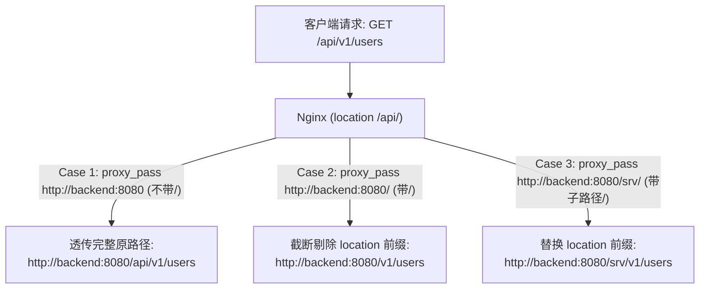

# Nginx反向代理proxy_pass路径截断与跨域CORS

## 核心技术原理与实战归纳
- **核心设问与思考**：“`proxy_pass http://127.0.0.1:8080` 与 `proxy_pass http://127.0.0.1:8080/` 仅仅相差一个末尾斜杠 `/`，为什么会导致后端服务收到的路径截然不同并频发 404 错误？当前端携带自定义 Header 访问跨域接口时，为什么浏览器会多发一个 `OPTIONS` 预检请求？”
- **深水区追问**：“为什么经过 Nginx 反向代理后，后端 Spring Boot/Node 服务打印出来的客户端 IP 全部变成了 `127.0.0.1`？如何配置才能防范客户端通过伪造 `X-Forwarded-For` 进行 IP 欺诈？WebSocket 长连接在 Nginx 转发时为何需要配置 `Upgrade` 协议升级？”

---

## 一、 proxy_pass 路径斜杠四大经典场景深度推导

在 Nginx 的反向代理配置中，`proxy_pass` 目标 URL **末尾到底有没有斜杠 `/`**，是全栈工程师最容易踩坑的深水区之一。



### 场景 1：proxy_pass 末尾“不带斜杠”（原样透传模式）
```nginx
location /api/ {
    proxy_pass http://127.0.0.1:8080; # 注意: 端口后没有任何 URI，连 / 都没有
}
```
- **客户端真实请求**：`GET /api/v1/users`
- **转发到后端的真实路径**：`GET /api/v1/users`
- **底层规则**：若 `proxy_pass` 只有 `IP:Port` 且末尾**无任何 URI 路径（连单斜杠都没有）**，Nginx 会将客户端请求的**原始完整 URI 原封不动直接拼接在目标地址后**发送给后端。

### 场景 2：proxy_pass 末尾“带斜杠”（绝对替换截断模式）
```nginx
location /api/ {
    proxy_pass http://127.0.0.1:8080/; # 注意: 端口后带有一个斜杠 /
}
```
- **客户端真实请求**：`GET /api/v1/users`
- **转发到后端的真实路径**：`GET /v1/users`（注意：`/api/` 被彻底截断吃掉了！）
- **底层规则**：若 `proxy_pass` 末尾**包含了 URI（哪怕只有一个 `/`）**，Nginx 会执行**字符串替换逻辑**：将客户端请求中匹配 `location` 规则的那一部分（`/api/`）彻底剥除，然后将其余部分（`v1/users`）拼接在 `proxy_pass` 后面的路径后。

### 场景 3：proxy_pass 包含特定子路径
```nginx
location /api/ {
    proxy_pass http://127.0.0.1:8080/gateway/;
}
```
- **客户端真实请求**：`GET /api/v1/users`
- **转发到后端的真实路径**：`GET /gateway/v1/users`（前缀 `/api/` 被完美替换为 `/gateway/`）。

### 场景 4：正则表达式 location 下的禁止语法（语法红线）
```nginx
# 错误配置案例 (直接触发 nginx -t 语法报错!)
location ~* ^/api/(.*) {
    proxy_pass http://127.0.0.1:8080/$1; # 语法报错!
}
```
- **语法死律**：在带有**正则表达式（`~` 或 `~*`）**的 `location` 块中，**`proxy_pass` 后面严禁携带任何 URI 路径（甚至不能带末尾 `/`）**！
- **正确姿势**：要么去掉目标端口后的路径；要么配合 `rewrite` 指令做路径重写：
  ```nginx
  location ~* ^/api/(.*) {
      rewrite ^/api/(.*)$ /$1 break;
      proxy_pass http://127.0.0.1:8080;
  }
  ```

---

## 二、 生产级跨域 CORS 终极配置与预检 OPTIONS 拦截

当浏览器在前端（如 `http://localhost:5173`）调用后端 API（如 `https://api.company.com`）时，由于域名或端口不一致，会受到浏览器的同源策略（Same-Origin Policy）限制。

### 1. 为什么会有 OPTIONS 预检请求？
- **简单请求（Simple Request）**：仅使用 GET/POST/HEAD，且无自定义 Header 时，浏览器直接发起请求并在响应头中检查 `Access-Control-Allow-Origin`；
- **复杂请求（Preflighted Request）**：只要前端携带了自定义 Header（如 `Authorization: Bearer xxx`）、或是使用 `application/json` 报文体，浏览器在发送正式请求前，**强制先向服务器发出一个 `Method: OPTIONS` 的预检探测请求**！
- **故障陷阱**：若后端的权限拦截器直接粗暴拦截了该 OPTIONS 请求（要求其登录鉴权），或者 Nginx 未放行 OPTIONS，浏览器将直接判定跨域失败，连真正的业务数据请求都懒得发！

### 2. Nginx 生产标准全开 CORS 模板配置
```nginx
location /api/ {
    # 1. 动态兼容指定的安全域名 (带凭据 credentials 时严禁配置为 *，必须动态提取 $http_origin)
    if ($http_origin ~* "^https?://(localhost|127\.0\.0\.1|.*\.company\.com)(:[0-9]+)?$") {
        add_header Access-Control-Allow-Origin $http_origin always;
        add_header Access-Control-Allow-Credentials 'true' always;
        add_header Access-Control-Allow-Methods 'GET, POST, PUT, DELETE, PATCH, OPTIONS' always;
        add_header Access-Control-Allow-Headers 'DNT,X-CustomHeader,Keep-Alive,User-Agent,X-Requested-With,If-Modified-Since,Cache-Control,Content-Type,Authorization,X-Token' always;
        add_header Access-Control-Max-Age 1728000 always; # 预检请求结果在浏览器本地缓存 20 天，无需频繁重发
    }

    # 2. 针对 OPTIONS 预检请求：直接在 Nginx 层面毫秒级就地拦截并回传 204 No Content，绝不穿透打扰后端！
    if ($request_method = 'OPTIONS') {
        return 204;
    }

    proxy_pass http://backend_upstream;
}
```

---

## 三、 客户端真实 IP 与 Host 协议头标准透传

经过 Nginx 代理后，后端（Java/Node）获取到的 `request.getRemoteAddr()` 默认全部是 Nginx 所在的本地 IP（`127.0.0.1`）。为了让后端能够获取用户真实物理公网 IP（用于风控防刷、IP 归属地展示），必须在代理层强行注入规范的请求头：

```nginx
location / {
    proxy_pass http://127.0.0.1:8080;

    # 1. 透传客户端浏览器请求时原始的 Host 域名 (防止后端重定向跳转时丢失域名)
    proxy_set_header Host $host;

    # 2. 注入直连客户端的真实物理网络 IP
    proxy_set_header X-Real-IP $remote_addr;

    # 3. 记录全链路多级代理 IP 列表 (客户端IP, 代理1, 代理2...)
    proxy_set_header X-Forwarded-For $proxy_add_x_forwarded_for;

    # 4. 透传客户端真实的协议 (http 或 https，供后端构建重定向 URL 时保持 HTTPS 协议)
    proxy_set_header X-Forwarded-Proto $scheme;
}
```

---

## 四、 WebSocket 反向代理长连接实战

全栈项目做实时聊天、大模型 SSE 流式输出或消息推送时，底层基于 WebSocket 协议。WebSocket 建立之初是一个标准的 HTTP 请求，随后通过协议协商握手升级为双向长连接。

```nginx
# 必须在 http 全局块配置 Connection 映射规则
map $http_upgrade $connection_upgrade {
    default upgrade;
    ''      close;
}

server {
    listen 80;
    server_name ws.company.com;

    location /socket.io/ {
        proxy_pass http://127.0.0.1:3000;

        # 【核心规范】指定 HTTP 协议版本为 1.1 (默认 1.0 不支持长连接升级)
        proxy_http_version 1.1;

        # 【核心规范】传递升级请求头
        proxy_set_header Upgrade $http_upgrade;
        proxy_set_header Connection $connection_upgrade;

        # 长连接防断超时时间 (默认 60s 无数据交互会被强制切断，调大至 1 小时)
        proxy_read_timeout 3600s;
        proxy_send_timeout 3600s;
    }
}
```

---

## 五、 生产避坑防雷指南

1. **`add_header` 指令的作用域继承覆盖陷阱**：
   - Nginx 的 `add_header` 存在一个极隐蔽的语法天坑：**如果某个子 `location` 内部配置了任意一条 `add_header` 指令，那么其父级 `http` 或 `server` 块中定义的所有 `add_header` 将被全部清空并覆盖，不再继承！**
   - 解决方案：跨域响应头建议在需要跨域的具体 `location` 中集中显式声明，或使用 `include cors.conf;` 统一导入。
2. **防范客户端伪造 `X-Forwarded-For`**：
   - 客户端在发送请求时可以恶意伪造一个 `X-Forwarded-For: 8.8.8.8`。后端若直接取该请求头的第一个 IP 作为用户身份，会被黑客轻松绕过 IP 黑名单；
   - 正确做法：对于第一层面向公网的 Nginx，直接使用 `$remote_addr`（该值来自底层的物理 TCP 连接握手，无法在应用层伪造）注入给 `$proxy_add_x_forwarded_for`。

---

## 六、 面试高频连环追问

### Q1: 在反向代理配置中，为什么说 `proxy_pass http://backend:8080/` 与 `proxy_pass http://backend:8080` 是完全不同的两套路由逻辑？
**答**：
- **不带斜杠（`http://backend:8080`）**：Nginx 判定为**无路径透传模式**。客户端发来的 URI（包括 `location` 本身的前缀）会被完整无损地拼接到目标主机后转发；
- **带斜杠（`http://backend:8080/`）**：Nginx 判定为**路径映射模式**。Nginx 会把 URI 中匹配 `location` 字符串的部分截断剔除，将剩余部分追加在斜杠后面；
- **典型翻车案例**：配置 `location /api/ { proxy_pass http://backend:8080/; }`，当请求 `/api/user` 时，后端实际收到的是 `/user`；若后端路由本身带有 `/api` 前缀（如 Spring 的 `context-path: /api`），后端就会找不到对应 Controller 而抛出 404！

### Q2: 为什么 `location` 中执行了 `if ($request_method = 'OPTIONS') { return 204; }` 能够大幅提升前端页面性能？
**答**：
1. **阻断无意义的后端打扰**：预检请求的唯一目的就是向浏览器确认当前安全策略（允许哪些域名、Methods 和 Headers），并不需要任何真实的业务数据。如果让 OPTIONS 穿透打到后端（Java/Node），后端会白白消耗数据库连接池、鉴权过滤器与 CPU 线程去处理一个空请求；
2. **极速响应**：由 Nginx 在网关层直接响应 HTTP 204（No Content），耗时通常在 1 毫秒以内。结合 `Access-Control-Max-Age` 缓存，大幅降低了复杂请求的首次网络往返延迟。
