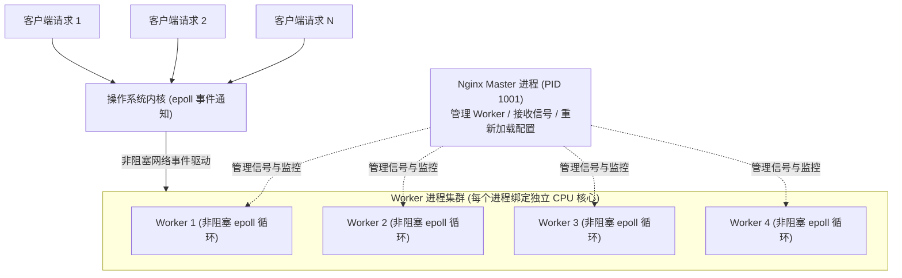
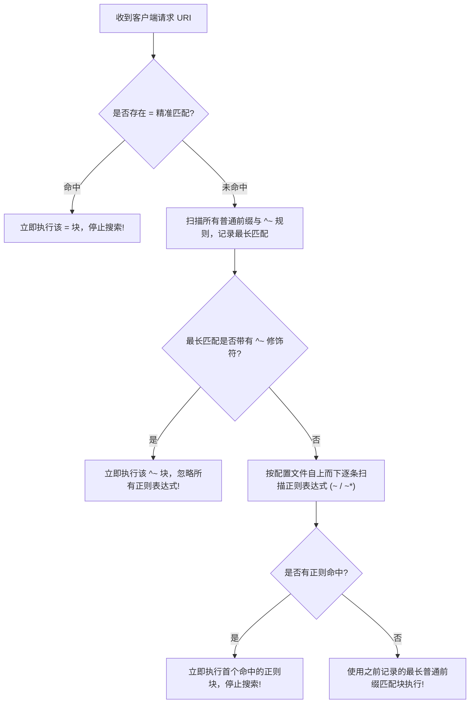

# Nginx核心架构-配置结构拆解与location路径匹配优先级

## 核心技术原理与实战归纳
- **核心设问与思考**：“为什么 Nginx 仅需几十兆内存就能轻松支撑上万并发连接，而传统 Apache/Tomcat 却容易线程耗尽？配置了 5 个不同的 `location` 规则，当一个带有前缀和正则的 URL 请求到达时，Nginx 内部精确的匹配判定流程到底遵循怎样的先后顺序？”
- **深水区追问**：“为什么生产环境修改配置后绝对不能随意使用 `systemctl restart nginx`，而必须使用 `nginx -s reload`？Nginx 是如何在不中断任何已有活跃 TCP 连接的情况下实现零感知平滑热重载的？”

---

## 一、 Nginx 架构内核：Master-Worker 多进程与 epoll 多路复用

Nginx 之所以具备极致的高性能、超低内存开销与卓越的高并发能力，源于其经典的**单 Master 多 Worker 多进程架构**与 Linux 底层 **`epoll` 事件驱动机制**。



### 1. 架构角色职责
- **Master 主进程**：以 `root` 身份运行。不处理任何具体的客户端 HTTP 请求。主要负责读取并校验配置文件、绑定系统特权端口（如 80/443）、创建/管理/监控所有子 Worker 进程的生命周期；
- **Worker 工作进程**：以受限的非 root 用户（如 `nginx` 或 `www-data`）运行。每个 Worker 内部运行一个基于 `epoll` 的死循环事件轮询器，单线程异步非阻塞地并发处理成千上万个客户端网络请求。

### 2. 零中断平滑热重载（Graceful Reload）物理机制
当我们在生产环境执行 `nginx -s reload` 时：
1. Master 进程首先重新解析并校验配置字典（若语法有错直接抛出告警，绝不破坏现有运行实例）；
2. 校验成功后，Master 依据新配置**拉起一批全新的 Worker 子进程**；
3. Master 向**旧的 Worker 进程发送 `QUIT` 信号**；
4. 旧 Worker 收到信号后**停止接收任何新的客户端连接**，继续处理完当前已经建立的活跃连接并正常回包给客户端；
5. 旧 Worker 上的所有存量连接处理完毕后，旧 Worker 自行优雅销毁退出。全程业务客户端无任何感知、无任何连接中断！

---

## 二、 nginx.conf 标准核心配置区块拆解

一个标准的生产级 Nginx 配置自顶向下划分为五大作用域（Context）：

```text
main 全局配置块 (影响整个 Nginx 实例的全局指令)
├── events 块 (网络连接模型与单进程并发数)
└── http 块 (HTTP 协议层通用配置)
    ├── upstream 块 (负载均衡后端服务器集群定义)
    └── server 块 (虚拟主机定义，监听特定域名或端口)
        └── location 块 (基于 URL 路径的具体请求路由与处理策略)
```

### 生产级标准骨架模板：
```nginx
# 1. main 全局块
user www-data;
# 自动与物理 CPU 核心数保持一致（4核则起4个Worker）
worker_processes auto;
# 将 Worker 进程与各个 CPU 核心强行绑定，消除 CPU 核心切换的缓存失效开销
worker_cpu_affinity auto;
error_log /var/log/nginx/error.log warn;
pid /var/run/nginx.pid;

# 2. events 网络事件块
events {
    # 强制使用 Linux 高性能事件驱动模型 epoll
    use epoll;
    # 单个 Worker 进程允许同时打开的最大网络连接数
    worker_connections 65535;
    # 允许单个 Worker 同时接收多个新网络连接
    multi_accept on;
}

# 3. http 协议块
http {
    include /etc/nginx/mime.types;
    default_type application/octet-stream;

    # 启用 Linux 内核零拷贝（Zero-Copy）技术直接在内核空间传输磁盘数据
    sendfile on;
    # 在数据包累积到一定大小时一次性发送，降低网络拥塞
    tcp_nopush on;
    tcp_nodelay on;
    keepalive_timeout 65;

    # 引入外部子虚拟主机配置文件 (模块化解耦)
    include /etc/nginx/conf.d/*.conf;
}
```

---

## 三、 location 匹配优先级黄金法则（核心技术考点）

在单个 `server` 块内部，通常配置了多个 `location`。当用户请求一个 URI（如 `/api/v1/users`）时，Nginx **绝不是简单地从上往下盲目按行执行**，而是遵循严格的**语法优先级权重体系**。

### 1. 五大匹配修饰符与优先级排序
| 优先级 | 修饰符 | 类型与含义 | 匹配规则与终止逻辑 |
| :---: | :---: | :--- | :--- |
| **P1** | **`=`** | **精准匹配（Exact Match）** | URI 必须与该规则**完全绝对一致**。一旦命中，立即终止后续所有搜索并执行！ |
| **P2** | **`^~`** | **非正则最佳前缀匹配** | 匹配以该字符串开头的最长前缀。一旦命中，**立即禁止并跳过后续所有正则检查**！ |
| **P3** | **`~` / `~*`** | **正则表达式匹配** | `~` 区分大小写，`~*` 忽略大小写。**严格按照配置文件中的书写上下顺序**，命中首个即生效！ |
| **P4** | **无修饰符** | **普通前缀匹配** | 寻找与 URI 匹配的**最长前缀**，记录下来，但**仍会继续向下尝试匹配正则**！ |
| **P5** | **`/`** | **通用兜底匹配** | 任何未被上述规则捕获的请求最终由该通用规则兜底。 |



---

## 四、 生产实战：location 匹配推导全真演算

假设 Nginx 配置了如下 5 个规则：
```nginx
# 规则 A: 精准匹配
location = /login {
    return 200 "Rule A: Exact /login\n";
}

# 规则 B: 带有 ^~ 的前缀匹配
location ^~ /static/ {
    return 200 "Rule B: Prefix static\n";
}

# 规则 C: 正则表达式匹配 (不区分大小写，匹配图片)
location ~* \.(gif|jpg|png|js|css)$ {
    return 200 "Rule C: Regex image/static\n";
}

# 规则 D: 普通前缀匹配
location /api/ {
    return 200 "Rule D: Generic /api/\n";
}

# 规则 E: 通用兜底
location / {
    return 200 "Rule E: Default root\n";
}
```

### 真实请求匹配结果推导：
1. **请求 `/login`**：
   - 结果：命中 **规则 A**（精准匹配优先级 P1 最高，瞬间返回，不再向下看）。
2. **请求 `/login?name=jack`**：
   - 结果：命中 **规则 A**（Nginx 匹配时会自动剥离查询参数 `?` 后的 Query String，仅对纯 URI `/login` 做匹配）。
3. **请求 `/static/logo.png`**：
   - 结果：命中 **规则 B**！
   - *推导深度*：该请求虽然完全满足规则 C 的正则表达式（`.png` 结尾），但由于规则 B 带有 `^~` 修饰符，其优先级（P2）高于正则表达式（P3），因此 Nginx 彻底放弃正则扫描，直接命中规则 B。
4. **请求 `/api/user.png`**：
   - 结果：命中 **规则 C**！
   - *推导深度*：该请求虽然匹配规则 D 的前缀 `/api/`，但由于规则 D **没有 `^~`**，Nginx 会先暂存规则 D，随后继续扫描正则，发现规则 C 正则匹配成功，因此最终覆盖为规则 C 执行！
5. **请求 `/home/index.html`**：
   - 结果：命中 **规则 E**（全部不匹配，走通用兜底）。

---

## 五、 生产避坑防雷指南

1. **配置文件语法检测金标准**：
   - 生产环境修改任何 Nginx 配置后，**严禁直接 reload**！必须先执行语法检查：
     ```bash
     nginx -t
     ```
     只有终端输出 `syntax is ok` 和 `test is successful` 后，才可安全执行 `nginx -s reload`。
2. **`worker_rlimit_nofile` 配合系统文件打开数**：
   - 如果配置了单 Worker `worker_connections 65535;`，操作系统默认的单进程最大文件描述符限制可能只有 1024。必须在全局块配置 `worker_rlimit_nofile 65535;`，否则高并发下 Nginx 会直接报错 `24: Too many open files`。

---

## 六、 面试高频连环追问

### Q1: 为什么说 `location ^~ /images/` 比 `location /images/` 在性能上更具有生产价值？
**答**：
- 如果没有 `^~`（写成 `location /images/`）：当客户端请求 `/images/banner.jpg` 时，Nginx 虽然能前缀匹配到该规则，但因为它是普通前缀，Nginx 必须耐着性子**把配置文件中后面写的所有正则表达式逐一执行一遍正则运算比对**，直到发现没有正则命中后才回过头执行 `/images/`，浪费了大量 CPU 正则计算资源；
- 加上 `^~`（`location ^~ /images/`）：一旦最长前缀命中它，Nginx 会立刻在内部打上短路标记，**完全跳过后续所有正则运算**，大幅减少高频静态资源请求的 CPU 运算开销，显著提升 QPS 吞吐。

### Q2: Nginx 为什么采用多进程而不是多线程模型？这种设计有什么物理优势？
**答**：
1. **独立内存空间与高可用隔离**：多进程之间内存地址完全独立，任何一个 Worker 进程如果因为偶发的内存段错误或第三方 C 模块 Bug 发生 Core Dump 崩溃，**完全不会影响其他 Worker 进程以及 Master 进程**，Master 会秒级自动再拉起一个新的 Worker，全站服务永不停机；
2. **规避多线程锁竞争与缓存失效**：Worker 独立运行，每个 Worker 绑定独立的物理 CPU 核心（CPU Affinity），消除了多线程在并发读写共享数据时的互斥锁（Mutex）与自旋锁争抢，并最大化利用了单个 CPU 核心的 L1/L2 硬件高速缓存。
