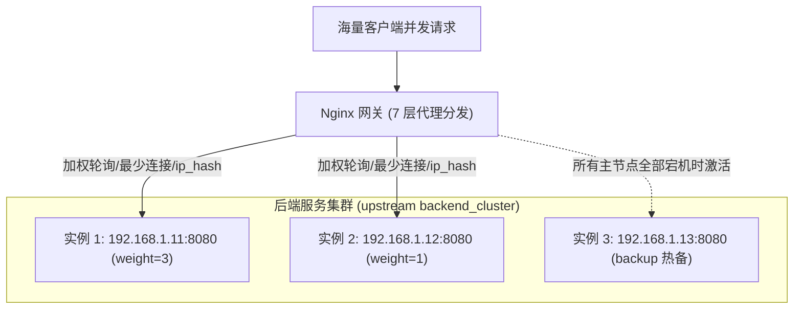

# Nginx负载均衡upstream算法与高可用配置

## 核心技术原理与实战归纳
- **核心设问与思考**：“单机后端实例无法承载大促流量时，如何通过 `upstream` 搭建双机或多机集群？为什么传统的轮询算法在有状态服务下会导致用户每次刷新都‘被踢下线’？`ip_hash` 会话保持与大型局域网 NAT 共享公网 IP 会引发什么严重的负载倾斜陷阱？”
- **深水区追问**：“当集群中的一台后端服务器突然 OOM 崩溃宕机，Nginx 是如何在不给客户端抛出 502 报错的前提下，自动、无感地把请求瞬间转移到另一台健康机器上的（`proxy_next_upstream`）？”

---

## 一、 upstream 负载均衡核心调度算法深度剖析

Nginx 通过在 `http` 作用域内声明 `upstream` 虚拟主机池，将来自网关的并发流量合理分摊至多台独立的物理或容器后端实例。



### 1. 五大核心调度算法对比与选型指南
| 调度算法 | 核心工作原理 | 适用生产业务场景 | 优缺点与风险防范 |
| :--- | :--- | :--- | :--- |
| **`round-robin`（默认轮询）** | 按时间顺序将请求逐一无差别分配到各个后端节点。 | 后端各服务器**硬件配置完全一致**的无状态微服务。 | 无法感知机器性能差异与当前负荷状况。 |
| **`weight`（加权轮询）** | 指定权重值，权重越高的节点承载分配的请求比例越多。 | **新老服务器混搭部署**（如 16核服务器权重大于 4核老服务器）。 | 依然属于静态分配，无法动态感知突发长任务。 |
| **`ip_hash`（客户端 IP 哈希）** | 对客户端的 IP 进行哈希计算并取模，同一 IP 永远固定路由到同一节点。 | 传统依赖**服务端本地内存 Session** 的老旧单体项目。 | **严重倾斜风险**：若数百个企业用户共用同一个出口公网 NAT，流量全部堆积在单节点上！ |
| **`least_conn`（最少连接数）** | 优先将新请求分发给**当前活跃并发连接数最少**的节点。 | **业务请求耗时极不均衡**的场景（如长报表下载与快接口混杂）。 | **高并发推荐！** 动态平衡系统负载，杜绝慢节点被压垮。 |
| **`hash $key [consistent]`** | 基于自定义变量（如 `$cookie_userid`）进行一致性哈希路由。 | 分布式缓存节点分发、特定用户灰度发布。 | 节点上下线时影响范围最小化。 |

---

## 二、 生产级 upstream 完整配置模板

```nginx
# 在 http 块内定义负载均衡集群
upstream backend_cluster {
    # 启用最少连接调度算法 (针对长短请求混杂场景极度平滑)
    least_conn;

    # 1. 核心主节点 1 (高性能机器，权重分配为 3)
    server 192.168.1.11:8080 weight=3 max_fails=3 fail_timeout=30s;

    # 2. 核心主节点 2 (普通机器，权重分配为 1)
    server 192.168.1.12:8080 weight=1 max_fails=3 fail_timeout=30s;

    # 3. 临时维护节点 (标记为 down，Nginx 绝不将流量分发给它，可平滑做无感升级发版)
    server 192.168.1.13:8080 down;

    # 4. 热备保障节点 (标记为 backup，平时空载不接流量；唯有主节点全部挂掉时才紧急拉起接管)
    server 192.168.1.14:8080 backup;

    # 保持与后端服务器的长连接池（防止频繁对后端发起 TCP 三次握手打满端口）
    keepalive 32;
}

server {
    listen 80;
    server_name api.company.com;

    location / {
        proxy_pass http://backend_cluster;

        # 【核心规范】指定 HTTP 1.1 并清空 Connection 头，激活 upstream 的 keepalive 机制
        proxy_http_version 1.1;
        proxy_set_header Connection "";

        proxy_set_header Host $host;
        proxy_set_header X-Real-IP $remote_addr;
        proxy_set_header X-Forwarded-For $proxy_add_x_forwarded_for;
    }
}
```

---

## 三、 被动健康检查熔断机制（max_fails 与 fail_timeout）

Nginx 开源版默认采用**被动健康检查（Passive Health Check）**机制：
- **`max_fails=3`**：在 `fail_timeout` 窗口期内，与该节点的通信如果连续失败了 3 次（如建连超时、拒绝连接）；
- **`fail_timeout=30s`**：
  1. 统计失败次数的滑动时间窗口为 30 秒；
  2. 触发连续 3 次失败后，Nginx 会自动将该坏节点**熔断踢出集群**，在接下来的 30 秒内完全不向其分发任何新请求；
  3. 30 秒冷却期过后，Nginx 会小心翼翼地放行一个探测请求尝试给它，若响应成功则平滑解除熔断并恢复正常权重分发！

---

## 四、 核心杀招：proxy_next_upstream 实现客户端零感知故障转移

**场景痛点**：假设后端实例 1 突然发生 OOM Crash 宕机。如果不做容灾配置，刚好分发给它的客户端就会收到刺眼的 `502 Bad Gateway` 报错，导致用户下单失败。

通过配置 `proxy_next_upstream`，Nginx 能够在检测到单台节点挂掉的瞬间，**在网关层透明地将本次请求无感重新分发给集群中的下一台健康节点，客户端完全不报错、无任何感知！**

```nginx
location / {
    proxy_pass http://backend_cluster;

    # 连接超时阈值 (建议设小，如 3~5 秒，超时立刻认定节点故障)
    proxy_connect_timeout 3s;
    proxy_read_timeout 15s;
    proxy_send_timeout 15s;

    # 【核心容灾指令】只要后端返回错误、超时或 502/503/504，立即自动切换下一个节点重试!
    proxy_next_upstream error timeout http_502 http_503 http_504;

    # 限制最大重试次数为 2 次，防范集群雪崩
    proxy_next_upstream_tries 2;
    # 限制整个重试等待总耗时不超过 10 秒
    proxy_next_upstream_timeout 10s;
}
```

> **[!WARNING] 非幂等请求（POST / 支付接口）的安全陷阱**：
> 默认情况下，Nginx 的 `proxy_next_upstream` **绝不会对带有请求体的非幂等请求（如 POST/PUT）进行自动重试**，因为担心第一台节点实际上已经扣款成功只是网络超时，重复分发会导致“重复扣款/重复下单”。若确定接口已在代码层做了严格的分布式幂等锁保护，可通过追加 `non_idempotent` 标志开启重试。

---

## 五、 生产避坑防雷指南

1. **`keepalive` 与后端长连接配合**：
   - 在 `upstream` 块中配置 `keepalive 32;` 之后，在对应的 `location` 中**必须配上两行代码**：
     ```nginx
     proxy_http_version 1.1;
     proxy_set_header Connection "";
     ```
   - 若不配，Nginx 默认会以 HTTP 1.0 协议连接后端并在 Header 中带上 `Connection: close`，导致 `keepalive` 完全形同虚设，频繁新建/关闭 TCP 连接引发端口耗尽！
2. **`ip_hash` 遇到内网代理的倾斜问题**：
   - 现代移动端应用或大中型企业用户，通常通过运营商统一出口网关或自建 NAT 访问互联网，成千上万个设备出口公网 IP 是完全相同的。在采用 `ip_hash` 时，这一批用户会全部被轰击到同一个后端节点上，造成“一机干冒烟、其余机器闲得慌”的假均衡。现代全栈项目强烈建议将登录凭证做成无状态 JWT 或借助分布式 Redis 集中存储 Session，无脑选用 `least_conn` 算法。

---

## 六、 面试高频连环追问

### Q1: Nginx 的开源版本被动健康检查（Passive Check）与商业版/第三方模块的主动健康检查（Active Check）有什么本质区别？
**答**：
- **被动健康检查（开源自带）**：
  Nginx 自己**从不主动**向后端发送健康心跳包。它是拿**“真实用户的业务请求当作小白鼠”**去探测的。只有当某个真实用户的请求发送过去，发现超时或挂了，累积达到 `max_fails` 次后，Nginx 才知道它坏了并熔断。这意味着**总会有少数不幸的真实用户请求踩雷**（虽然可通过 `proxy_next_upstream` 自动补偿重试）；
- **主动健康检查（如集成 `nginx_upstream_check_module` 或商业版 Nginx Plus）**：
  Nginx 会在后台启动专有探针定时器，每隔几秒**主动向后端节点的特定接口（如 `/health`）发送 HTTP GET 心跳包**。若连续几次未返回 200，立刻提前在内存路由表中将该机器下线，真实用户的流量永远不会被分发到坏节点上，实现 100% 预防性容灾。

### Q2: 为什么在生产环境的大促高并发场景下，更推荐使用 `least_conn` 而不是加权轮询 `weight`？
**答**：
- `weight` 属于**静态机械分配**。它假设每个请求消耗的后端资源是均匀一致的。但在真实全栈业务中，请求开销极度分化：有的请求只是查一条 Redis 缓存只需 2 毫秒，有的请求是查复杂的联合数据库报表耗时 2 秒；
- 若采用轮询或权重，很可能巧合地把 5 个极重的长事务请求连续分发给了同一台机器，导致该机器的 Worker 线程池瞬间被打满饱和崩溃；
- `least_conn` 属于**动态闭环分配**。它实时统计每个节点当前正在并发执行中的连接数，一旦发现某个节点当前堆积了未完成的长请求，就会自动绕开它，将后续的请求全部倾斜分发给其他轻载节点，从而在物理层面平滑削减各实例的处理毛刺。
