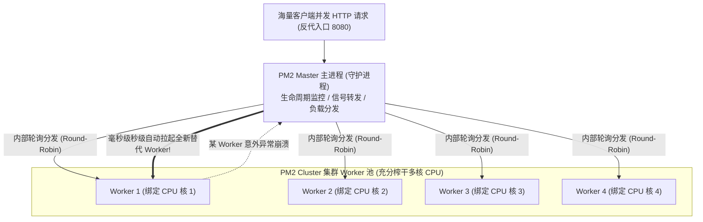
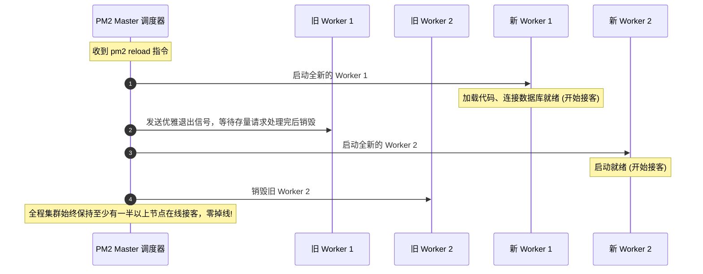

# PM2-全栈Node进程守护集群模式与日志管理

## 核心技术原理与实战归纳
- **核心设问与思考**：“Node.js 运行时是著名的单线程事件循环机制，一台 8 核 CPU 的云服务器如果直接执行 `node app.js`，其他 7 个核心完全处于围观闲置状态。**PM2 是如何利用 Cluster 模式瞬间榨干全部 CPU 核心让 API 吞吐量（QPS）实现成倍翻升的？**”
- **深水区追问**：“线上全栈项目发版时，如何做到‘**完全不停机、用户零感知的平滑热重载（Zero-Downtime Reload）**’？当 Node.js 发生偶发性内存泄漏（Memory Leak）时，如何让 PM2 在内存逼近危险线时自动重启自愈？如何防止 PM2 的默认日志把服务器磁盘占满？”

---

## 一、 PM2 架构全景：突破 Node.js 单线程的物理束缚

Node.js 主线程虽然擅长处理 I/O 密集型任务，但由于其执行计算是单线程的，一旦遭遇复杂的加解密运算、大数据序列化，单核心 CPU 瞬间被打满到 100%，所有后续请求全部陷入排队阻塞。



### 核心收益：
1. **多核并行（Cluster Mode）**：底层调用 Node.js 的 `cluster` 模块，由 Master 统一监听端口并利用 Linux 操作系统的共享套接字分发连接，每个 Worker 是一个独立的 Node.js V8 实例；
2. **崩溃秒级自愈（Auto-Restart）**：一旦某个 Worker 遇到未捕获的异常（Unhandled Exception）崩溃退出，PM2 Master 会在**几十毫秒内自动拉起一个全新的 Worker 填补空缺**；
3. **开机持久化与自启（Startup）**：云服务器因断电重启后，PM2 会自动依照保存的进程快照全量恢复所有业务服务。

---

## 二、 生产级配置文件：`ecosystem.config.js` 工业级模板

在生产环境中，严禁直接在终端敲命令参数启动，必须通过标准的 `ecosystem.config.js` 统一代码化管控：

```javascript
module.exports = {
  apps: [
    {
      // 1. 服务基础元数据
      name: 'shop-api-prod',
      script: './dist/main.js', // 入口文件路径 (NestJS / Express / 原生 Node)
      cwd: '/opt/projects/shop-api',

      // 2. 【核心高并发模式】开启 Cluster 集群模式
      exec_mode: 'cluster',
      // 'max' 代表自动探测 CPU 物理总核数并启动相同数量的 Worker 实例 (4核启动4个)
      instances: 'max',

      // 3. 【核心高可用与自愈策略】
      autorestart: true, // 开启崩溃自动重启
      max_restarts: 10,  // 若短时间内连续崩溃超过 10 次，停止无限死循环重试
      restart_delay: 2000, // 崩溃后等待 2 秒再拉起

      // 4. 【核心防爆内存自愈】单进程物理内存一旦超过 1GB，PM2 会自动安全平滑重启该实例，彻底杜绝内存泄漏撑爆服务器!
      max_memory_restart: '1024M',

      // 5. 零停机平滑发布等待时长 (毫秒)
      listen_timeout: 5000,
      kill_timeout: 5000,

      // 6. 日志格式化与路径规划
      error_file: '/var/log/pm2/shop-api-error.log',
      out_file: '/var/log/pm2/shop-api-out.log',
      log_date_format: 'YYYY-MM-DD HH:mm:ss Z',
      merge_logs: true, // 多 Worker 的日志自动合并到同一个文件，方便集中查看

      // 7. 多环境配置隔离
      env_development: {
        NODE_ENV: 'development',
        PORT: 3000,
      },
      env_production: {
        NODE_ENV: 'production',
        PORT: 8080,
      },
    },
  ],
};
```

---

## 三、 零停机热重载（Zero-Downtime Reload）核心时序

**场景痛点**：全栈开发更新了后端代码，执行 `pm2 restart all` 时，PM2 会先暴力把所有正在运行的进程一次性全部杀死，然后再重新启动。这会导致在重启的 3~5 秒窗口期内，**所有正在请求接口的用户直接遭遇网络断开或 502 报错**！

### 标杆杀招：使用 `pm2 reload` 替代 `pm2 restart`
```bash
# 执行无感平滑热重载 (一个一个轮流替换，客户端零感知!)
pm2 reload ecosystem.config.js --env production
```



---

## 四、 必备插件：pm2-logrotate 自动化日志分割（防爆磁盘）

PM2 默认会将所有日志无休止地追加写入同一个文件，运行数月后日志体积高达数十个 GB，导致磁盘打满且 `pm2 logs` 直接卡死。
必须安装官方日志轮转插件：

```bash
# 1. 一键安装官方日志分割模块
pm2 install pm2-logrotate

# 2. 配置日志分割规则:
# 当单个日志文件体积达到 10MB 时，自动执行物理切分
pm2 set pm2-logrotate:max_size 10M

# 最多保留最近的 30 个历史日志切片 (超出自动销毁)
pm2 set pm2-logrotate:retain 30

# 开启 Gzip 自动压缩历史归档 (节约 90% 存储空间)
pm2 set pm2-logrotate:compress true
```

---

## 五、 PM2 常用运维管理指令速查

```bash
# 1. 依照生产配置文件启动全套集群
pm2 start ecosystem.config.js --env production

# 2. 查看当前全量服务运行状态 (CPU、内存、重启计数、Uptime)
pm2 status

# 3. 终端动态高颜值实时性能仪表盘 (实时监控内存曲线与单进程消耗)
pm2 monit

# 4. 实时跟踪滚动日志 (--lines 100 查看最新100行)
pm2 logs
pm2 logs shop-api-prod --lines 100

# 5. 【核心运维】配置 Linux 开机无感自启动
# 第一步: 生成对应操作系统的自启脚本
pm2 startup
# (根据终端提示执行生成的 sudo env PATH=... 命令)
# 第二步: 将当前正在运行的所有进程状态持久化冻结保存
pm2 save
```

---

## 六、 生产避坑防雷指南

1. **Cluster 模式下的定时任务（Node-Cron）重复执行灾难**：
   - 如果你的代码中写了 `cron.schedule('0 0 * * *', ...)` 每天定时跑任务；
   - 在 Cluster 模式下启动了 4 个 Worker，**该定时任务会被 4 个 Worker 同时并发触发 4 次，导致发了 4 份邮件或重复扣款 4 次！**
   - **解决方案**：
     - 方案 A：在代码中判断当前进程是否为主节点（`if (process.env.NODE_APP_INSTANCE === '0')`），仅允许 0 号节点跑定时任务；
     - 方案 B：将定时任务独立拆分为单独的单实例进程（`instances: 1`）独立运行。
2. **`pm2 save` 遗漏问题**：
   - 新建服务或修改配置后，**必须手动敲一次 `pm2 save`**！若不执行 `pm2 save`，云服务器下次重启时恢复的仍然是上次旧快照中的服务状态。

---

## 七、 面试高频连环追问

### Q1: 在 PM2 的 Cluster 模式下，多个 Worker 进程是如何监听同一个 TCP 端口（如 8080）而不发生端口冲突报错的？
**答**：
- **底层原理（Linux 端口共享与 Master 转发）**：
  并不是每个 Worker 进程各自去执行 `server.listen(8080)`；
- 在 Cluster 模式下，**真正的操作系统端口监听是由 PM2 的 Master 主进程统一完成并独占的**；
- 当外部客户端的新连接请求到达操作系统时，Master 进程在底层通过调用系统的 `sendmsg()` 或内部跨进程 IPC 通道，利用**文件描述符传递（File Descriptor Passing）**机制，将底层的客户端套接字句柄以轮询（Round-Robin）算法透明交接给空闲的子 Worker 进程去处理具体的 HTTP 编解码，因此在操作系统层面永远只有一个主监听者，根本不会触发端口冲突异常。

### Q2: 为什么 `pm2 reload` 能够做到不停机零中断，而 `pm2 restart` 会导致请求中断？
**答**：
- **`pm2 restart`（冷重启）**：
  采用的是“**先全杀、后全拉**”的粗暴时序。Master 先向所有运行中的 Worker 广播 SIGKILL 或 SIGTERM，所有正在响应的连接被瞬时掐断，随后才逐个加载代码重新分配内存启动，中间必定存在秒级的全网服务真空期；
- **`pm2 reload`（平滑滚动热替换，Rolling Update）**：
  采用的是“**先起一、后关一**”的滑动窗口交替机制。Master 会先拉起一个全新的 Worker 实例，等待其完成代码解析并准备就绪后，再向一个旧的 Worker 发送优雅退出信号；旧 Worker 处理完当前手头已接的请求后自行退场。整个替换过程持续轮替推进，**集群的可用容量从未跌至零**，因此对外部客户端而言实现了绝对的零断连、零 502。
