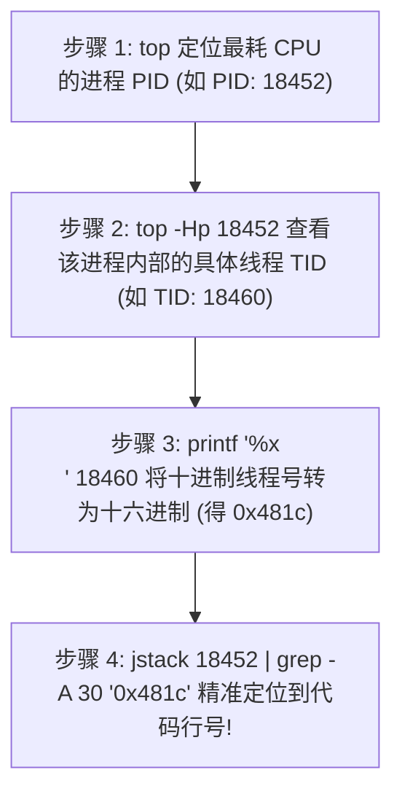
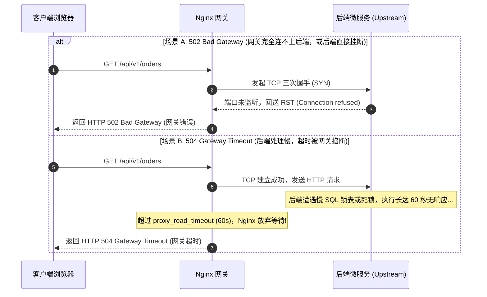

# 全栈排障SOP-CPU飙升100磁盘打爆与502-504根治

## 核心技术原理与实战归纳
- **核心设问与思考**：“周五晚上线上突然报警 CPU 飙升 100%，如何在 3 分钟内层层下钻定位到具体是哪一个线程、哪一行业务代码在死循环？执行 `rm -f` 删除了 20GB 大日志，为什么系统依然提示 `No space left on device` 并导致 MySQL 锁死只读？”
- **深水区追问**：“用户在前端大白屏报错，**`502 Bad Gateway` 与 `504 Gateway Timeout` 在底层 TCP/HTTP 网络交互时序上有何截然不同的物理根因？** 如何通过 Nginx 错误日志精准切分是前端、网关还是后端数据库的锅？”

---

## 一、 故障一：CPU 飙升 100% 线程堆栈秒级溯源 SOP

当全栈后端（Java / Node / Python）突发 CPU 100% 时，切忌盲目重启服务（重启会抹除珍贵的现场证据，导致后续故障反复爆发）。遵循以下四步标准 SOP：



### 1. 实战推导四部曲（以高负载后端排查为例）
```bash
# 步骤 1: 找出占用 CPU 最凶残的进程 PID
top -c
# 假设发现 PID 为 18452 的 Java/Node 进程 CPU 占用高达 99.8%

# 步骤 2: 下钻查看该进程内部各个线程的实时 CPU 消耗 (-H 展开线程, -p 指定PID)
top -Hp 18452
# 假设发现第一行 PID (此时实际代表线程 TID) 为 18460 的线程持续霸占 CPU

# 步骤 3: 将十进制的线程 ID 转换为小写的十六进制 (因为底层堆栈日志以十六进制记录 nid)
printf "%x\n" 18460
# 终端输出: 481c

# 步骤 4: 导出线程运行时堆栈，直接过滤该十六进制线程号
jstack 18452 | grep -A 30 "0x481c"
```

### 2. 真实堆栈证据分析与根因定位：
终端会瞬间直接吐出代码行级真相：
```text
"http-nio-8080-exec-5" #25 daemon prio=5 os_prio=0 tid=0x00007f... nid=0x481c runnable [0x00007f...]
   java.lang.Thread.State: RUNNABLE
        at com.company.shop.service.OrderService.calculateDiscount(OrderService.java:188)
        at com.company.shop.controller.OrderController.submit(OrderController.java:56)
```
- **瞬间破案**：真相立刻浮出水面——`OrderService.java` 第 188 行的代码存在一个**未跳出循环条件的 `while` 死循环**，或编写了存在**严重灾难性回溯（Catastrophic Backtracking）的复杂正则表达式**，直接修改该行代码即可彻底根治！

---

## 二、 故障二：磁盘爆满与 `deleted` 幽灵空间秒级清理 SOP

线上磁盘满载会导致数据库无法写入事物日志直接崩溃（Crash），甚至导致全系统无法写入任何临时 Session 文件。

### 1. 快速确诊故障类型
```bash
# 1. 检查磁盘物理存储容量
df -h
# 2. 检查文件索引节点 Inode 是否耗尽
df -i
```

### 2. 秒级抓捕大文件目录
```bash
# 从根目录开始逐级统计各文件夹大小，降序排列出前 10 大元凶
du -sh /* 2>/dev/null | sort -hr | head -n 10
# 假设发现 /var/log 占用了整整 80GB
```

### 3. 【核心绝杀】排查 `deleted` 句柄未释放幽灵文件
许多工程师习惯性执行 `rm -f /var/log/app.log`，但发现 `df -h` 依然显示 100% 满载。
这是因为**进程仍在持续打开该文件，操作系统物理上无法释放数据块**！

```bash
# 1. 瞬间揪出所有已被删除但仍被进程霸占的幽灵文件清单:
lsof | grep deleted
```
典型输出：
```text
COMMAND   PID     USER   FD   TYPE DEVICE   SIZE/OFF     NODE NAME
node    20480 www-data    3w   REG  253,1 53687091200  1234567 /var/log/app/huge.log (deleted)
```
- **解法 A（安全清空）**：通过文件描述符管道瞬间将底层数据清零，空间立刻物理释放（无需重启服务）：
  ```bash
  cat /dev/null > /proc/20480/fd/3
  ```
- **解法 B**：执行 `systemctl restart app` 或 `pm2 reload all`，进程退出后内核自动回收全部空间。

---

## 三、 故障三：502 Bad Gateway vs 504 Gateway Timeout 全链路溯源 SOP

当用户向客服投诉“页面打不开，全是 502/504”时，这是 Nginx 网关在向你亮红灯。两者在网络交互层面上有着截然相反的物理分水岭：



### 1. 502 Bad Gateway 根治排查链路
- **物理本质**：Nginx 作为代理，**在上游后端完全没有拿到合法的响应**（连接被拒绝、后端进程死光、或后端处理到一半发生 OOM 崩溃直接掐断了 TCP 连接）；
- **排查步骤**：
  1. 查看 Nginx 错误日志：
     ```bash
     tail -n 50 /var/log/nginx/error.log
     ```
  2. 若日志提示：`connect() failed (111: Connection refused) while connecting to upstream`：
     - **病因**：后端服务根本没启动，或者崩了！
     - **核验**：执行 `systemctl status backend`、`pm2 status` 或 `docker ps`，查看后端容器是否正处于 `Restarting` 状态；
  3. 若日志提示：`recv() failed (104: Connection reset by peer) while reading response header`：
     - **病因**：后端在处理这个请求时，突然发生 JVM OOM 或 Node 进程内存溢出，进程被操作系统瞬间强杀，连接非正常断开。

### 2. 504 Gateway Timeout 根治排查链路
- **物理本质**：Nginx 已经成功与后端建立了连接，但**后端处理这个请求太慢了**，超过了 Nginx 配置的 `proxy_read_timeout`（默认 60 秒），Nginx 耐心耗尽，主动向客户端断开并抛出 504；
- **排查步骤**：
  1. 查看 Nginx 错误日志：`upstream timed out (110: Connection timed out) while reading response header from upstream`；
  2. **病因**：**后端遭遇了慢 SQL（缺少索引全表扫描）、分布式死锁、或者在事务内部调用了卡死超时的外部第三方接口（如微信/支付宝支付接口未设超时）**；
  3. **定位**：排查 MySQL 慢查询日志（`slow.log`）或后端 APM 调用链追踪，抓取耗时超过 10 秒的数据库查询进行索引优化。

---

## 四、 生产自救排障军规清单

1. **优先恢复业务（止血），随后保护现场（定损）**：
   - 当线上发生严重雪崩时，如果确定重启能临时恢复，**先快速导出 jstack/日志快照，再做平滑重启**，优先保证用户可用性；
2. **严禁在排障时执行任何不带条件的清空命令**：
   - 严禁随意执行 `rm -rf` 或 `truncate` 数据库表；
   - 清理日志必须统一使用 `> app.log` 保持 inode 句柄完好。

---

## 五、 面试高频连环追问

### Q1: 如果线上接口偶发性报 502 Bad Gateway，但后端服务并没有崩溃，进程依然在线，可能是什么原因导致的？
**答**：
1. **全连接队列（Accept Queue）溢出丢包**：在高并发突刺下，后端（如 Tomcat/Node）的工作线程池被打满，无法及时调用 `accept()` 处理连接，导致操作系统的 TCP 全连接队列溢出，内核向 Nginx 回送 RST 或丢弃请求；
2. **Nginx 与后端保持的长连接（Keepalive）被后端超时切断**：
   Nginx 与后端配置了 `keepalive`，若后端的空闲超时时间（如 Tomcat 的 `keepAliveTimeout=20s`）小于 Nginx 的空闲保持时间（如 60s），后端主动向 Nginx 发送 FIN 切断连接；若此时刚好 Nginx 正好把一个新请求复用该连接推过去，就会撞上后端的关闭包，直接触发 502；
3. **响应头过大超过缓冲区**：后端回传的 Cookie 或自定义 Header 体积超过了 Nginx 默认的 `proxy_buffer_size`（默认 4KB/8KB），Nginx 无法完整缓存响应头，直接报错 `upstream sent too big header` 并向客户端抛出 502。

### Q2: 遇到一台服务器 Load Average 很高，执行 `top` 发现 `%Cpu(s)` 的 `sy`（系统内核调用）占用高达 60%，通常是什么代码问题引起的？
**答**：
- **`sy` 高的核心本质是操作系统频繁在“内核态”执行开销极大的工作**：
  1. **过度的线程并发导致激烈的上下文切换（Context Switch）**：线程池配置了上千个线程去并发争抢有限的 CPU 核心，CPU 将 60% 以上的算力浪费在保存寄存器、恢复线程栈和内存调度上，执行 `vmstat 1` 会看到 `cs`（Context Switches）数值高达数十万；
  2. **锁争抢极度剧烈**：大量的线程在竞争同一个重量级互斥锁，频繁触发从用户态陷入内核态挂起与唤醒（futex 系统调用）；
  3. **海量高频短连接网络 I/O**：频繁创建与销毁 TCP Socket，触发密集的系统中断与内存拷贝。
