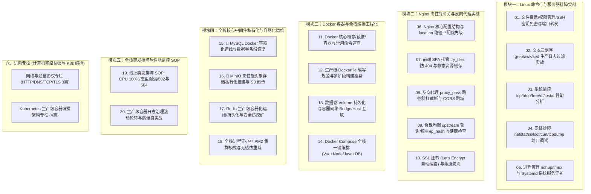
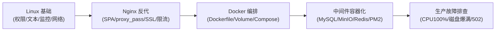

# 全栈工程师服务器运维与中间件实操全景地图

## 一、设计理念：面向全栈、立足生产、即查即用

在现代互联网研发中，“只懂写业务代码、不懂服务器与中间件”的开发者越来越难以应对复杂的线上交付。无论是独立开发者、全栈工程师，还是中大厂核心技术骨干，**服务器配置、反向代理、容器化部署、中间件调优与线上排障**都是不可逾越的底层工程基石。

本知识库彻底摒弃“纯概念照本宣科”或“开局直上沉重 K8s 集群”，而是从真实全栈开发场景出发，系统构建五大核心模块与两大进阶专栏：
- **Linux 命令行与排障实战（01~05）**：告别盲目死记硬背，聚焦登录云服务器后最常用的前 20% 核心命令（文件权限、文本三剑客 grep/awk/sed、性能监控 top/free/df/iostat、网络抓包 ss/lsof/curl、Systemd 守护进程），解决 80% 的日常运维痛点；
- **Nginx 高性能网关与反代实战（06~10）**：系统拆解前端单页（Vue/React）静态托管与 `try_files` 路由防 404、反向代理 `proxy_pass` 尾部斜杠截断陷阱、跨域 CORS、负载均衡 `upstream`、免费 SSL 证书（Let's Encrypt）自动续期与限流防刷；
- **Docker 容器与全栈编排工程化（11~14）**：深入 Docker 核心分层（UnionFS）、高频命令速查、生产级多阶段构建 Dockerfile 瘦身、数据卷 Volume 持久化与跨容器自定义网络、Docker Compose 全栈前后端一键编排；
- **全栈核心中间件私有化与容器化运维（15~18 🌟重点）**：针对全栈实战高频组件，深入落地 **MySQL Docker 容器化运维**（持久化挂载、`my.cnf`、自动定时备份恢复）、**MinIO 高性能私有化对象存储搭建**（Docker 部署、控制台端口、存储桶策略与 S3 前后端直传）、**Redis 生产级运维**（持久化落盘与防挖矿）、**PM2 进程管理**（集群模式与零停机热重启）；
- **全栈突发排障与性能监控 SOP（19~20）**：提供标准化生产应急手册，覆盖 CPU 飙升 100% 根因定位、磁盘打爆 `No space left on device` 秒级清理、502/504 错误全链路溯源、容器日志滚动轮转防爆盘；
- **进阶专栏（网络协议与 K8s 架构）**：保留高含金量的计算机网络底层协议（TCP/TLS/DNS/抓包）与 Kubernetes 生产级容器编排架构，供中高阶架构演进与大厂面试深入研读。

---

## 二、全景导航地图

---

### 模块一：Linux 命令行与服务器排障实战（01~05）
| 序号 | 专题名称 | 核心知识点与能力域 | 文档链接 |
| :---: | :--- | :--- | :---: |
| 01 | Linux基础命令-文件目录权限管理与SSH免密登录全解 | 常用目录操作、`chmod` 755/644 权限模型、`chown`、SSH 密钥对生成与免密登录、跳板机端口转发 | [点击阅读](/doc/DevOps/Linux-文件目录权限管理与SSH免密登录全解) |
| 02 | Linux文本三剑客-grep-awk-sed生产日志过滤实战 | `grep -rn` 多行上下文搜索、`awk` 统计 Top 10 IP 与状态码分布、`sed` 批量文件替换、管道符高效组合 | [点击阅读](/doc/DevOps/Linux-文本三剑客grep-awk-sed生产日志过滤实战) |
| 03 | Linux系统监控-top-htop-free-df-iostat性能分析 | `top`/`htop` Load Average 与 CPU 指标、`free -m` 区分 Buffer/Cache、`df -h` 查容量、`iostat` 瓶颈定位 | [点击阅读](/doc/DevOps/Linux-系统监控top-htop-free-df-iostat性能分析) |
| 04 | Linux网络排障-netstat-ss-lsof-curl网络调试 | `ss -tlnp` 查监听、`lsof -i` 定位端口占用 PID、`curl -Iv` 测试 HTTP 延迟分布、`tcpdump` 基础抓包 | [点击阅读](/doc/DevOps/Linux-网络排障netstat-ss-lsof-curl网络调试) |
| 05 | Linux进程管理-后台运行nohup-tmux与Systemd服务守护实战 | `nohup ... &` 后台挂起、终端复用器 `tmux` 会话持久化、手写 `systemd.service` 开机自启守护服务 | [点击阅读](/doc/DevOps/Linux-进程管理nohup-tmux与Systemd服务守护实战) |

---

### 模块二：Nginx 高性能网关与反向代理实战（06~10）
| 序号 | 专题名称 | 核心知识点与能力域 | 文档链接 |
| :---: | :--- | :--- | :---: |
| 06 | Nginx核心架构-配置结构拆解与location路径匹配优先级 | Master-Worker 进程模型、配置块结构、`location` 匹配优先级（`=` > `^~` > `~*` > `/`） | [点击阅读](/doc/DevOps/Nginx-核心配置结构与location路径匹配优先级) |
| 07 | Nginx前端SPA托管try_files防404与静态缓存 | Vue/React 单页托管、`try_files $uri $uri/ /index.html` 根治 History 刷新 404、强缓存与协商缓存 | [点击阅读](/doc/DevOps/Nginx-前端SPA托管try_files防404与静态缓存) |
| 08 | Nginx反向代理proxy_pass路径截断与跨域CORS | `proxy_pass` 结尾斜杠 `/` 路径替换陷阱、CORS 跨域响应头配置、WebSocket 长连接反向代理 | [点击阅读](/doc/DevOps/Nginx-反向代理proxy_pass路径截断与跨域CORS) |
| 09 | Nginx负载均衡upstream算法与高可用配置 | `upstream` 负载池、轮询、权重、`ip_hash` 会话保持、`least_conn` 算法、健康检查与超时重试 | [点击阅读](/doc/DevOps/Nginx-负载均衡upstream算法与高可用配置) |
| 10 | Nginx-SSL证书自动化Let's-Encrypt与限流防刷 | Certbot 自动申请与自动续签免费证书、强制 301 重定向 HTTPS、Gzip 压缩优化、`limit_req` 防刷 | [点击阅读](/doc/DevOps/Nginx-SSL证书自动化Let's-Encrypt与限流防刷) |

---

### 模块三：Docker 容器与全栈编排工程化（11~14）
| 序号 | 专题名称 | 核心知识点与能力域 | 文档链接 |
| :---: | :--- | :--- | :---: |
| 11 | Docker核心架构镜像容器操作与常用命令速查 | Namespace 隔离与 Cgroups 配额、UnionFS 镜像分层、容器生命周期命令速查与存储清理技巧 | [点击阅读](/doc/DevOps/Docker-核心架构镜像容器操作与常用命令速查) |
| 12 | Docker生产级Dockerfile编写规范与多阶段瘦身 | Node 前端与 Spring Boot/Go 后端多阶段构建实战、基础镜像瘦身至几十兆、`.dockerignore` 规范 | [点击阅读](/doc/DevOps/Docker-生产级Dockerfile编写规范与多阶段瘦身) |
| 13 | Docker数据卷Volume持久化与自定义网络通信 | 命名卷 Named Volume vs 绑定挂载 Bind Mount 避坑、自定义 bridge 网络自动 DNS 容器互通 | [点击阅读](/doc/DevOps/Docker-数据卷Volume持久化与自定义网络通信) |
| 14 | Docker-Compose全栈一键编排前后端与数据库 | `docker-compose.yml` 标准模板、一键拉起 Vue + API + MySQL + Redis、`depends_on` 时序控制 | [点击阅读](/doc/DevOps/Docker-Compose全栈一键编排前后端与数据库) |

---

### 模块四：全栈核心中间件私有化与容器化运维（15~18 🌟重点）
| 序号 | 专题名称 | 核心知识点与能力域 | 文档链接 |
| :---: | :--- | :--- | :---: |
| 15 | MySQL-Docker容器化运维数据持久化与自动备份 | 官方镜像最佳部署、数据卷挂载、自定义 `my.cnf`、宿主机 Crontab + `docker exec mysqldump` 定时备份恢复 | [点击阅读](/doc/DevOps/MySQL-Docker容器化运维数据持久化与自动备份) |
| 16 | MinIO-高性能对象存储私有化搭建与全栈S3直传 | MinIO 单机 Docker 部署（API 9000 与控制台 9001）、存储桶策略、全栈前后端 S3 协议分片直传与预签名 URL | [点击阅读](/doc/DevOps/MinIO-高性能对象存储私有化搭建与全栈S3直传) |
| 17 | Redis-生产级容器化运维持久化落盘与安全加固 | Docker 挂载 `redis.conf`、强密码 `requirepass`、禁用高危指令、内存淘汰策略、AOF/RDB 双写持久化 | [点击阅读](/doc/DevOps/Redis-生产级容器化运维持久化落盘与安全加固) |
| 18 | PM2-全栈Node进程守护集群模式与日志管理 | Node 全栈上线神器、`ecosystem.config.js` 配置、多核 `cluster` 模式、零停机热重载、内存超限重启自愈 | [点击阅读](/doc/DevOps/PM2-全栈Node进程守护集群模式与日志管理) |

---

### 模块五：全栈突发排障与性能监控 SOP（19~20）
| 序号 | 专题名称 | 核心知识点与能力域 | 文档链接 |
| :---: | :--- | :--- | :---: |
| 19 | 全栈排障SOP-CPU飙升100磁盘打爆与502-504根治 | CPU 100% 线程定位代码、磁盘打爆 `No space left on device`（大文件与已删除未释放句柄）、502/504 溯源 | [点击阅读](/doc/DevOps/全栈排障SOP-CPU飙升100磁盘打爆与502-504根治) |
| 20 | 生产级容器日志治理滚动轮转与防爆盘实战 | 容器资源配额限制（CPU/Memory）、Docker 全局与局部 `json-file` 日志滚动（`max-size: 10m`）、系统日志轮转 | [点击阅读](/doc/DevOps/生产级容器日志治理滚动轮转与防爆盘实战) |

---

### 进阶专栏一：网络与通信协议全解（3 篇）
| 序号 | 专题名称 | 核心知识点与能力域 | 文档链接 |
| :---: | :--- | :--- | :---: |
| 附01 | HTTP与DNS基本使用及排错 | HTTP 方法、状态码、DNS 递归查询排错、缓存控制、请求链路分段耗时分析 | [点击阅读](/doc/Network/HTTP与DNS基本使用及排错) |
| 附02 | 计算机网络与核心通信协议全解 | TCP 三次握手/四次挥手、海量 `TIME_WAIT` / `CLOSE_WAIT` 根治、TLS 1.3 握手模型、SSL Pinning 防抓包 | [点击阅读](/doc/Network/计算机网络与核心通信协议全解) |
| 附03 | 网络与通信协议前言 | 网络分层架构与学习总览 | [点击阅读](/doc/Network/前言) |

---

### 进阶专栏二：Kubernetes 容器编排架构（4 篇）
| 序号 | 专题名称 | 核心知识点与能力域 | 文档链接 |
| :---: | :--- | :--- | :---: |
| 附04 | K8s生产级容器编排与核心架构全解 | Control Plane 控制面与 Worker Node 架构、Pod/ReplicaSet 核心设计模型 | [点击阅读](/doc/DevOps/K8s生产级容器编排与核心架构全解) |
| 附05 | K8s工作负载与发布策略实战 | Deployment 滚动发布、探针（Liveness/Readiness/Startup）健康门禁、优雅停机排空 | [点击阅读](/doc/DevOps/K8s工作负载与发布策略实战) |
| 附06 | K8s网络与存储体系全解 | Service 4层负载、Ingress 7层网关、CNI 网络模型、PV/PVC 存储体系 | [点击阅读](/doc/DevOps/K8s网络与存储体系全解) |
| 附07 | K8s生产治理与故障排查 | CrashLoopBackOff、Pending、OOMKilled、ImagePullBackOff 故障排查 SOP | [点击阅读](/doc/DevOps/K8s生产治理与故障排查) |

---

## 三、全栈实战开发与面试心法

1. **单机云服务器开发部署**：优先精通**模块一（Linux 命令）**、**模块二（Nginx）**与**模块三（Docker Compose）**，实现任意全栈项目在云主机上 10 分钟快速、无污染、标准化发布；
2. **中间件私有化与高可用**：重点掌握**模块四（MySQL/MinIO/Redis/PM2）**，具备不依赖昂贵云厂商全家桶、自建稳定高性价比中间件服务的基础工程能力；
3. **线上突发灾难自救**：熟记**模块五（线上故障排障 SOP）**，当生产环境发生接口打不开、CPU 飚满或磁盘报警时，能够依据标准流程在 5 分钟内快速止血定损。
