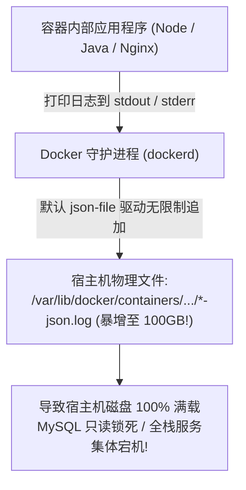

# 生产级容器日志治理滚动轮转与防爆盘实战

## 核心技术原理与实战归纳
- **核心设问与思考**：“新搭建的云服务器运行半年后突然全线瘫痪报 `No space left on device`，排查发现是 `/var/lib/docker/containers/` 下某个容器的 `*-json.log` 单文件膨胀到了整整 80GB！为什么 Docker 默认不会自动清理日志？**全局日志滚动轮转（Log Rotation）应该如何标准化配置？**”
- **深水区追问**：“在非容器化的 Linux 原生生产环境中，如何利用系统自带的 **`logrotate`** 结合 **`copytruncate`** 机制，在不重启业务进程、不丢失日志句柄的前提下，实现每日自动切割、Gzip 压缩归档与 30 天自动清除？”

---

## 一、 Docker 默认日志机制：为什么是潜伏的“磁盘定时炸弹”？

### 1. JSON-file 默认日志驱动的物理黑盒
当你在 Docker 中启动任何容器，且业务程序向终端标准输出（`stdout`）或标准错误（`stderr`）打印日志时：
1. Docker 守护进程（dockerd）会通过管道捕获这些输出；
2. 默认的日志驱动（Logging Driver）是 **`json-file`**；
3. dockerd 会把每一行日志封装为一个 JSON 对象，并**无休止、无上限地持续追加写入**到宿主机物理磁盘的以下路径：
   `/var/lib/docker/containers/<容器完整ID>/<容器完整ID>-json.log`；
4. **致命的默认值**：Docker 官方默认配置中，**`max-size` 是无限制（Unlimited）**，**`max-file` 是 1**！这意味着无论这个日志文件膨胀到 10GB、50GB 还是 200GB，Docker 绝不会主动切割，直到将整个磁盘的所有可用 Block 和 Inode 彻底榨干压垮！



---

## 二、 全局日志轮转：daemon.json 工业级终极加固

要从源头上杜绝新建容器撑爆磁盘，必须在宿主机的 Docker 守护进程全局配置文件中注入**强制日志轮转配额**。

### 1. 修改全局配置 `/etc/docker/daemon.json`
```bash
sudo vim /etc/docker/daemon.json
```

追加写入标准生产日志配额规范：
```json
{
  "log-driver": "json-file",
  "log-opts": {
    "max-size": "10m",
    "max-file": "3"
  }
}
```
- **参数物理含义解读**：
  - **`max-size: "10m"`**：单个日志文件体积一旦达到 **10MB**，Docker 会立即触发物理切割并冻结旧文件，开启一个新文件继续写入；
  - **`max-file: "3"`**：最多保留 **3 个历史切片文件**（即 `*-json.log`、`*-json.log.1`、`*-json.log.2`）。当第 4 个文件生成时，最老的一个切片会被操作系统自动永久抹除；
  - **效果**：**任何容器产生的日志总量被死死锁死在 $10\text{MB} \times 3 = 30\text{MB}$ 以内**！即使业务代码发生死循环疯狂刷屏打印日志，也绝对不会对宿主机磁盘空间构成任何威胁！

### 2. 生效命令
```bash
# 重载系统守护进程并重启 Docker (不会影响后续新建的容器)
sudo systemctl daemon-reload
sudo systemctl restart docker
```
> **[!WARNING] 注意事项**：
> 修改 `daemon.json` 仅对**此后新创建的容器**生效！对于已经存在的旧容器，必须将其销毁并重新 `docker run` 或 `docker compose up -d` 重新构建后才会继承该全局策略。

---

## 三、 单容器与 Docker Compose 细粒度日志控制

如果你不想修改全局配置，或者希望为特定的核心服务（如 Nginx 或订单系统）单独定制更大的日志配额，可以在启动指令或 Compose 文件中精准覆盖：

### 1. 在 `docker run` 中单独配置
```bash
docker run -d --name my-app \
  --log-driver json-file \
  --log-opt max-size=20m \
  --log-opt max-file=5 \
  my-app:latest
```

### 2. 在 `docker-compose.yml` 中单独配置
```yaml
version: '3.8'

services:
  backend:
    image: shop-api:latest
    container_name: prod-api
    restart: unless-stopped
    # 细粒度日志配额约束
    logging:
      driver: "json-file"
      options:
        max-size: "10m"
        max-file: "3"

  mysql:
    image: mysql:8.0
    logging:
      driver: "json-file"
      options:
        max-size: "20m"
        max-file: "5"
```

---

## 四、 Linux 原生日志轮转神器：logrotate 生产级实战

如果你的服务是直接运行在 Linux 宿主机上（非 Docker 容器，如手写 Systemd 或 Nginx 原生部署），Linux 系统自带的 **`logrotate`** 是最成熟的工业级解决方案。

### 1. 编写生产级切割配置：`/etc/logrotate.d/shop-api`
```bash
sudo vim /etc/logrotate.d/shop-api
```

写入标准规范：
```text
/var/log/app/*.log {
    # 每天执行一次切割检查
    daily
    # 最多保留 30 天的历史日志切片，超期自动删除
    rotate 30
    # 开启 Gzip 自动压缩，将历史日志压缩为 .log.1.gz (节约 90% 空间)
    compress
    # 延迟到下一次轮转时再压缩 (防止当前正在写入的文件被同时压缩报错)
    delaycompress
    # 若日志文件不存在，不抛出任何报错，静默跳过
    missingok
    # 若日志文件是空的 (0 字节)，不进行任何切割轮转
    notifempty
    # 切割后的新文件赋予 644 权限，所属用户为 www-data
    create 0644 www-data www-data

    # 【核心核心神技】copytruncate 机制!
    copytruncate
}
```

### 2. 为什么 `copytruncate` 是全栈日志切割的核心神技？
- **传统方式（把旧文件 mv 走，再 touch 一个新文件）的灾难**：
  操作系统中，运行中的程序（如 Node.js 或 Java）持有着原文件的 **`inode` 和文件描述符（FD）**。如果你直接把文件 `mv app.log app.log.1` 并新建了 `app.log`，程序的内部写指针仍然死死指向被改名后的 `app.log.1`！程序依然会向旧文件写入，导致新文件永远为空；
- **`copytruncate` 的物理优雅机制**：
  1. 它首先将当前活跃的 `app.log` 完整**复制一份副本**为 `app.log.1`；
  2. 随后在原地通过系统调用将原文件 `app.log` 的内容**截断清零（Truncate to 0 字节）**；
  3. 程序的 `inode` 和文件描述符**完全没有发生任何改变**！程序继续往原文件从第 0 字节开始平滑写入，完全不需要重启任何服务，实现真正的**线上零感知切割**！

---

## 五、 容器安全运行边界：物理 CPU 与内存配额限制

在微服务容器化架构中，为了防止单个服务发生内存泄漏（如未清理的大 Map）拖垮整台宿主机，必须在容器启动时显式施加 Cgroups 物理配额：

### 1. 内存硬限制与 Swap 约束
```bash
docker run -d --name heavy-app \
  # 限制该容器最大允许使用的物理内存为 512MB
  --memory=512m \
  # 限制物理内存 + Swap 交换空间的总和为 1GB (超出直接触发 OOMKilled 终止退出)
  --memory-swap=1g \
  my-app:latest
```

### 2. CPU 算力限制
```bash
docker run -d --name heavy-calc \
  # 限制该容器在任意一秒内，最多只能使用相当于 1.5 个 CPU 核心的算力时间片
  --cpus="1.5" \
  my-calc:latest
```

---

## 六、 生产避坑防雷指南

1. **容器已被日志打满 100% 时的紧急自救**：
   - 很多工程师在遇到容器日志把磁盘撑满时，执行 `rm -f /var/lib/docker/containers/.../*-json.log`；
   - **灾难后果**：文件被删但 Docker 守护进程仍持有句柄，空间不仅无法释放，还会导致 `docker logs` 彻底失灵报 `no such file or directory`；
   - **标准自救清空姿势**：
     ```bash
     # 使用管道直接将物理日志截断为 0 字节，磁盘空间秒级全部归还，服务完全不中断!
     cat /dev/null > $(docker inspect --format='{{.LogPath}}' <容器名>)
     ```

---

## 七、 面试高频连环追问

### Q1: 在执行 `docker stats` 查看容器指标时，发现某容器的 STATUS 突然显示为 `Exited (137)`，这是什么原因引起的？如何确诊？
**答**：
- **核心结论**：退出码 **`137`（128 + 9）** 意味着该容器内部的进程**收到了操作系统内核发送的 `SIGKILL`（信号 9）被无情强杀**；
- **真实病因（OOMKilled）**：绝大多数情况下是因为**容器使用的物理内存超过了通过 `--memory` 设置的 Cgroups 配额上限**，被 Linux 内核的 OOM Killer 强制瞬时绞杀；
- **核验确诊命令**：
  ```bash
  docker inspect <容器名> --format='{{.State.OOMKilled}}'
  ```
  如果输出为 **`true`**，确诊为内存打满被 OOM 强杀。需排查程序内部是否存在内存泄漏，或适当调大容器的内存配额。

### Q2: 为什么有了 `logrotate`，很多生产团队依然建议在应用程序内部配置专有的日志框架（如 Logback / Winston）做滚动？
**答**：
- **`copytruncate` 的微小竞态窗口期（Race Condition）**：
  在 `copytruncate` 复制完副本到将原文件截断清空的微小时间窗口内（通常几十毫秒），如果有超高并发的大量新日志涌入写入，这部分新写入的日志在截断时可能会发生轻微丢失；
- **应用内部框架的优势**：
  应用内置的日志框架（如 Java Logback 的 `RollingFileAppender`、Node.js 的 `winston-daily-rotate-file`）能够直接感知代码内部的 Log Event，可以在文件达到预设大小的瞬间，原子性地在内存中关闭旧文件并创建新文件，实现 **100% 零数据丢失**的精确切割与基于日期的精细归档。
