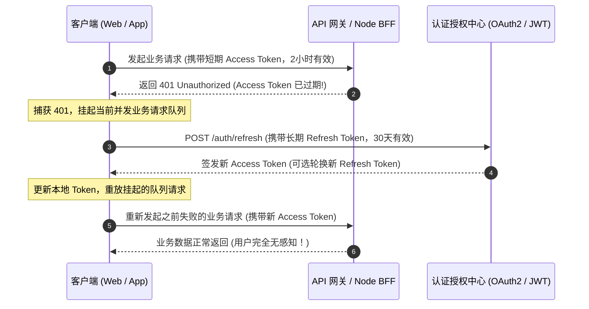

# 全栈 Token 无感刷新与双 Token 架构生产实战

在现代 Web 前端（Vue/React）、移动端与全栈微服务架构中，单纯使用一个长期有效的 JWT Token 存在巨大的安全隐患（一旦被中间人截获，攻击者可在过期前长期滥用且服务端无法轻易作废）。

业内通用的标准黄金解决方案是采用**双 Token 架构（Access Token + Refresh Token）**，并结合前端拦截器实现用户无感知的**无感静默刷新机制**。

---

## 1. 双 Token 架构物理流转模型



---

## 2. 前端 Axios / Fetch 生产级无感刷新与并发锁队列

当用户的 Access Token 过期时，若页面上同时并发触发了 5 个接口请求，若未做并发控制，前端会同时发起 5 次刷新 Token 的请求，导致严重的竞态冲突与 Refresh Token 失效。

### 标准解决方案：状态标志位 + 失败请求队列挂起

```typescript
import axios from 'axios';

const http = axios.create({ baseURL: 'https://api.yourdomain.com' });

let isRefreshing = false; // 是否正在刷新中锁
let pendingRequests: Array<(token: string) => void> = []; // 挂起的重试请求队列

// 响应拦截器
http.interceptors.response.use(
  (response) => response,
  async (error) => {
    const originalRequest = error.config;

    // 捕获 401 且未重试过
    if (error.response?.status === 401 && !originalRequest._retry) {
      if (isRefreshing) {
        // 关键点：若当前正在刷新，将后续请求包装成 Promise 挂入队列等待通知
        return new Promise((resolve) => {
          pendingRequests.push((newToken: string) => {
            originalRequest.headers.Authorization = `Bearer ${newToken}`;
            resolve(http(originalRequest));
          });
        });
      }

      originalRequest._retry = true;
      isRefreshing = true;

      try {
        const refreshToken = localStorage.getItem('refresh_token');
        const res = await axios.post('https://api.yourdomain.com/auth/refresh', {
          refreshToken
        });

        const newAccessToken = res.data.accessToken;
        localStorage.setItem('access_token', newAccessToken);

        // 重新执行之前挂起的全部请求
        pendingRequests.forEach((callback) => callback(newAccessToken));
        pendingRequests = [];

        // 重新执行当前失败的请求
        originalRequest.headers.Authorization = `Bearer ${newAccessToken}`;
        return http(originalRequest);
      } catch (refreshErr) {
        // Refresh Token 也已过期，彻底踢回登录页
        localStorage.clear();
        window.location.href = '/login';
        return Promise.reject(refreshErr);
      } finally {
        isRefreshing = false;
      }
    }

    return Promise.reject(error);
  }
);
```

---

## 3. 服务端安全加固规范

1. **Refresh Token 轮换（Rotation）**：每次客户端使用 Refresh Token 换取新 Access Token 时，服务端应废弃旧的 Refresh Token 并同时签发一个全新的 Refresh Token，限制被盗凭据的有效窗口；
2. **黑名单与多设备踢下线（Token Revocation）**：在 Redis 中记录已主动退出或被管理员禁用的 Token 签名指纹（JTI），拦截注销后的非法请求。
