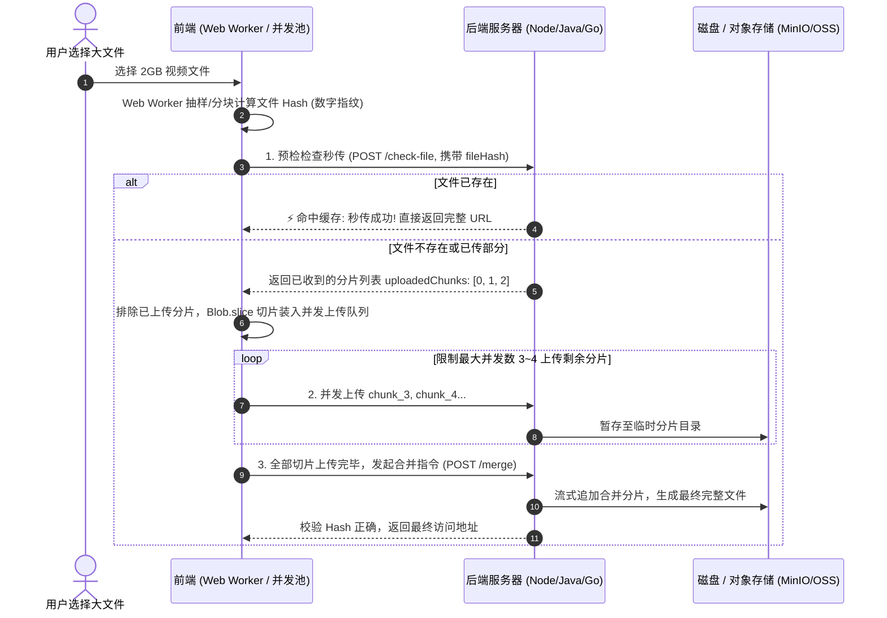

# 大文件分片上传与断点续传全栈实战

## 🎯 招聘面试核心考点
- **面试官设问**：“如果在客户端或 Web 端上传几个 G 的高清视频或离线安装包，直传超时或断网失败怎么解决？”
- **深水区追问**：“如何实现**秒传**？传到 90% 断开如何实现**断点续传**？前端几百个分片同时上传如何控制**并发请求池**，防止浏览器网络连接数占满崩溃？”

---

## 🏢 真实生产业务场景
- **网盘与企业文档中心**：如百度网盘、阿里云盘的文件拖拽上传。
- **音视频生产系统**：抖音/B站创作者端上传 4K/8K 视频原片。
- **离线安装包与大模型权重交付**：移动端上传大容量 Dump 日志、后端管理平台分发 Android APK 与大模型模型权重（`.gguf`/`.bin`）。

---

## ⚙️ 核心全链路流程图

::: tip 🧩 通俗心智模型：拼图邮寄与顺丰断点补发
* **第一步：计算数字指纹（文件 Hash，类似身份证号）**：
  * 在 Web Worker 子线程里快速算好整个文件的 MD5。先拿着指纹问服务器：“你仓库里有这套拼图吗？”如果早有了，直接判定**秒传成功（耗时 0 秒）**！
* **第二步：切块分装（`Blob.slice` 切成 2MB 小拼图块）**：
  * 如果仓库没有，把 2GB 大文件切成 1000 块小拼图。如果中途网络断开（断电/地铁无信号），**根本不需要重头再传**，重连后问服务器收到了哪些块，只补发剩下的块（**断点续传**）！
* **第三步：限制小哥人数（并发控制池，例如固定 4 个通道）**：
  * 绝不能同时发起 1000 个 HTTP 请求，否则直接把浏览器和后端网关撑爆。
* **第四步：仓库总拼装（POST /merge 发起合流）**：
  * 仓库核验 1000 块全部集齐，流水线管道将各分片追加合并成完整大文件并校验 Hash。
:::



---

## 💻 最小可运行 MVP 代码实战

### 1. 前端：文件切片、秒传预检与并发控制池（纯 TypeScript / JS）

```javascript
// upload_manager.js
class ChunkUploader {
  constructor(file, chunkSize = 2 * 1024 * 1024) { // 每个分片 2MB
    this.file = file;
    this.chunkSize = chunkSize;
    this.totalChunks = Math.ceil(file.size / chunkSize);
    this.fileHash = '';
  }

  // 1. 模拟/实际计算文件 Hash（防止大文件卡死主线程）
  async calculateHash() {
    // 生产环境使用 spark-md5 结合 Web Worker 分块读取
    // 这里为最小 MVP 演示，提取文件名前后各 1MB 计算特征哈希
    return new Promise((resolve) => {
      this.fileHash = `file_${this.file.name}_${this.file.size}`;
      resolve(this.fileHash);
    });
  }

  // 2. 预检接口：检查秒传和已上传的分片
  async checkUploaded() {
    const res = await fetch(`http://localhost:8080/api/upload/check?fileHash=${this.fileHash}`);
    return await res.json(); // 返回: { isComplete: boolean, uploadedChunks: number[] }
  }

  // 3. 并发控制池：限制同时最多 3 个请求在飞
  async uploadChunks(uploadedList = [], maxConcurrent = 3) {
    const chunks = [];
    for (let i = 0; i < this.totalChunks; i++) {
      if (!uploadedList.includes(i)) {
        const start = i * this.chunkSize;
        const end = Math.min(this.file.size, start + this.chunkSize);
        chunks.push({ index: i, blob: this.file.slice(start, end) });
      }
    }

    let executing = [];
    for (const chunk of chunks) {
      const p = this.uploadSingleChunk(chunk).then(() => {
        executing.splice(executing.indexOf(p), 1);
      });
      executing.push(p);

      if (executing.length >= maxConcurrent) {
        await Promise.race(executing); // 等待最快完成的一个腾出位置
      }
    }
    await Promise.all(executing); // 等待收尾剩余分片
  }

  // 单个切片上传
  async uploadSingleChunk(chunk) {
    const formData = new FormData();
    formData.append('fileHash', this.fileHash);
    formData.append('chunkIndex', chunk.index);
    formData.append('chunk', chunk.blob);

    await fetch('http://localhost:8080/api/upload/chunk', {
      method: 'POST',
      body: formData,
    });
    console.log(`[上传进度] 切片 ${chunk.index + 1}/${this.totalChunks} 上传成功`);
  }

  // 4. 通知服务端合并
  async merge() {
    const res = await fetch('http://localhost:8080/api/upload/merge', {
      method: 'POST',
      headers: { 'Content-Type': 'application/json' },
      body: JSON.stringify({
        fileHash: this.fileHash,
        fileName: this.file.name,
        totalChunks: this.totalChunks
      }),
    });
    return await res.json();
  }
}
```

---

### 2. 后端：分片保存与零拷贝快速合并（Spring Boot 控制器）

```java
@RestController
@RequestMapping("/api/upload")
public class ChunkUploadController {

    private final String TEMP_DIR = "/data/temp_chunks/";
    private final String TARGET_DIR = "/data/files/";

    // 1. 预检接口：判断秒传与断点列表
    @GetMapping("/check")
    public Map<String, Object> checkUpload(@RequestParam String fileHash) {
        Map<String, Object> result = new HashMap<>();
        File targetFile = new File(TARGET_DIR + fileHash);
        
        if (targetFile.exists()) {
            result.put("isComplete", true); // 秒传触发！
            return result;
        }

        File tempDir = new File(TEMP_DIR + fileHash);
        List<Integer> uploadedChunks = new ArrayList<>();
        if (tempDir.exists() && tempDir.isDirectory()) {
            for (File chunk : tempDir.listFiles()) {
                uploadedChunks.add(Integer.parseInt(chunk.getName()));
            }
        }
        result.put("isComplete", false);
        result.put("uploadedChunks", uploadedChunks); // 断点续传，只传剩余分片
        return result;
    }

    // 2. 接收单个分片
    @PostMapping("/chunk")
    public String uploadChunk(@RequestParam String fileHash,
                              @RequestParam Integer chunkIndex,
                              @RequestParam MultipartFile chunk) throws IOException {
        File chunkDir = new File(TEMP_DIR + fileHash);
        if (!chunkDir.exists()) chunkDir.mkdirs();

        File chunkFile = new File(chunkDir, String.valueOf(chunkIndex));
        chunk.transferTo(chunkFile);
        return "SUCCESS";
    }

    // 3. 合并所有分片
    @PostMapping("/merge")
    public String mergeChunks(@RequestBody Map<String, Object> params) throws IOException {
        String fileHash = (String) params.get("fileHash");
        String fileName = (String) params.get("fileName");
        int totalChunks = (Integer) params.get("totalChunks");

        File chunkDir = new File(TEMP_DIR + fileHash);
        File targetFile = new File(TARGET_DIR + fileHash + "_" + fileName);

        // 使用 FileChannel 零拷贝顺序写入，吞吐量极大
        try (FileChannel outChannel = new FileOutputStream(targetFile).getChannel()) {
            for (int i = 0; i < totalChunks; i++) {
                File chunkFile = new File(chunkDir, String.valueOf(i));
                try (FileChannel inChannel = new FileInputStream(chunkFile).getChannel()) {
                    inChannel.transferTo(0, inChannel.size(), outChannel);
                }
                chunkFile.delete(); // 合并后立刻删除临时切片，释放磁盘
            }
        }
        chunkDir.delete();
        return "MERGE_SUCCESS: " + targetFile.getAbsolutePath();
    }
}
```

---

## ⚠️ 生产级避坑指南（面试绝密加分项）
1. **防止孤儿分片占满磁盘**：用户上传到一半关掉浏览器，留下的临时分片如何清理？
   - **方案**：必须配置**定时清理任务（Cron Job）**，每日凌晨扫描 `TEMP_DIR`，将创建时间超过 24 小时且未被合并的目录直接删除。
2. **并发合并 IO 瓶颈**：如果有上百个大文件同时执行 `merge`，磁盘 IO 会直接被打满。
   - **方案**：合并操作必须放入**异步线程池**或推入 **MQ 延迟队列**，合并成功后通过 WebSocket 通知前端。
