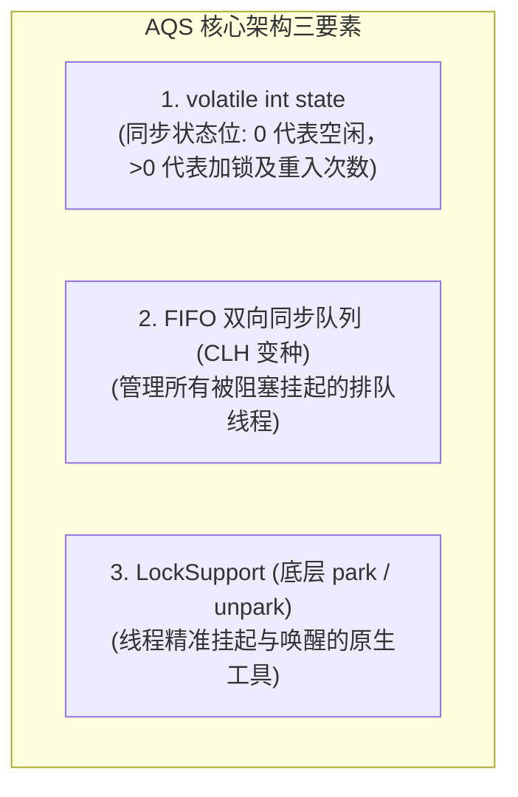

# AQS 核心架构设计与源码深度逐行解析

如果说 JMM 和 CAS 是 Java 并发编程的理论与硬件底座，那么 **AQS（AbstractQueuedSynchronizer，抽象队列同步器）** 就是构建整个 `java.util.concurrent`（JUC）高级并发大厦的钢铁支架。

`ReentrantLock`、`ReentrantReadWriteLock`、`Semaphore`、`CountDownLatch` 等著名并发工具，底层全部依赖 AQS 实现。

---

## 1. AQS 核心三大物理支柱

AQS 的优雅与强大，源自其极致精炼的三大核心组件：



### 1.1 `volatile int state`（同步状态）
- 使用 `volatile` 修饰，保证跨线程内存可见性。
- 通过底层的 CAS 操作（`compareAndSetState`）保证状态变更的原子性。
- **不同子类的语义映射**：
  - 在 **`ReentrantLock`** 中：`state = 0` 表示锁空闲；`state > 0` 表示已被线程持有，且数值代表该线程**重入该锁的次数**！
  - 在 **`Semaphore`** 中：`state` 代表**当前剩余可用的许可证（Permits）数量**。
  - 在 **`CountDownLatch`** 中：`state` 代表**尚未倒数清零的剩余计数**。
  - 在 **`ReentrantReadWriteLock`** 中：一个 32 位的 `state` 被精妙地拆成两半 —— **高 16 位代表读锁持有计数，低 16 位代表写锁重入次数**！

---

### 1.2 CLH 变种双向队列（同步队列）
- 当线程争夺 `state` 失败后，AQS 会将其封装为一个 **`Node` 节点**，并加入到双向链表队列中。
- **`Node` 节点内部四大核心状态（`waitStatus`）**：
  - **`SIGNAL (-1)`**：**极度核心**。表示当前节点的**后继节点正处于阻塞挂起状态**，当前节点释放锁或取消后，**必须负责主动唤醒（unpark）后继节点**！
  - **`CANCELLED (1)`**：表示当前节点由于超时或被外部中断而取消排队，属于无效垃圾节点，会被自动移出链表。
  - **`CONDITION (-2)`**：表示当前节点正在 `Condition` 条件等待队列中挂起。
  - **`PROPAGATE (-3)`**：仅在共享模式下使用，表示下一次共享状态的释放必须无条件向后传播唤醒。

---

## 2. 独占式获取锁（`acquire`）源码逐行深度拆解

以 `ReentrantLock.lock()` 为例，底层直接调用 `AQS.acquire(1)`：

```java
public final void acquire(int arg) {
    // 1. 尝试直接获取锁，若成功直接返回！
    // 2. 若失败，先调用 addWaiter 封装入队，再调用 acquireQueued 死循环自旋挂起
    if (!tryAcquire(arg) &&
        acquireQueued(addWaiter(Node.EXCLUSIVE), arg))
        selfInterrupt();
}
```

### 2.1 步骤一：`addWaiter(Node.EXCLUSIVE)` 入队
如果第一次 CAS 抢锁失败，当前线程必须被封装成 Node 节点，追加到双向链表尾部：
```java
private Node addWaiter(Node mode) {
    Node node = new Node(Thread.currentThread(), mode);
    Node pred = tail;
    // 快速尝试：如果队列尾部已经初始化，直接尝试一次 CAS 追加到尾部
    if (pred != null) {
        node.prev = pred;
        if (compareAndSetTail(pred, node)) {
            pred.next = node;
            return node;
        }
    }
    // 快速失败或尾部未初始化，进入 enq 死循环自旋保证 100% 入队成功
    enq(node);
    return node;
}
```

---

### 2.2 步骤二：`acquireQueued` 核心自旋与挂起（核心灵魂）
线程入队后，并不是立刻傻傻地休眠，而是进入 `acquireQueued` 的死循环自旋中：

```java
final boolean acquireQueued(final Node node, int arg) {
    boolean failed = true;
    try {
        boolean interrupted = false;
        for (;;) {
            // 获取当前节点的前驱节点
            final Node p = node.predecessor();
            
            // 核心！如果前驱节点恰好是 head 虚拟头节点，说明当前节点是队列中“排在第一位的老大”！
            // 此时它有资格再次尝试抢一次锁 (tryAcquire)！
            if (p == head && tryAcquire(arg)) {
                setHead(node); // 抢锁成功，当前节点晋升为全新的 head 虚节点！
                p.next = null; // 帮助 GC 回收老 head
                failed = false;
                return interrupted;
            }
            
            // 如果前驱不是 head，或者再次抢锁依然失败：
            // 1. shouldParkAfterFailedAcquire: 确保把前驱节点的状态通过 CAS 设置为 SIGNAL (-1)!
            // 2. parkAndCheckInterrupt: 调用 LockSupport.park() 真正将当前线程挂起休眠！
            if (shouldParkAfterFailedAcquire(p, node) &&
                parkAndCheckInterrupt())
                interrupted = true;
        }
    } finally {
        if (failed)
            cancelAcquire(node);
    }
}
```

> **为什么必须把前驱节点设为 `SIGNAL (-1)`？**  
> 因为线程一旦调用 `LockSupport.park()`，就彻底失去主动执行代码的能力，进入深度睡眠。它醒来的唯一希望，就是**前驱节点在释放锁时看一眼自己的状态，发现是 `SIGNAL`，从而调用 `unpark` 把它叫醒**！因此线程在自己睡觉前，必须严谨地在前驱节点上贴一张“叫醒我”的标签。

---

## 3. 独占式释放锁（`release`）源码逐行拆解

当持有锁的线程调用 `unlock()` 时，底层调用 `AQS.release(1)`：

```java
public final boolean release(int arg) {
    // 1. 调用子类的 tryRelease，尝试将 state 减 1 (处理重入)
    if (tryRelease(arg)) {
        Node h = head;
        // 如果头节点不为空，且头节点状态 != 0 (通常为 SIGNAL -1)
        if (h != null && h.waitStatus != 0)
            unparkSuccessor(h); // 核心唤醒后继！
        return true;
    }
    return false;
}
```

### `unparkSuccessor` 是如何寻找并唤醒后继节点的？
```java
private void unparkSuccessor(Node node) {
    int ws = node.waitStatus;
    if (ws < 0)
        compareAndSetWaitStatus(node, ws, 0); // 复位状态

    Node s = node.next;
    // 细节精深：如果 next 节点为空，或者已经被取消 (CANCELLED > 0)
    if (s == null || s.waitStatus > 0) {
        s = null;
        // 从链表尾部 tail 开始，逆序向前查找距离 head 最近的有效非取消节点！
        for (Node t = tail; t != null && t != node; t = t.prev)
            if (t.waitStatus <= 0)
                s = t;
    }
    // 唤醒目标有效后继线程！
    if (s != null)
        LockSupport.unpark(s.thread);
}
```

> **为什么从尾部 `tail` 逆序向前找，而不是从头部正向找？**  
> 因为在入队方法 `enq()` 中：  
> `node.prev = pred; compareAndSetTail(pred, node); pred.next = node;`  
> 在高并发下，CAS 成功将 tail 指向新节点的一瞬间，**`pred.next = node` 这一行可能尚未执行**！此时从前向后找会遭遇 `next == null` 的断链；但 **`node.prev` 是在 CAS 之前就已经绑定好的**，因此从尾部逆向遍历能 100% 确保遍历到整条链表的所有节点！

---

## 4. Condition 条件等待队列核心运转机制

每个 `ConditionObject` 内部维护了一个纯单向的条件等待队列（由 `firstWaiter` 和 `lastWaiter` 组成）：

```text
AQS 内部双队列协同全景：
┌────────────────────────────────────────────────────────┐
│ 同步等待队列 (Sync Queue - 双向链表):                   │
│ [Head 虚拟节点] ◀══▶ [Node(线程1)] ◀══▶ [Node(线程2)]   │
└───────────────────────────▲────────────────────────────┘
                            │ signal() 时将节点转移至同步队列
┌───────────────────────────┴────────────────────────────┐
│ 条件等待队列 (Condition Queue - 单向链表):              │
│ [firstWaiter: 线程3] ──▶ [线程4] ──▶ [lastWaiter: 线程5] │
└────────────────────────────────────────────────────────┘
```

1. **`await()` 过程**：
   - 当前线程必须已经持有独占锁；
   - 调用 `await()` 时，将当前线程封装为节点，追加到**条件单向队列尾部**；
   - 彻底释放当前持有的锁资源（重入次数全部清零记录在案），唤醒同步队列中的后继节点；
   - 调用 `LockSupport.park()` 进入条件休眠。
2. **`signal()` 过程**：
   - 将条件单向队列头部的有效节点取出；
   - **直接移动并挂载到同步双向队列的尾部**；
   - 将该节点的前驱状态设为 `SIGNAL`，等待未来锁释放时被唤醒重争锁资源！
