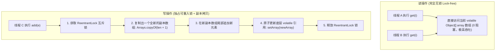

# ArrayList 与 CopyOnWriteArrayList 源码剖析

`List` 集合是日常业务开发中使用频次最高的数据结构。在社招面试中，围绕 `ArrayList` 和 `CopyOnWriteArrayList` 的考察往往从基础属性出发，直接深入到**扩容位运算推导、fail-fast 机制的底层触发、以及读写分离并发容器在面对高并发写入时的内存开销权衡**。

---

## 1. ArrayList 核心源码与扩容机制深度解剖

`ArrayList` 本质上是一个**基于动态对象数组**的顺序表实现。

### 1.1 核心成员变量
```java
public class ArrayList<E> extends AbstractList<E> ... {
    // 默认初始容量 (首次真正写入数据时才会分配)
    private static final int DEFAULT_CAPACITY = 10;
    
    // 共享的空数组实例，用于惰性初始化
    private static final Object[] DEFAULTCAPACITY_EMPTY_ELEMENTDATA = {};
    
    // 底层物理数组
    transient Object[] elementData; 
    
    // 当前集合中实际包含的元素个数
    private int size;
}
```

### 1.2 懒加载与 1.5 倍扩容机制源码演进
当执行 `new ArrayList<>()` 时，底层并不会立即在堆中开辟包含 10 个引用的数组，而是赋值为 `DEFAULTCAPACITY_EMPTY_ELEMENTDATA`（空数组）。

当第一次执行 `add(e)` 时，才会真正触发首次扩容分配：
```java
private void grow(int minCapacity) {
    int oldCapacity = elementData.length;
    // 核心算法：1.5 倍扩容 (右移 1 位等价于除以 2)
    int newCapacity = oldCapacity + (oldCapacity >> 1);
    
    if (newCapacity - minCapacity < 0)
        newCapacity = minCapacity;
        
    // 底层通过本地方法 System.arraycopy 实现高性能物理内存数据迁移
    elementData = Arrays.copyOf(elementData, newCapacity);
}
```

> **位运算优势**：`oldCapacity + (oldCapacity >> 1)` 比乘除法更贴近 CPU 原生机器码指令，执行速度极致。

---

## 2. fail-fast 快速失败机制与并发修改安全

在单线程或多线程环境下，经常有人遇到经典的 **`ConcurrentModificationException`**。

### 2.1 触发根因与 `modCount`
- 在 `ArrayList` 内部维护了一个成员变量：
  ```java
  protected transient int modCount = 0; // 记录结构性修改的次数 (add/remove/clear)
  ```
- 当通过 `for-each` 语法糖遍历集合时，底层自动生成了 `ArrayList.Itr` 迭代器实例。
- 迭代器在初始化时，会把当前的 `modCount` 快照赋值给内部的 `expectedModCount`：
  ```java
  int expectedModCount = modCount;
  ```
- 每次调用 `iterator.next()` 时，都会无条件执行：
  ```java
  final void checkForComodification() {
      if (modCount != expectedModCount)
          throw new ConcurrentModificationException();
  }
  ```
- 如果在遍历期间，代码直接调用了 `list.remove(e)` 或 `list.add(e)`，导致宿主对象的 `modCount` 累加，而迭代器内部的 `expectedModCount` 保持原样，**两者瞬间失衡，当场抛出异常！**

### 2.2 生产正确做法：如何安全地边遍历边删除？
1. **使用迭代器自带的 `remove()` 方法**：
   ```java
   Iterator<String> it = list.iterator();
   while (it.hasNext()) {
       if (condition(it.next())) {
           it.remove(); // 内部会自动执行 expectedModCount = modCount，保持同步
       }
   }
   ```
2. **使用 JDK 8+ 的函数式方法**：
   ```java
   list.removeIf(item -> condition(item)); // 优雅、高效且线程边界清晰
   ```

---

## 3. CopyOnWriteArrayList（COW）：写时复制高并发容器

`ArrayList` 是非线程安全的。如果在多线程高并发读写环境下直接使用，会导致数据覆盖甚至数组越界。

除了老旧低效的 `Vector`（所有方法加 `synchronized` 锁）之外，JUC 提供了著名的 **`CopyOnWriteArrayList`**。

### 3.1 写时复制（Copy-On-Write）核心架构



### 3.2 源码核心实操解析
查看 `CopyOnWriteArrayList.add(E e)` 源码：
```java
public boolean add(E e) {
    synchronized (lock) { // JDK 11+ 改用 synchronized 内部锁，JDK 8 为 ReentrantLock
        Object[] es = getArray();
        int len = es.length;
        // 核心：复制新数组
        es = Arrays.copyOf(es, len + 1);
        es[len] = e;
        // 核心：原子替换底层 volatile 引用指针
        setArray(es);
        return true;
    }
}
```

### 3.3 核心特性：弱一致性迭代器
- `CopyOnWriteArrayList` 的迭代器在创建时，直接将当前的内部数组作为不变快照（Snapshot）传递给迭代器。
- 即使后续有其他写线程执行了 `add()` 并切换了新数组，迭代器遍历的**依然是它诞生时刻的旧数组快照**。
- **结论**：COW 迭代器**绝对不会抛出 `ConcurrentModificationException`**，且遍历过程完全无锁；但代价是它读到的是**弱一致性的数据快照**，不能保证实时强一致。

---

## 4. 社招高频面试追问

### Q1：CopyOnWriteArrayList 有哪些致命缺点？在什么场景下严禁使用？
1. **内存占用暴增与频繁 GC 隐患**：
   每次写操作（`add/set/remove`）都需要把底层整个数组完整复制一份。如果集合中包含几十万个对象，每插入一条数据都会在堆中创建几十万个引用的新数组，导致堆内存短时间内剧烈膨胀，频繁触发 Full GC！
2. **写性能低下**：
   频繁写操作不仅需要频繁拷贝大数组，还涉及锁争用。
- **严禁使用场景**：**写多读少、数据量庞大的高频更新场景！**
- **最佳适用场景**：**“读极大、写极少、数据量不大”的场景**，如系统的配置项缓存列表、黑白名单列表、发布订阅模式的事件监听器列表（Listener List）。
