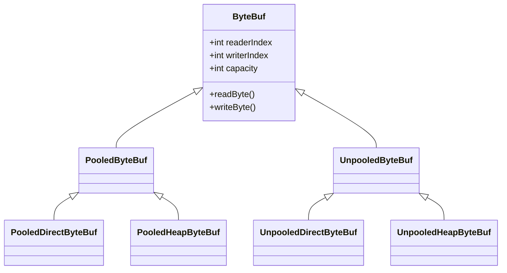
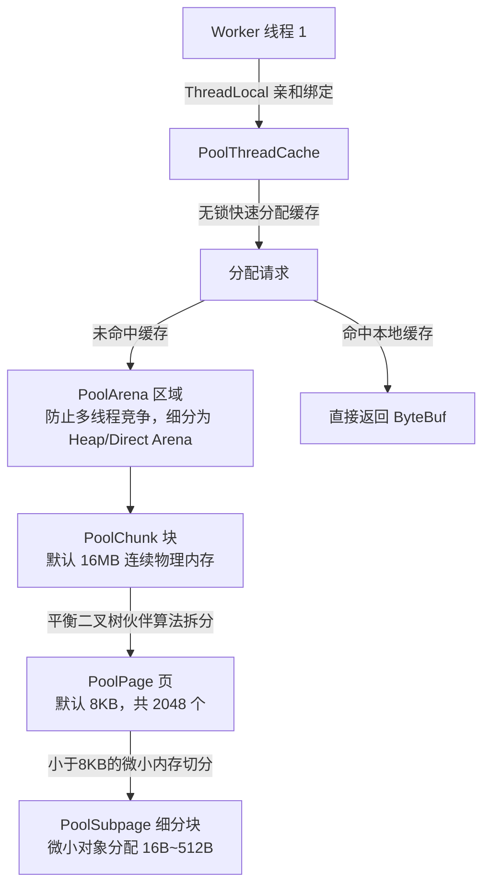
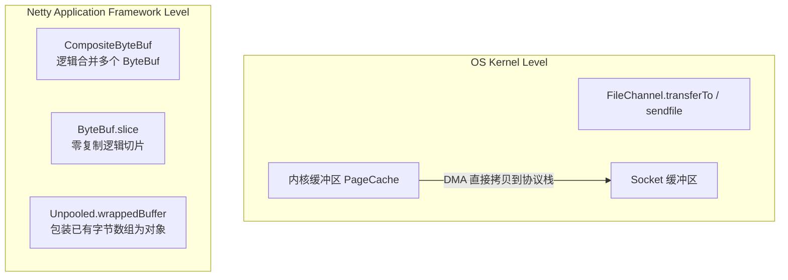

# ByteBuf内存分配与Netty零拷贝机制全景

在网络传输中，高性能数据载体的设计直接决定了框架的处理上限。JDK 自带的 `java.nio.ByteBuffer` 存在读写模式切换繁琐（必须手动调用 `flip()`）、无法动态扩容、无内存池机制等硬伤。Netty 重新设计了 `ByteBuf` 体系，结合**多层级伙伴内存分配算法（jemalloc）**与**用户态/内核态零拷贝**，将内存利用率与网络吞吐推向极致。

---

## 核心底层机制与全景架构

### 1. ByteBuf 的分类维度矩阵

Netty 的 ByteBuf 从三个正交维度进行设计划分：
1. **内存位置**：
   - `Heap ByteBuf`（堆内存）：分配在 JVM 堆内，受 GC 管辖。写入 Socket 时必须先复制到操作系统内核或临时直接内存。
   - `Direct ByteBuf`（直接内存/堆外内存）：通过 JNI `Unsafe.allocateMemory()` 或 `ByteBuffer.allocateDirect()` 分配在 OS 物理内存中，避免用户态与内核态二次复制，但分配与销毁开销较大。
2. **内存池化**：
   - `Pooled ByteBuf`（池化）：从预分配的高速内存池（PoolArena）中切分出空闲内存块，用完回收归池，高并发下大幅缓解 GC 暂停与内存碎片。
   - `Unpooled ByteBuf`（非池化）：每次创建都重新申请物理内存，GC 时销毁。
3. **安全访问**：
   - `Unsafe`：依赖 `sun.misc.Unsafe` 通过物理内存地址偏移量直接读写，速度极快。
   - `Non-Unsafe`：通过原生数组下标或标准 ByteBuffer API 操作，具备跨平台沙盒安全性。



### 2. 双指针读写设计

与 JDK ByteBuffer 必须依赖 `flip()` 翻转状态不同，`ByteBuf` 引入了独立的两个指针：
```
+-------------------+------------------+------------------+
| discardable bytes |  readable bytes  |  writable bytes  |
|                   |     (CONTENT)    |                  |
+-------------------+------------------+------------------+
|                   |                  |                  |
0      <=      readerIndex    <=   writerIndex    <=    capacity
```
- 读取数据时：`readerIndex` 递增，一旦 `readerIndex == writerIndex` 则不可再读。
- 写入数据时：`writerIndex` 递增，超过 `capacity` 时若未达到 `maxCapacity` 则自动扩容。

---

## 源码级架构物理拆解

### 1. 基于 jemalloc 思想的内存池架构（PooledByteBufAllocator）

Netty 借鉴了 FreeBSD 高性能内存分配器 **jemalloc** 的核心架构，将内存划分为多层组织：



#### 核心层级解析：
1. **PoolArena**：为了减少高并发下多线程申请内存的锁竞争，Netty 预分配了多个 Arena（数量默认为 `CPU 核心数 * 2`）。每个线程通过 `ThreadLocal` 亲和绑定到特定的 Arena。
2. **PoolChunk**：Netty 向操作系统一次性申请的一大块连续物理内存（默认大小为 $16\text{ MB}$）。
   - 在 Netty 4.1.45 之前，使用满二叉树（Complete Binary Tree）组织 2048 个 8KB Page，高度为 11。每个节点记录当前子树可分配的最大节点深度。
   - 新版 Netty 采用位图 `LongPriorityQueue` 提升分配效率。
3. **PoolPage**：Chunk 拆分出的最小单位，默认大小为 $8\text{ KB}$。
4. **PoolSubpage**：当申请的内存小于一个 Page（$8\text{ KB}$，即 Tiny / Small 规格）时，直接分配 8KB 容易造成严重的内部碎片。Netty 会将一个 8KB 的 Page 继续等分为多个相同大小的 Subpage（例如 16B、32B、...、512B），并用 `long[] bitmap` 记录每个小块的占用状态。
5. **PoolThreadCache**：利用 `ThreadLocal` 缓存当前线程最近释放的内存块（Tiny/Small/Normal）。当该线程再次申请相同大小的内存时，直接从线程本地栈弹出，全程**无锁操作（Zero Lock Contention）**。

---

### 2. 全景“零拷贝”（Zero-Copy）体系

Netty 的“零拷贝”包含两个截然不同的层面：**操作系统内核层** 与 **应用框架层**。



#### 维度一：操作系统层面（`DefaultFileRegion`）
- 在传输大文件时，常规方式需将文件读入 JVM 堆，再写出到 Socket，经历 4 次上下文切换与 4 次数据拷贝。
- Netty 使用 `DefaultFileRegion` 包装底层的 `FileChannel.transferTo()`，底层调用 Linux 系统的 `sendfile` 系统调用。数据直接通过 DMA 引擎从 PageCache 传输至网卡协议引擎，**无需 CPU 拷贝，也无需载入用户态内存**。

#### 维度二：Netty 架构层面
1. **`CompositeByteBuf`（复合缓冲区）**：
   - 传统协议拼装（如将 HTTP Header 与 Body 合并）需要开辟一块新数组并将两者 `System.arraycopy` 进去。
   - `CompositeByteBuf` 内部维护一个 `Component[]` 数组，在逻辑上表现为连续内存，底层实际引用不同的分段 ByteBuf，**消除数据合并的内存分配与拷贝**。
2. **`ByteBuf.slice()`（零拷贝切片）**：
   - 将一个 ByteBuf 拆分为多个小段时，不产生内存复制。返回的 ByteBuf 与原 ByteBuf **共享同一块底层内存**，只是拥有各自独立的 `readerIndex` 与 `writerIndex`。
3. **`Unpooled.wrappedBuffer()`（包装）**：
   - 将原生 `byte[]` 包装为一个 ByteBuf 对象，只持有数组指针引用，不进行任何内存复制。

---

### 3. 引用计数机制与内存泄露探测

由于 Direct ByteBuf 分配在堆外，无法依赖 JVM 的 GC 自动回收。Netty 实现了 `ReferenceCounted` 引用计数接口：
- 创建时初始引用计数为 1。
- 调用 `retain()` 引用计数加 1。
- 调用 `release()` 引用计数减 1。
- 当引用计数降为 0 时，调用底层的 `deallocate()` 将内存释放回池或归还操作系统。

#### 四级内存泄露检测级别（`ResourceLeakDetector`）
通过 JVM 参数 `-Dio.netty.leakDetection.level=XXX` 设置：
- `DISABLED`：关闭检测，性能最高。
- `SIMPLE`（默认）：按约 1% 的采样率抽查 ByteBuf。发现泄露时输出 ERROR 日志，但不提示申请点堆栈。
- `ADVANCED`：采样率 1%，记录 ByteBuf 的全部调用链路历史栈，能够精确定位泄露发生的代码行。
- `PARANOID`（偏执模式）：100% 全采样，开销极大，专用于单元测试和灰度环境排查疑难泄露。

---

## 社招高频硬核连环追问

### Q1: 直接内存（Direct Memory）既然这么快，为什么不全部使用直接内存？
- **考点**：物理存储取舍、系统调用开销与堆外监控难度。
- **解析**：
  1. **分配与回收成本高昂**：Direct 内存的申请需要调用操作系统内核的 `mmap` 或 `malloc`，伴随用户态到内核态的上下文切换，开销远高于 JVM 堆内分配（指针碰撞 Bump-the-pointer）。
  2. **非 I/O 计算优势不明显**：堆外内存的优势仅体现在减少网卡到 JVM 的额外复制。若数据纯粹在 Java 内部做大量业务计算或反序列化为 POJO，直接内存在访问时还存在跨 JNI 调用的微弱惩罚，不如堆内内存友好。
  3. **排查与排障成本高**：堆外内存不受常规堆大小监控（如 `-Xmx`）限制，无法直观被 JConsole / VisualVM 堆快照统计，排查 OOM 极为困难。

### Q2: 什么是虚假内存泄漏？为什么有时 Netty 报错 LEAK 但实际上没有物理泄漏？
- **考点**：`ResourceLeakDetector` 的虚引用（PhantomReference）生命周期机制。
- **解析**：
  - Netty 的泄漏检测依赖 `PhantomReference` 监控 ByteBuf 对象是否被 GC 回收。
  - 如果一个 `ByteBuf` 已经被 JVM GC 回收，但其底层的引用计数（`refCnt`）仍然大于 0，说明业务代码在丢弃对象前忘记了显式调用 `release()`，Netty 便会判定为 `LEAK`。
  - **虚假泄漏场景**：某些池化 ByteBuf 实际上在其包装对象（Wrapper）被 GC 后，被 Netty 终结器（Finalizer）强制补救回收。虽然底层物理内存未永久丢失，但违反了确定性内存归还规范，在高并发下会导致池中内存碎片积压，同样需要严肃修复。

### Q3: `ByteBuf.duplicate()` 与 `ByteBuf.slice()` 有什么区别？
- **考点**：共享视图的边界控制。
- **解析**：
  - **`duplicate()`**：共享整块底层存储空间，包含完整的 capacity。拥有自己独立的读写指针，覆盖范围为 `0 ~ maxCapacity`。
  - **`slice()`**：只共享原 ByteBuf 的**可读区域（`readerIndex` 到 `writerIndex`）**。切片后的 `readerIndex` 初始化为 0，`capacity` 锁定为原 ByteBuf 的 `readableBytes()`。两者均不发生物理内存拷贝。

---

## 生产级避坑指南与故障排查 SOP

### 1. 堆外内存泄漏（Direct Memory OOM）排查 SOP

**现象**：程序崩溃抛出 `java.lang.OutOfMemoryError: Direct buffer memory` 或操作系统杀进程（Linux OOM Killer）。

#### 排查与定位步骤
1. **调整 Netty 泄漏检测级别为高级**：
   在 JVM 启动参数中加入：
   ```bash
   -Dio.netty.leakDetection.level=ADVANCED
   ```
2. **观察日志中的“LEAK: ByteBuf.release() was not called”告警**：
   日志会打印该 ByteBuf 创建时的堆栈轨迹：
   ```text
   LEAK: ByteBuf.release() was not called before it's garbage-collected.
   Recent access records:
   #1: io.netty.handler.codec.ByteToMessageDecoder.channelRead(...)
   Created at:
   #1: com.example.gateway.codec.PacketDecoder.decode(PacketDecoder.java:42)
   ```
3. **定位责任链释放盲区**：
   检查解码器链条中是否存在分叉路径（如遇到错误数据分支直接 `return;` 而未 `release()`）。

### 2. 避免大对象打爆 PoolChunk 的配置规范

**风险**：Netty 默认单个 Chunk 大小为 $16\text{ MB}$。如果业务层传输超大包（如客户端上传 $20\text{ MB}$ 文件）直接申请 `PooledByteBuf`，由于超出单个 Chunk 容量，Netty 无法走池化逻辑，只能回退为无池化分配，高频触发产生大量堆外物理碎片。

**优化建议**：
1. 大报文必须走流式切片分块传输（ChunkedWriteHandler），禁止在内存中一次性分配超过 Chunk 大小的 ByteBuf。
2. 合理调配 JVM 参数：
   ```bash
   # 限制直接内存上限，避免无节制挤占物理内存
   -XX:MaxDirectMemorySize=4g
   # 开启 Netty 使用 Unsafe 优化堆外分配
   -Dio.netty.noUnsafe=false
   ```
