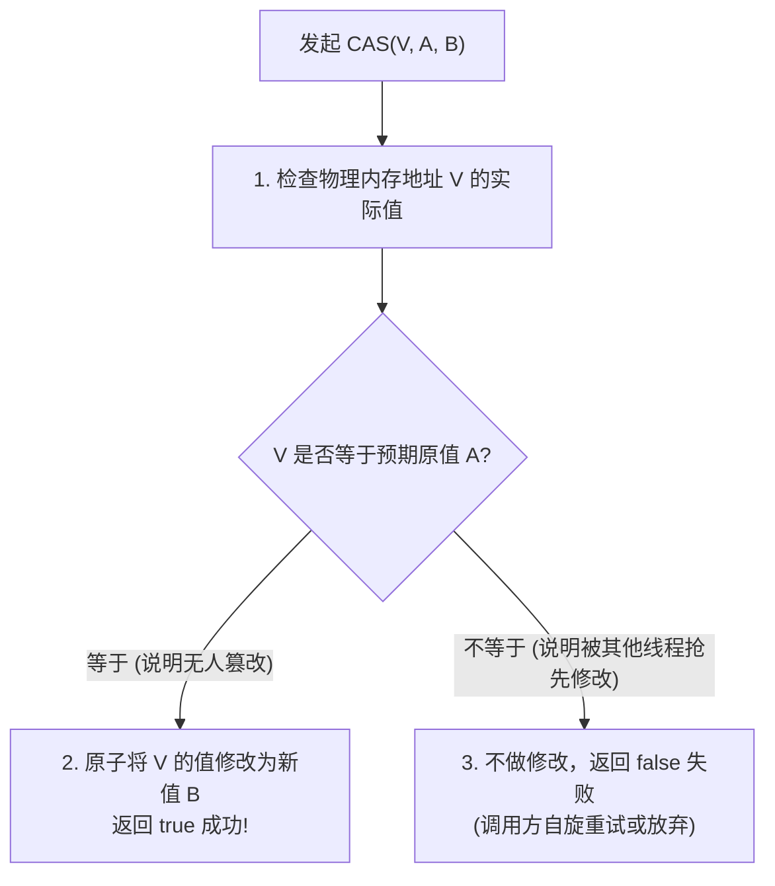

# CAS 机制与无锁并发编程：Unsafe 与 LongAdder

在高并发性能优化中，“无锁（Lock-Free）编程”往往比传统的重量级互斥锁能压榨出更极致的 CPU 吞吐。从 `java.util.concurrent.atomic` 原子类、AQS 状态维护，到高性能 Disruptor 队列，底层几乎全部立足于 **CAS（Compare-And-Swap）** 机制。

本篇深度拆解 CAS 硬件级汇编指令、三大经典缺陷，并剖析高并发计数之王 **`LongAdder`** 的分段累加与消除伪共享（False Sharing）黑科技。

---

## 1. 什么是 CAS？Unsafe 与 `cmpxchg` 汇编指令

CAS 的全称是 **Compare-And-Swap（比较并交换）**，是一种典型的**乐观并发策略**。

### 1.1 核心思想与三大操作数
CAS 包含三个核心操作数：
- **内存地址 $V$**：待修改的变量内存物理位置；
- **预期旧值 $A$**：线程认为当前内存中应该持有的旧值；
- **拟写入的新值 $B$**：准备将变量更新成的目标新值。

$$\text{当且仅当 } V == A \text{ 时，执行 } V = B \text{；否则操作失败，不做任何变更并返回当前最新值。}$$



---

### 1.2 底层硬件实现：`Unsafe` 与 `lock cmpxchg`
在 Java 中，我们无法直接操作物理内存指针，JDK 通过 `sun.misc.Unsafe` 提供的本地方法（Native Method）向底层穿透：
```java
// Unsafe 核心本地方法声明：
public final native boolean compareAndSwapInt(Object o, long offset, int expected, int x);
```
翻阅 OpenJDK 源码中的 C++ 实现（`os_cpu/linux_x86/vm/atomic_linux_x86.inline.hpp`）：
```cpp
inline jint Atomic::cmpxchg (jint exchange_value, volatile jint* dest, jint compare_value) {
  int mp = os::is_MP(); // 检查当前机器是否是多核 CPU (Multi-Processor)
  __asm__ volatile (
     LOCK_IF_MP(mp) "cmpxchgl %1,(%3)" // 如果是多核 CPU，强制给指令增加 LOCK 前缀！
     : "=a" (exchange_value)
     : "r" (exchange_value), "a" (compare_value), "r" (dest)
     : "cc", "memory");
  return exchange_value;
}
```
- **核心汇编指令：`lock cmpxchg`**！
- 在单核 CPU 下，单条 `cmpxchg` 指令天然原子；但在现代多核 CPU 下，加上 **`LOCK` 前缀** 会锁定缓存行（或锁总线），**在硬件芯片物理层面绝对保证了“比较并替换”这两个操作一气呵成、绝对不可分割！**

---

## 2. CAS 的三大经典缺陷与工业级破解

### 2.1 缺陷一：ABA 问题
- **本质**：变量最初是 A，被线程 1 改成了 B，随后又被线程 2 改回了 A。当线程 3 执行 CAS 时，发现值依然是 A，便盲目判定为“从没发生过修改”，成功执行替换。
- **隐患**：在涉及复合状态对象或链表节点复用（如 ABA 导致弹栈栈顶错误）时，可能产生灾难性逻辑漏洞。
- **破解方案：版本号机制与 `AtomicStampedReference`**：
  引入版本戳（Stamp）。每次修改不仅比对值，**还必须比对版本号是否一致**，每次修改版本号单调自增：
  ```java
  AtomicStampedReference<String> ref = new AtomicStampedReference<>("A", 1);
  // 必须值与 stamp 版本号完全一致才允许替换
  ref.compareAndSet("A", "B", 1, 2);
  ```

---

### 2.2 缺陷二：循环时间长导致 CPU 空转开销大
- 如果并发竞争极其剧烈，多个线程同时对同一个变量发起 CAS，会导致大量失败线程进入 `while(true)` 死循环自旋，消耗极高的 CPU 算力。
- **破解**：JVM 引入自适应自旋（Adaptive Spinning），并在自旋循环体中加入 CPU **`PAUSE` 指令**，降低 CPU 流水线功耗并延迟抢占。

### 2.3 缺陷三：只能保证单个共享变量的原子操作
- 针对单个整型可以用 `AtomicInteger`，但若需要同时原子保证两个变量（如 `a` 和 `b`）的变更，单纯的 CAS 无法直接跨变量。
- **破解**：使用 **`AtomicReference`** 将多个属性封装为一个独立的复合不可变不可变对象进行原子替换，或退化使用 `synchronized` / `ReentrantLock`。

---

## 3. 高并发计数之王：`LongAdder` 源码与“伪共享”消除

在 JDK 8 之前，高并发累加通常使用 `AtomicLong`。但在超高并发下，所有线程死磕同一个变量，引发剧烈的总线风暴。为此，Doug Lea 大师在 JDK 8 引入了 **`LongAdder`**。

### 3.1 `LongAdder` 核心设计：分段热点打散（Striped64）
`LongAdder` 继承自 `Striped64`：
- **`base` 变量**：低并发无竞争时，直接通过 CAS 累加 `base`，开销等同于普通原子类。
- **`Cell[]` 数组**：一旦检测到 CAS 发生竞争冲突，立即将写入压力打散到 `Cell` 数组的不同槽位中，每个线程只对属于自己哈希探针（`probe`）的 `Cell` 进行局部累加！
- **最终求和**：调用 `sum()` 时，简单将 `base` 与所有 `Cell` 的值线性相加。

```text
高并发下的请求流打散：
                     ┌──▶ Thread 1 ──▶ Cell[0] (只加该槽位)
AtomicLong (单点死磕) │
全局只抢一个 Value   ├──▶ Thread 2 ──▶ Cell[1] (只加该槽位)
                     │
                     └──▶ Thread 3 ──▶ Cell[2] (只加该槽位)
```

---

### 3.2 核心黑科技：`@Contended` 消除 CPU 伪共享（False Sharing）

查看 `Striped64.Cell` 的定义，其头部有一个特殊的注解：
```java
@jdk.internal.vm.annotation.Contended // 核心黑科技！
static final class Cell {
    volatile long value;
    Cell(long x) { value = x; }
    ...
}
```

#### 什么是 CPU 伪共享（False Sharing）？
- 现代 CPU 与内存之间以 **缓存行（Cache Line，大小通常为 64 字节）** 为基本传输单位。
- 假设 `Cell[0]` 和 `Cell[1]` 在堆内存中紧邻存放，极大概率会**挤在同一个 64 字节的缓存行中**！
- 当 CPU 核心 1 修改了 `Cell[0]` 时，根据硬件 MESI 协议，它会强制使得整个 64 字节缓存行在其他核心中**全部失效**！
- 此时位于核心 2 的线程明明只是在修改独立的 `Cell[1]`，却因为缓存行失效必须穿透到主内存重新加载，**两个毫无业务关联的变量在底层产生了虚假的相互竞争**！

#### `@Contended` 的字节码对齐填充魔法：
JVM 在识别到 `@Contended` 注解后，会在编译时**在该对象的内部自动填充 128 个字节的无用虚拟占位数据（Padding）**！
- 确保每一个 `Cell` 对象独占一整行独立的 CPU 缓存行；
- 彻底消灭不同核心之间的缓存行伪共享冲突，使得 CPU 流水线吞吐性能达到物理硬件的极限！
