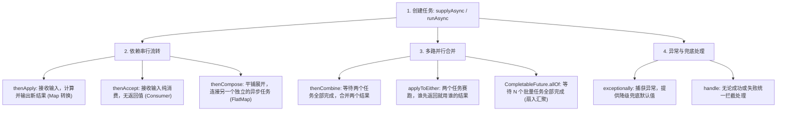

# CompletableFuture 异步编排实战与并发吞吐量提升

在现代分布式微服务体系中，一个用户请求往往需要聚合下游多个独立服务的数据（例如进入电商商品详情页：需要并发查询商品基本信息、实时价格、库存中心、优惠券服务、用户会员等级以及千人千面推荐列表）。

如果采用传统的串行同步调用，整体响应延迟将是所有服务耗时的累加值；如果采用早期 JDK 5 的 `Future.get()`，主线程必须在阻塞等待中挂起。

JDK 8 引入的 **`CompletableFuture`** 彻底革新了 Java 的异步响应式编程体验。

---

## 1. 传统 Future 的痛点与 CompletableFuture 的破局

| 对比维度 | 传统 `Future` | 现代 `CompletableFuture` |
|:---|:---|:---|
| **结果获取机制** | 只能调用 **`future.get()` 阻塞式死等**，或者轮询 `isDone()` | **纯非阻塞回调（Callback）**，计算完成自动触发下游链条 |
| **异步链条编排** | 无法做到“任务 A 完成后，自动将结果作为入参触发任务 B” | 极简声明式串行编排：**`thenApply` / `thenCompose`** |
| **多任务聚合协同**| 无法表达“等待 N 个服务全部响应完成后再统一返回” | 原生支持多路汇聚：**`allOf` / `anyOf` / `thenCombine`** |
| **异常处理与降级**| 只能在外部 `try-catch` | 支持函数式管道级异常降级捕获：**`exceptionally` / `handle`** |

---

## 2. 核心编排 API 体系速查字典



---

## 3. 生产极高危踩坑：线程池陷阱（必须显式指定自定义线程池）

在调用 `CompletableFuture.supplyAsync(Supplier<U> supplier)` 时，如果不传第二个 `Executor` 参数：
- **底层的默认行为**：会直接使用全局共享的 **`ForkJoinPool.commonPool()`**！
- **引发惨烈故障**：
  `commonPool` 是全 JVM 共享的，其默认线程数仅仅等于 CPU 核心数减 1。如果你的某个业务在里面执行了**耗时的远程 RPC、数据库大查询或文件 I/O**，该线程池的几个工作线程瞬间全被占死！
  导致整个 JVM 内部所有的其他业务（甚至包括 Parallel Stream 并行流）全部陷入死锁和饥饿状态！

> **生产铁律**：  
> **所有的 `supplyAsync` / `runAsync`，必须强制显式传入业务专属的独立自定义线程池！**
> ```java
> CompletableFuture.supplyAsync(() -> doRpc(), bizThreadPool);
> ```

---

## 4. 工业级电商详情页多服务并行聚合实战

真实业务场景：商品详情页需要并行拉取 4 个下游服务的响应，要求总体耗时收敛在“最慢的那一个服务耗时”，并对非核心接口做安全熔断降级。

```java
public ProductDetailVO getProductDetail(Long productId, Long userId) {
    // 1. 核心任务：查询商品基础信息 (商品基本信息必须成功)
    CompletableFuture<ProductBaseInfo> baseFuture = CompletableFuture.supplyAsync(
        () -> productService.getBaseInfo(productId), bizThreadPool
    );

    // 2. 并行任务：查询实时价格与可用库存
    CompletableFuture<StockInfo> stockFuture = CompletableFuture.supplyAsync(
        () -> stockService.getStock(productId), bizThreadPool
    ).exceptionally(ex -> {
        log.warn("库存服务降级: {}", ex.getMessage());
        return StockInfo.defaultStock(); // 异常降级兜底
    });

    // 3. 并行任务：查询当前用户可用优惠券
    CompletableFuture<List<Coupon>> couponFuture = CompletableFuture.supplyAsync(
        () -> couponService.getUserCoupons(productId, userId), bizThreadPool
    ).exceptionally(ex -> Collections.emptyList());

    // 4. 并行任务：查询推荐关联商品
    CompletableFuture<List<ProductItem>> recommendFuture = CompletableFuture.supplyAsync(
        () -> recommendService.getRecommend(productId), bizThreadPool
    ).exceptionally(ex -> Collections.emptyList());

    // 5. 核心聚合：等待所有 4 个异步任务全部并行完成！
    CompletableFuture.allOf(baseFuture, stockFuture, couponFuture, recommendFuture)
                     .join(); // 等待全量就绪

    // 6. 内存组装拼装最终聚合视图
    ProductDetailVO vo = new ProductDetailVO();
    vo.setBaseInfo(baseFuture.join());
    vo.setStockInfo(stockFuture.join());
    vo.setCoupons(couponFuture.join());
    vo.setRecommends(recommendFuture.join());
    return vo;
}
```
- **耗时对比**：
  - 串行执行：$100\text{ms} + 80\text{ms} + 70\text{ms} + 120\text{ms} = \mathbf{370\text{ms}}$；
  - `CompletableFuture` 并行聚合：耗时取决于最慢的推荐服务，总耗时仅需 $\mathbf{\approx 125\text{ms}}$！响应速度提升 **3 倍**！
