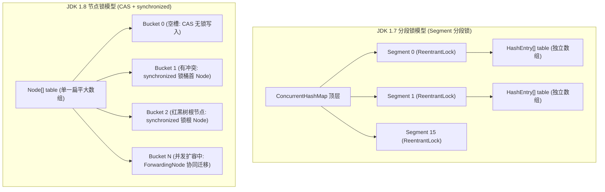
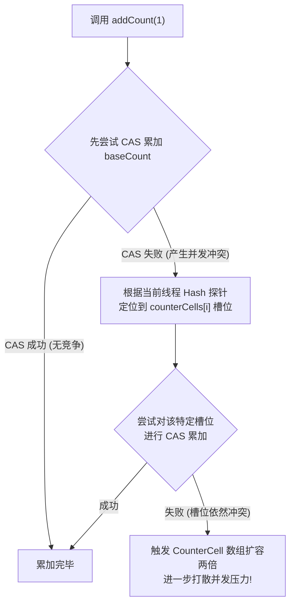

# ConcurrentHashMap 1.7 与 1.8 架构演进与并发控制

在多线程高并发高吞吐系统中，`ConcurrentHashMap`（CHM）是支撑各种本地内存缓存、连接池和注册中心元数据的核心底层基石。

社招面试中，面试官必问：“1.7 的分段锁是怎样实现的？为什么 1.8 要彻底废弃 Segment？1.8 的 `put` 流程中 CAS 和 synchronized 是如何配合的？在高并发下 `size()` 统计是如何通过 CounterCell 消除 CPU 总线争用的？”

---

## 1. 架构演进：从 1.7 分段锁到 1.8 细粒度节点锁



### 1.1 JDK 1.7 分段锁（Segment）的局限
- **原理**：底层由一个 `Segment[]` 数组构成，每个 `Segment` 继承自 `ReentrantLock`，内部再维护一个小的 `HashEntry[]` 数组。
- **并发度瓶颈**：并发度固定为 `Segment` 的数组长度（默认 16）。这意味着**同一时刻最多只能有 16 个线程同时并发写入**，后续无论数据量扩得多大，并发度都无法动态扩展。
- **结构复杂**：多级间接寻址，每次查找都需要先定位 Segment，再定位具体 HashEntry，内存开销大且对 CPU 缓存极不友好。

---

## 2. JDK 1.8 的全新并发控制体系（CAS + synchronized）

在 JDK 1.8 中，作者完全废弃了 `Segment`，改回了与普通 HashMap 相同的单一扁平大数组结构（`Node<K,V>[] table`），并将并发控制的粒度直接**细化到了每一个数组槽位（Bucket）**！

### 2.1 源码级 `putVal` 双轨并发控制拆解
```java
final V putVal(K key, V value, boolean onlyIfAbsent) {
    if (key == null || value == null) throw new NullPointerException(); // 严禁 null!
    int hash = spread(key.hashCode());
    int binCount = 0;
    for (Node<K,V>[] tab = table;;) {
        Node<K,V> f; int n, i, fh;
        // 1. 数组为空，通过 CAS 竞争初始化数组 (initTable)
        if (tab == null || (n = tab.length) == 0)
            tab = initTable();
            
        // 2. 槽位为空：完全无需加锁，直接使用底层 CAS 尝试写入！
        else if ((f = tabAt(tab, i = (n - 1) & hash)) == null) {
            if (casTabAt(tab, i, null, new Node<K,V>(hash, key, value, null)))
                break; // CAS 成功，直接退出无锁写入！
        }
        
        // 3. 槽位首节点的 hash 为 MOVED (-1)，说明该槽位正在被其他线程执行扩容迁移
        else if ((fh = f.hash) == MOVED)
            tab = helpTransfer(tab, f); // 当前线程主动加入，协助多线程并发扩容！
            
        // 4. 槽位已有数据，发生哈希碰撞：锁定该桶的首节点 (f)!
        else {
            V oldVal = null;
            synchronized (f) { // 核心！仅锁住当前这一个槽位的首节点！
                if (tabAt(tab, i) == f) {
                    if (fh >= 0) { // 链表操作
                        ... 
                    } else if (f instanceof TreeBin) { // 红黑树操作
                        ...
                    }
                }
            }
            ...
        }
    }
    // 5. 类似 LongAdder 思想原子统计 size，并检查是否需要扩容
    addCount(1L, binCount);
    return null;
}
```

### 2.2 为什么 1.8 放弃了 `ReentrantLock` 而拥抱 `synchronized`？
1. **内存占用极致紧凑**：
   如果使用 `ReentrantLock`，每个槽位节点都必须实例化一个独立的锁对象和 AQS 等待队列，极其浪费堆内存。而 `synchronized` 是基于 Java 对象头中的 **Mark Word** 实现的，**完全不占用额外的对象指针内存**！
2. **JVM 官方底层编译优化**：
   从 JDK 1.6 开始，JVM 团队对 `synchronized` 倾注了大量底层重构（偏向锁、轻量级锁自旋、锁消除、锁粗化），在低冲突场景下开销极低。

---

## 3. 高并发 `size()` 统计：CounterCell 分段累加的艺术

在单线程环境下，统计总数只需 `size++`。但在千万级 QPS 并发下，如果所有线程都去对同一个 `AtomicLong` 发起 CAS 累加，会导致**极高的 CPU 缓存一致性总线嗅探风暴（Bus Snooping Storm）**，吞吐量崩塌。

### 3.1 借鉴 `LongAdder` 的分段打散思想
`ConcurrentHashMap` 内部维护了两个核心成员：
```java
// 基础计数值 (低并发无竞争时使用)
private transient volatile long baseCount;

// 分段计数单元数组 (高并发竞争剧烈时启用)
private transient volatile CounterCell[] counterCells;
```



### 3.2 最终求和公式
当业务调用 `map.size()` 时：
$$\text{size} = \text{baseCount} + \sum_{i=0}^{N} \text{counterCells}[i].\text{value}$$
- **效果**：将原本针对一个变量的全局写热点，均匀打散到了多个独立的 CPU 缓存行（Cache Line）槽位中，实现了近乎无限扩展的高并发计数能力！

---

## 4. 多线程协同并发扩容（`transfer`）机制

在普通 HashMap 中，扩容只能由触发阈值的单线程孤军奋战完成；而 `ConcurrentHashMap` 具备划时代的**多线程协助扩容（Help Transfer）机制**：

1. **`ForwardingNode` 占位哨兵**：
   当一个槽位（Bucket）的数据全量迁移到新数组后，旧数组该位置会被放置一个特殊的 **`ForwardingNode`（其 hash 固定为 -1，即 `MOVED`）**。
2. **多线程并发认领任务区间（Stride）**：
   - 扩容发起后，系统将老数组划分成若干个步长区间（默认每个线程分担 16 个桶）；
   - 后续任何其他写入线程在遇到 `MOVED` 节点时，**不会被生硬阻塞，而是主动加入扩容大军**，根据指针向后认领属于自己的 16 个桶并行迁移数据！
   - 多个线程同时协助迁移，使得千万级大 Map 的扩容在极短时间内瞬间完成！

---

## 5. 社招高频面试追问

### Q1：为什么 `ConcurrentHashMap` 严禁 Key 和 Value 存入 `null`，而普通 `HashMap` 可以？
- **普通 HashMap 单线程使用**：如果 `map.get(key)` 返回 `null`，可以通过 `map.containsKey(key)` 准确判断“是根本没有这个键，还是这个键对应的值就是 null”。
- **ConcurrentHashMap 多线程环境下的二义性（Ambiguity）灾难**：
  假设线程 A 执行 `map.get(key)` 返回了 `null`。在线程 A 准备调用 `map.containsKey(key)` 确认的微秒之间，线程 B 完全可能恰好执行了 `map.remove(key)`！
  这就产生了解释上的二义性：**你根本无法确定这个 null 究竟是刚才存在的值，还是并发删除后的结果**！为了在并发语义下杜绝这种不可解的竞态条件，设计者大师 Doug Lea 强制规定：**Key 和 Value 绝对不允许为 `null`！**
