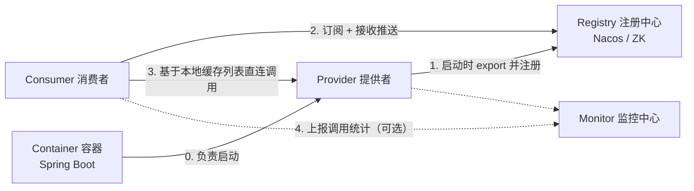
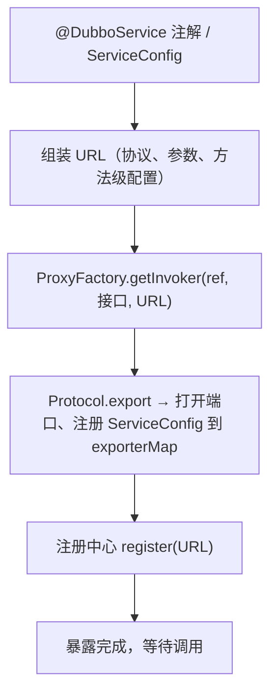
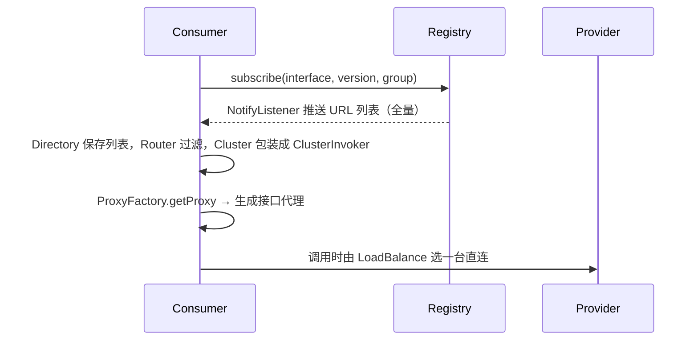

# Dubbo分布式RPC核心原理与实战

## 使用入口：先解决问题，再做验证

让两个服务调用明确接口并处理远端失败。

**先做基本操作**：先运行 provider/consumer、设置超时并验证调用，再学习注册发现、协议、SPI 和负载均衡。初次学习可先完成[本模块基础实践](/doc/Java/Java语言基础与日常开发)。

**再逐步深入**：基本 API 与输入输出 → 常见失败和使用边界 → 场景排查与优化 → 本文机制分析与源码。面试先讲用途和自己的操作过程，再回答场景与原理追问。

## 基本接入实战（Spring Boot 3 + Dubbo 3.2）

**依赖**

```xml
<dependency>
  <groupId>org.apache.dubbo</groupId>
  <artifactId>dubbo-spring-boot-starter</artifactId>
  <version>3.2.10</version>
</dependency>
<dependency>
  <groupId>org.apache.dubbo</groupId>
  <artifactId>dubbo-registry-nacos</artifactId>
  <version>3.2.10</version>
</dependency>
```

**公共 API 模块**（Provider 与 Consumer 共享，只放接口和 DTO）

```java
public interface OrderService {
    OrderDTO create(CreateOrderCmd cmd);
    OrderDTO queryById(Long id);
}
```

**Provider**

```java
@SpringBootApplication
@EnableDubbo(scanBasePackages = "com.demo.order")
public class OrderProviderApp { public static void main(String[] a) { SpringApplication.run(OrderProviderApp.class, a); } }

@DubboService(version = "1.0.0", timeout = 3000, retries = 0)   // 写接口不重试
public class OrderServiceImpl implements OrderService {
    @Override
    public OrderDTO create(CreateOrderCmd cmd) {
        // 幂等键：cmd.getRequestId() + 唯一索引，防重复创建
        return orderRepository.save(cmd);
    }
    @Override
    public OrderDTO queryById(Long id) { return orderRepository.findById(id); }
}
```

**Consumer**

```java
@RestController
public class OrderController {
    // 读接口允许重试，写接口 retries=0 或 failfast
    @DubboReference(version = "1.0.0", timeout = 500, retries = 1, check = false,
                    loadbalance = "leastactive")
    private OrderService orderService;

    @PostMapping("/orders")
    public OrderDTO create(@RequestBody CreateOrderCmd cmd) { return orderService.create(cmd); }
}
```

**启动顺序**：装 Nacos → 启 Provider（控制台能看到 `providers` 数量）→ 启 Consumer。排查先用 `telnet 127.0.0.1 20880` 或 `dubbo-admin` 看服务列表。

> **一句话结论**：Dubbo 的本质是「**用 URL 统一描述一切配置，用 Invoker 统一描述一切调用**」——服务导出把 `接口 + 实现` 包装成 Invoker 挂到 Protocol 上对外暴露，服务引用从注册中心拿到 URL 列表后拼成一条 `Filter → Cluster → Directory → Router → LoadBalance → Protocol` 的调用链；理解了这条链，超时、重试、容错、灰度路由就都只是链上某个节点的参数。

## 30 秒速览

| 维度 | Dubbo 3.x | Spring Cloud Alibaba | gRPC |
|---|---|---|---|
| 定位 | RPC 框架 + 服务治理 | 微服务**全家桶**（网关/配置/流控/事务） | 高性能 RPC 框架 |
| 通信协议 | dubbo（TCP 私有）/ **tri（HTTP/2）** | HTTP/REST（Feign） | HTTP/2 + Protobuf |
| 服务发现 | 接口级 + 应用级（3.x 默认应用级） | Nacos 应用级 | 需自行集成 |
| 序列化 | hessian2 / fastjson2 / protobuf | JSON | Protobuf（强约束） |
| 治理能力 | 超时、重试、路由、限流、熔断、Mock | 交给 Sentinel / Gateway | 几乎无，靠生态 |
| 适用场景 | 内部高频调用、接口多、要求治理精细 | 中小团队快速搭微服务、对外 HTTP | 多语言、跨端、强类型契约 |

**选型口语版**：内部服务之间高频调用选 Dubbo（性能 + 治理），对外网关和 BFF 层用 HTTP，跨语言跨团队用 gRPC；Spring Cloud 不是替代品，它和 Dubbo 可以共存（Nacos 同时做注册配置中心）。

## 一、整体架构：五个角色



| 角色 | 关键点 |
|---|---|
| Provider | 暴露服务，把 `ref` 包成 Invoker，绑定端口监听 |
| Consumer | 订阅服务，拿到 **URL 列表缓存到本地**，调用于是**不经过注册中心**（注册中心挂了不影响已运行调用） |
| Registry | 只负责「地址簿」，不做流量转发，因此不会成为调用链路瓶颈 |
| Monitor | 异步上报 RT / QPS / 失败率，可关（`dubbo.monitor.enable=false`） |
| Container | 通常是 Spring Boot，负责生命周期 |

> **面试常错点**：很多人以为调用要经过注册中心。实际是「注册中心只提供地址，调用直连」，所以注册中心宕机只影响新实例上线，不影响存量调用。

## 二、核心抽象：URL 与 Invoker

Dubbo 里所有配置最终都会被拼成一个 URL 字符串，这是它扩展性强的根源：

```text
dubbo://192.168.1.10:20880/com.demo.OrderService?anyhost=true&application=order-service
  &interface=com.demo.OrderService&methods=create,query&timeout=3000&retries=2&loadbalance=random
```

- **URL 是配置总线**：协议、地址、接口、方法级参数全在 query 里，SPI 扩展点从 URL 里读参数决定用哪个实现（这就是 `@Adaptive`）。
- **Invoker 是调用实体**：`invoke(Invocation)` 一个方法，把「本地调用 / 远程调用 / 集群调用 / Mock 调用」全部归一化。整个 Dubbo 就是一层层 Invoker 套娃。

```java
// 一条消费端调用链，从外到内（简化）
Proxy(OrderService)               // 给你的接口动态代理
  → Filter 链（ContextFilter、ActiveLimitFilter、TimeoutFilter…）
  → ClusterInvoker（Failover / Failfast…做容错）
  → Directory + Router（按 tag、条件路由过滤 URL 列表）
  → LoadBalance（加权随机 / 轮询…选一个 Invoker）
  → ProtocolFilterWrapper（提供端 Filter：AccessLog、ExceptionFilter…）
  → DubboInvoker → 序列化 → Netty 发送
```

**记法**：`Proxy → Filter → Cluster → Directory/Router → LoadBalance → Protocol → Transport → Codec`。排查「为什么超时」「为什么打到旧实例」「为什么重试了 3 次」全部沿这条链定位。

## 三、服务导出（Export）与引用（Refer）

### 3.1 导出：`ServiceConfig.export()`



关键点：
- 同一端口可暴露多个服务（`ServiceConfig` 存在 `exporterMap`，key 是 `接口:版本:分组`）。
- `delay` 参数可延迟暴露，避免服务未预热就被打流量。
- 导出前会做**本地存根（stub）**、`Mock` 的绑定。

### 3.2 引用：`ReferenceConfig.get()`



- **`check=false`**：启动时不校验提供者是否存在，避免提供者后启动导致消费方启动失败（但记得配，否则上线顺序被绑死）。
- 注册中心推送是**全量覆盖**，不是增量；推送风暴时 `dubbo.registry.file` 会落本地缓存文件，注册中心全挂仍可用缓存启动。

## 四、SPI 机制：Dubbo 的扩展之本

JDK SPI 的缺陷：一次性加载所有实现（浪费）、无法按名获取、无 IoC/AOP、无自适应。Dubbo SPI 全部解决：

| 能力 | 说明 |
|---|---|
| 按名加载 | `ExtensionLoader.getExtensionLoader(Xxx.class).getExtension("random")`，只实例化用到的 |
| IoC | 扩展实现里的 setter（如 `setLoadbalance()`）会被自动注入其他扩展 |
| AOP | 包装类（Wrapper）自动包裹，Dubbo 内置 Filter 链就是靠这个 |
| `@Adaptive` | 方法上标注：运行时**从 URL 参数动态选实现**，Dubbo 为接口自动生成 `Xxx$Adaptive` 字节码 |
| `@Activate` | 标注自动激活的扩展（如 Filter 按 `group=consumer/provider` 生效） |
| `@SPI("默认值")` | 指定默认扩展名 |

```java
@SPI("random")
public interface LoadBalance {
    @Adaptive("loadbalance")          // 从 URL 的 loadbalance 参数取扩展名
    <T> Invoker<T> select(List<Invoker<T>> invokers, URL url, Invocation invocation);
}
```

```properties
# resources/META-INF/dubbo/com.demo.LoadBalance
myweight=com.demo.MyWeightLoadBalance
```

**自定义一个 Filter 的例子**（记调用耗时、打 traceId）：

```java
@Activate(group = {CommonConstants.CONSUMER, CommonConstants.PROVIDER}, order = -9000)
public class TraceFilter implements Filter {
    @Override
    public Result invoke(Invoker<?> invoker, Invocation invocation) throws RpcException {
        long start = System.currentTimeMillis();
        RpcContext.getServiceContext().setAttachment("traceId", TraceIdUtils.get());
        try {
            return invoker.invoke(invocation);
        } finally {
            Metrics.record(invoker.getInterface().getSimpleName(),
                    invocation.getMethodName(), System.currentTimeMillis() - start);
        }
    }
}
```

> **坑**：`RpcContext` 的 attachment 是「一次性」的——本次调用后清空。异步调用要显式 `RpcContext.getServiceContext().setAttachment()` 且注意 `async` 场景下的上下文传递；Dubbo 3 用 `RpcContext.getServiceContext()` / `getClientAttachment()` 区分客户端与服务端。

## 五、协议与序列化

### 5.1 dubbo 协议报文（16 字节头）

```text
 0        1        2        3
 +--------+--------+--------+--------+
 | magic  | magic  | flag   | status |   magic=0xdabb, flag 含 请求/响应、单向、事件、序列化ID
 +--------+--------+--------+--------+
 |         requestId (8 bytes)        |   请求响应关联
 +------------------------------------+
 |         dataLength (4 bytes)       |   body 长度
 +------------------------------------+
 |              body                  |   序列化后的参数 / 返回值
```

- 单一长连接 + 多线程复用（默认 `connections=0` 表示共享连接），心跳保活。
- **默认 8MB 包体上限**（`payload=8388608`），传大对象直接超限报错——别用 Dubbo 传文件或大 JSON。

### 5.2 协议与序列化选型

| 项 | 选择 | 说明 |
|---|---|---|
| 协议 | `dubbo` | 默认，TCP 长连接，性能最好，但非标准协议，网关/多语言不友好 |
| 协议 | `tri`（Triple） | **Dubbo 3 推荐**，基于 HTTP/2，兼容 gRPC，可被网关、浏览器、Mesh 直接访问 |
| 序列化 | `hessian2` | 默认，Java 生态兼容好；注意**字段增删要保证兼容**（新增字段给默认值） |
| 序列化 | `fastjson2` | 速度快，跨语言可读，但有安全历史包袱（务必开 autoType 白名单） |
| 序列化 | `protobuf` | 强契约、跨语言首选，需要 IDL |

> **踩坑实录**：Provider 升级加了字段、Consumer 还是老版本 hessian2 反序列化，通常没问题（缺字段为默认值）；但如果**改了字段类型**（`int → String`）或改了类全限定名，直接 `IllegalArgumentException` 或反序列化失败。所以 DTO 只增不改不删。

## 六、集群容错与负载均衡

### 6.1 六种容错策略

| 策略 | 行为 | 适用场景 | 风险 |
|---|---|---|---|
| `failover`（默认） | 失败换一台重试，`retries=2` 即最多 3 次 | 读操作、幂等写 | **非幂等写会重复下单/重复扣款** |
| `failfast` | 失败立即报错 | 非幂等写（下单、支付） | 无重试，需业务兜底 |
| `failsafe` | 失败忽略，只记日志 | 日志上报、审计等旁路 | 静默失败 |
| `failback` | 失败记录，定时重发 | 消息通知类 | 延迟不可控 |
| `forking` | 并行调 N 台，取第一个成功 | 对 RT 极敏感、读多 | 资源放大 N 倍 |
| `broadcast` | 广播所有提供者 | 缓存刷新、配置推送 | 慢的拖累整体 |

**线上事故模板**：`failover` + 默认 `retries=2` + 下单接口 = 一次网络抖动用户被扣三次钱。正确做法：写接口显式 `@DubboReference(retries = 0)` 或 `cluster = "failfast"`，再加业务幂等键。

### 6.2 负载均衡

| 实现 | 机制 | 适用 |
|---|---|---|
| `random`（默认） | 加权随机，带**服务预热**（权重随启动时间爬升） | 通用，实例性能均匀 |
| `roundrobin` | 平滑加权轮询 | 实例同质、要求绝对均匀 |
| `leastactive` | 选活跃调用数最少的（慢机器自然少接） | 机器性能不均、有长任务 |
| `shortestresponse` | 选预估 RT 最短的 | RT 敏感 |
| `consistenthash` | 按参数一致性哈希 | 有缓存亲和性要求（如同一用户固定打同一台） |
| `p2c`（3.x） | Power of Two Choices，随机取两个选优 | 大规模集群，缓解热点 |

## 七、服务治理实战配置

```yaml
dubbo:
  application:
    name: order-service
    qos-enable: false            # 生产建议关掉 QoS 端口，或改端口 + 强鉴权
  registry:
    address: nacos://10.0.0.11:8848
    parameters:
      namespace: prod
  protocol:
    name: tri                    # Dubbo 3 推荐 Triple
    port: 20880
  provider:
    timeout: 3000                # 提供端兜底超时
    threads: 200                 # 业务线程池（默认 fixed 200）
    threadpool: fixed
    executes: 200                # 单方法并发上限，超过直接拒绝，防雪崩
  consumer:
    timeout: 1000
    retries: 1
    check: false
    loadbalance: leastactive
    actives: 100                 # 单消费者单方法并发上限（ActiveLimitFilter）
```

| 治理能力 | 用法 | 场景 |
|---|---|---|
| 超时 | `@DubboReference(timeout = 500, methods = @Method(name = "query", timeout = 300))` | 方法级覆盖接口级，消费端覆盖提供端 |
| 直连调试 | `dubbo://ip:20880` 或 `-Ddubbo.resolve.file` | 测试环境绕过注册中心 |
| 服务分组 | `group = "gray"` | 同接口多实现（不同渠道/租户） |
| 多版本 | `version = "1.0.0"` | 灰度发布，新老版本并存 |
| Tag 路由 | `@DubboReference(parameters = {"tag", "gray"})` + 提供者打标 | 机房/灰度隔离，比多版本更轻 |
| 条件路由 | 控制台配 `host = 10.0.0.1 => host != 10.0.0.1` | 临时摘除某台、同机房优先 |
| 限流 | `executes` / `actives` / Sentinel 适配 | 防单点打爆 |
| 熔断 | Sentinel + Dubbo Adapter | 下游持续失败时快速失败 |
| Mock 降级 | `@DubboReference(mock = "return null")` / 自写 Mock 类 | 下游不可用时返回兜底值 |
| 优雅停机 | `dubbo.shutdown.hook` 开启，等待处理中请求 | 发布不丢请求 |

## 九、生产坑清单

| 坑 | 现象 | 正解 |
|---|---|---|
| 默认重试导致重复写 | 一次请求写入 2~3 条订单 | 写接口 `retries=0` + `failfast` + 业务幂等键，见 [幂等性设计](/doc/SystemDesign/幂等性设计与重复请求治理) |
| 超时配置方向搞反 | 消费端设 3s、提供端设 5s，结果消费端先超时并重试，提供端还在跑 | 消费端超时应 **≥** 提供端，否则「重试叠加」放大下游压力 |
| 线程池打满 | `Thread pool is EXHAUSTED`，全站 RT 飙升 | 配 `executes` 拒绝 + 独立线程池隔离 + 监控 `dubbo_threadpool_*` |
| 大包传输失败 | `Data length too large: xxx, max payload: 8388608` | 改传 OSS 地址/分页，或调 `payload`（不推荐无脑调大） |
| 注册中心推送风暴 | 大规模扩缩容时 CPU 飙高 | 用应用级服务发现（3.x 默认）、控制实例数、开本地缓存文件 |
| 泛化调用踩坑 | 网关侧调 Dubbo 服务，参数顺序/类型对不上 | 用 `ReferenceConfig` + `GenericService`，参数按方法签名顺序传，明确 `generic=true` |
| 序列化安全 | 反序列化漏洞（hessian/fastjson 历史 CVE） | 升级版本，开启 `serialize.check.status=STRICT` 类白名单 |
| 优雅停机失效 | 发布时流量打到已关闭的应用 | 开 shutdown hook、注册中心先下线再停机、配合 K8s `preStop` 睡眠 |
| 本地缓存目录权限 | 容器内无写权限，注册中心挂了起不来 | 指定 `dubbo.registry.file=/tmp/dubbo/xxx.cache` |

## 十、高频追问

| 追问 | 高分回答要点 |
|---|---|
| Dubbo 调用一定要经过注册中心吗？ | 不。注册中心只提供地址，调用是消费端持本地 URL 列表直连；注册中心宕机不影响存量调用 |
| Dubbo SPI 和 JDK SPI 区别？ | JDK 全量加载、只能遍历；Dubbo 按名加载 + IoC + AOP（Wrapper）+ `@Adaptive` 运行时按 URL 选实现 + `@Activate` 自动激活 |
| `@Adaptive` 到底做什么？ | 为接口动态生成 Xxx$Adaptive 类，从 URL 参数取扩展名再委托，实现「配置驱动」；类级 @Adaptive 则只有手写一个自适应实现 |
| 服务导出做了什么？ | 组装 URL → ProxyFactory 把 ref 包成 Invoker → Protocol.export 打开端口并缓存 exporter → 注册到 Registry |
| 为什么写接口不能 failover？ | failover 会把「对端已处理但响应超时」的请求重发，导致重复写入；必须 retries=0 + 幂等键 |
| Dubbo 3 应用级服务发现解决什么？ | 接口级注册在服务多、接口多时数据量爆炸（万级实例 × 百级接口），应用级按「应用-实例」注册，数据量下降 1~2 个数量级 |
| Triple 协议优势？ | 基于 HTTP/2，天然支持流式、多路复用，兼容 gRPC，可穿透网关/Service Mesh，解决 dubbo 私有协议不被基础设施识别的痛点 |
| Dubbo 与 Spring Cloud 怎么选？ | 内部高频 RPC 选 Dubbo（性能与治理），对外/前端用 HTTP 网关；两者共用 Nacos，不是二选一，详见 [SpringCloud 微服务](/doc/Java/Spring/SpringCloud微服务核心组件与架构实战) |

**延伸阅读**：[SpringCloud 微服务核心组件](/doc/Java/Spring/SpringCloud微服务核心组件与架构实战)、[常用中间件核心原理与选型速查](/doc/Java/常用中间件核心原理与选型速查)、[分布式锁与 Redisson](/doc/SystemDesign/分布式锁与Redisson源码全解)、[限流算法与分布式限流](/doc/SystemDesign/限流算法与分布式限流实战)。
