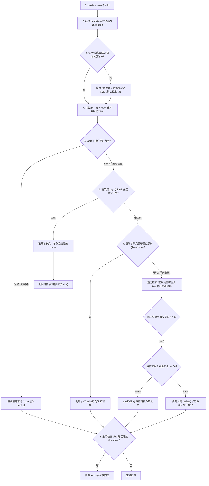

# HashMap 1.8 源码终极大解剖（下）：put 流程、树化与扩容

掌握了 HashMap 的哈希算法与容量设计后，接下来的核心主线就是**数据到底是如何写入（put）、何时升级为红黑树（treeify）、以及在容量不足时如何通过极致的高低位链表技巧完成扩容（resize）的**。

---

## 1. `put(key, value)` 核心执行流程 8 步走全景图

调用 `map.put(k, v)` 时，底层直接调用 `putVal(...)` 方法。整个执行流堪称工业级算法设计典范：



---

## 2. 为什么树化阈值是 8，退化为链表阈值是 6？

很多同学知道“达到 8 转红黑树，降到 6 退回链表”，但常被追问：“为什么不在 7 的时候退化？为什么不一开始就用红黑树？”

### 2.1 为什么不一开始就用红黑树？
- **空间开销巨大**：一个普通的单向链表节点 `Node` 仅包含 4 个属性（hash, key, value, next）；而一个红黑树节点 `TreeNode` 不仅继承自 `LinkedHashMap.Entry`，还包含 `parent`, `left`, `right`, `prev`, `red` 等多个指针属性，**内存占用是普通链表节点的两倍以上**！
- **短链表查找更快**：当节点只有 2~3 个时，链表直接顺序遍历在 CPU 缓存行（L1/L2 Cache）预取中效率极高，完全不需要维护复杂的红黑树旋转与着色逻辑。

### 2.2 为什么退化阈值是 6，而不是 7 或 8？
- **防御“震荡颠簸（Thrashing）”**：
  如果树化是 8，退化也是 8（或者 7）：假设业务高频对同一个桶交替执行“插入一条数据、删除一条数据”：
  - 插入一条：数量由 7 变成 8，**触发昂贵的红黑树化构造**；
  - 随后删除一条：数量由 8 变成 7，**又触发树拆解回链表**；
  - 再插入一条：又转成树！
- **中间留出 7 作为安全缓冲区间**：有效拉开了结构转换的物理阈值，杜绝了系统在临界点发生频繁剧烈的性能颠簸。

---

## 3. 核心深水区：`resize()` 扩容与高低位链表转移艺术

在 JDK 1.7 中，每次扩容都必须把所有节点取出来重新执行 `hash % newCapacity`，计算极其沉重。

而在 JDK 1.8 中，由于每次扩容都是**严格翻倍（Capacity $\times 2$）**，作者利用精妙的二进制数学规律，创造了**高低位链表算法（Low List & High List）**！

### 3.1 数学底层规律推导
假设原容量 `oldCap = 16`（二进制 `0001 0000`），扩容后 `newCap = 32`（二进制 `0010 0000`）。
- 原下标计算：`hash & 15`（即 `hash & 0000 1111`，取最后 4 位）。
- 新下标计算：`hash & 31`（即 `hash & 0001 1111`，取最后 5 位）。
- **关键启示**：新下标到底等于多少，**完全仅仅取决于 `hash` 的第 5 位（即 `oldCap` 对应的那个二进制位）到底原本是 0 还是 1**！

```text
判断规则极简：只需计算 hash & oldCap 是否等于 0！

1. 若 (hash & oldCap) == 0:
   说明新增的第 5 位是 0，新下标与旧下标完全一致！
   直接挂入 lowList (低位链表)，新索引 = 原索引。

2. 若 (hash & oldCap) != 0:
   说明新增的第 5 位是 1，新下标正好比旧下标多了 16 (即 oldCap)！
   直接挂入 highList (高位链表)，新索引 = 原索引 + oldCap。
```

```java
// JDK 1.8 扩容源码核心精髓片段：
Node<K,V> loHead = null, loTail = null; // 低位链表 (保持原索引)
Node<K,V> hiHead = null, hiTail = null; // 高位链表 (原索引 + oldCap)
Node<K,V> next;
do {
    next = e.next;
    // 核心位运算判定：
    if ((e.hash & oldCap) == 0) {
        if (loTail == null) loHead = e;
        else loTail.next = e;
        loTail = e;
    } else {
        if (hiTail == null) hiHead = e;
        else hiTail.next = e;
        hiTail = e;
    }
} while ((e = next) != null);

// 循环完毕，直接整条链表一枪打入新数组！
if (loTail != null) {
    loTail.next = null;
    newTable[j] = loHead; // 原位置
}
if (hiTail != null) {
    hiTail.next = null;
    newTable[j + oldCap] = hiHead; // 原位置 + oldCap
}
```
- **收益**：**不需要重新调用任何一次 `hash()` 运算，而且迁移后保持了原有的先后顺序（尾插法）**，效率达到了人类算法的巅峰！

---

## 4. 多线程并发使用 HashMap 的两大线上致命灾难

### 4.1 灾难一：JDK 1.7 头插法引发的“环形链表死循环”（CPU 100%）
在 JDK 1.7 中，由于扩容迁移采用的是**头插法（新节点插在链表最前面）**，链表在迁移后物理顺序会发生颠倒。
- 当两个并发线程同时执行 `resize()` 时：
  - 线程 A 在读取了 `e` 和 `next` 后被操作系统挂起（此时 `e = A, next = B`）；
  - 线程 B 完整跑完了整个扩容过程，由于头插法，原链表 `A -> B` 变成了 `B -> A`；
  - 随后线程 A 被唤醒继续执行，根据自己手中的旧上下文继续插入，**导致 `A.next = B` 与 `B.next = A` 相互引用，瞬间闭合成一个死循环环形链表**！
  - 下一次任何线程发起 `get(A)` 时，沿着环形链表死循环无限空转，**CPU 瞬间打满 100%**！

### 4.2 灾难二：JDK 1.8 虽然用尾插法杜绝了死循环，但依然存在“并发数据覆盖丢失”
在 JDK 1.8 中：
- 线程 A 和线程 B 同时向同一个空槽位执行 `put` 操作；
- 两个线程同时计算下标发现该槽位为空（`table[i] == null`）；
- 线程 A 刚刚判断为空被操作系统时间片切走；
- 线程 B 抢先一步将自己的 Node 写入了 `table[i]`；
- 随后线程 A 恢复执行，不再重新检查，**直接将自己的 Node 写入 `table[i]`，无情覆盖了线程 B 刚刚写入的数据！**
- 此外，`++size` 操作并非原子操作，并发下还会发生计数丢失。

> **生产铁律**：在多线程并发场景下，**严禁使用 HashMap**，必须坚决使用 **`ConcurrentHashMap`**！
