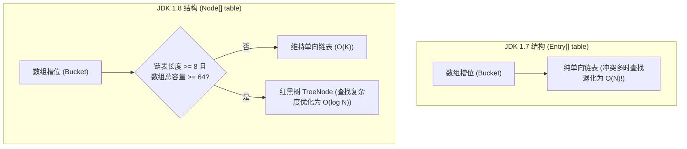

# HashMap 1.8 源码终极大解剖（上）：结构演进与 Hash 算法

在 Java 面试的长河中，`HashMap` 的底层原理是永恒的主题。社招面试如果只回答“基于哈希表，通过 hashCode 计算下标”，在面试官眼中连及格线都达不到。

必须深入到**底层的数学位运算推导、扰动函数为什么要混合高低 16 位、为什么容量必须是 2 的整数次幂、以及负载因子 0.75 背后的泊松分布数学原理**。

---

## 1. 结构演进：从 1.7 的“数组+链表”到 1.8 的“数组+链表+红黑树”



### 1.1 为什么 JDK 1.8 引入红黑树？
- 在 JDK 1.7 中，若遭遇哈希碰撞严重（或者遭遇恶意的 Hash 碰撞 DoS 攻击），同一个桶（Bucket）上的链表会无限变长。
- 此时 `get()` 和 `put()` 的时间复杂度会从理想的 $O(1)$ 直接断崖式退化为 **$O(N)$**，使得整个 Web 服务 CPU 飙升 100%。
- 引入**红黑树（自平衡二叉查找树）**后，即便在极端哈希碰撞下，最坏查找时间复杂度依然被严格保全在 **$O(\log_2 N)$**！

---

## 2. 核心数学推导一：为什么容量必须是 2 的整数次幂？

在 `HashMap` 中，计算一个 Key 在数组中的具体槽位下标（Index）的代码如下：

```java
// n 代表数组容量 (table.length)
index = (n - 1) & hash;
```

### 2.1 为什么用位与运算 `&` 代替取模运算 `%`？
- 传统的散列取余计算为：`index = hash % n`。
- 但在 CPU 指令集层面，**整数除法和取模是开销极高的高耗指令（需要几十个 CPU 时钟周期）**；
- 而**位与运算（`&`）是原生的底层电路二进制操作，单时钟周期即可完成**！

### 2.2 数学等价的前提：$n$ 必须是 2 的幂次方！
数学原理证明：**当且仅当 $n$ 为 2 的整数次幂（即 $n = 2^k$）时，$n - 1$ 的二进制表示一定是低位全为 1 的掩码（Mask）**！
- 假设 $n = 16$（$2^4$），则 $n - 1 = 15$，二进制为 **`0000 1111`**；
- 此时 `hash & (n - 1)` 相当于直接保留了 `hash` 二进制的最后 4 位，**在数学上与 `hash % 16` 的结果完全完全一致**！

### 2.3 反证法：如果容量不是 2 的幂（如 $n = 15$）会发生什么灾难？
- 若 $n = 15$，则 $n - 1 = 14$，二进制为 **`0000 1110`**（最末位是 0！）。
- 无论传入的 `hash` 算出来是多少，与 `0000 1110` 做 `&` 运算后，**结果的二进制末位永远只能是 0，绝不可能出现 1**！
- **灾难后果**：
  - 数组的所有奇数下标槽位（1, 3, 5, 7, 9, 11, 13）**在物理上永远不可能被分配到任何数据**！
  - 空间利用率直接折损 **50%**，同时偶数槽位的碰撞概率直接暴增一倍！

---

## 3. 核心数学推导二：扰动函数 `hash()` 的高低 16 位混合艺术

查看 JDK 1.8 中 `HashMap.hash()` 的源码：
```java
static final int hash(Object key) {
    int h;
    return (key == null) ? 0 : (h = key.hashCode()) ^ (h >>> 16);
}
```

### 3.1 为什么不能直接拿 `key.hashCode()` 当作 hash 值？
- 默认情况下，`HashMap` 的初始容量只有 **16**，$n - 1 = 15$（二进制 `0000 1111`）。
- 如果直接用 `key.hashCode() & 15`：
  - **只有 hashCode 的最后 4 位真正参与了寻址运算**！
  - 即使两个 Key 的 hashCode 在高 28 位完全不同，只要最后 4 位碰巧相同，就会被分到同一个槽位发生死磕碰撞！

### 3.2 扰动算法的精妙设计（右移 16 位 + 异或 `^`）
```text
原始 hashCode (h):       1111 0000 1010 0101   0101 1100 0011 1010
无符号右移 16 位 (h >>> 16): 0000 0000 0000 0000   1111 0000 1010 0101
-----------------------------------------------------------------------
异或计算结果 (^):         1111 0000 1010 0101   1010 1100 1001 1111
                                                ▲
                                                │ 低位现在同时融入了高位与低位的特征!
```
- **核心价值**：
  将高 16 位的特征，通过异或运算平移“扩散”到了低 16 位中。
  即使后续计算下标时只取低几位掩码，**高位的信息也已经深刻参与了低位的计算**，以仅仅一次右移加一次异或的极小 CPU 代价，将碰撞概率削减了数十倍！

---

## 4. 负载因子（Load Factor）为什么默认是 0.75？

在源码注释中，作者明确提到了这是**时间复杂度与空间利用率的经典泊松分布（Poisson Distribution）折中**：

$$\text{扩容阈值 Threshold} = \text{Capacity} \times \text{Load Factor}$$

- **如果负载因子设为 1.0**：
  空间利用率达到极致，但哈希冲突概率大幅上升，链表变长，每次查询需要遍历的节点变多，牺牲了时间性能。
- **如果负载因子设为 0.5**：
  冲突极少，但只要数组用了一半就开始扩容，内存空间浪费 50%，扩容引起的数组拷贝开销频发。
- **0.75 是统计学上的黄金平衡点**：
  根据概率论泊松分布计算，当负载因子为 0.75 时，同一个槽位中链表长度达到 8 的概率仅为 **0.00000006（千万分之六）**！这意味着正常业务下几乎很难发生链表变长，兼顾了极致的访问性能与合理的内存开销。
