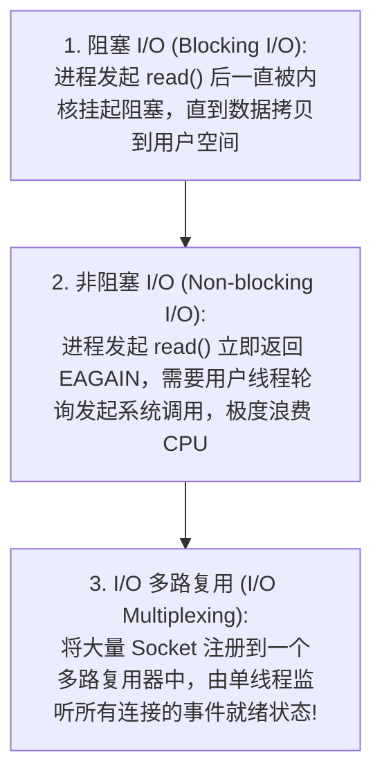

# I/O 多路复用模型与 epoll 底层工作机制

在 Linux 高并发服务器领域，无论是 Redis、Nginx、还是 Java 生态的 Netty，它们能够轻松支撑起几十万甚至百万并发连接的底座，全部仰仗于 Linux 操作系统的核心机制 —— **I/O 多路复用（I/O Multiplexing）与 `epoll`**。

社招面试中，“select、poll、epoll 的根本区别是什么？epoll 底层通过什么数据结构管理海量连接？水平触发（LT）与边缘触发（ET）有什么本质差异？”是高频必考的底层硬核问题。

---

## 1. 常见 I/O 模型的演进全景

从单机处理单个连接到高并发海量连接，操作系统的 I/O 经历了深刻的演进：



- **“多路”的含义**：指海量、成千上万个网络连接通道（Socket / 文件描述符 fd）。
- **“复用”的含义**：指**复用同一个操作系统线程**去监听和处理这些网络连接的读写事件！

---

## 2. select、poll 与 epoll 的史诗级进化对比

Linux 历史上先后出现了三种 I/O 多路复用系统调用：

| 对比维度 | `select` | `poll` | **`epoll`（现代标配）** |
|:---|:---|:---|:---|
| **底层数据结构** | 线性数组（固定长度的 Bitmap，默认 1024） | 链表数组（`struct pollfd`） | **红黑树（管理所有 fd） + 双向链表（存放就绪 fd）** |
| **最大连接数限制** | **有硬限制（默认 1024）**，由 `FD_SETSIZE` 锁死 | 无硬限制，受限于系统最大文件描述符数 | **无硬限制**，1GB 内存约可支持 10 万连接 |
| **fd 数据拷贝机制** | 每次调用必须将全部 fd 集合从用户态全量**拷贝**到内核态 | 每次调用同样必须全量拷贝整个链表结构 | **仅通过 `epoll_ctl` 增量注册拷贝一次**，后续监听无需反复拷贝 |
| **事件通知与遍历** | 内核只通知“有几个连接就绪”，用户线程必须 **$O(N)$ 遍历全量轮询** | 同样需要 **$O(N)$ 遍历全量数组** 寻找就绪项 | **$O(1)$ 复杂度**！内核直接将就绪 fd 挂载到双向链表，只返回就绪项！ |
| **工作效率** | 连接数越多，轮询和拷贝开销越大，性能线性暴跌 | 同上，面对高并发大量空闲连接性能极差 | **性能与连接总数解耦**，仅取决于“活跃连接数”，极度高效！ |

---

## 3. epoll 底层三大核心系统调用与数据结构

`epoll` 彻底摒弃了传统 select 每次都需要全量拷贝和全量轮询的落后机制，拆分成了 **3 个独立的系统调用**：

```mermaid
flowchart TD
    subgraph KernelSpace["Linux 内核态 (epoll 内部核心结构)"]
        RBTree["高效红黑树 (Red-Black Tree):<br/>管理成千上万个已注册的 Socket fd，查找插入均为 O(log N)"]
        ReadyList["就绪双向链表 (Ready List):<br/>仅存放真正收到网卡数据、处于就绪状态的活跃 Socket"]
    end

    UserApp["用户态进程 (如 Netty / Redis)"]
    
    UserApp -->|1. epoll_create: 开辟内核事件表| KernelSpace
    UserApp -->|2. epoll_ctl: 添加/修改/删除特定 Socket fd| RBTree
    UserApp -->|3. epoll_wait: 仅仅获取就绪链表中的就绪事件 (O(1))| ReadyList
```

### 3.1 核心调用拆解：
1. **`int epoll_create(int size)`**：
   在内核中创建并初始化一个 `eventpoll` 对象，构建一棵空的红黑树和一个就绪双向链表。
2. **`int epoll_ctl(int epfd, int op, int fd, struct epoll_event *event)`**：
   **增量管理连接**。负责向内核红黑树中添加（`EPOLL_CTL_ADD`）、修改或删除一个 Socket 连接。
   - **关键机制**：在向红黑树插入节点的同时，内核会为该 Socket 与网卡驱动建立**回调机制（Callback）**！一旦该 Socket 的网卡缓冲区有数据到达，网卡硬件中断会触发回调，**内核自动将该 Socket 节点追加挂载到“就绪双向链表”中**！
3. **`int epoll_wait(int epfd, struct epoll_event *events, int maxevents, int timeout)`**：
   **核心事件轮询等待**。
   - 用户线程调用 `epoll_wait` 时，**完全不需要去遍历整棵红黑树**！
   - 它只需检查**就绪双向链表是否为空**：
     - 若为空：线程进入休眠等待；
     - 若不为空：**直接将就绪双向链表中的活跃节点内存映射传递给用户态**！时间复杂度是纯粹的 **$O(1)$**！

---

## 4. 触发模式大决战：水平触发（LT） vs 边缘触发（ET）

这是社招面试中最考查细节的硬核题。

### 4.1 水平触发（Level Triggered, LT，epoll 默认模式）
- **触发条件**：只要内核缓冲区中**还有数据未被读完（数据处于“高电平”状态）**，每次调用 `epoll_wait`，内核就会**持续不断地反复通知你**！
- **优缺点**：编写简单不易出错。即使本次读取只读了部分数据，下次 `epoll_wait` 依然会被唤醒继续读。但系统调用频次稍多。

### 4.2 边缘触发（Edge Triggered, ET，极致高性能模式）
- **触发条件**：只有当缓冲区的数据状态发生**跳变（从无数据到有数据，或者新增加数据）时，内核才通知你一次**！
- **优缺点**：系统调用最少，避免反复唤醒，性能达到极限。
- **编写陷阱与必须遵守的军规**：
  在 ET 模式下，**必须使用非阻塞 Socket（`O_NONBLOCK`），且在收到通知后必须使用 `while` 循环一直读取，直到返回 `EAGAIN` 或 `EWOULDBLOCK` 为止！**
  如果使用阻塞 Socket，读取到最后没有数据时线程会被活活卡死；如果不读完，剩下的数据由于不会再次触发“边缘跳变”，将永远滞留在内核缓冲区导致数据丢失！

> **Netty 默认模式**：Netty 在 Linux 上提供的原生 Native Epoll 传输层（`EpollEventLoopGroup`）默认采用性能更极致的 **边缘触发（ET）** 模式。
