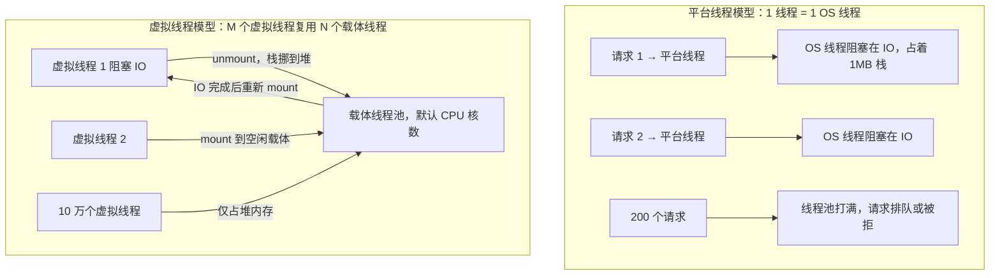
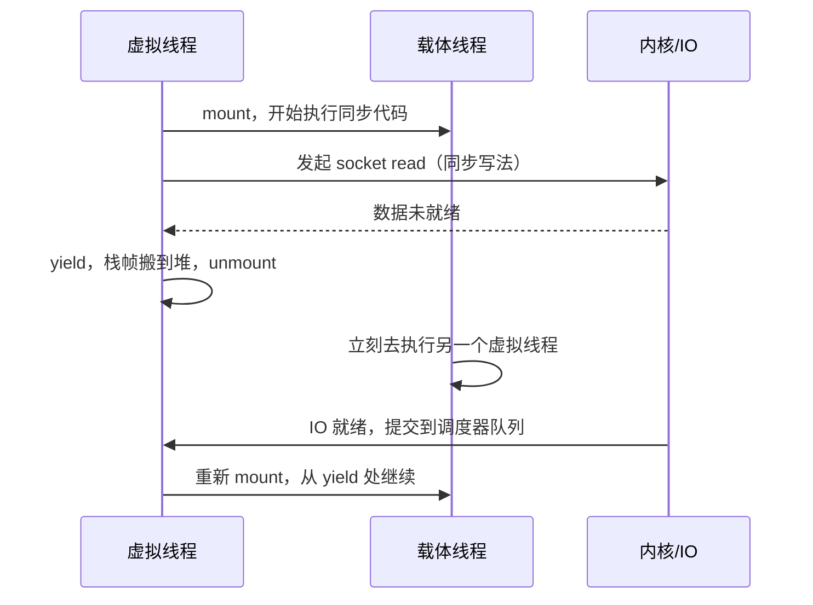

# JDK 17-21 新特性与虚拟线程全解

## 使用入口：先解决问题，再做验证

使用新语言特性并评估阻塞并发任务的实现。

**先做基本操作**：先在明确 JDK 版本下试用 record 和虚拟线程执行器，保留资源上限与超时，再比较线程调度。初次学习可先完成[本模块基础实践](/doc/Java/Java语言基础与日常开发)。

**再逐步深入**：基本 API 与输入输出 → 常见失败和使用边界 → 场景排查与优化 → 本文机制分析与源码。面试先讲用途和自己的操作过程，再回答场景与原理追问。

> **一句话结论**：虚拟线程（Project Loom）让**同步阻塞写法拿到异步级吞吐**——JVM 在遇到阻塞 IO 时把虚拟线程从载体线程上卸载（unmount），载体线程立刻去跑别的虚拟线程；不用改回调、不用改线程池模型，也不用重写业务代码。

## 30 秒速览

| 版本 | 里程碑特性 | 生产意义 |
|---|---|---|
| JDK 8（2014） | Lambda、Stream、Optional、默认方法、新的日期 API | 至今存量最大 |
| JDK 11（2018 LTS） | `var`、HTTP Client、G1 成为默认、ZGC（实验）、单文件源码启动 | 微服务主流下限 |
| JDK 17（2021 LTS） | **Records、Sealed Classes、Pattern Matching for switch（预览）、强封装 JDK 内部 API、ZGC 正式** | 当前主流升级目标 |
| JDK 21（2023 LTS） | **虚拟线程正式、结构化并发（预览）、ScopedValue（预览）、switch 模式匹配正式、分代 ZGC** | 高并发 IO 服务首选 |
| JDK 24+ | JEP 491 解除 `synchronized` 钉住、结构化并发继续预览 | 虚拟线程最后一处硬伤被修 |

## 一张图看懂平台线程 vs 虚拟线程



平台线程的瓶颈是**OS 线程昂贵**：默认栈约 1MB、上下文切换走内核、几千个就到顶。虚拟线程是 JVM 用户态调度的 `VirtualThread` 对象，栈存在堆里且按需增长，百万级也能创建。

## 二、虚拟线程底层三件套

| 组件 | 职责 | 关键点 |
|---|---|---|
| `Continuation` | 保存/恢复执行栈（yield / run） | 阻塞点主动让出，是「协作式」而非抢占式调度 |
| `VirtualThreadScheduler` | 默认 `ForkJoinPool`，并行度 = CPU 核数 | 调度的是「挂载到载体线程」，不是时间片轮转 |
| JDK 阻塞点改造 | `Socket`、文件 IO、`LockSupport.park()`、`Thread.sleep()` 等 | 阻塞前 `unmount`，IO 就绪后重新排队 `mount` |



> 注意：**没有「异步回调」，没有 Future 链，代码从头到尾是顺序的**。调试栈、异常堆栈、ThreadLocal 语义都保持同步代码的直观性——这才是 Loom 相对 Reactive（WebFlux / Netty 回调）的最大价值。

## 三、生产代码与四条铁律

```java
// ① 最简用法：每个任务一个虚拟线程，无需池化
try (var executor = Executors.newVirtualThreadPerTaskExecutor()) {
    IntStream.range(0, 10_000).forEach(i -> executor.submit(() -> {
        var json = httpClient.send(request, BodyHandlers.ofString()); // 同步阻塞，吞吐照旧
        return handle(json.body());
    }));
}

// ② Spring Boot 3.2+ 一行开启，Tomcat/Jetty 每个请求一个虚拟线程
// application.yml: spring.threads.virtual.enabled=true
@Bean
TomcatProtocolHandlerCustomizer<?> virtualThreads() {
    return handler -> handler.setExecutor(Executors.newVirtualThreadPerTaskExecutor());
}

// ③ 需要限流时用 Semaphore，不要用固定线程池
Semaphore limiter = new Semaphore(500);   // 限制对下游脆弱服务的并发
executor.submit(() -> {
    limiter.acquire();
    try { return callDownstream(); } finally { limiter.release(); }
});

// ④ 结构化并发：子任务随作用域一起取消/失败，杜绝线程泄漏
try (var scope = StructuredTaskScope.ShutdownOnFailure.open()) {
    Supplier<User>   u = scope.fork(() -> loadUser(id));
    Supplier<Orders> o = scope.fork(() -> loadOrders(id));
    scope.join().throwIfFailed();         // 任一失败则取消另一个
    return new Dashboard(u.get(), o.get());
}  // 作用域关闭时保证没有子任务残留
```

| 铁律 | 原因 |
|---|---|
| **不要池化虚拟线程** | 它们极廉价，池化反而制造瓶颈，且 `ThreadLocal` 会被复用污染 |
| **CPU 密集任务别用** | 没有阻塞点就不会 unmount，只会把载体线程占满；继续用固定大小平台线程池 |
| **JDK 21 里避免在虚拟线程中用 `synchronized` 包住阻塞 IO** | 会发生 **pinning**（钉住载体线程，无法卸载），吞吐退化成平台线程；改用 `ReentrantLock`，或升级到 JDK 24（JEP 491 已修复） |
| **慎用 ThreadLocal / 大对象** | 百万虚拟线程 × 每个线程一份 ThreadLocal = 堆爆炸；用 `ScopedValue` 传上下文 |

```java
// ScopedValue：不可变、有明确作用域、无内存泄漏的上下文传递（替代 ThreadLocal 传 traceId）
static final ScopedValue<String> TRACE_ID = ScopedValue.newInstance();
ScopedValue.where(TRACE_ID, traceId).run(() -> {
    callService();   // 同一虚拟线程作用域内可读取，子作用域自动继承
});
```

## 四、收益量化与适用边界

| 场景 | 平台线程池（200 线程） | 虚拟线程 | 结论 |
|---|---|---|---|
| 纯 IO，单次 100ms，下游充足 | ~2000 QPS 上限，队列堆积 | 受下游与文件描述符限制，可上万 | ✅ 收益巨大 |
| 混合：80% IO + 20% CPU | 阻塞时 CPU 闲置 | 载体线程被 CPU 段占用，收益中等 | ✅ 仍值得 |
| 纯 CPU（图像/加密/排序） | 与核数匹配即最优 | 无收益，甚至多一层调度开销 | ❌ 不用 |
| 单请求内串行调 5 个服务 | 500ms | 配合结构化并发并行调 → 100ms | ✅ 额外收益 |

**迁移前必查三项**：① 依赖是否兼容 JDK 21（老版字节码增强、反射访问 JDK 内部 API 会因强封装失败）；② 是否有 `synchronized` 包裹 IO；③ 是否靠 `ThreadLocal` 传递大量对象（线程池复用惯用法在虚拟线程下要重写）。

## 五、JDK 17 常用语法糖（面试手撕会考）

```java
// Records：不可变数据载体，自动生成构造器/equals/hashCode/toString
record UserDTO(Long id, String name) {
    public UserDTO { Objects.requireNonNull(name); }  // 紧凑构造器做校验
}

// Sealed Classes：限制继承树，配合 switch 模式匹配做到穷尽检查
sealed interface Result permits Ok, Err {}
record Ok(Object data) implements Result {}
record Err(String msg) implements Result {}

String show(Result r) {
    return switch (r) {                 // JDK 21 正式，无需 default（编译器知道已穷尽）
        case Ok o  -> "data=" + o.data();
        case Err e -> "error=" + e.msg();
    };
}

// 文本块 + 格式化
String sql = """
    SELECT id, name FROM user
    WHERE status = %s
    """.formatted("ACTIVE");
```

其他值得记的：`instanceof` 模式匹配（`if (o instanceof String s) s.length()`）、`var` 局部变量、ZGC/分代 ZGC（TB 级堆停顿 < 1ms）、`jlink` 定制运行时镜像、JFR + `jcmd` 线上诊断、Vector API 与 Foreign Function & Memory API（替代 JNI）。

## 六、虚拟线程 vs Reactive（WebFlux）怎么选

| 维度 | 虚拟线程 | Reactive |
|---|---|---|
| 编程模型 | 同步顺序代码 | 链式操作符 / 回调 |
| 调试与堆栈 | 完整可读 | 堆栈断裂，定位困难 |
| 生态兼容 | 现有 JDBC、Servlet、Spring MVC 直接可用 | 需 R2DBC、WebClient，阻塞库会毁掉整体 |
| 背压 | 无原生背压，用 Semaphore / 有界队列 | 原生背压 |
| 适用 | 绝大多数 CRUD/IO 密集服务 | 流式数据、严格背压、已有完整响应式栈 |

高分答法：**Loom 并没有让 Reactive 失效，但把「为了吞吐必须写异步」这个前提推翻了**；新项目若无强背压需求，同步 + 虚拟线程的可维护性通常更优。

## 七、高频追问（含高分/低分特征）

| 追问 | 高分回答要点 | 低分回答 |
|---|---|---|
| 虚拟线程为什么快？ | 阻塞 IO 时 unmount，载体线程复用；栈在堆上按需增长，创建成本极低 | 「线程更轻量」但说不出调度机制 |
| 载体线程是什么？ | 真正执行字节码的平台线程，默认 ForkJoinPool 并行度 = CPU 核数 | 「就是OS线程，一一对应」 |
| 什么是 pinning？ | 在 synchronized 块或 native 方法内阻塞时无法 unmount，载体线程被钉住；JDK 21 存在，24 已修 | 答不上来 |
| 虚拟线程能替代线程池吗？ | 不池化；限流用 Semaphore/有界队列，CPU 密集仍用固定平台线程池 | 「全都换成虚拟线程」 |
| ThreadLocal 有什么风险？ | 百万线程各自持有一份副本导致堆膨胀，且不再靠池复用传值；改 ScopedValue | 「没问题」 |
| Spring Boot 怎么接入？ | 3.2+ `spring.threads.virtual.enabled=true`，或自定义 Tomcat executor | 「不能用，Servlet 是阻塞的」 |
| 和 Kotlin 协程区别？ | 协程是编译器 CPS 转换 + 语言级挂起点，虚拟线程是 JVM 运行时调度、对 Java 代码零改造 | 「差不多」 |

**延伸阅读**：[JMM 并发编程与线程池](/doc/Java/JMM并发编程与线程池)、[JVM 底层原理与调优实战](/doc/Java/JVM底层原理与调优实战)、[高并发排障实战](/doc/Java/高并发大数据与线上疑难故障排查实战)。
