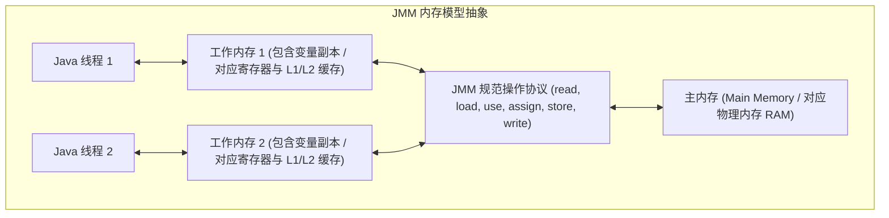

# JMM 内存模型与 Happens-Before 原则深度解析

在多核 CPU 时代，每个 CPU 核心都配备了自己独立的 L1/L2/L3 高速硬件缓存，且现代 CPU 和编译器为了最大化指令流水线吞吐，会进行激进的**指令重排序（Instruction Reordering）**。

为了在跨平台（Windows, Linux, macOS, ARM, x86）的异构硬件上提供一致的并发内存访问语义，Java 语言规范提出了 **Java 内存模型（Java Memory Model, JMM）**。

---

## 1. JMM 架构抽象：主内存（Main Memory）与工作内存（Working Memory）

JMM 是一套规范与抽象模型，并不直接对应真实的物理硬件：



### 1.1 关键交互规则
1. **所有共享变量（成员变量、静态变量）均存储在“主内存”中**。
2. **每个线程拥有自己私有的“工作内存”**。工作内存中保存了该线程使用到的变量的主内存副本。
3. **线程不能直接读写主内存中的变量**：所有的读取和修改必须先在工作内存中完成，随后再同步回主内存。
4. **不同线程之间无法直接访问对方的工作内存**：线程间的数据传递必须经过主内存中转。

---

## 2. 并发编程的三大核心命题

任何多线程并发程序的正确性，都可以收敛为三大特性的保障：

### 2.1 可见性（Visibility）
- **定义**：当一个线程修改了某个共享变量的值，其他线程能够立即感知到最新的修改。
- **失效场景**：线程 A 修改了变量但尚未刷回主内存，或者线程 B 一直在自己的工作内存寄存器缓存中死读旧值，导致线程 A 的修改对线程 B 不可见。

### 2.2 有序性（Ordering）与指令重排
- 为了提升执行性能，编译器（Javac）、即时编译器（JIT）和 CPU 处理芯片在不改变**单线程执行结果（as-if-serial 语义）**的前提下，允许对指令执行顺序进行重排序。
- **多线程下的重排灾难**：
  ```java
  // 线程 A:
  a = 1;
  flag = true;
  
  // 线程 B:
  if (flag) {
      System.out.println(a); // 若发生指令重排 flag 先于 a 执行，此处可能输出 0！
  }
  ```

### 2.3 原子性（Atomicity）
- **定义**：一个或一组操作，要么全部执行且执行过程不被任何外部因素打断，要么全部不执行。
- **经典陷阱**：`count++` 表面上是一行代码，但在底层字节码层面分为三步：`getfield`（读取）、`iadd`（加1）、`putfield`（回写）。在多线程并发下必然发生读写覆盖，无法保证原子性。

---

## 3. 核心裁决公理：Happens-Before 原则深度解析

面对复杂的指令重排，开发者如何判断操作 A 是否一定对操作 B 可见？JMM 提出了终极判定基石 —— **`Happens-Before`（先行发生原则）**。

> **如果操作 A 先行发生于（Happens-Before）操作 B，那么操作 A 产生的所有影响（修改内存变量的值、发送了消息）对于操作 B 来说是绝对可见的！**

### 3.1 JMM 内置的 8 大 Happens-Before 黄金规则

1. **程序次序规则（Program Order Rule）**：
   在一个线程内，按照代码控制流顺序，书写在前面的操作 Happens-Before 书写在后面的操作（单线程保护）。
2. **管程锁定规则（Monitor Lock Rule）**：
   对一个锁的 `unlock` 解锁操作，Happens-Before 于后续对同一个锁的 `lock` 加锁操作。
3. **volatile 变量规则（Volatile Variable Rule）**：
   **对一个 volatile 变量的写操作，Happens-Before 于后续对这个 volatile 变量的读操作！**（强制刷新主内存与禁止指令跨屏障重排）。
4. **线程启动规则（Thread Start Rule）**：
   主线程调用子线程的 `Thread.start()` 方法，Happens-Before 于该子线程中的任何操作。
5. **线程终止规则（Thread Termination Rule）**：
   子线程中的所有操作，Happens-Before 于其他线程检测到该子线程终止（如通过 `Thread.join()` 成功返回）。
6. **线程中断规则（Thread Interruption Rule）**：
   对线程 `interrupt()` 的调用，Happens-Before 于被中断线程的代码检测到中断事件的发生（`Thread.interrupted()`）。
7. **对象终结规则（Finalizer Rule）**：
   一个对象的构造函数执行结束，Happens-Before 于它的 `finalize()` 方法的开始。
8. **传递性规则（Transitivity）**：
   如果操作 A Happens-Before 操作 B，且操作 B Happens-Before 操作 C，则操作 A 必然 Happens-Before 操作 C！

---

## 4. 社招高频面试追问

### Q1：`as-if-serial` 语义和 `Happens-Before` 的根本区别是什么？
- **`as-if-serial` 语义关注的是“单线程”**：不管编译器和 CPU 怎么重排序，单线程程序的执行结果不能被改变。它给开发者创造了一种“代码是单线程顺序执行”的假象。
- **`Happens-Before` 关注的是“跨线程并发内存可见性”**：它明确指定了在多线程环境下，何时一个操作对另一个操作可见，为并发编程提供了确定的内存语义保证，同时允许编译器在不违背 Happens-Before 的前提下自由发挥优化重排。
