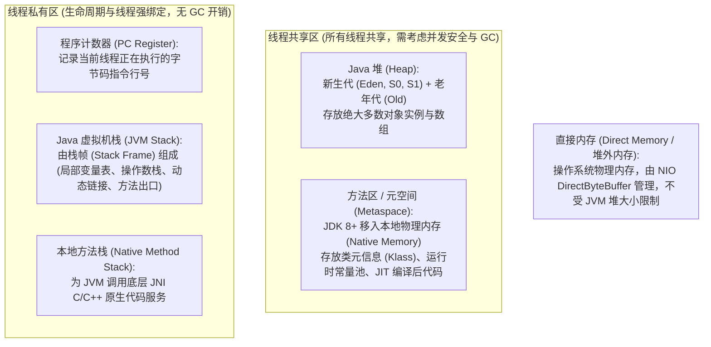
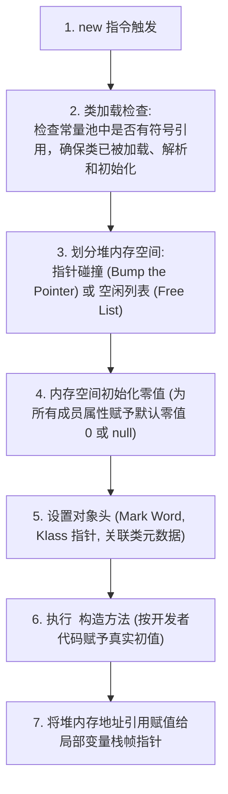

# JVM 内存区域划分与对象创建生命周期

JVM（Java Virtual Machine）是所有 Java 程序的物理运行载体。社招面试中，围绕 JVM 的考察早已告别“背诵各个内存区域名称”，而是深入到了**对象创建时的物理内存分配机制、TLAB 并发缓冲、逃逸分析与 JIT 标量替换、以及对象晋升老年代的动态判定规则**。

---

## 1. JVM 运行时数据区（Runtime Data Areas）全景

根据 Java 虚拟机规范，JVM 运行时的内存区域分为两大派系：



---

## 2. 对象创建的 5 大物理阶段全景拆解

当代码执行 `User user = new User();` 时，虚拟机内部经历了一系列极其精密的步骤：



---

### 2.1 内存分配的并发安全杀手锏：TLAB（Thread Local Allocation Buffer）
在多线程高并发创建对象时，多个线程如果同时在堆内存中申请空间，修改内存指针必然发生剧烈冲突。

JVM 采用了极其优异的 **TLAB（本地线程分配缓冲）** 机制：
- JVM 会在新生代 Eden 区内部，**提前为每个线程开辟一小块私有的内存保留区域（通常占 Eden 区的 1%）**；
- 当线程申请分配内存时，**首先在自己的私有 TLAB 空间内进行分配**，整个分配过程**纯粹在本地私有内存执行，完全无锁、零并发争用**！
- 只有当线程的 TLAB 空间耗尽、申请新的 TLAB 空间时，才退化为使用 **CAS 加锁** 在全局 Eden 区中争夺内存。

---

## 3. JIT 编译优化黑科技：逃逸分析与栈上分配

在大家的固有印象中：“所有的 Java 对象都是在堆上分配的”。**这句话在现代 JVM 中已经不完全正确！**

从 JDK 6 开始，HotSpot 虚拟机的 JIT 编译器引入了 **逃逸分析（Escape Analysis）**：
- **方法逃逸**：分析一个对象是否在方法内部被定义后，作为返回值返回给了外部，或被赋值给了外部全局成员变量。
- **线程逃逸**：分析一个对象是否可能被外部其他线程访问到。

### 逃逸分析触发的三大极限优化：
1. **栈上分配（Stack Allocation）**：
   如果 JIT 确定一个对象**绝不发生方法逃逸**，为了极致降低 GC 压力，JVM 会直接**在当前方法的线程栈帧上开辟内存分配该对象**！该对象随着方法的调用结束**自动弹栈销毁，完全不经过垃圾收集器，GC 压力降为 0**！
2. **标量替换（Scalar Replacement）**：
   如果对象不逃逸，JVM 甚至不需要在栈上开辟连续空间，而是**将这个聚合对象直接“肢解打散”为若干个独立的原始局部变量（标量：int, long 等）**，直接存入 CPU 寄存器或局部变量表！
3. **锁消除（Lock Elimination）**：
   消除单线程私有对象的同步互斥锁。

---

## 4. 对象在分代内存中的流转与晋升老年代全规则

在经典分代垃圾收集器中，堆内存划分为 **新生代（Eden, S0, S1，默认比例 8:1:1）** 与 **老年代（Old Generation，占堆内存 2/3）**。

```text
新生代内存流转全景：
新对象诞生 ──▶ Eden 区 (80%) ──▶ 触发 Minor GC
                                    │ (存活对象拷贝)
                                    ▼
S0 (Survivor From 10%) ◀══ 互换 ══▶ S1 (Survivor To 10%)
                                    │ (每挺过一次 Minor GC 年龄 +1)
                                    ▼ 达到晋升阈值
                       老年代 (Old Generation 占 2/3)
```

### 4.1 晋升老年代的 4 大判定准则：
1. **长期存活的对象晋升（年龄阈值）**：
   每个对象在对象头的 Mark Word 中记录了 GC 年龄（占 4 位二进制，因此最大为 15）。每在 Survivor 区经历一次 Minor GC 并存活，年龄加 1。默认当年龄达到 **15**（通过 `-XX:MaxTenuringThreshold` 配置）时，晋升老年代。
2. **动态对象年龄判定（Dynamic Age Determination）**：
   **并不一定要等到 15 岁才晋升！**  
   如果在 Survivor 空间中，**低于或等于某个年龄的所有对象所占用的内存总和，超过了 Survivor 空间的一半（50%，由 `TargetSurvivorRatio` 控制）**，那么**大于或等于该年龄的所有对象，无需等待直接批量全部提前晋升老年代！**
3. **大对象直接进入老年代**：
   超长的字符串、大数组等需要连续内存空间的大对象，如果在新生代频繁复制会导致极其沉重的内存拷贝。通过参数 `-XX:PretenureSizeThreshold` 设置阈值，大于该体积的对象**直接在老年代开辟分配**，绕过新生代。
4. **空间分配担保机制（Handle Promotion Failure）**：
   在发生 Minor GC 之前，JVM 会预先检查老年代的最大可用连续空间，是否大于新生代所有对象的总和；如果不足，会根据历史每次晋升的平均值进行风险评估，若评估有溢出风险，则提前触发 **Full GC**。
